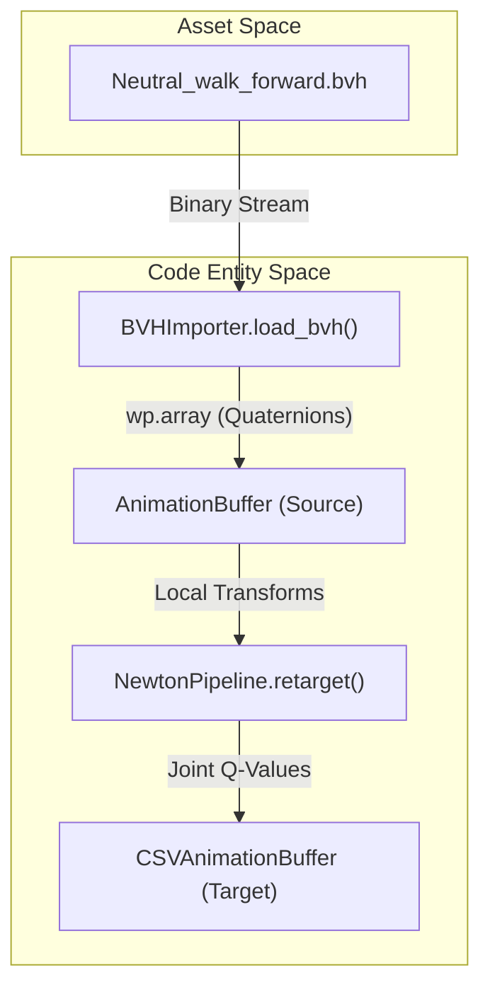
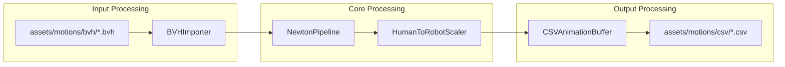

<!-- source: DeepWiki mcp.deepwiki.com · repo NVIDIA/soma-retargeter · page 1.2 Sample Motion Assets · fetched 2026-10-26 -->

# Sample Motion Assets

Relevant source files

The following files were used as context for generating this wiki page:

- [.gitattributes](.gitattributes)
- [assets/motions/bvh/Neutral_throw_ball_001__A057.bvh](assets/motions/bvh/Neutral_throw_ball_001__A057.bvh)
- [assets/motions/bvh/Neutral_walk_forward_002__A057.bvh](assets/motions/bvh/Neutral_walk_forward_002__A057.bvh)
- [assets/motions/bvh/dance_hiphop_shuffle_square_R_fast_002__A318.bvh](assets/motions/bvh/dance_hiphop_shuffle_square_R_fast_002__A318.bvh)
- [assets/motions/bvh/high_jump_R_001__A277.bvh](assets/motions/bvh/high_jump_R_001__A277.bvh)
- [assets/motions/csv/Neutral_walk_forward_002__A057.csv](assets/motions/csv/Neutral_walk_forward_002__A057.csv)
- [assets/motions/csv/dance_hiphop_shuffle_square_R_fast_002__A318.csv](assets/motions/csv/dance_hiphop_shuffle_square_R_fast_002__A318.csv)

The SOMA Retargeter includes a curated set of motion assets located in the `assets/motions/` directory. These assets serve as both functional input examples for the retargeting pipeline and as reference outputs to verify the accuracy and stability of the IK solver and feet stabilization modules.

## Asset Directory Structure

The motion assets are organized by file format, reflecting their role in the data flow:

*   **`assets/motions/bvh/`**: Contains raw Biovision Hierarchy (BVH) files. These are the source human motion captures used as inputs to the `NewtonPipeline`.
*   **`assets/motions/csv/`**: Contains processed motion data in CSV format. These files represent the final retargeted joint angles (q-values) for the target robot (e.g., Unitree G1).

### Git LFS Integration
Due to the high frequency and duration of the motion captures, these files are managed via **Git LFS (Large File Storage)**. This ensures the repository remains lightweight while maintaining binary integrity for the animation data. The `.gitattributes` file explicitly tracks these extensions:

[ .gitattributes:1-5 ]()

| Extension | Filter / Merge Strategy |
| :--- | :--- |
| `.bvh` | `lfs` |
| `.csv` | `lfs` |
| `.usd` / `.usda` | `lfs` |

**Sources:** [ .gitattributes:1-5 ]()

---

## Bundled BVH Samples (Input)

The bundled BVH files represent a variety of human movement patterns designed to test different aspects of the retargeting engine, such as limb extension, rapid acceleration, and root translation.

| Filename | Purpose / Test Case |
| :--- | :--- |
| `Neutral_walk_forward_002__A057.bvh` | Standard locomotion; tests root blending and cyclic gait stability. |
| `Neutral_throw_ball_001__A057.bvh` | Asymmetric upper-body movement; tests arm IK and torso rotation. |
| `dance_hiphop_shuffle_square_R_fast_002__A318.bvh` | High-frequency leg movement; tests `FeetStabilizer` and solver convergence speed. |
| `high_jump_R_001__A277.bvh` | Vertical displacement and airborne phases; tests gravity/root height scaling. |

### Data Flow: From Asset to Pipeline
The following diagram illustrates how these assets are ingested by the `BVHImporter` and passed into the core system entities.

**Motion Data Ingestion Flow**

**Sources:** [assets/motions/bvh/Neutral_walk_forward_002__A057.bvh:1-3](), [assets/motions/bvh/Neutral_throw_ball_001__A057.bvh:1-3]()

---

## Bundled CSV Samples (Reference Output)

The `assets/motions/csv/` directory contains pre-computed retargeting results for the Unitree G1 robot. These files are generated by the `CSVAnimationBuffer` class and serve as a "Golden Set" for regression testing.

### CSV Structure
Each CSV file corresponds to a BVH source and contains:
1.  **Header**: Mapping of robot joint names to column indices.
2.  **Root Data**: World-space position and orientation for the robot's base link.
3.  **Joint Data**: Scalar values representing the angular position (q) for every Degree of Freedom (DOF) of the target skeleton.

**Reference Assets:**
*   `assets/motions/csv/Neutral_walk_forward_002__A057.csv` [assets/motions/csv/Neutral_walk_forward_002__A057.csv:1-3]()
*   `assets/motions/csv/dance_hiphop_shuffle_square_R_fast_002__A318.csv` [assets/motions/csv/dance_hiphop_shuffle_square_R_fast_002__A318.csv:1-3]()

---

## Technical Implementation Reference

The assets are utilized by the following key classes within the `soma_retargeter` package:

### 1. Asset Discovery and Loading
The `BVHImporter` handles the parsing of the BVH files into the `AnimationBuffer` format. It uses a specialized GPU kernel to convert Euler angles from the BVH file into quaternions used by the Newton solver.

### 2. Output Generation
The `CSVAnimationBuffer` is responsible for sampling the retargeted results. It blends the root transformation and linearizes joint DOFs to produce the final CSV output found in `assets/motions/csv/`.

**Asset Interaction Diagram**

**Sources:** [assets/motions/bvh/dance_hiphop_shuffle_square_R_fast_002__A318.bvh:1-3](), [assets/motions/csv/dance_hiphop_shuffle_square_R_fast_002__A318.csv:1-3]()

---

