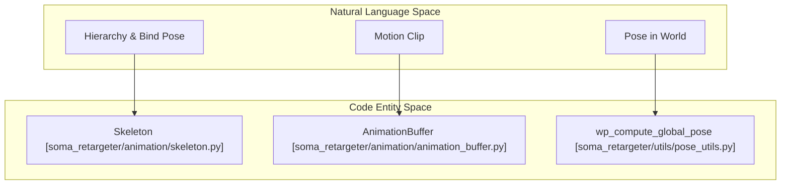
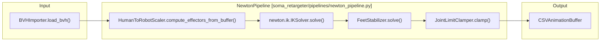

<!-- source: DeepWiki mcp.deepwiki.com · repo NVIDIA/soma-retargeter · page 10 Glossary · fetched 2026-10-26 -->

# Glossary

Relevant source files

The following files were used as context for generating this wiki page:

- [README.md](README.md)
- [soma_retargeter/animation/animation_buffer.py](soma_retargeter/animation/animation_buffer.py)
- [soma_retargeter/animation/skeleton.py](soma_retargeter/animation/skeleton.py)
- [soma_retargeter/assets/bvh.py](soma_retargeter/assets/bvh.py)
- [soma_retargeter/pipelines/feet_stabilizer.py](soma_retargeter/pipelines/feet_stabilizer.py)
- [soma_retargeter/pipelines/ik_objectives.py](soma_retargeter/pipelines/ik_objectives.py)
- [soma_retargeter/pipelines/newton_pipeline.py](soma_retargeter/pipelines/newton_pipeline.py)
- [soma_retargeter/pipelines/utils.py](soma_retargeter/pipelines/utils.py)
- [soma_retargeter/robotics/csv_animation_buffer.py](soma_retargeter/robotics/csv_animation_buffer.py)
- [soma_retargeter/robotics/human_to_robot_scaler.py](soma_retargeter/robotics/human_to_robot_scaler.py)
- [soma_retargeter/utils/space_conversion_utils.py](soma_retargeter/utils/space_conversion_utils.py)

This glossary defines the core technical terms, data structures, and domain concepts used in the SOMA Retargeter. It serves as a reference for understanding how human motion data is processed, scaled, and mapped onto robotic hardware.

## Core Animation Data Model

The following terms define how skeletal data and motion are represented in memory.

| Term | Definition | Key File/Class |
| :--- | :--- | :--- |
| **Skeleton** | A static description of a joint hierarchy, including joint names, parent-child indices, and a reference (bind) pose. | [soma_retargeter/animation/skeleton.py:10-147]() |
| **SkeletonInstance** | A poseable instance of a `Skeleton`. It maintains its own world-space `xform` and a set of local transforms for its current pose. | [soma_retargeter/animation/skeleton.py:149-183]() |
| **AnimationBuffer** | A container for time-sampled local joint transforms. It supports sampling at arbitrary times via linear interpolation. | [soma_retargeter/animation/animation_buffer.py:11-94]() |
| **Local Transform** | A `wp.transform` representing a joint's position and orientation relative to its parent. | [soma_retargeter/animation/skeleton.py:23-25]() |
| **Global Transform** | A `wp.transform` representing a joint's position and orientation in world space, calculated via Forward Kinematics (FK). | [soma_retargeter/utils/pose_utils.py:14-25]() |

### Data Flow: Natural Language to Code Entities

The following diagram maps high-level animation concepts to the specific classes and kernels that implement them.

**Animation Data Mapping**

Sources: [soma_retargeter/animation/skeleton.py:10-150](), [soma_retargeter/animation/animation_buffer.py:11-20](), [soma_retargeter/utils/pose_utils.py:14-30]()

---

## Retargeting & Robotics Concepts

Terms related to the conversion of motion from a human source to a robotic target.

### Human-to-Robot Scaling
*   **Effector**: A specific joint (e.g., "LeftFoot", "RightHand") used as a target for the Inverse Kinematics solver. [soma_retargeter/robotics/human_to_robot_scaler.py:48-56]()
*   **HumanToRobotScaler**: A class that adjusts human joint positions based on the height ratio between the source capture and the target robot model. It applies `joint_scales` and `joint_offsets` to align human morphology with robot morphology. [soma_retargeter/robotics/human_to_robot_scaler.py:13-47]()

### Inverse Kinematics (IK)
*   **Newton**: The underlying GPU-accelerated optimization library used to solve IK objectives. [soma_retargeter/pipelines/newton_pipeline.py:6-7]()
*   **IKSmoothJointFilter**: A custom IK objective that applies a smooth penalty (using an inverse Gaussian filter) as joints approach their hardware limits, preventing jerky motions near boundaries. [soma_retargeter/pipelines/ik_objectives.py:92-104]()
*   **IKMap**: A configuration mapping that defines which human joints correspond to which robot bodies and their relative offsets. [soma_retargeter/pipelines/newton_pipeline.py:84-93]()

### Pipeline Components
*   **FeetStabilizer**: A post-processing stage that uses a two-bone IK solver to ensure robot feet maintain contact with the ground, correcting for floating or penetration introduced by the main IK solve. [soma_retargeter/pipelines/feet_stabilizer.py:17-52]()
*   **JointLimitClamper**: Enforces hard hardware limits on joint degrees of freedom (DOF) to ensure the generated motion is safe for the physical robot. [soma_retargeter/pipelines/joint_limit_clamper.py:13-30]()

### System Integration: Pipeline Execution

The following diagram illustrates how the `NewtonPipeline` coordinates different code entities to transform a BVH into a robot-ready CSV.

**Pipeline Orchestration**

Sources: [soma_retargeter/pipelines/newton_pipeline.py:29-130](), [soma_retargeter/robotics/human_to_robot_scaler.py:131-150](), [soma_retargeter/pipelines/feet_stabilizer.py:95-105]()

---

## File Formats & I/O

| Term | Definition | Implementation |
| :--- | :--- | :--- |
| **BVH** | Biovision Hierarchy file. Used for input human motion. Parsed into a `Skeleton` and `AnimationBuffer`. | [soma_retargeter/assets/bvh.py:240-250]() |
| **CSV** | Comma-Separated Values. The output format for the robot, containing root transforms and joint angles (Q values). | [soma_retargeter/robotics/csv_animation_buffer.py:10-24]() |
| **USD / USDA** | Universal Scene Description. Used for loading the high-fidelity skeletal mesh of the SOMA body for visualization. | [soma_retargeter/assets/usd.py:12-30]() |

## Mathematical & Utility Concepts

*   **wp.transform**: A NVIDIA Warp data type representing a rigid body transformation (a 3D vector for position and a quaternion for rotation). [soma_retargeter/assets/bvh.py:88]()
*   **SpaceConverter**: A utility to convert between coordinate systems (e.g., Maya's Y-up vs. Newton's Z-up). [soma_retargeter/utils/space_conversion_utils.py:54-69]()
*   **FacingDirectionType**: An enum defining the orientation of the source model (e.g., `MAYA` or `MUJOCO`). [soma_retargeter/utils/space_conversion_utils.py:9-13]()
*   **Initialization Frames**: A set of frames (usually 10) prepended to an animation to allow the IK solver to "warm up" from a reference T-pose to the first frame of motion. [soma_retargeter/pipelines/newton_pipeline.py:25-116]()

Sources: [soma_retargeter/utils/space_conversion_utils.py:9-90](), [soma_retargeter/robotics/csv_animation_buffer.py:10-88](), [soma_retargeter/pipelines/newton_pipeline.py:22-26]()