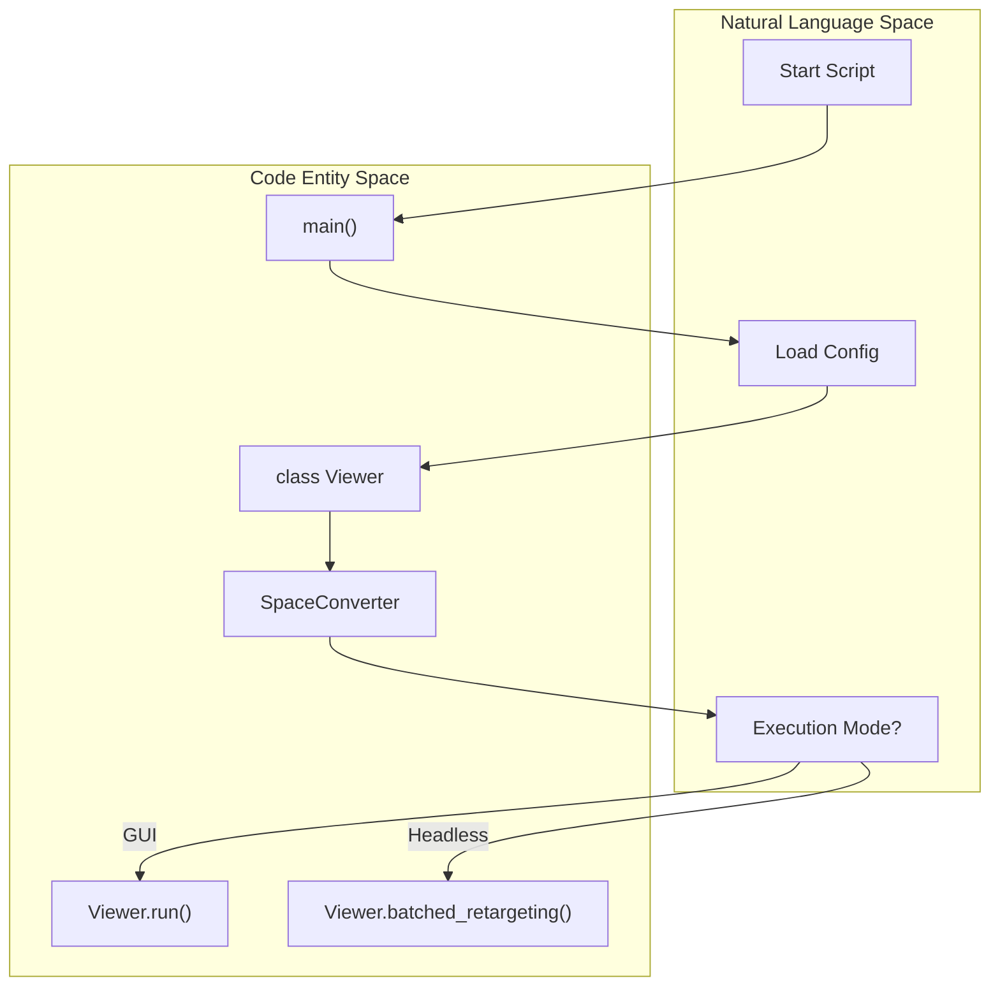
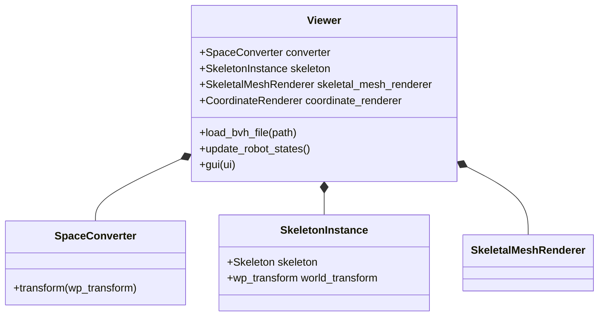

<!-- source: DeepWiki mcp.deepwiki.com · repo NVIDIA/soma-retargeter · page 2 Application Entry Point · fetched 2026-10-26 -->

# Application Entry Point

Relevant source files

The following files were used as context for generating this wiki page:

- [app/bvh_to_csv_converter.py](app/bvh_to_csv_converter.py)
- [assets/default_bvh_to_csv_converter_config.json](assets/default_bvh_to_csv_converter_config.json)

The `app/bvh_to_csv_converter.py` script serves as the primary entry point for the SOMA Retargeter system. It orchestrates the flow of data from raw BVH motion files through the Newton-based IK pipeline to produce robot-compatible CSV files. The script is designed to handle both interactive visualization for debugging/configuration and high-throughput batch processing for large datasets.

### Overview of Orchestration

The application uses a `Viewer` class [app/bvh_to_csv_converter.py:30-31]() to manage the lifecycle of the retargeting process. Depending on the command-line arguments and configuration, it initializes either a graphical OpenGL window (using the Newton viewer) or a `ViewerNull` [app/bvh_to_csv_converter.py:37-39]() for headless execution.

#### System Entry Flow
The following diagram illustrates how the entry point initializes the environment and branches into the two primary execution modes.

**Entry Point Logic Flow**

Sources: [app/bvh_to_csv_converter.py:30-39](), [app/bvh_to_csv_converter.py:35-35]()

---

### Configuration and CLI

The script relies on a JSON configuration file to define default paths and retargeting parameters. By default, it loads `assets/default_bvh_to_csv_converter_config.json` [assets/default_bvh_to_csv_converter_config.json:1-10]().

| Key | Description | Default |
| :--- | :--- | :--- |
| `import_folder` | Source directory for BVH files | `assets/motions/bvh` |
| `export_folder` | Destination for generated CSVs | `assets/motions/test-export` |
| `batch_size` | Number of files processed per GPU batch | `100` |
| `retarget_source` | Source character profile (e.g., SOMA) | `soma` |
| `retarget_target` | Target robot profile (e.g., Unitree G1) | `unitree_g1` |
| `retarget_source_facing_direction` | Coordinate system of input (e.g., Mujoco) | `Mujoco` |

Sources: [assets/default_bvh_to_csv_converter_config.json:1-10]()

---

### Execution Modes

The application operates in two distinct modes based on the presence of the `--batch` flag or the state of the `Viewer` initialization.

#### 1. Interactive Viewer Mode
In this mode, the `Viewer` class initializes a graphical interface using `imgui`. It allows users to:
*   **Visualize** the source human skeleton and the target robot model (Unitree G1) side-by-side [app/bvh_to_csv_converter.py:70-78]().
*   **Adjust** spatial offsets using interactive gizmos [app/bvh_to_csv_converter.py:61-61]().
*   **Trigger** the retargeting pipeline for a single file and inspect the results in real-time.
*   **Render** skeletal meshes and joint axes using `SkeletalMeshRenderer` and `CoordinateRenderer` [app/bvh_to_csv_converter.py:86-89]().

For details, see [Interactive Viewer Mode (OpenGL / imgui)](#2.1).

#### 2. Batch Processing Mode
When run in batch mode, the application bypasses the UI and focuses on throughput. It utilizes the `batched_retargeting()` method to:
*   Recursively scan the `import_folder` for BVH files.
*   Group animations into batches to maximize GPU utilization via NVIDIA Warp.
*   Execute the `NewtonPipeline` without rendering overhead.
*   Export results directly to the `export_folder`.

For details, see [Batch Processing Mode](#2.2).

---

### Component Relationship
The `Viewer` class acts as a central hub, connecting asset loaders, renderers, and the retargeting pipeline.

**Viewer Component Architecture**

Sources: [app/bvh_to_csv_converter.py:30-35](), [app/bvh_to_csv_converter.py:86-93](), [app/bvh_to_csv_converter.py:104-123]()

---

