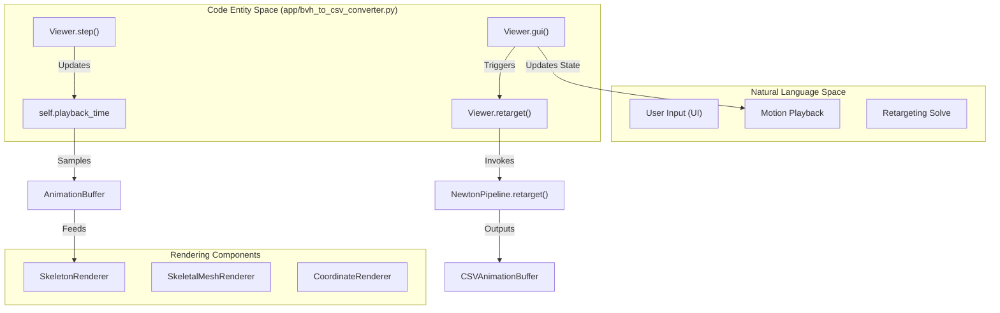
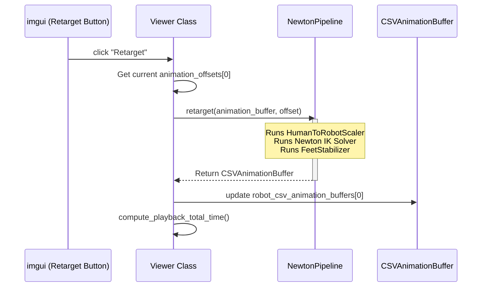

<!-- source: DeepWiki mcp.deepwiki.com · repo NVIDIA/soma-retargeter · page 2.1 Interactive Viewer Mode (OpenGL / imgui) · fetched 2026-10-26 -->

# Interactive Viewer Mode (OpenGL / imgui)

Relevant source files

The following files were used as context for generating this wiki page:

- [.gitignore](.gitignore)
- [app/bvh_to_csv_converter.py](app/bvh_to_csv_converter.py)
- [assets/docs/banner.gif](assets/docs/banner.gif)
- [assets/docs/interactive-viewer-screenshot.png](assets/docs/interactive-viewer-screenshot.png)

The Interactive Viewer Mode provides a real-time graphical interface for monitoring and controlling the BVH-to-CSV retargeting process. Built on the `newton.viewer` framework, it integrates OpenGL rendering with an `imgui` overlay to allow users to manipulate character offsets, control playback, and trigger the Newton IK solver pipeline manually.

### The Viewer Class

The `Viewer` class in `app/bvh_to_csv_converter.py` is the central orchestrator for the interactive session. It manages the rendering lifecycle, UI state, and the synchronization between source animation data and the target robot model.

| Entity | Role |
| :--- | :--- |
| `self.viewer` | The underlying `newton.viewer.Viewer` instance providing the OpenGL context [app/bvh_to_csv_converter.py:32](). |
| `self.model` | The Newton model containing the target robot (e.g., Unitree G1) and ground plane [app/bvh_to_csv_converter.py:76](). |
| `self.converter` | A `SpaceConverter` that handles coordinate transformations between source BVH space and the viewer's world space [app/bvh_to_csv_converter.py:35](). |
| `self.skeleton_instances` | List of `SkeletonInstance` objects representing the source human characters [app/bvh_to_csv_converter.py:116](). |

**Sources:** [app/bvh_to_csv_converter.py:30-94]()

### Data Flow and System Architecture

The following diagram illustrates how the `Viewer` class connects the Natural Language concepts (like "Playback" or "Retargeting") to the underlying Code Entities.

**Viewer System Architecture**

**Sources:** [app/bvh_to_csv_converter.py:96-103](), [app/bvh_to_csv_converter.py:166-175](), [app/bvh_to_csv_converter.py:223-245]()

### UI Panels and Controls

The interface is divided into two primary `imgui` panels defined in the `gui()` callback [app/bvh_to_csv_converter.py:96]().

#### 1. Playback Controls
This panel manages the temporal state of the loaded animations.
*   **Time Slider:** Direct manipulation of `self.playback_time` [app/bvh_to_csv_converter.py:263]().
*   **Speed Multiplier:** Adjusts `self.playback_speed` (default 1.0) [app/bvh_to_csv_converter.py:270]().
*   **Looping:** Toggles `self.playback_loop` to restart the animation automatically [app/bvh_to_csv_converter.py:273]().

#### 2. Scene Options
This panel controls visibility and file operations.
*   **Visibility Toggles:** Includes `show_skeleton_mesh`, `show_skeleton`, and `show_skeleton_joint_axes` [app/bvh_to_csv_converter.py:313-316]().
*   **Gizmo Manipulation:** When `show_gizmos` is active, the viewer renders translation/rotation gizmos for `self.animation_offsets`, allowing the user to reposition the source human relative to the robot [app/bvh_to_csv_converter.py:330-340]().
*   **Load/Save Dialogs:** Buttons to trigger `load_bvh_file()` or save the retargeted output via `csv_utils.save_csv()` [app/bvh_to_csv_converter.py:343-350]().

**Sources:** [app/bvh_to_csv_converter.py:253-305](), [app/bvh_to_csv_converter.py:307-355]()

### Real-time Retargeting Trigger

The retargeting process is triggered via the "Retarget" button in the UI. This executes the `retarget()` method, which bridges the interactive state to the `NewtonPipeline`.

**Retargeting Logic Flow**

**Sources:** [app/bvh_to_csv_converter.py:223-245](), [app/bvh_to_csv_converter.py:124-137]()

### Implementation Details

#### Gizmo-based Offset Manipulation
The viewer uses `newton.viewer.gizmo` to allow users to manually align the source character with the target robot. The offset is stored as a `wp.transform` and is applied to the source skeleton's root before the IK solve [app/bvh_to_csv_converter.py:204-211]().

#### Rendering Lifecycle
In every frame, the `step()` function:
1.  Increments `self.playback_time` based on `frame_dt` [app/bvh_to_csv_converter.py:169]().
2.  Updates the robot's joint positions in `self.model.joint_q` by sampling the `CSVAnimationBuffer` [app/bvh_to_csv_converter.py:149-150]().
3.  Calls `newton.eval_fk` to update the robot's global state [app/bvh_to_csv_converter.py:164]().
4.  Updates the `SkeletonRenderer` and `SkeletalMeshRenderer` with the sampled human pose [app/bvh_to_csv_converter.py:186-196]().

**Sources:** [app/bvh_to_csv_converter.py:138-165](), [app/bvh_to_csv_converter.py:166-221]()

---

