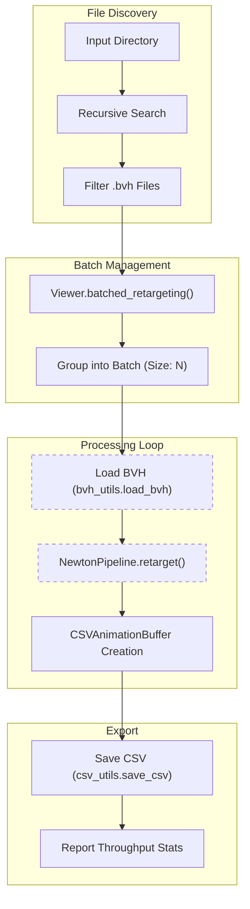
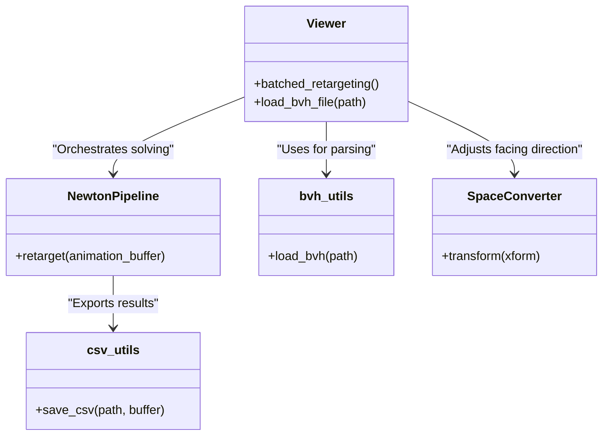

<!-- source: DeepWiki mcp.deepwiki.com · repo NVIDIA/soma-retargeter · page 2.2 Batch Processing Mode · fetched 2026-10-26 -->

# Batch Processing Mode

Relevant source files

The following files were used as context for generating this wiki page:

- [app/bvh_to_csv_converter.py](app/bvh_to_csv_converter.py)
- [assets/default_bvh_to_csv_converter_config.json](assets/default_bvh_to_csv_converter_config.json)

The Batch Processing Mode is a headless execution path within the `Viewer` class designed for high-throughput motion retargeting. It bypasses the OpenGL/imgui interface to recursively process directories of BVH files, grouping them into optimized batches for the Newton pipeline, and exporting the results as robot-compatible CSV files.

### Overview and Execution Flow

Batch processing is triggered when the application is launched without a graphical display or via specific CLI configurations. The primary entry point for this mode is `Viewer.batched_retargeting()`, which orchestrates the discovery, transformation, and export of motion data.

The system utilizes a "headless" Newton viewer instance (`newton.viewer.ViewerNull`) to maintain compatibility with the pipeline's internal requirements while avoiding the overhead of GPU rendering and window management [app/bvh_to_csv_converter.py:37-39]().

#### Data Flow Diagram: Batch Execution
The following diagram illustrates the transition from file discovery to the final CSV export within the batch processing loop.

Title: Batch Processing Pipeline Data Flow

Sources: [app/bvh_to_csv_converter.py:236-245](), [app/bvh_to_csv_converter.py:270-285](), [assets/default_bvh_to_csv_converter_config.json:2-4]()

### File Discovery and Batching

The process begins by scanning the `import_folder` defined in the configuration [assets/default_bvh_to_csv_converter_config.json:2](). The `Viewer` uses `pathlib` to recursively find all files with the `.bvh` extension [app/bvh_to_csv_converter.py:236-240]().

To optimize GPU resource utilization and pipeline initialization, files are processed in chunks defined by the `batch_size` parameter (defaulting to 100) [assets/default_bvh_to_csv_converter_config.json:4](). This prevents memory exhaustion when dealing with thousands of motion files while maintaining high throughput.

| Configuration Key | Description | Default Value |
| :--- | :--- | :--- |
| `import_folder` | Source directory for recursive BVH search | `"assets/motions/bvh"` |
| `export_folder` | Destination for generated CSV files | `"assets/motions/test-export"` |
| `batch_size` | Number of files processed in one pipeline iteration | `100` |

Sources: [assets/default_bvh_to_csv_converter_config.json:1-9](), [app/bvh_to_csv_converter.py:236-245]()

### Implementation Details

The core logic resides in `Viewer.batched_retargeting()`. For each batch, the system performs the following technical steps:

1.  **Pipeline Initialization**: A `NewtonPipeline` is instantiated using the source and target configurations (e.g., SOMA to Unitree G1) [app/bvh_to_csv_converter.py:242-250]().
2.  **BVH Loading**: Each file is parsed using `bvh_utils.load_bvh()`, which returns a `Skeleton` and an `AnimationBuffer` [app/bvh_to_csv_converter.py:114-118]().
3.  **Newton Solve**: The pipeline executes the `retarget()` method. This involves human-to-robot scaling, Newton IK solving with joint limits, and feet stabilization.
4.  **CSV Serialization**: The resulting robot joint trajectories are wrapped in a `CSVAnimationBuffer` and written to the `export_folder` using `csv_utils.save_csv()` [app/bvh_to_csv_converter.py:101-101]().

#### Code Entity Mapping
This diagram maps the natural language concepts of the batch process to the specific classes and methods in the codebase.

Title: Code Entity Relationship for Batch Mode

Sources: [app/bvh_to_csv_converter.py:30-35](), [app/bvh_to_csv_converter.py:236-250](), [app/bvh_to_csv_converter.py:114-118]()

### Performance Reporting

During execution, the system tracks and reports throughput statistics. It calculates the total time taken to process the entire batch and provides metrics such as "Files per Second" and "Total Frames Processed." This is facilitated by the `tqdm` progress bar integration, which provides real-time feedback in the terminal during headless operation [app/bvh_to_csv_converter.py:23-23]().

The batch mode also ensures that any visual offsets or space conversions (e.g., converting from Mujoco to Newton coordinate spaces) are applied consistently across all files in the batch via the `SpaceConverter` class [app/bvh_to_csv_converter.py:35-35]().

Sources: [app/bvh_to_csv_converter.py:21-23](), [app/bvh_to_csv_converter.py:236-250]()

---

