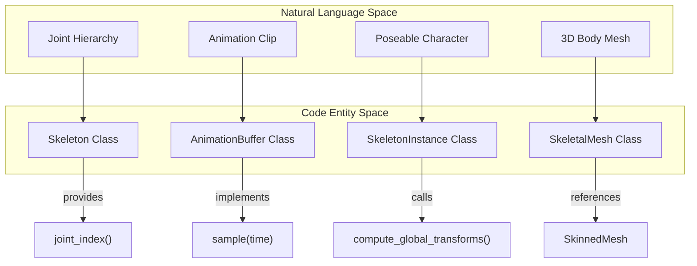
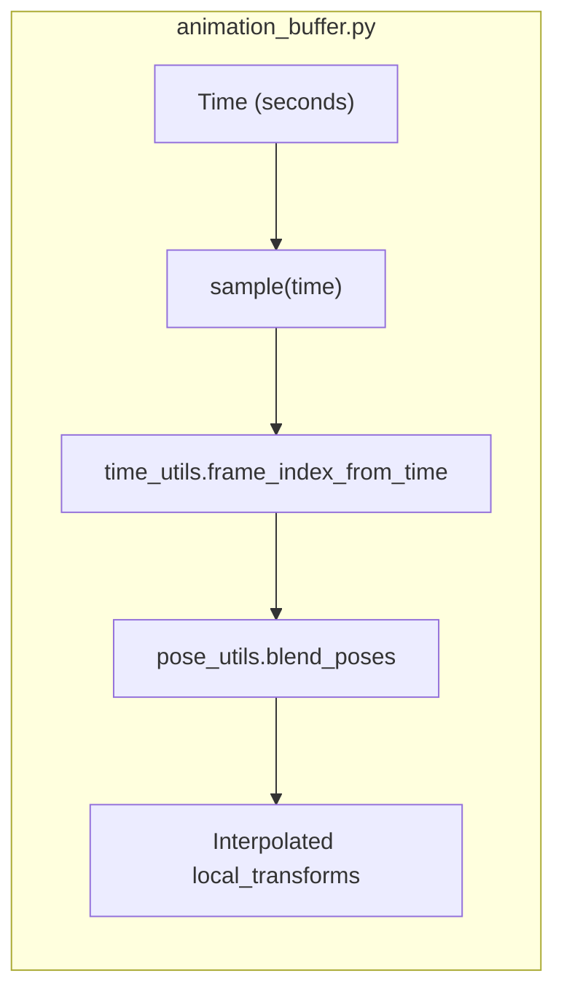

<!-- source: DeepWiki mcp.deepwiki.com · repo NVIDIA/soma-retargeter · page 3 Core Animation Data Model · fetched 2026-10-26 -->

# Core Animation Data Model

Relevant source files

The following files were used as context for generating this wiki page:

- [soma_retargeter/animation/__init__.py](soma_retargeter/animation/__init__.py)
- [soma_retargeter/animation/animation_buffer.py](soma_retargeter/animation/animation_buffer.py)
- [soma_retargeter/animation/ik.py](soma_retargeter/animation/ik.py)
- [soma_retargeter/animation/mesh.py](soma_retargeter/animation/mesh.py)
- [soma_retargeter/animation/skeleton.py](soma_retargeter/animation/skeleton.py)

This page provides an overview of the fundamental data structures used to represent skeletal hierarchy, pose data, and animated sequences within the SOMA Retargeter. The system relies on [NVIDIA Warp](https://github.com/NVIDIA/warp) for high-performance GPU-accelerated math and transformations.

The data model is designed to support hierarchical joint structures, time-sampled animation buffers with linear interpolation, and skinned skeletal meshes for visualization.

### System Entity Map
The following diagram illustrates how high-level animation concepts map to specific classes and functions in the codebase.

**Natural Language to Code Entity Mapping**

Sources: [soma_retargeter/animation/skeleton.py:10-14](), [soma_retargeter/animation/animation_buffer.py:11-18](), [soma_retargeter/animation/mesh.py:83-85]()

---

### Skeleton and SkeletonInstance
The `Skeleton` class is the static definition of a character's structure. It stores joint names, parent-child relationships via integer indices, and a reference pose. The `SkeletonInstance` represents a specific, poseable occurrence of that skeleton in world space.

| Class | Responsibility | Key Attributes |
| :--- | :--- | :--- |
| `Skeleton` | Defines the hierarchy and reference pose. | `parent_indices`, `joint_names`, `reference_local_transforms` |
| `SkeletonInstance` | Manages a specific pose and world placement. | `xform` (world transform), `local_transforms`, `color` |

For details, see [Skeleton and SkeletonInstance](#3.1).

Sources: [soma_retargeter/animation/skeleton.py:10-149](), [soma_retargeter/animation/skeleton.py:149-169]()

---

### AnimationBuffer and Frame Sampling
The `AnimationBuffer` acts as a container for time-sampled local joint transforms. It is the primary structure used to store motion captured data (from BVH) or retargeted results (for CSV export).

**Animation Data Flow**

Key features include:
* **Linear Interpolation**: The `sample()` method computes blended poses between frames based on the `sample_rate`.
* **Skeleton Remapping**: `create_animation_buffer_for_skeleton()` allows transferring animation data between different skeletons by matching joint names.
* **IK Utilities**: A specialized `wp_solve_two_bone_ik` function provides analytic solving for limbs (e.g., arms and legs).

For details, see [AnimationBuffer and Frame Sampling](#3.2).

Sources: [soma_retargeter/animation/animation_buffer.py:11-94](), [soma_retargeter/animation/animation_buffer.py:96-128](), [soma_retargeter/animation/ik.py:19-45]()

---

### Skeletal Mesh (USD)
For visual representation, the system uses the `SkeletalMesh` class. This links one or more `SkinnedMesh` objects to a `Skeleton`.

* **Bind Poses**: It stores `bind_transforms` (inverse bind-pose transforms) for every joint, which are essential for Linear Blend Skinning (LBS).
* **USD Integration**: Assets are typically loaded from Universal Scene Description (USD) files, which provide the geometry, skinning weights, and initial joint transforms.

For details, see [Skeletal Mesh (USD)](#3.3).

Sources: [soma_retargeter/animation/mesh.py:27-81](), [soma_retargeter/animation/mesh.py:83-137]()

---

