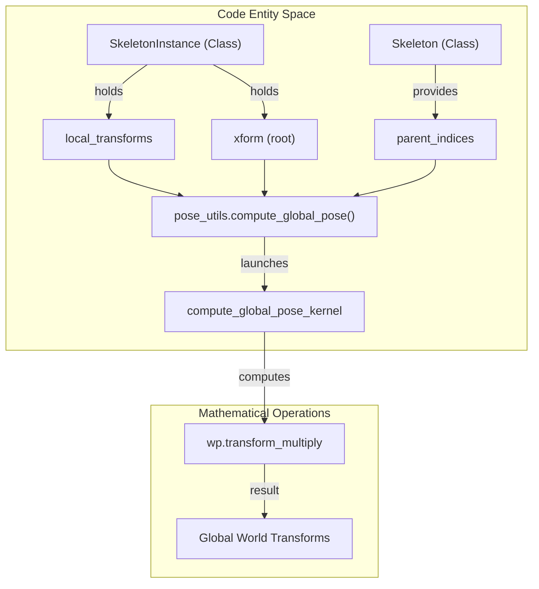
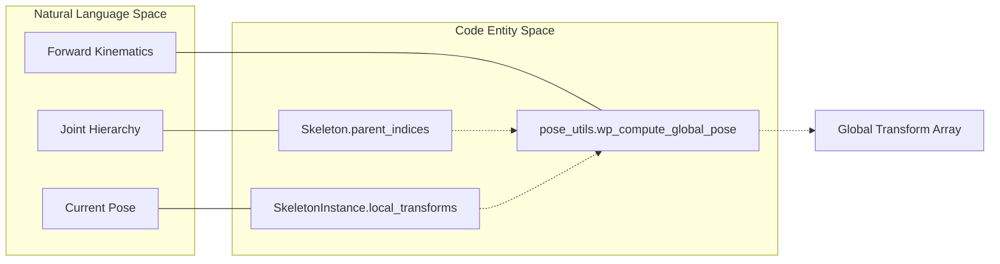

<!-- source: DeepWiki mcp.deepwiki.com · repo NVIDIA/soma-retargeter · page 3.1 Skeleton and SkeletonInstance · fetched 2026-10-26 -->

# Skeleton and SkeletonInstance

Relevant source files

The following files were used as context for generating this wiki page:

- [soma_retargeter/animation/skeleton.py](soma_retargeter/animation/skeleton.py)
- [soma_retargeter/utils/pose_utils.py](soma_retargeter/utils/pose_utils.py)

This page provides a deep dive into the fundamental skeletal data structures used throughout the SOMA Retargeter. It covers the definition of joint hierarchies, the management of poseable instances, and the mathematical foundations of forward kinematics (FK) used to compute world-space transforms.

## Skeleton

The `Skeleton` class is a stateless description of a character's joint hierarchy [soma_retargeter/animation/skeleton.py:10-14](). It stores the structural topology and the reference (bind) pose of the skeleton.

### Key Components
*   **Joint Hierarchy**: Defined by a list of `joint_names` and a corresponding array of `parent_indices` [soma_retargeter/animation/skeleton.py:32-33]().
*   **Reference Pose**: Stored as `_reference_local_transforms`, representing the default local-space transformation for every joint [soma_retargeter/animation/skeleton.py:56-63]().
*   **Axis Definitions**: Defaults to a Z-up (`wp.vec3(0, 0, 1)`) and -Y forward (`wp.vec3(0, -1, 0)`) coordinate system [soma_retargeter/animation/skeleton.py:35-36]().

### Joint Resolution
The class provides utility methods to map between joint names and indices, which is critical for configuring IK objectives and mapping human joints to robot joints.
*   `joint_index(name)`: Returns the integer index of a joint, or -1 if not found [soma_retargeter/animation/skeleton.py:65-81]().
*   `joint_name(index)`: Returns the string name for a specific index [soma_retargeter/animation/skeleton.py:83-96]().
*   `joint_parent(index)`: Returns the index of the parent joint [soma_retargeter/animation/skeleton.py:98-112]().

**Sources:** [soma_retargeter/animation/skeleton.py:10-148]()

---

## SkeletonInstance

A `SkeletonInstance` represents a poseable, stateful instance of a `Skeleton` [soma_retargeter/animation/skeleton.py:149-155](). While the `Skeleton` defines the structure, the `SkeletonInstance` stores the current pose and world-space placement.

### Instance State
*   **`local_transforms`**: A numpy array of current local-space transforms for each joint, initialized from the skeleton's reference pose [soma_retargeter/animation/skeleton.py:168]().
*   **`xform`**: A `wp.transform` representing the world-space position and orientation of the skeleton's root [soma_retargeter/animation/skeleton.py:166]().
*   **`color`**: A `wp.vec3` used by renderers to distinguish different instances (e.g., source vs. target) [soma_retargeter/animation/skeleton.py:167]().

### Skeleton Logic Flow
The following diagram illustrates how the `Skeleton` and `SkeletonInstance` classes interact with the `pose_utils` module to compute global poses.

**Diagram: Pose Computation Data Flow**

**Sources:** [soma_retargeter/animation/skeleton.py:149-173](), [soma_retargeter/utils/pose_utils.py:64-94]()

---

## Forward Kinematics and Pose Utilities

The system relies on NVIDIA Warp kernels to perform efficient skeletal math. The primary operation is converting between local-space transforms (relative to parent) and global-space transforms (world coordinates).

### Global Pose Computation
The `compute_global_transforms` method in `Skeleton` delegates to `pose_utils.compute_global_pose` [soma_retargeter/animation/skeleton.py:137-146](). This function launches a Warp kernel that iterates through the hierarchy:

1.  **Root Joint**: The global transform of the first joint (index 0) is calculated by multiplying the instance's world `root_tx` with the joint's `local_pose[0]` [soma_retargeter/utils/pose_utils.py:46]().
2.  **Child Joints**: For every subsequent joint, the global transform is the product of its parent's global transform and its own local transform [soma_retargeter/utils/pose_utils.py:47-49]().

### Implementation Details

| Function | File Reference | Description |
| :--- | :--- | :--- |
| `wp_compute_global_pose` | [pose_utils.py:38-50]() | Warp device function implementing the FK loop. |
| `compute_global_pose_kernel` | [pose_utils.py:53-61]() | Kernel wrapper for parallel execution (dim=1). |
| `compute_local_pose` | [pose_utils.py:97-124]() | Inverse operation: computes local offsets from world transforms. |
| `blend_poses` | [pose_utils.py:141-167]() | Interpolates between two sets of local transforms using `wp.quat_slerp`. |

### System Mapping
The relationship between the high-level skeleton management and the low-level Warp acceleration is shown below.

**Diagram: System Entity Mapping**

**Sources:** [soma_retargeter/utils/pose_utils.py:10-167](), [soma_retargeter/animation/skeleton.py:137-146]()

---

