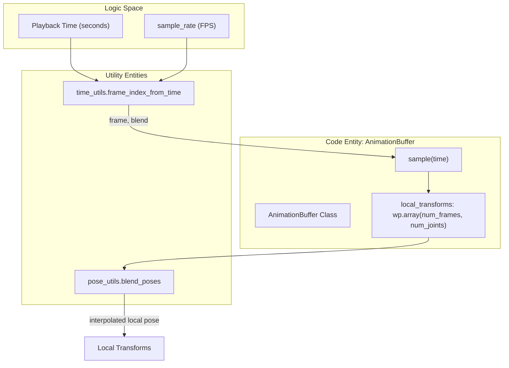
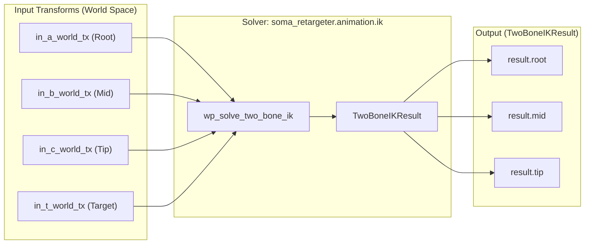

<!-- source: DeepWiki mcp.deepwiki.com · repo NVIDIA/soma-retargeter · page 3.2 AnimationBuffer and Frame Sampling · fetched 2026-10-26 -->

# AnimationBuffer and Frame Sampling

Relevant source files

The following files were used as context for generating this wiki page:

- [soma_retargeter/animation/animation_buffer.py](soma_retargeter/animation/animation_buffer.py)
- [soma_retargeter/animation/ik.py](soma_retargeter/animation/ik.py)
- [soma_retargeter/utils/time_utils.py](soma_retargeter/utils/time_utils.py)

The `AnimationBuffer` serves as the primary data structure for storing and sampling time-varying skeletal poses. It manages local-space joint transforms across a fixed duration and provides mechanisms for temporal interpolation and skeletal remapping. Additionally, the system includes specialized Inverse Kinematics (IK) helpers to solve three-joint chains (e.g., legs or arms) within this animation context.

## AnimationBuffer Implementation

The `AnimationBuffer` class [soma_retargeter/animation/animation_buffer.py:11-18]() stores animation data as a sequence of local joint transforms. It is defined by a `Skeleton` reference, a `num_frames` count, and a `sample_rate` (FPS) [soma_retargeter/animation/animation_buffer.py:32-34]().

### Data Structure and Initialization
The core data is stored in `self.local_transforms`, a NumPy array of shape `(num_frames, num_joints)` using the `wp.transform` data type [soma_retargeter/animation/animation_buffer.py:38-41](). If no transforms are provided at initialization, the buffer defaults to the skeleton's reference pose for every frame [soma_retargeter/animation/animation_buffer.py:36-39]().

### Sampling and Interpolation
To support arbitrary playback speeds and sub-frame accuracy, the `sample()` method implements linear interpolation [soma_retargeter/animation/animation_buffer.py:78-93]().

1.  **Time to Frame Conversion**: The utility `frame_index_from_time` calculates the integer frame index and a floating-point `blend` factor [soma_retargeter/utils/time_utils.py:7-34]().
2.  **Pose Blending**: If the `blend` factor is significant (> 1e-5), the system calls `pose_utils.blend_poses()` to interpolate between the current frame and the subsequent frame [soma_retargeter/animation/animation_buffer.py:90-93]().

### Global Transform Computation
While the buffer stores local transforms, world-space visualization and IK require global transforms. The `compute_global_transforms()` method performs forward kinematics by traversing the skeleton hierarchy, optionally starting from a custom `root_tx` [soma_retargeter/animation/animation_buffer.py:58-76]().

**Sources:**
- [soma_retargeter/animation/animation_buffer.py:11-94]()
- [soma_retargeter/utils/time_utils.py:7-34]()

---

## Skeleton Remapping

The utility function `create_animation_buffer_for_skeleton()` allows transferring animation data between two different `Skeleton` objects [soma_retargeter/animation/animation_buffer.py:96-128]().

This is a name-based remapping process:
1.  A new `AnimationBuffer` is initialized using the target `new_skeleton` [soma_retargeter/animation/animation_buffer.py:115]().
2.  The function iterates through the source skeleton's joints [soma_retargeter/animation/animation_buffer.py:119]().
3.  If a joint name from the source exists in the target skeleton, its local transforms across all frames are copied to the new buffer [soma_retargeter/animation/animation_buffer.py:120-124]().

### Entity Mapping: Animation Data Flow
The following diagram illustrates how the `AnimationBuffer` bridges the `Skeleton` definition with temporal sampling logic.

Title: Animation Sampling Data Flow

**Sources:**
- [soma_retargeter/animation/animation_buffer.py:78-94]()
- [soma_retargeter/utils/time_utils.py:7-34]()

---

## Two-Bone IK Helper

The module `soma_retargeter/animation/ik.py` provides an analytic solver for three-joint chains (e.g., Hip-Knee-Ankle). This is used primarily for post-processing adjustments like feet stabilization.

### wp_solve_two_bone_ik
This Warp function implements a geometric IK solver [soma_retargeter/animation/ik.py:19-89](). It calculates the required rotations for the root (A) and middle (B) joints so that the tip (C) reaches a target (T).

*   **Cosine Rule**: Used to find the interior angles based on segment lengths `l_ab` and `l_cb` [soma_retargeter/animation/ik.py:63-64]().
*   **Bending Plane**: The solver determines the plane of rotation using the current joint positions or a provided `in_hint_world` vector to disambiguate the "elbow/knee" direction [soma_retargeter/animation/ik.py:67]().
*   **Warp Kernel**: The logic is wrapped in `two_bone_ik_kernel`, allowing the solver to run efficiently on the GPU for batched operations [soma_retargeter/animation/ik.py:93-112]().

### IK Data Entities
Title: Two-Bone IK Solver Interface

**Sources:**
- [soma_retargeter/animation/ik.py:12-112]()

## Summary of Key Functions

| Function | File | Description |
| :--- | :--- | :--- |
| `AnimationBuffer.sample()` | [animation_buffer.py:78]() | Interpolates local transforms at a given timestamp. |
| `create_animation_buffer_for_skeleton()` | [animation_buffer.py:96]() | Remaps animation data to a new hierarchy by joint name. |
| `wp_solve_two_bone_ik()` | [ik.py:19]() | Analytic IK solver for 3-joint chains. |
| `frame_index_from_time()` | [time_utils.py:7]() | Calculates frame indices and blend weights for sampling. |

**Sources:**
- [soma_retargeter/animation/animation_buffer.py:1-128]()
- [soma_retargeter/animation/ik.py:1-112]()
- [soma_retargeter/utils/time_utils.py:1-34]()

---

