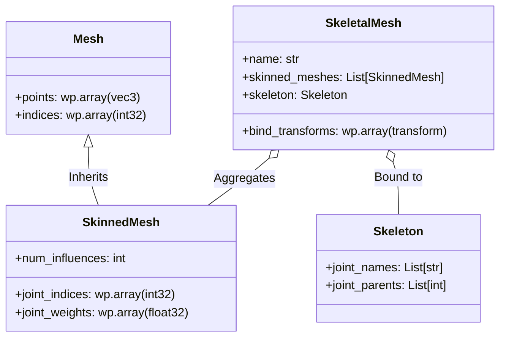
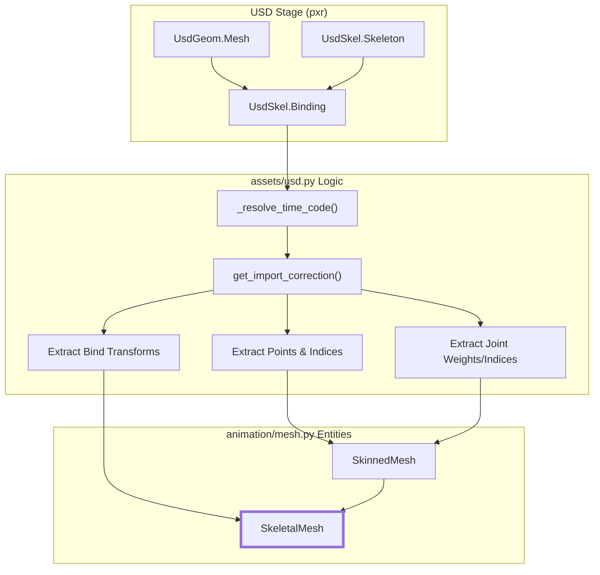

<!-- source: DeepWiki mcp.deepwiki.com · repo NVIDIA/soma-retargeter · page 3.3 Skeletal Mesh (USD) · fetched 2026-10-26 -->

# Skeletal Mesh (USD)

Relevant source files

The following files were used as context for generating this wiki page:

- [soma_retargeter/animation/mesh.py](soma_retargeter/animation/mesh.py)
- [soma_retargeter/assets/usd.py](soma_retargeter/assets/usd.py)
- [soma_retargeter/configs/soma/soma_base_skel_minimal.usd](soma_retargeter/configs/soma/soma_base_skel_minimal.usd)

The **Skeletal Mesh** system provides the data structures and loading mechanisms for representing deformable character geometry within the SOMA Retargeter. It bridges the gap between static USD (Universal Scene Description) assets and the dynamic, GPU-accelerated animation pipeline.

## Data Structures

The system uses a hierarchical representation of geometry, starting from raw vertex data up to a complete character bound to a skeleton.

### Mesh and SkinnedMesh
The base `Mesh` class [soma_retargeter/animation/mesh.py:12-25]() stores fundamental geometric data: vertex positions (`points`) and triangle connectivity (`indices`).

The `SkinnedMesh` class [soma_retargeter/animation/mesh.py:27-81]() extends this to support Linear Blend Skinning (LBS). It adds:
*   **Joint Indices**: An array mapping vertices to the skeleton joints that influence them [soma_retargeter/animation/mesh.py:53-56]().
*   **Joint Weights**: An array of scalar weights defining the strength of each joint's influence [soma_retargeter/animation/mesh.py:58-61]().
*   **Influences**: The number of joints affecting a single vertex, calculated as the ratio of total joint indices to total points [soma_retargeter/animation/mesh.py:42-45]().

### SkeletalMesh
The `SkeletalMesh` class [soma_retargeter/animation/mesh.py:83-137]() aggregates one or more `SkinnedMesh` instances (e.g., separate meshes for the body, hair, or clothing) and binds them to a single `Skeleton` [soma_retargeter/animation/mesh.py:105-108]().

A critical component of this class is the `bind_transforms` array [soma_retargeter/animation/mesh.py:129-132](). These are the per-joint transforms in the mesh's bind pose, used during the skinning process to transform vertices from model space into the local space of their influencing joints.

### Entity Relationship Diagram
This diagram illustrates how the Python classes in `mesh.py` relate to the core `Skeleton` and the USD loading logic.

**Skeletal Mesh Entity Mapping**

Sources: [soma_retargeter/animation/mesh.py:12-137](), [soma_retargeter/animation/skeleton.py:10-143]()

---

## USD Asset Loading

The `assets/usd.py` module handles the extraction of skeletal data from USD files using the `pxr.Usd` and `pxr.UsdSkel` libraries.

### Coordinate System Alignment
USD files may authored with different up-axes (Y or Z) and units (centimeters, meters, etc.). The loader performs automatic correction:
*   **Up-Axis**: `get_up_axis_transform()` computes a rotation to align the USD stage with the target application (typically Z-up) [soma_retargeter/assets/usd.py:81-118]().
*   **Scaling**: `get_stage_meters_per_unit()` retrieves the stage metadata to ensure all vertex positions and joint translations are converted to meters [soma_retargeter/assets/usd.py:54-64]().

### The Loading Pipeline
The loading process follows a specific flow to ensure that the resulting `SkeletalMesh` is compatible with the GPU-based `SkeletalMeshRenderer`.

**USD to SkeletalMesh Data Flow**

Sources: [soma_retargeter/assets/usd.py:21-148](), [soma_retargeter/animation/mesh.py:105-112]()

---

## SOMA Body Mesh

The primary skeletal mesh used by the retargeter is the **SOMA body mesh**, defined in `soma_base_skel_minimal.usd` [soma_retargeter/configs/soma/soma_base_skel_minimal.usd:1-4]().

This asset provides:
1.  **Low-poly Geometry**: Optimized for real-time visualization in the interactive viewer.
2.  **Standard Topology**: A consistent vertex layout that matches the SOMA human skeleton.
3.  **Skinning Weights**: Pre-authored weights that allow the mesh to deform naturally as the `NewtonPipeline` solves for human motion.

### Integration with Renderer
The `SkeletalMeshRenderer` consumes the `SkeletalMesh` object. Every frame, it performs the following steps:
1.  Receives the current joint transforms from the `SkeletonInstance`.
2.  Combines these with the `bind_transforms` from the `SkeletalMesh`.
3.  Executes a Warp kernel to perform Linear Blend Skinning on the GPU.
4.  Updates the vertex buffer of the mesh for the OpenGL viewer.

Sources: [soma_retargeter/animation/mesh.py:83-103](), [soma_retargeter/assets/usd.py:151-181]()

---

