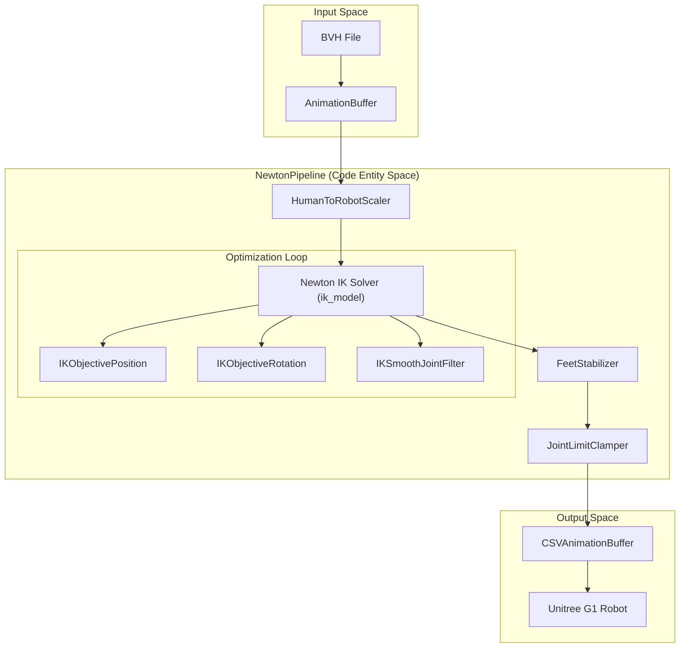
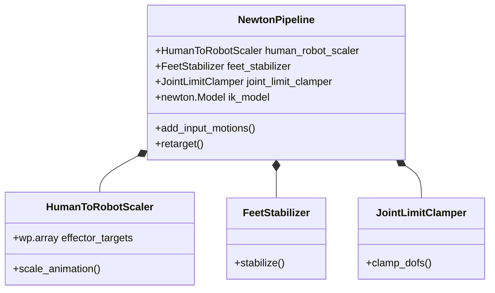

<!-- source: DeepWiki mcp.deepwiki.com · repo NVIDIA/soma-retargeter · page 4 Retargeting Pipeline · fetched 2026-10-26 -->

# Retargeting Pipeline

Relevant source files

The following files were used as context for generating this wiki page:

- [soma_retargeter/pipelines/__init__.py](soma_retargeter/pipelines/__init__.py)
- [soma_retargeter/pipelines/newton_pipeline.py](soma_retargeter/pipelines/newton_pipeline.py)
- [soma_retargeter/pipelines/utils.py](soma_retargeter/pipelines/utils.py)

The retargeting pipeline is the central engine of the SOMA Retargeter, responsible for transforming human motion data (BVH) into robot-executable joint commands (CSV). This process is managed by the `NewtonPipeline` class, which orchestrates several specialized stages including spatial scaling, optimization-based Inverse Kinematics (IK), and physical stabilization.

### Pipeline Overview

The pipeline operates by consuming an `AnimationBuffer` representing human motion and passing it through a series of transformations to map it onto a target robot model, such as the Unitree G1 [soma_retargeter/pipelines/newton_pipeline.py:29-37](). The pipeline is designed to handle both single-frame interactive updates and high-throughput batch processing.

#### High-Level Data Flow

The following diagram illustrates how data moves from the input BVH through the various code entities within the `NewtonPipeline`.

**Diagram: Retargeting Data Flow**

Sources: [soma_retargeter/pipelines/newton_pipeline.py:131-160](), [soma_retargeter/pipelines/newton_pipeline.py:236-260]()

---

### Pipeline Stages

The `NewtonPipeline` coordinates four primary stages to ensure the resulting motion is both visually accurate and kinematically valid for the target hardware.

#### 1. Human-to-Robot Scaling
Before IK solving begins, the human motion must be scaled to match the proportions of the target robot. The `HumanToRobotScaler` uses a configuration-driven approach to calculate scale ratios based on the human's height relative to the robot's model height [soma_retargeter/pipelines/newton_pipeline.py:77-78](). It produces target effector transforms that the IK solver will attempt to reach.

For details, see [Human-to-Robot Scaling](#4.1).

#### 2. IK Solving with Newton
The core of the retargeting is an optimization-based IK solve using the `newton` library. The pipeline builds a `newton.Model` from the robot's MJCF definition [soma_retargeter/pipelines/newton_pipeline.py:73-75](). It applies multiple objectives, including position and rotation targets for effectors, joint limit constraints, and a custom `IKSmoothJointFilter` to prevent temporal jitter [soma_retargeter/pipelines/newton_pipeline.py:202-225]().

For details, see [IK Solving with Newton](#4.2).

#### 3. Feet Stabilization
To prevent foot sliding and ensure stable ground contact, the `FeetStabilizer` performs a post-IK adjustment. It uses a two-bone IK chain logic to anchor the robot's feet to the ground or specific hint locations [soma_retargeter/pipelines/newton_pipeline.py:105-106](). This stage is critical for maintaining the physical plausibility of the motion on a humanoid platform.

For details, see [Feet Stabilization](#4.3).

#### 4. Joint Limit Clamping and Post-Processing
The final stage ensures the generated joint angles strictly adhere to the hardware's Degrees of Freedom (DOF) limits. The `JointLimitClamper` processes the IK output to enforce safety boundaries [soma_retargeter/pipelines/newton_pipeline.py:106](). Additionally, the pipeline handles "warm-up" frames to initialize the solver state smoothly before the actual motion begins [soma_retargeter/pipelines/newton_pipeline.py:108-116]().

For details, see [Joint Limit Clamping and Post-Processing](#4.4).

---

### System Integration

The pipeline is initialized by specifying a `SourceType` and `TargetType` [soma_retargeter/pipelines/newton_pipeline.py:53-54](). It automatically resolves the correct JSON configurations (e.g., `soma_to_g1_retargeter_config.json`) using utility functions [soma_retargeter/pipelines/utils.py:120-144]().

**Diagram: Pipeline Component Association**

Sources: [soma_retargeter/pipelines/newton_pipeline.py:29-118](), [soma_retargeter/pipelines/utils.py:10-18]()

| Feature | Description | File Reference |
| :--- | :--- | :--- |
| **IK Iterations** | Number of solver iterations per frame (Default: 24) | [soma_retargeter/pipelines/newton_pipeline.py:22]() |
| **Initialization** | Uses a zero-pose frame to stabilize the solver | [soma_retargeter/pipelines/newton_pipeline.py:111-116]() |
| **GPU Acceleration** | Uses NVIDIA Warp for scaling and pose computations | [soma_retargeter/pipelines/newton_pipeline.py:4]() |
| **Multi-Motion** | Supports batching multiple BVH inputs into one pipeline run | [soma_retargeter/pipelines/newton_pipeline.py:131-143]() |

Sources: [soma_retargeter/pipelines/newton_pipeline.py:1-200](), [soma_retargeter/pipelines/utils.py:1-145]()

---

