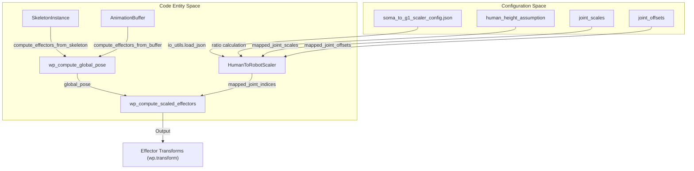
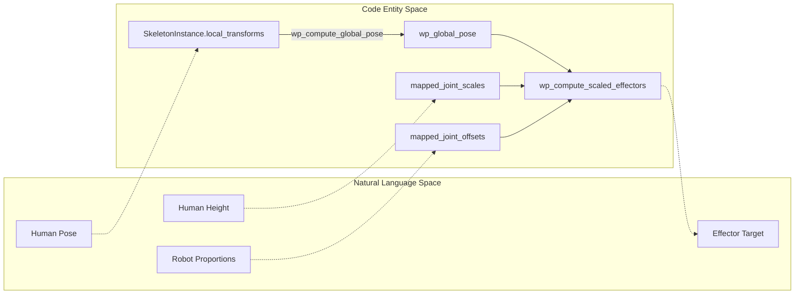

<!-- source: DeepWiki mcp.deepwiki.com · repo NVIDIA/soma-retargeter · page 4.1 Human-to-Robot Scaling · fetched 2026-10-26 -->

# Human-to-Robot Scaling

Relevant source files

The following files were used as context for generating this wiki page:

- [soma_retargeter/configs/unitree_g1/soma_to_g1_scaler_config.json](soma_retargeter/configs/unitree_g1/soma_to_g1_scaler_config.json)
- [soma_retargeter/robotics/__init__.py](soma_retargeter/robotics/__init__.py)
- [soma_retargeter/robotics/human_to_robot_scaler.py](soma_retargeter/robotics/human_to_robot_scaler.py)

The `HumanToRobotScaler` class is a core component of the retargeting pipeline responsible for mapping human skeletal motion to robot-aligned effector targets. It handles the geometric discrepancies between human and robot proportions by applying configurable scale ratios and coordinate offsets. This process ensures that the IK solver targets locations that are physically reachable and anatomically sensible for the target robot hardware, such as the Unitree G1.

### Core Logic and Scaling Math

The scaler operates by transforming human joint positions into "effector" targets. This involves three primary transformations:
1.  **Global Height Scaling**: A global ratio is computed by comparing the actual human subject's height to a `human_height_assumption` defined in the configuration [soma_retargeter/robotics/human_to_robot_scaler.py:22-25]().
2.  **Per-Joint Scaling**: Specific joints (e.g., "LeftLeg", "RightArm") can have individual scale factors to account for different limb proportions [soma_retargeter/configs/unitree_g1/soma_to_g1_scaler_config.json:5-27]().
3.  **Joint Offsets**: Local translation and rotation offsets are applied to align the human joint's coordinate system with the robot's expected effector frame [soma_retargeter/robotics/human_to_robot_scaler.py:27-33]().

### System Architecture: Human-to-Robot Mapping

The following diagram illustrates how the `HumanToRobotScaler` consumes configuration data and skeletal poses to produce effector transforms.

**Figure 1: Scaling Data Flow**

**Sources:** [soma_retargeter/robotics/human_to_robot_scaler.py:13-47](), [soma_retargeter/configs/unitree_g1/soma_to_g1_scaler_config.json:1-127]()

---

### Implementation Details

#### Initialization and Configuration
The `HumanToRobotScaler` is initialized with a `Skeleton`, the human's height, and a path to a JSON configuration file [soma_retargeter/robotics/human_to_robot_scaler.py:17-20](). During `__init__`, it:
*   Calculates a height ratio: `ratio = human_height / config['human_height_assumption']` [soma_retargeter/robotics/human_to_robot_scaler.py:22]().
*   Pre-multiplies all `joint_scales` by this ratio [soma_retargeter/robotics/human_to_robot_scaler.py:24-25]().
*   Converts JSON offset arrays into `wp.transform` objects [soma_retargeter/robotics/human_to_robot_scaler.py:29-33]().
*   Maps joint names to internal indices for efficient GPU processing [soma_retargeter/robotics/human_to_robot_scaler.py:38-41]().

#### GPU-Accelerated Computation
The class provides two primary methods for computing effectors, both utilizing NVIDIA Warp kernels for high-performance GPU execution:

| Method | Purpose | Input |
| :--- | :--- | :--- |
| `compute_effectors_from_skeleton` | Single frame computation for interactive use. | `SkeletonInstance` |
| `compute_effectors_from_buffer` | Batched computation for full animations. | `AnimationBuffer` |

Both methods follow a two-step process:
1.  **Global Pose Computation**: Calls `pose_utils.wp_compute_global_pose` to convert local joint transforms into world-space transforms [soma_retargeter/robotics/human_to_robot_scaler.py:81-89]().
2.  **Effector Scaling**: Launches `compute_scaled_effectors_kernel` which applies the final offsets and scales [soma_retargeter/robotics/human_to_robot_scaler.py:91-102]().

**Sources:** [soma_retargeter/robotics/human_to_robot_scaler.py:57-129](), [soma_retargeter/robotics/human_to_robot_scaler.py:131-163]()

---

### Scaling Logic: Natural Language to Code Entity Mapping

The transformation from raw human motion to robot-ready effectors involves several internal code entities and mathematical steps.

**Figure 2: Transformation Pipeline**

**Sources:** [soma_retargeter/robotics/human_to_robot_scaler.py:57-129](), [soma_retargeter/utils/pose_utils.py:7-10]()

### Configuration Structure
The scaler relies on a specific JSON schema found in `soma_to_g1_scaler_config.json`. Key sections include:

*   **`human_height_assumption`**: The reference height (in meters) for which the base `joint_scales` were authored [soma_retargeter/configs/unitree_g1/soma_to_g1_scaler_config.json:4]().
*   **`joint_scales`**: Multipliers for specific bone lengths (e.g., `LeftLeg: 0.86`) [soma_retargeter/configs/unitree_g1/soma_to_g1_scaler_config.json:5-27]().
*   **`joint_offsets`**: A dictionary where each key is a joint name and the value is a list containing a translation `[x, y, z]` and a rotation quaternion `[x, y, z, w]` [soma_retargeter/configs/unitree_g1/soma_to_g1_scaler_config.json:49-126]().

**Sources:** [soma_retargeter/configs/unitree_g1/soma_to_g1_scaler_config.json:1-127]()

---

