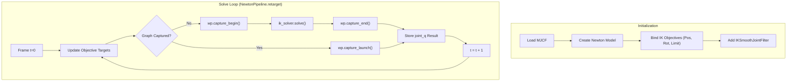

<!-- source: DeepWiki mcp.deepwiki.com · repo NVIDIA/soma-retargeter · page 4.2 IK Solving with Newton · fetched 2026-10-26 -->

# IK Solving with Newton

<details>
<summary>Relevant source files</summary>

The following files were used as context for generating this wiki page:

- [soma_retargeter/configs/unitree_g1/soma_to_g1_retargeter_config.json](soma_retargeter/configs/unitree_g1/soma_to_g1_retargeter_config.json)
- [soma_retargeter/pipelines/ik_objectives.py](soma_retargeter/pipelines/ik_objectives.py)
- [soma_retargeter/pipelines/newton_pipeline.py](soma_retargeter/pipelines/newton_pipeline.py)
- [soma_retargeter/utils/newton_utils.py](soma_retargeter/utils/newton_utils.py)

</details>


The IK Solving stage is the core of the retargeting pipeline, responsible for finding a set of robot joint angles that satisfy the target effector transforms produced by the human-to-robot scaling stage. This process utilizes the **Newton** optimization-based IK solver, which minimizes a multi-objective cost function across the robot's degrees of freedom (DOFs).

## Solver Configuration and Model Building

The `NewtonPipeline` initializes a Newton `Model` based on the target robot's MJCF definition. For the Unitree G1, it loads the model from `mjcf/g1_29dof_rev_1_0.xml` using `newton.ModelBuilder` [soma_retargeter/pipelines/newton_pipeline.py:73-75]().

The solver is configured with a specific number of iterations (default 24) and weights for various objectives defined in the retargeter configuration [soma_retargeter/pipelines/newton_pipeline.py:64-66]().

### IK Mapping
The mapping between the source human skeleton joints and the target robot body links is defined in `ik_map` within the configuration file [soma_retargeter/configs/unitree_g1/soma_to_g1_retargeter_config.json:24-109](). Each entry specifies:
*   `t_body` / `r_body`: The target Newton body link for position and rotation.
*   `t_weight` / `r_weight`: The importance of the position and rotation objectives for this specific link.

**Newton Solver Setup Data Flow**

| Component | Source | Role |
| :--- | :--- | :--- |
| `ModelBuilder` | `newton.ModelBuilder` | Loads MJCF and builds the differentiable robot model [soma_retargeter/pipelines/newton_pipeline.py:73-75](). |
| `IKObjectivePosition` | `newton.ik` | Minimizes distance between scaled human joint and robot link [soma_retargeter/pipelines/newton_pipeline.py:226-231](). |
| `IKObjectiveRotation` | `newton.ik` | Minimizes orientation difference between human and robot links [soma_retargeter/pipelines/newton_pipeline.py:233-238](). |
| `IKObjectiveJointLimit` | `newton.ik` | Penalizes joints exceeding their MJCF-defined soft limits [soma_retargeter/pipelines/newton_pipeline.py:240-244](). |
| `IKSmoothJointFilter` | `soma_retargeter.pipelines.ik_objectives` | Custom objective for smooth limit avoidance [soma_retargeter/pipelines/ik_objectives.py:92-104](). |

**Sources:** [soma_retargeter/pipelines/newton_pipeline.py:59-118](), [soma_retargeter/configs/unitree_g1/soma_to_g1_retargeter_config.json:24-109]()

## Custom Objective: IKSmoothJointFilter

The `IKSmoothJointFilter` is a custom `ik.IKObjective` that applies an inverse Gaussian filter to joint coordinates as they approach their limits. Unlike standard hard limits, this provides a smooth gradient that helps the optimizer stay within the valid workspace without sudden discontinuities.

### Implementation Details
*   **Kernel:** It uses `_wp_smooth_joint_filter_func` to calculate a penalty based on the distance from the joint center `c` and a `padding_limit` [soma_retargeter/pipelines/ik_objectives.py:11-28]().
*   **Masking:** It supports `coord_masks`, allowing the filter to be applied with different strengths to specific joints (e.g., shoulders vs. wrists) [soma_retargeter/pipelines/ik_objectives.py:114-122]().
*   **Analytic Jacobian:** It implements `supports_analytic()` to provide a diagonal Jacobian for performance [soma_retargeter/pipelines/ik_objectives.py:161-162](), [soma_retargeter/pipelines/ik_objectives.py:72-90]().

**Sources:** [soma_retargeter/pipelines/ik_objectives.py:92-195]()

## Execution Loop and CUDA Graph Capture

To achieve high performance, the pipeline utilizes **CUDA Graph Capture**. The IK solve for a single frame is recorded into a graph, which is then replayed for every subsequent frame in the animation buffer.

### Frame-by-Frame Solve Loop
1.  **Initialization Frames:** Prepend transition frames from a "Zero Pose" to the start of the animation to ensure a stable solver start [soma_retargeter/utils/newton_utils.py:64-127]().
2.  **Graph Capture:** On the first frame, `ik_solver.solve()` is called inside a `wp.capture_begin()` block [soma_retargeter/pipelines/newton_pipeline.py:263-272]().
3.  **Playback:** For all remaining frames, the captured graph is launched via `wp.capture_launch()`, significantly reducing CPU overhead [soma_retargeter/pipelines/newton_pipeline.py:284-285]().
4.  **Warm-start:** The solution from frame `t` is used as the initial guess for frame `t+1` [soma_retargeter/pipelines/newton_pipeline.py:280-281]().

**Newton Solver Execution Logic**



**Sources:** [soma_retargeter/pipelines/newton_pipeline.py:246-300](), [soma_retargeter/utils/newton_utils.py:64-84]()

## Performance and Constraints

| Feature | Entity / Variable | Implementation Detail |
| :--- | :--- | :--- |
| **Iteration Count** | `self.ik_iterations` | Controls the Newton-Raphson steps per frame [soma_retargeter/pipelines/newton_pipeline.py:64](). |
| **Joint Masks** | `smooth_joint_filter_coord_masks` | Per-joint scaling for the smooth filter [soma_retargeter/pipelines/newton_pipeline.py:94-97](). |
| **Coordinate Masking** | `newton_utils.create_joint_coord_masks` | Maps body link names to joint coordinate indices [soma_retargeter/utils/newton_utils.py:33-61](). |
| **Post-Processing** | `JointLimitClamper` | Final pass to ensure hard limits are never breached [soma_retargeter/pipelines/newton_pipeline.py:106](). |

**Sources:** [soma_retargeter/pipelines/newton_pipeline.py:64-116](), [soma_retargeter/utils/newton_utils.py:33-61]()

## Code Entity Relationship

The following diagram bridges the logical retargeting concepts to the specific classes and functions implemented in the `pipelines` and `utils` modules.

**Newton IK System Map**

```mermaid
classDiagram
    class NewtonPipeline {
        +ik_model: newton.Model
        +ik_solver: newton.ik.IKSolver
        +retarget(buffers, offsets)
        -_build_target_mapping()
    }
    class IKSmoothJointFilter {
        +joint_limit_lower: wp.array
        +joint_limit_upper: wp.array
        +compute_residuals()
        +compute_jacobian()
    }
    class newton_utils {
        +create_joint_coord_masks()
        +create_buffer_with_initialization_frames()
    }
    
    NewtonPipeline "1" *-- "1" IKSmoothJointFilter : uses
    NewtonPipeline ..> newton_utils : calls
    IKSmoothJointFilter --|> "newton.ik.IKObjective" : inherits
```

**Sources:** [soma_retargeter/pipelines/newton_pipeline.py:29-118](), [soma_retargeter/pipelines/ik_objectives.py:92-123](), [soma_retargeter/utils/newton_utils.py:33-68]()

---

