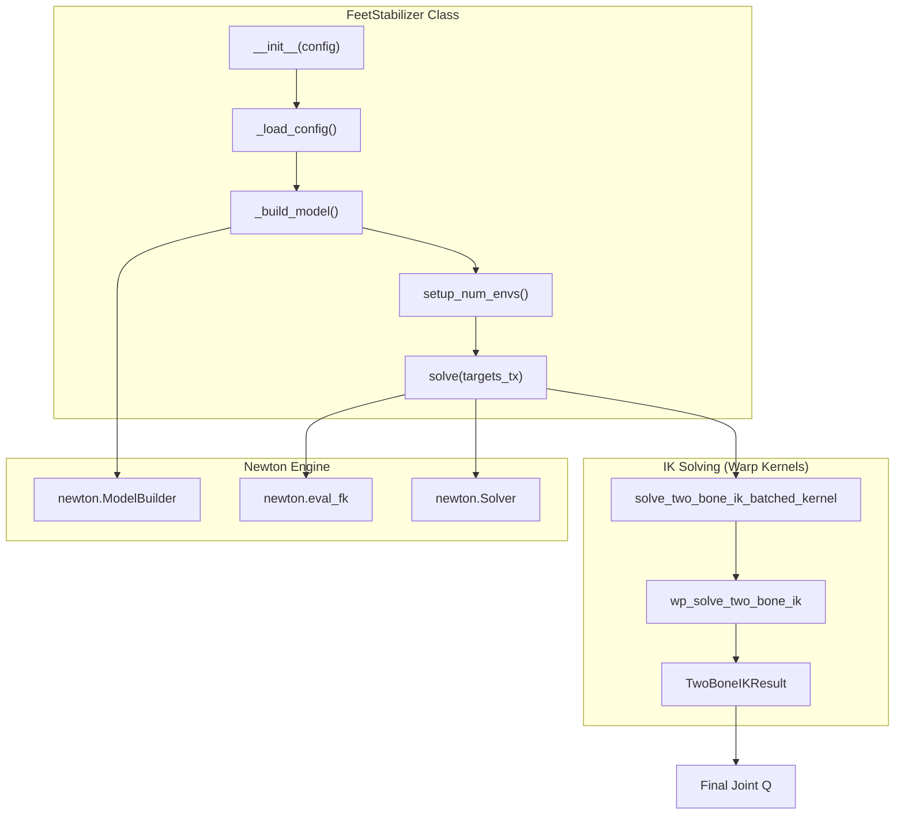
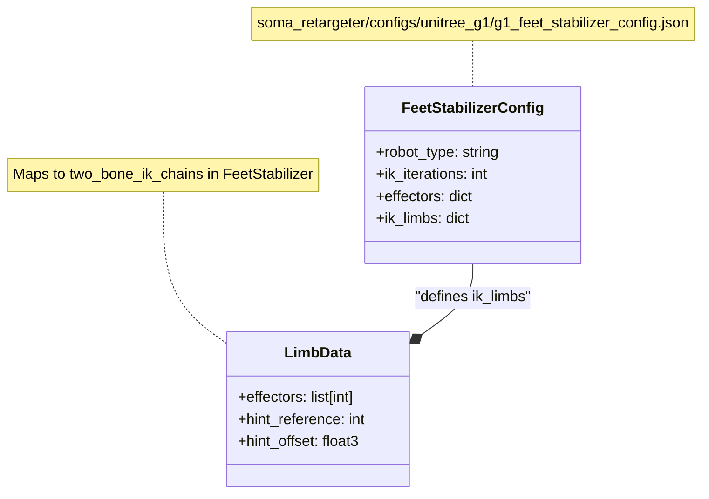

<!-- source: DeepWiki mcp.deepwiki.com · repo NVIDIA/soma-retargeter · page 4.3 Feet Stabilization · fetched 2026-10-26 -->

# Feet Stabilization

Relevant source files

The following files were used as context for generating this wiki page:

- [soma_retargeter/animation/ik.py](soma_retargeter/animation/ik.py)
- [soma_retargeter/configs/unitree_g1/g1_feet_stabilizer_config.json](soma_retargeter/configs/unitree_g1/g1_feet_stabilizer_config.json)
- [soma_retargeter/pipelines/feet_stabilizer.py](soma_retargeter/pipelines/feet_stabilizer.py)

The `FeetStabilizer` class provides a specialized post-processing stage in the retargeting pipeline designed to ensure robust foot-ground contact and leg posture. While the main Newton IK solver handles full-body posing, the `FeetStabilizer` applies a high-fidelity, analytic two-bone IK solve to the leg chains (hip-knee-ankle) to correct for any floating or ground penetration that may persist after the global optimization.

### System Overview

The stabilizer operates by anchoring the pelvis and solving for the leg joints using a batched Warp kernel. It uses a configuration-driven approach to define which joints constitute the "limbs" and where the end-effectors should be placed relative to the ground or target transforms.

#### Key Responsibilities
*   **Pelvis Anchoring**: Maintains the root position of the lower body while leg adjustments are made [soma_retargeter/pipelines/feet_stabilizer.py:125-125]().
*   **Analytic IK Solve**: Uses a trigonometric "Two-Bone IK" approach to calculate precise joint angles for the hip and knee [soma_retargeter/animation/ik.py:19-89]().
*   **Hint-Based Bending**: Uses "hint" offsets to ensure knees bend in the correct anatomical direction (e.g., forward for the Unitree G1) [soma_retargeter/animation/ik.py:66-67]().
*   **Batch Processing**: Executes the stabilization across multiple environments or animation frames simultaneously using CUDA kernels [soma_retargeter/pipelines/feet_stabilizer.py:111-150]().

---

### Data Flow and Architecture

The `FeetStabilizer` bridges the gap between the high-level retargeting logic and low-level geometric IK solvers.

#### System Architecture Diagram
This diagram illustrates how the `FeetStabilizer` interacts with the Newton physics engine and the Warp-based IK utilities.

Sources: [soma_retargeter/pipelines/feet_stabilizer.py:17-70](), [soma_retargeter/animation/ik.py:12-112]()

---

### The Two-Bone IK Algorithm

The core logic resides in `wp_solve_two_bone_ik`, which implements an analytic solver for a chain consisting of a root (A), mid (B), and tip (C) joint.

#### Geometric Calculation
1.  **Target Blending**: The target position is blended with the current tip position based on `in_weight` [soma_retargeter/animation/ik.py:51-51]().
2.  **Cosine Rule**: The interior angles for joints A and B are calculated using the Law of Cosines to ensure the distance from root to tip matches the distance to the target [soma_retargeter/animation/ik.py:63-64]().
3.  **Bend Plane**: A rotation axis is determined by the cross product of the limb vector and a hint vector. This prevents the "knee" from flipping or bending backward [soma_retargeter/animation/ik.py:66-67]().
4.  **Transform Updates**: The solver updates the local rotations and propagates them to world space, ensuring the end-effector matches the target orientation via `wp.quat_slerp` [soma_retargeter/animation/ik.py:87-87]().

#### Two-Bone IK Data Structure
| Field | Type | Description |
| :--- | :--- | :--- |
| `root` | `wp.transform` | The solved world transform for the hip [soma_retargeter/animation/ik.py:14-14](). |
| `mid` | `wp.transform` | The solved world transform for the knee [soma_retargeter/animation/ik.py:15-15](). |
| `tip` | `wp.transform` | The solved world transform for the ankle/foot [soma_retargeter/animation/ik.py:16-16](). |

Sources: [soma_retargeter/animation/ik.py:12-16](), [soma_retargeter/animation/ik.py:19-89]()

---

### Configuration and Mapping

The stabilizer is configured via a JSON file (e.g., `g1_feet_stabilizer_config.json`), which maps robot-specific link names to the IK solver's expected limb structure.

#### Config Structure Entity Map
This diagram maps the JSON configuration keys to the internal logic of the `FeetStabilizer`.

Sources: [soma_retargeter/configs/unitree_g1/g1_feet_stabilizer_config.json:1-29](), [soma_retargeter/pipelines/feet_stabilizer.py:45-48]()

#### Key Configuration Parameters
*   **`effectors`**: A dictionary of joint names and their corresponding position/rotation weights used during the final Newton optimization pass [soma_retargeter/configs/unitree_g1/g1_feet_stabilizer_config.json:6-14]().
*   **`ik_limbs`**: Defines the `left_leg` and `right_leg` chains. Each limb specifies three indices corresponding to the `effectors` list (Root, Mid, Tip) [soma_retargeter/configs/unitree_g1/g1_feet_stabilizer_config.json:17-28]().
*   **`hint_offset`**: A `vec3` (e.g., `[0.25, 0.0, 0.25]`) that defines a world-space direction relative to a reference joint to guide knee bending [soma_retargeter/configs/unitree_g1/g1_feet_stabilizer_config.json:21-21]().

---

### Implementation Details: `solve()`

The `solve()` method executes the stabilization pipeline. It is typically called after the main retargeting pass to "clean up" the lower body pose.

1.  **Batched Execution**: It launches `solve_two_bone_ik_batched_kernel`, which iterates over every environment (frame) in parallel [soma_retargeter/pipelines/feet_stabilizer.py:111-122]().
2.  **Hint Calculation**: For each leg, it calculates a world-space hint position by transforming the `hint_offset` by the current world transform of the `hint_reference` joint [soma_retargeter/pipelines/feet_stabilizer.py:131-134]().
3.  **Newton Refinement**: After the analytic IK solve provides the target transforms for the hip, knee, and ankle, a Newton solver (`self.solver.solve`) is invoked to find the final joint coordinates (`joint_q`) that satisfy these transforms while respecting joint limits [soma_retargeter/pipelines/feet_stabilizer.py:155-162]().

Sources: [soma_retargeter/pipelines/feet_stabilizer.py:95-162](), [soma_retargeter/pipelines/feet_stabilizer.py:111-150]()

---

