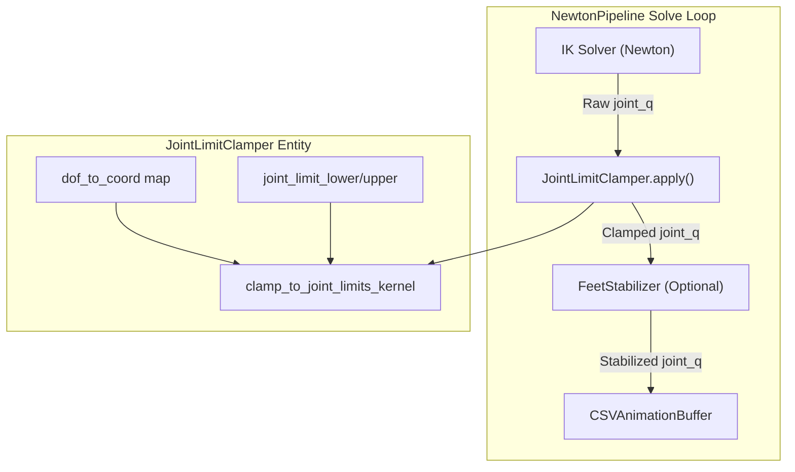
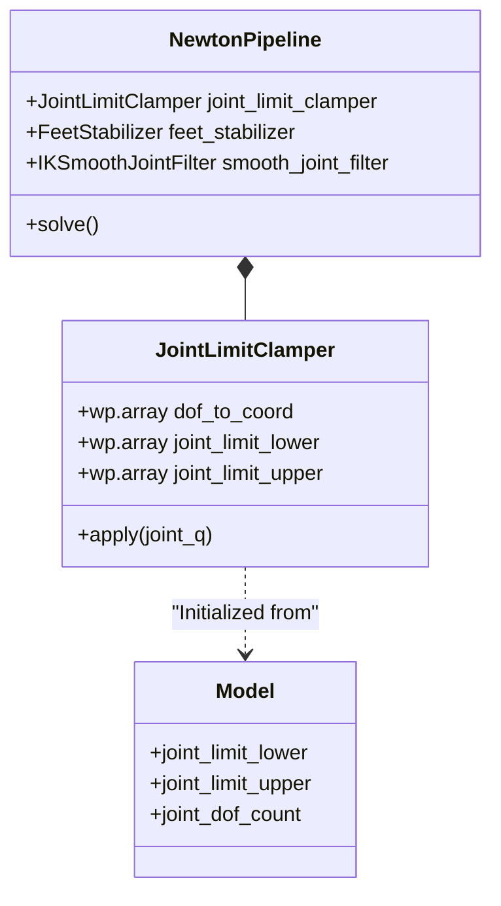

<!-- source: DeepWiki mcp.deepwiki.com · repo NVIDIA/soma-retargeter · page 4.4 Joint Limit Clamping and Post-Processing · fetched 2026-10-26 -->

# Joint Limit Clamping and Post-Processing

Relevant source files

The following files were used as context for generating this wiki page:

- [soma_retargeter/pipelines/joint_limit_clamper.py](soma_retargeter/pipelines/joint_limit_clamper.py)
- [soma_retargeter/pipelines/newton_pipeline.py](soma_retargeter/pipelines/newton_pipeline.py)

The final stage of the retargeting pipeline ensures that the motion generated by the Inverse Kinematics (IK) solver adheres to the physical constraints of the target hardware (Unitree G1) and transitions smoothly from a rest pose into the retargeted motion. This is achieved through the `JointLimitClamper` class and a multi-phase initialization strategy within the `NewtonPipeline`.

### JointLimitClamper Implementation

The `JointLimitClamper` is a utility designed to enforce hard hardware limits on joint positions. While the Newton IK solver includes a `IKObjectiveJointLimit` objective to pull joints toward their valid ranges [soma_retargeter/pipelines/newton_pipeline.py:65-65](), numerical solvers can occasionally overshoot these boundaries. The clamper acts as a safety pass to ensure every degree of freedom (DOF) is strictly within the robot's specification.

#### Data Mapping
During initialization, the clamper maps the robot model's Degrees of Freedom (DOFs) to their corresponding coordinate indices in the `joint_q` configuration vector. This is necessary because Newton's internal representation of joint states may differ from the flat array used for hardware commands.

| Component | Source | Role |
| :--- | :--- | :--- |
| `n_dofs` | `model.joint_dof_count` | Number of velocity-level degrees of freedom. |
| `n_coords` | `model.joint_coord_count` | Number of position-level coordinates (q). |
| `joint_limit_lower` | `model.joint_limit_lower` | Hardware minimum bounds for each DOF. |
| `joint_limit_upper` | `model.joint_limit_upper` | Hardware maximum bounds for each DOF. |

Sources: [soma_retargeter/pipelines/joint_limit_clamper.py:12-28]()

#### GPU-Accelerated Clamping
The clamping operation is performed via a Warp kernel, `clamp_to_joint_limits_kernel`, which processes all DOFs across all batches in parallel.

**Logic Flow: Clamping Kernel**
1. Retrieve the `dof_idx` and `env` (batch index) from the Warp thread ID [soma_retargeter/pipelines/joint_limit_clamper.py:54-54]().
2. Look up the coordinate index using `in_dof_to_coord` [soma_retargeter/pipelines/joint_limit_clamper.py:55-55]().
3. Apply `wp.clamp` to the value in `inout_joint_q` using the lower and upper limits for that specific DOF [soma_retargeter/pipelines/joint_limit_clamper.py:59-62]().

Sources: [soma_retargeter/pipelines/joint_limit_clamper.py:47-71]()

### Initialization and Stabilization Strategy

To prevent jerky movements at the start of a retargeted clip, the `NewtonPipeline` implements a "warm-up" strategy using initialization and stabilization frames.

#### Phase 1: Initialization Frames
The pipeline prepends a set number of frames (default 10) where the robot is held in a static `initialization_pose` [soma_retargeter/pipelines/newton_pipeline.py:108-116](). This pose is typically a standard "Zero" or "T-Pose" defined in a BVH file (e.g., `soma_zero_frame0.bvh`).

#### Phase 2: Stabilization and Weight Ramping
Following the initialization frames, a set of "stabilization frames" (default 5) are used to transition from the static pose to the first frame of the actual motion [soma_retargeter/pipelines/newton_pipeline.py:116-116](). 

During this phase, the weight of the `IKSmoothJointFilter` is dynamically adjusted. The `smooth_joint_filter_weight` is multiplied by a ramp-up factor:
`weight = base_weight * min(1.0, frame_index / num_stabilization_frames)`

This allows the IK solver to gradually prioritize temporal smoothness, preventing the robot from "snapping" into the first frame of the human motion.

Sources: [soma_retargeter/pipelines/newton_pipeline.py:25-26](), [soma_retargeter/pipelines/newton_pipeline.py:108-116]()

### System Entity Mapping

The following diagram illustrates how the `JointLimitClamper` and stabilization logic integrate into the broader `NewtonPipeline` execution flow.

**Post-Processing Data Flow**

Sources: [soma_retargeter/pipelines/newton_pipeline.py:19-20](), [soma_retargeter/pipelines/joint_limit_clamper.py:8-11]()

### Code Integration: Clamping in the Pipeline

The `JointLimitClamper` is instantiated during the `NewtonPipeline` initialization if the target is a supported robot like the Unitree G1 [soma_retargeter/pipelines/newton_pipeline.py:106-106](). It is invoked at the end of every frame's IK solve within the main retargeting loop.

**Logic Flow: Frame Post-Processing**
1. **IK Solve**: The Newton solver computes the optimal `joint_q` for the current frame.
2. **Clamping**: `self.joint_limit_clamper.apply(self.joint_q)` is called to enforce hardware limits [soma_retargeter/pipelines/joint_limit_clamper.py:30-43]().
3. **Feet Stabilization**: If enabled, the `FeetStabilizer` further adjusts the leg joints to ensure ground contact [soma_retargeter/pipelines/newton_pipeline.py:105-105]().

**Entity Relationship Diagram**

Sources: [soma_retargeter/pipelines/newton_pipeline.py:29-37](), [soma_retargeter/pipelines/joint_limit_clamper.py:8-12]()

---

