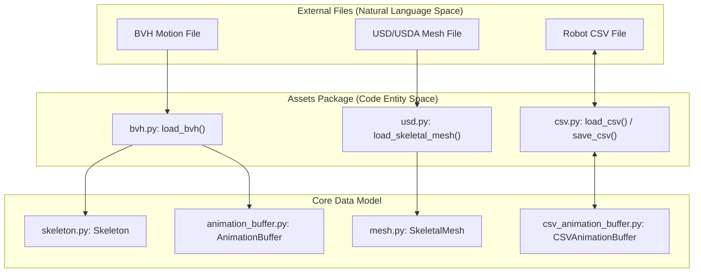
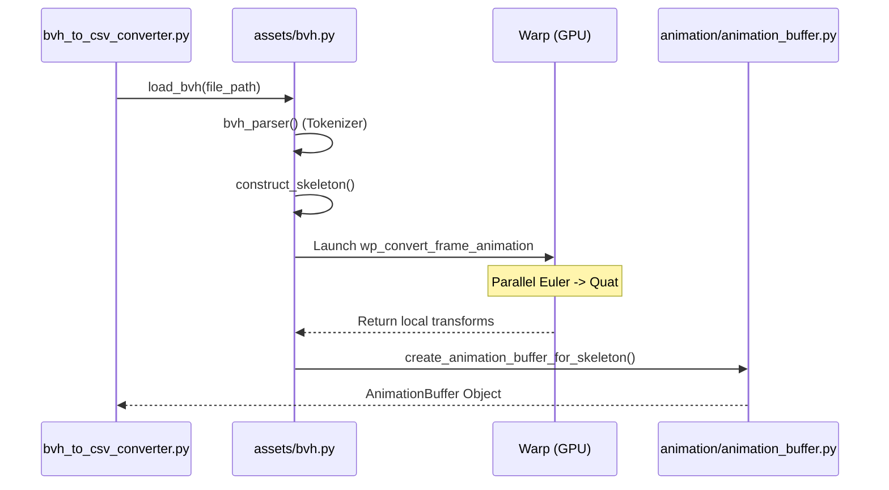

<!-- source: DeepWiki mcp.deepwiki.com · repo NVIDIA/soma-retargeter · page 5 File I/O: BVH, CSV, and USD · fetched 2026-10-26 -->

# File I/O: BVH, CSV, and USD

Relevant source files

The following files were used as context for generating this wiki page:

- [soma_retargeter/assets/__init__.py](soma_retargeter/assets/__init__.py)
- [soma_retargeter/assets/bvh.py](soma_retargeter/assets/bvh.py)
- [soma_retargeter/assets/csv.py](soma_retargeter/assets/csv.py)
- [soma_retargeter/assets/usd.py](soma_retargeter/assets/usd.py)

The `assets` sub-package is the central hub for all file ingestion and export operations within the SOMA Retargeter. It provides specialized importers for motion capture data (BVH) and skeletal mesh geometry (USD), as well as exporters for robot-compatible motion data (CSV). These modules abstract away coordinate system conversions, unit scaling, and data structure transformations to ensure compatibility with the internal `AnimationBuffer` and `Skeleton` models.

### Data Flow Overview

The following diagram illustrates how external file formats are mapped to internal code entities and processed through the system.

**File I/O Entity Mapping**

Sources: [soma_retargeter/assets/__init__.py:1-2](), [soma_retargeter/assets/bvh.py:1510-1512](), [soma_retargeter/assets/csv.py:86-115](), [soma_retargeter/assets/usd.py:9-11]()

---

## 5.1 BVH Parsing (BVHImporter)

The BVH (Biovision Hierarchy) format is the primary source of human motion data. The `BVHImporter` class handles the multi-step process of converting ASCII BVH files into GPU-ready animation data. This involves tokenizing the hierarchy to build a `Skeleton` object and then processing the `MOTION` section.

Key technical components include:
*   **Hierarchy Construction**: The `construct_skeleton()` method parses the `HIERARCHY` block to define joint parents and reference offsets [soma_retargeter/assets/bvh.py:1455-1460]().
*   **GPU Conversion**: Because BVH stores rotations as Euler angles, the importer uses a Warp kernel, `wp_convert_frame_animation`, to perform massively parallel Euler-to-quaternion conversions on the GPU [soma_retargeter/assets/bvh.py:64-89]().
*   **Unit Scaling**: Positions are automatically scaled from centimeters (common in BVH) to meters [soma_retargeter/assets/bvh.py:79-79]().

For details, see [BVH Parsing (BVHImporter)](#5.1).

Sources: [soma_retargeter/assets/bvh.py:64-89](), [soma_retargeter/assets/bvh.py:1440-1460]()

---

## 5.2 CSV Output (CSVAnimationBuffer)

The retargeting pipeline's final output is a CSV file formatted for direct playback on robot hardware (specifically the Unitree G1). The `CSVAnimationBuffer` class manages this data, which consists of a root transform (translation and rotation) followed by 1D Degrees of Freedom (DOF) for each motor.

*   **Configurable Layouts**: The `RobotCSVConfig` protocol allows the system to support different robot joint mappings. The default `UnitreeG129DOF_CSVConfig` defines the 29-DOF structure required for the G1 [soma_retargeter/assets/csv.py:26-43]().
*   **Data Conversion**: The `save_csv()` function converts internal radians and meter-based transforms back into the degrees and centimeters expected by the hardware controllers [soma_retargeter/assets/csv.py:72-81]().
*   **Sampling**: The buffer supports linear interpolation of joint angles via its `sample()` method to match the robot's control frequency.

For details, see [CSV Output (CSVAnimationBuffer)](#5.2).

Sources: [soma_retargeter/assets/csv.py:15-23](), [soma_retargeter/assets/csv.py:115-140]()

---

## 5.3 USD Asset Loading

Universal Scene Description (USD) files are used to load the visual representation of the SOMA body and the target robot. The `assets/usd.py` module uses the `pxr.Usd` (OpenUSD) library to extract geometric and skeletal data.

*   **Coordinate Correction**: USD stages often use different "Up" axes (Y vs Z). The loader automatically computes corrective transforms to align assets with the system's Z-up convention [soma_retargeter/assets/usd.py:121-148]().
*   **Skeletal Mesh Extraction**: It parses `UsdSkel` prims to retrieve bind poses, joint hierarchies, and skinning weights (joint indices and weights per vertex) [soma_retargeter/assets/usd.py:9-10]().
*   **SOMA Body**: The file `soma_base_skel_minimal.usd` serves as the reference mesh for human visualization during the retargeting process.

For details, see [USD Asset Loading](#5.3).

Sources: [soma_retargeter/assets/usd.py:67-79](), [soma_retargeter/assets/usd.py:121-148]()

---

### File I/O Logic Flow

The following diagram demonstrates the internal logic of the `assets` package when processing a motion file.

**Asset Processing Pipeline**

Sources: [soma_retargeter/assets/bvh.py:64-73](), [soma_retargeter/assets/bvh.py:1510-1530](), [soma_retargeter/animation/animation_buffer.py:231-235]()

---

