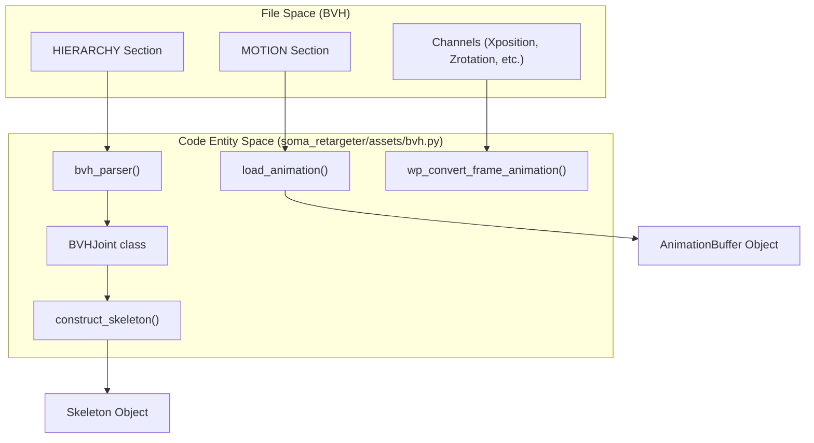
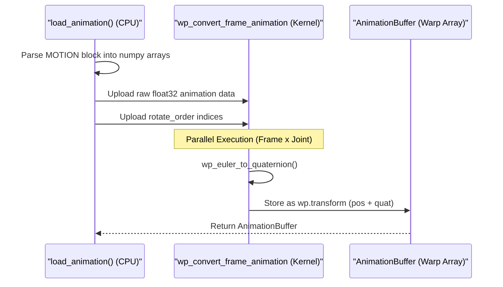

<!-- source: DeepWiki mcp.deepwiki.com · repo NVIDIA/soma-retargeter · page 5.1 BVH Parsing (BVHImporter) · fetched 2026-10-26 -->

# BVH Parsing (BVHImporter)

Relevant source files

The following files were used as context for generating this wiki page:

- [soma_retargeter/assets/bvh.py](soma_retargeter/assets/bvh.py)
- [soma_retargeter/configs/soma/soma_zero_frame0.bvh](soma_retargeter/configs/soma/soma_zero_frame0.bvh)
- [soma_retargeter/utils/math_utils.py](soma_retargeter/utils/math_utils.py)

The `BVHImporter` is the primary interface for ingesting motion capture data into the SOMA Retargeter pipeline. It handles the transition from text-based BVH files to GPU-accelerated `AnimationBuffer` structures. This process involves tokenizing the BVH hierarchy, constructing a skeletal tree, and converting Euler-angle animation channels into normalized quaternions using NVIDIA Warp kernels.

## System Overview and Data Flow

The ingestion process flows from a raw string stream to a structured `Skeleton` object and finally to a GPU-resident `AnimationBuffer`.

### Entity Mapping: File to Code
The following diagram maps the logical components of a BVH file to the specific classes and functions in `soma_retargeter/assets/bvh.py`.

Title: BVH Parsing Entity Mapping

Sources: [soma_retargeter/assets/bvh.py:175-185](), [soma_retargeter/assets/bvh.py:246-250](), [soma_retargeter/assets/bvh.py:328-335]()

## Tokenization and Hierarchy Building

### `bvh_parser()`
The `bvh_parser()` function is a recursive-descent style tokenizer. It processes the BVH file line-by-line to build a tree of `BVHJoint` objects [soma_retargeter/assets/bvh.py:246-326](). 
- It identifies `ROOT`, `JOINT`, and `End Site` keywords to define parent-child relationships [soma_retargeter/assets/bvh.py:265-285]().
- It parses the `OFFSET` values to define the local translation of joints relative to their parents [soma_retargeter/assets/bvh.py:287-290]().
- It records the `CHANNELS` order (e.g., `3 Zrotation Xrotation Yrotation`), which is critical for correct Euler-to-Quaternion conversion later [soma_retargeter/assets/bvh.py:292-300]().

### `construct_skeleton()`
Once the `BVHJoint` tree is built, `construct_skeleton()` flattens this hierarchy into a linear format compatible with the `Skeleton` class [soma_retargeter/assets/bvh.py:328-360]().
- **Joint Indexing**: It assigns a unique integer ID to every joint in a depth-first traversal [soma_retargeter/assets/bvh.py:343-345]().
- **Reference Pose**: It converts the BVH `OFFSET` values (which are in centimeters in many BVH conventions) to meters by multiplying by `0.01` [soma_retargeter/assets/bvh.py:348-350]().
- **Parent Indices**: It generates the `parent_indices` array used for forward kinematics [soma_retargeter/assets/bvh.py:355-357]().

Sources: [soma_retargeter/assets/bvh.py:246-360]()

## Animation Loading and GPU Conversion

The `load_animation()` function converts the raw text numbers in the `MOTION` section into a GPU-backed `AnimationBuffer`.

### Euler to Quaternion Kernel
Because BVH files store rotations as Euler angles in varying orders (XYZ, ZXY, etc.), the system uses a Warp kernel `wp_convert_frame_animation` to perform massive parallel conversion [soma_retargeter/assets/bvh.py:63-89]().

Title: Animation Conversion Pipeline

### Key Functions in Conversion
| Function | Role |
| :--- | :--- |
| `wp_euler_to_quaternion` | Iteratively multiplies axis-angle quaternions based on the `rotation_order` array [soma_retargeter/assets/bvh.py:49-60](). |
| `wp_get_quaternion_from_axis` | Helper to generate a rotation around a specific X(0), Y(1), or Z(2) axis [soma_retargeter/assets/bvh.py:35-47](). |
| `wp_convert_frame_animation` | The main kernel. It handles coordinate scaling (cm to m) and assigns the resulting `wp.transform` to the output buffer [soma_retargeter/assets/bvh.py:63-89](). |

Sources: [soma_retargeter/assets/bvh.py:14-89](), [soma_retargeter/assets/bvh.py:362-452]()

## Convenience Functions

### `load_bvh()`
This is the primary entry point for users [soma_retargeter/assets/bvh.py:455-477](). It orchestrates the entire sequence:
1. Calls `bvh_parser()` to get the joint hierarchy.
2. Calls `construct_skeleton()` to create the `Skeleton` object.
3. Calls `load_animation()` to create the `AnimationBuffer`.
4. Returns a tuple of `(skeleton, animation_buffer)`.

### Visualization Helpers
The `get_global_positions()` function [soma_retargeter/assets/bvh.py:133-143]() is used by the `SkeletonRenderer` to calculate the start and end points of bones in world space. It iterates through the skeleton and uses the parent index to find the vector between a joint and its parent [soma_retargeter/assets/bvh.py:138-141]().

Sources: [soma_retargeter/assets/bvh.py:133-143](), [soma_retargeter/assets/bvh.py:455-477]()

---

