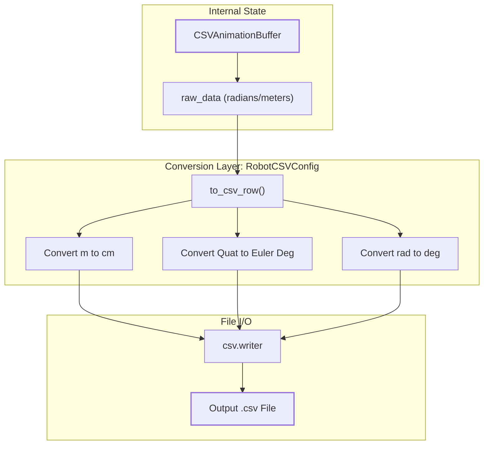
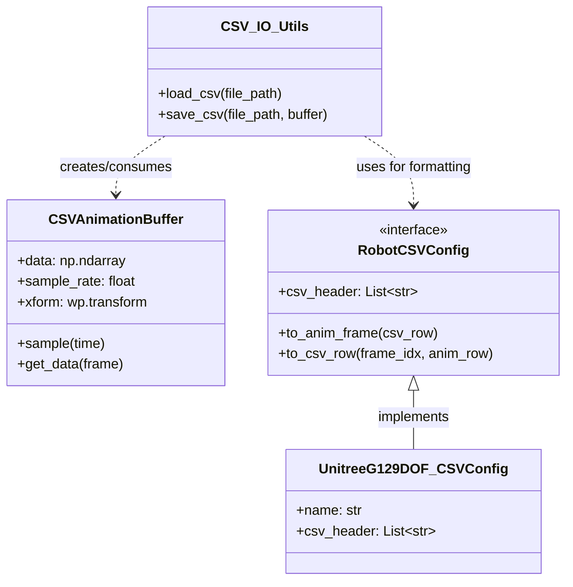

<!-- source: DeepWiki mcp.deepwiki.com · repo NVIDIA/soma-retargeter · page 5.2 CSV Output (CSVAnimationBuffer) · fetched 2026-10-26 -->

# CSV Output (CSVAnimationBuffer)

Relevant source files

The following files were used as context for generating this wiki page:

- [soma_retargeter/assets/csv.py](soma_retargeter/assets/csv.py)
- [soma_retargeter/robotics/csv_animation_buffer.py](soma_retargeter/robotics/csv_animation_buffer.py)

The `CSVAnimationBuffer` class and its associated utilities provide the final stage of the retargeting pipeline, responsible for storing, interpolating, and exporting robot-compatible motion data. While the internal pipeline often works with full skeletal transforms, the CSV output format is specifically designed for robot playback, typically consisting of a root transform (translation and rotation) followed by individual joint Degrees of Freedom (DOF).

## The CSVAnimationBuffer Class

The `CSVAnimationBuffer` serves as a container for retargeted motion data that has been converted into the robot's specific DOF space. Unlike the standard `AnimationBuffer` which stores local transforms for every joint in a hierarchy, this buffer stores raw numerical arrays formatted for CSV export.

### Data Structure and Storage
The class maintains the following key attributes:
*   `data`: A list or array of frames, where each frame is a `np.ndarray` containing root translation, root rotation, and joint angles [[soma_retargeter/robotics/csv_animation_buffer.py:21]]().
*   `sample_rate`: The frequency (FPS) at which the data was captured [[soma_retargeter/robotics/csv_animation_buffer.py:22]]().
*   `xform`: A global offset transform applied to the root during sampling [[soma_retargeter/robotics/csv_animation_buffer.py:23]]().

### Sampling and Interpolation
The `sample()` method allows for continuous time-based playback by interpolating between discrete CSV frames.

| Feature | Implementation Detail |
| :--- | :--- |
| **Time Mapping** | Uses `time_utils.frame_index_from_time` to calculate the floor frame and the fractional blend weight [[soma_retargeter/robotics/csv_animation_buffer.py:72]](). |
| **Root Translation** | Linear interpolation (`wp.lerp`) between `vec3` positions [[soma_retargeter/robotics/csv_animation_buffer.py:81]](). |
| **Root Rotation** | Spherical linear interpolation (`wp.quat_slerp`) between quaternions [[soma_retargeter/robotics/csv_animation_buffer.py:82]](). |
| **Joint DOFs** | Standard linear blending of scalar joint angles [[soma_retargeter/robotics/csv_animation_buffer.py:85]](). |

**Sources:** [[soma_retargeter/robotics/csv_animation_buffer.py:10-88]]()

## CSV Configuration and Robot Mapping

Because different robots have different joint orders and naming conventions, the system uses a `RobotCSVConfig` protocol to define how internal animation data maps to CSV rows.

### Unitree G1 29DOF Configuration
The `UnitreeG129DOF_CSVConfig` class implements the specific layout required for the Unitree G1 humanoid. It defines a header with 43 columns, including the frame index, 3 root translation components, 3 root Euler rotation components, and 29 specific joint DOFs [[soma_retargeter/assets/csv.py:26-43]]().

#### Data Conversion Flow
The configuration handles unit conversions and rotation representation changes:
1.  **Translation**: Converts between meters (internal) and centimeters (CSV) [[soma_retargeter/assets/csv.py:56]](), [[soma_retargeter/assets/csv.py:73]]().
2.  **Root Rotation**: Converts between quaternions (internal) and Euler angles in degrees (CSV) [[soma_retargeter/assets/csv.py:60-61]](), [[soma_retargeter/assets/csv.py:75-76]]().
3.  **Joint Angles**: Converts between radians (internal) and degrees (CSV) [[soma_retargeter/assets/csv.py:64]](), [[soma_retargeter/assets/csv.py:81]]().

### System Data Flow: Animation to CSV

The following diagram illustrates how data moves from the internal `CSVAnimationBuffer` through the configuration layer to the final filesystem output.

**Animation Export Logic**

**Sources:** [[soma_retargeter/assets/csv.py:15-83]](), [[soma_retargeter/robotics/csv_animation_buffer.py:10-45]]()

## Save and Load Functions

The `soma_retargeter.assets.csv` module provides high-level functions to interface with the filesystem.

### `save_csv`
This function iterates through every frame in a `CSVAnimationBuffer`, applies the `to_csv_row` transformation from the provided `RobotCSVConfig`, and writes the resulting strings to a file [[soma_retargeter/assets/csv.py:115-140]]().

### `load_csv`
This function performs the inverse:
1.  Loads raw numerical data using `np.loadtxt` [[soma_retargeter/assets/csv.py:101]]().
2.  Iterates through rows and applies `to_anim_frame` to reconstruct the internal radian/meter representation [[soma_retargeter/assets/csv.py:109-110]]().
3.  Wraps the resulting array in a new `CSVAnimationBuffer` instance via `create_from_raw_data` [[soma_retargeter/assets/csv.py:112]]().

### Class Relationship Diagram

This diagram maps the logical entities to their implementation classes in the codebase.

**Code Entity Mapping**

**Sources:** [[soma_retargeter/assets/csv.py:15-115]](), [[soma_retargeter/robotics/csv_animation_buffer.py:10-45]]()

---

