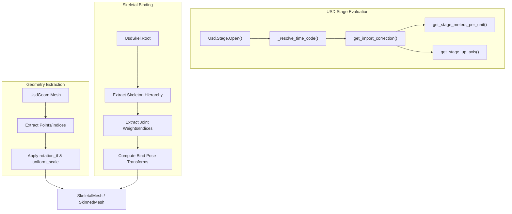

<!-- source: DeepWiki mcp.deepwiki.com · repo NVIDIA/soma-retargeter · page 5.3 USD Asset Loading · fetched 2026-10-26 -->

# USD Asset Loading

<details>
<summary>Relevant source files</summary>

The following files were used as context for generating this wiki page:

- [soma_retargeter/assets/usd.py](soma_retargeter/assets/usd.py)
- [soma_retargeter/configs/soma/__init__.py](soma_retargeter/configs/soma/__init__.py)
- [soma_retargeter/configs/soma/soma_base_skel_minimal.usd](soma_retargeter/configs/soma/soma_base_skel_minimal.usd)

</details>


The USD asset loading subsystem is responsible for parsing Universal Scene Description (USD/USDA) files to extract skeletal hierarchies, bind poses, and skinned mesh geometry. It leverages the `pxr.Usd` (USD Core) libraries for stage traversal and `trimesh` for geometric processing, ensuring that SOMA body meshes and robot models are correctly imported into the internal `SkeletalMesh` data structures.

## System Overview

The primary entry point for USD operations is `soma_retargeter/assets/usd.py`. This module handles the conversion between USD's scene graph representation and the flat, linear arrays used by NVIDIA Warp and the SOMA animation pipeline.

### Key Components

| Component | Role |
| :--- | :--- |
| `pxr.Usd` / `pxr.UsdSkel` | Industry-standard libraries used to traverse the USD stage, evaluate transforms, and access skeletal data. |
| `soma_base_skel_minimal.usd` | The default SOMA body mesh asset containing the reference human topology and skeletal structure. |
| `assets/usd.py` | Contains helper functions for unit conversion, coordinate system alignment, and matrix decomposition. |
| `SkeletalMesh` | The destination data structure that stores vertex positions, indices, and skinning weights. |

## Data Flow: USD to Skeletal Mesh

The loading process involves resolving stage-level metadata (up-axis and units) before extracting geometric data. This ensures that assets authored in different DCC tools (e.g., Maya's Y-up vs. Omniverse's Z-up) are unified into the SOMA coordinate space.

### Import Logic Diagram

"USD Loading Pipeline"

Sources: [soma_retargeter/assets/usd.py:21-51](), [soma_retargeter/assets/usd.py:121-149](), [soma_retargeter/assets/usd.py:54-79]()

## Implementation Details

### Coordinate System Alignment
USD stages can vary in their `upAxis` and `metersPerUnit` metadata. The `get_import_correction` function computes a `wp.transform` (rotation) and a `uniform_scale` factor to map the source USD units into the target application space (typically Z-up, 1.0 = 1 meter) [soma_retargeter/assets/usd.py:121-149]().

- **Y-up to Z-up**: A +90° rotation around the X-axis is applied [soma_retargeter/assets/usd.py:103-109]().
- **Z-up to Y-up**: A -90° rotation around the X-axis is applied [soma_retargeter/assets/usd.py:110-116]().

### Matrix Decomposition
Since USD often stores transforms as 4x4 matrices, the `decompose_matrix` function is used to extract `wp.vec3` positions, `wp.quat` rotations, and scale factors. It specifically handles USD's row-major matrix convention where translation is stored in the 4th row (index 3) [soma_retargeter/assets/usd.py:187-209]().

### Time Code Resolution
A critical detail in `assets/usd.py` is the `_resolve_time_code` function. Many DCC exporters do not author a meaningful "Default" value for animated attributes. The loader prefers the `stage.GetStartTimeCode()` to ensure that the "bind pose" matches the first frame of animation rather than a potentially uninitialized fallback state [soma_retargeter/assets/usd.py:21-45]().

## Entity Mapping: Code to USD

The following diagram maps internal class names to the USD primitives they interact with during the loading process.

"Code Entity to USD Primitive Mapping"
```mermaid
classDiagram
    class SkeletalMesh {
        +points: wp.array
        +indices: wp.array
        +skeleton: Skeleton
    }
    class SkinnedMesh {
        +joint_indices: wp.array
        +joint_weights: wp.array
    }
    class USD_Stage {
        +UsdGeomMesh
        +UsdSkelSkeleton
        +UsdSkelAnimation
    }

    SkeletalMesh ..> "UsdGeom.Mesh" : Parsed from
    SkinnedMesh ..> "UsdSkel.BindingAPI" : Extracts weights from
    Skeleton ..> "UsdSkel.Skeleton" : Extracts hierarchy from
    AnimationBuffer ..> "UsdSkel.Animation" : Samples samples from
```
Sources: [soma_retargeter/assets/usd.py:9-11](), [soma_retargeter/animation/mesh.py:1-20]()

## SOMA Body Mesh Asset

The system uses `soma_base_skel_minimal.usd` as the canonical representation of the SOMA human model. This asset is stored as a USD Large File Storage (LFS) pointer in the repository and contains the mesh topology required for the `SkeletalMeshRenderer` to visualize the retargeting results in real-time [soma_retargeter/configs/soma/soma_base_skel_minimal.usd:1-3]().

### Integration with Trimesh
While USD is used for the skeletal structure and scene hierarchy, the `trimesh` library is utilized for specific geometric operations, such as calculating surface normals or performing ray-casts if needed during mesh processing. The `assets/usd.py` module facilitates the hand-off between `pxr.Usd` data and `trimesh.Trimesh` objects by converting USD `VtArray` types into standard NumPy arrays compatible with `trimesh`.

Sources: [soma_retargeter/assets/usd.py:1-15](), [soma_retargeter/animation/mesh.py:1-20]()

---

