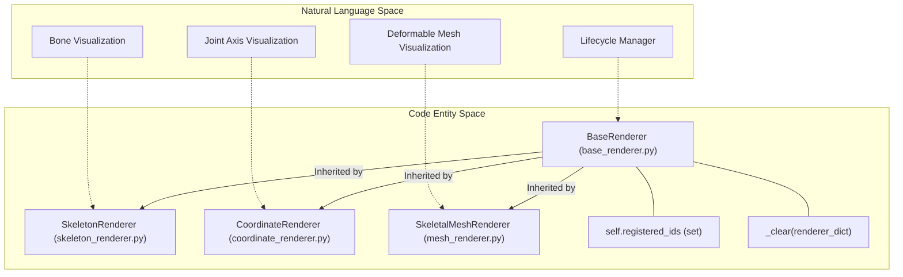
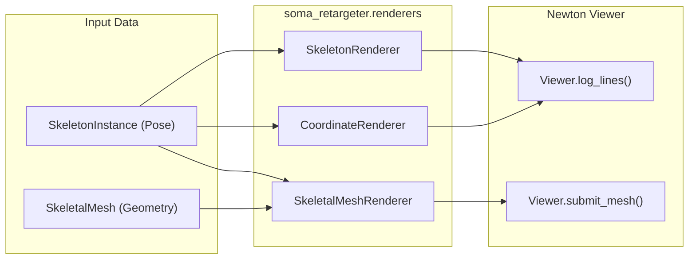

<!-- source: DeepWiki mcp.deepwiki.com · repo NVIDIA/soma-retargeter · page 6 Rendering Subsystem · fetched 2026-10-26 -->

# Rendering Subsystem

Relevant source files

The following files were used as context for generating this wiki page:

- [soma_retargeter/renderers/__init__.py](soma_retargeter/renderers/__init__.py)
- [soma_retargeter/renderers/base_renderer.py](soma_retargeter/renderers/base_renderer.py)

The `soma_retargeter.renderers` sub-package provides a modular visualization framework for the retargeting pipeline. It translates abstract skeletal data and mesh geometry into visual primitives that can be consumed by the Newton viewer's real-time rendering engine.

The subsystem is built around a unified lifecycle managed by the `BaseRenderer` class, which ensures that resources created in the viewer are properly tracked and disposed of to prevent memory leaks during interactive sessions.

### BaseRenderer Lifecycle

The `BaseRenderer` class [soma_retargeter/renderers/base_renderer.py:4-24]() serves as the abstract foundation for all concrete renderers. It provides a standardized mechanism for tracking "registered" objects within the Newton viewer.

*   **Registration**: When a renderer creates a visual object (like a line set or a mesh) in the viewer, it stores the object's unique identifier using `_register_unique_id(id)` [soma_retargeter/renderers/base_renderer.py:10-12]().
*   **Cleanup**: The `_clear(renderer_dict)` method [soma_retargeter/renderers/base_renderer.py:14-23]() iterates through all tracked IDs, calls the object's `destroy()` method if it exists, and removes the reference from the viewer's internal dictionary.

### Renderer Architecture

The subsystem is divided into three specialized renderers, each responsible for a specific aspect of the scene visualization. These renderers utilize NVIDIA Warp kernels to perform high-performance geometry updates on the GPU.

| Renderer | Purpose | Key Code Entities |
| :--- | :--- | :--- |
| **SkeletonRenderer** | Visualizes hierarchies as pyramid-style bone lines. | `SkeletonRenderer`, `_update_skeleton_lines_kernel` |
| **CoordinateRenderer** | Displays RGB axis gizmos at each joint location. | `CoordinateRenderer` |
| **SkeletalMeshRenderer** | Renders deformed skin geometry (e.g., SOMA body). | `SkeletalMeshRenderer`, `SkeletalMesh` |

#### System Entity Mapping

The following diagram illustrates how the abstract rendering concepts map to specific classes and their relationship to the `BaseRenderer` lifecycle.

**Rendering Class Hierarchy**

Sources: [soma_retargeter/renderers/base_renderer.py:4-24]()

### Component Overview

#### Skeleton and Coordinate Renderers
These renderers are primarily used for debugging and visualizing the "wireframe" state of the retargeting. 
*   **SkeletonRenderer**: Draws the hierarchical relationship between joints. It transforms the `SkeletonInstance` global transforms into a set of line segments representing bones.
*   **CoordinateRenderer**: Visualizes the orientation of each joint. This is critical for verifying that the `ik_map` and joint offsets are correctly aligned with the target robot's hardware specifications.

For technical details on Warp kernel implementation and the `log_lines` API, see **[Skeleton and Coordinate Renderers](#6.1)**.

#### Skeletal Mesh Renderer
The `SkeletalMeshRenderer` handles the most computationally intensive part of the visualization: Linear Blend Skinning (LBS). It takes a `SkeletalMesh` object (containing vertices and skinning weights) and deforms it in real-time based on the current pose of a `SkeletonInstance`. 

For details on USD mesh loading and GPU-accelerated deformation, see **[Skeletal Mesh Renderer](#6.2)**.

**Renderer Integration Flow**

Sources: [soma_retargeter/renderers/base_renderer.py:1-24]()

---

