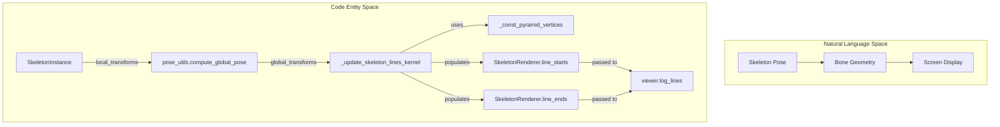
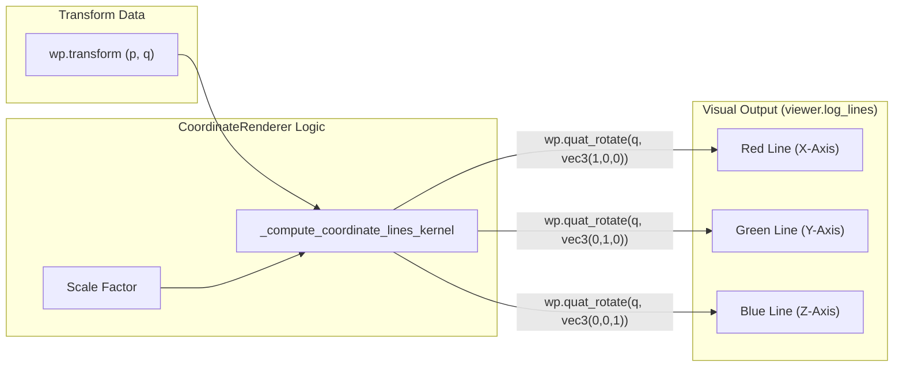

<!-- source: DeepWiki mcp.deepwiki.com · repo NVIDIA/soma-retargeter · page 6.1 Skeleton and Coordinate Renderers · fetched 2026-10-26 -->

# Skeleton and Coordinate Renderers

Relevant source files

The following files were used as context for generating this wiki page:

- [soma_retargeter/renderers/base_renderer.py](soma_retargeter/renderers/base_renderer.py)
- [soma_retargeter/renderers/coordinate_renderer.py](soma_retargeter/renderers/coordinate_renderer.py)
- [soma_retargeter/renderers/skeleton_renderer.py](soma_retargeter/renderers/skeleton_renderer.py)

The SOMA Retargeter provides specialized rendering components to visualize skeletal hierarchies and joint orientations within the Newton viewer. These renderers leverage **NVIDIA Warp** kernels to compute geometry on the GPU, ensuring high-performance visualization of complex characters and retargeting results.

## BaseRenderer Lifecycle

Both the `SkeletonRenderer` and `CoordinateRenderer` inherit from `BaseRenderer`, which provides a standardized mechanism for tracking and cleaning up visual objects registered with the viewer [soma_retargeter/renderers/base_renderer.py:4-24]().

### Registration and Cleanup
The `BaseRenderer` maintains a `set` of unique identifiers (`registered_ids`) representing the lines or gizmos submitted to the viewer [soma_retargeter/renderers/base_renderer.py:8](). 
*   **`_register_unique_id(id)`**: Adds a name (e.g., `/skeleton_0`) to the tracking set [soma_retargeter/renderers/base_renderer.py:10-12]().
*   **`_clear(renderer_dict)`**: Iterates through tracked IDs, calls the `destroy()` method on the corresponding viewer object if it exists, and removes the entry from the viewer's internal dictionary [soma_retargeter/renderers/base_renderer.py:14-21]().

**Sources:** [soma_retargeter/renderers/base_renderer.py:4-24]()

---

## SkeletonRenderer

The `SkeletonRenderer` visualizes a `SkeletonInstance` by drawing pyramid-shaped bone lines between parent and child joints [soma_retargeter/renderers/skeleton_renderer.py:91-92]().

### Bone Geometry Generation
Instead of simple lines, the renderer constructs a 3D pyramid for every bone. This is defined by a constant array of 16 vertices (`_const_pyramid_vertices`) that form the edges of a dual-pyramid shape [soma_retargeter/renderers/skeleton_renderer.py:10-27]().

| Function/Kernel | Role |
| :--- | :--- |
| `_build_bones` | Filters joints based on an optional mask and creates parent-child index pairs [soma_retargeter/renderers/skeleton_renderer.py:126-135](). |
| `_update_skeleton_lines_kernel` | The main entry point for GPU computation. It iterates over every bone and calls `compute_bone_lines` [soma_retargeter/renderers/skeleton_renderer.py:71-89](). |
| `compute_bone_lines` | Calculates the rotation (`wp.quat_between_vectors`) and scaling required to align a pyramid between two joint positions [soma_retargeter/renderers/skeleton_renderer.py:47-69](). |
| `compute_pyramid_vertices` | Applies the calculated transform to the base pyramid vertices to produce world-space line segments [soma_retargeter/renderers/skeleton_renderer.py:32-45](). |

### Data Flow: Skeleton to Viewer
The following diagram illustrates how a `SkeletonInstance` is transformed into line segments for the `viewer.log_lines` API.

**Skeleton Rendering Pipeline**

**Sources:** [soma_retargeter/renderers/skeleton_renderer.py:71-120](), [soma_retargeter/utils/pose_utils.py:1-10]() (referenced via `pose_utils.compute_global_pose`).

---

## CoordinateRenderer

The `CoordinateRenderer` is used to visualize the orientation of joints or arbitrary transforms using standard RGB (Red=X, Green=Y, Blue=Z) axis gizmos [soma_retargeter/renderers/coordinate_renderer.py:37-38]().

### Implementation Details
*   **Kernel-based computation**: The `_compute_coordinate_lines_kernel` calculates three line segments for every input transform [soma_retargeter/renderers/coordinate_renderer.py:12-35]().
*   **Dynamic Resizing**: The renderer automatically reallocates its internal Warp arrays (`axes_starts`, `axes_ends`, `axes_colors`) if the number of requested transforms exceeds the current buffer size [soma_retargeter/renderers/coordinate_renderer.py:52-55]().
*   **Integration**: It uses `viewer.log_lines` to submit the computed axes to the Newton viewer [soma_retargeter/renderers/coordinate_renderer.py:74]().

### Logic Mapping
The mapping between transform components and visual axes is handled entirely within the Warp kernel.

**Coordinate Axis Mapping**

**Sources:** [soma_retargeter/renderers/coordinate_renderer.py:12-35](), [soma_retargeter/renderers/coordinate_renderer.py:46-75]()

---

## Integration with Newton Viewer

Both renderers interact with the viewer through a consistent API. This lifecycle ensures that frame-by-frame updates do not leak memory or clutter the scene graph.

### The Draw/Clear Loop
1.  **`draw(viewer, data, id)`**:
    *   Calculates global positions/orientations on the GPU [soma_retargeter/renderers/skeleton_renderer.py:108-116]().
    *   Generates a unique path string (e.g., `f"/coordinate_axes{id}"`) [soma_retargeter/renderers/coordinate_renderer.py:72]().
    *   Registers the ID with the `BaseRenderer` [soma_retargeter/renderers/base_renderer.py:10-12]().
    *   Submits lines to `viewer.log_lines(name, starts, ends, colors)` [soma_retargeter/renderers/coordinate_renderer.py:74]().
2.  **`clear(viewer)`**:
    *   Invokes the `_clear` method from the base class, targeting either `viewer.lines` or specific renderer dictionaries [soma_retargeter/renderers/skeleton_renderer.py:122-124]().

### Comparison Table

| Feature | SkeletonRenderer | CoordinateRenderer |
| :--- | :--- | :--- |
| **Primary Input** | `SkeletonInstance` [soma_retargeter/renderers/skeleton_renderer.py:103]() | `List[wp.transform]` [soma_retargeter/renderers/coordinate_renderer.py:46]() |
| **Visual Primitive** | Pyramid Bones (16 lines/bone) [soma_retargeter/renderers/skeleton_renderer.py:98]() | RGB Axis Gizmos (3 lines/transform) [soma_retargeter/renderers/coordinate_renderer.py:23]() |
| **Coloring** | Single color from `SkeletonInstance.color` [soma_retargeter/renderers/skeleton_renderer.py:120]() | Per-axis fixed RGB [soma_retargeter/renderers/coordinate_renderer.py:32-34]() |
| **GPU Kernel** | `_update_skeleton_lines_kernel` [soma_retargeter/renderers/skeleton_renderer.py:71]() | `_compute_coordinate_lines_kernel` [soma_retargeter/renderers/coordinate_renderer.py:12]() |

**Sources:** [soma_retargeter/renderers/skeleton_renderer.py:91-136](), [soma_retargeter/renderers/coordinate_renderer.py:37-79]()

---

