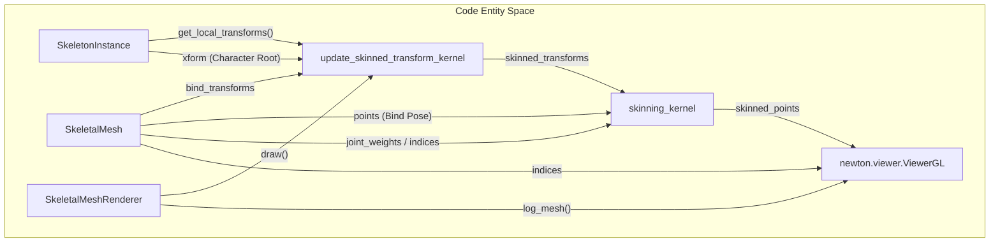
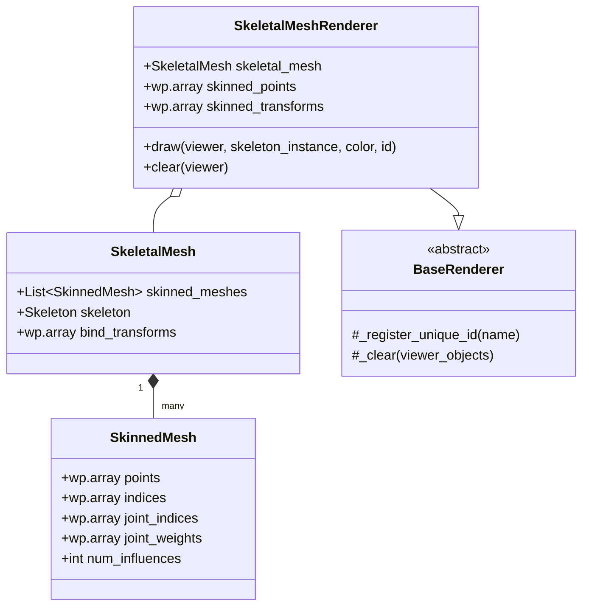

<!-- source: DeepWiki mcp.deepwiki.com · repo NVIDIA/soma-retargeter · page 6.2 Skeletal Mesh Renderer · fetched 2026-10-26 -->

# Skeletal Mesh Renderer

Relevant source files

The following files were used as context for generating this wiki page:

- [soma_retargeter/animation/mesh.py](soma_retargeter/animation/mesh.py)
- [soma_retargeter/renderers/mesh_renderer.py](soma_retargeter/renderers/mesh_renderer.py)

The `SkeletalMeshRenderer` is a specialized rendering component within the SOMA Retargeter that handles the visualization of deformable characters, specifically the SOMA body mesh. It implements GPU-accelerated Linear Blend Skinning (LBS) using NVIDIA Warp to transform mesh vertices based on the current pose of a `SkeletonInstance` [soma_retargeter/renderers/mesh_renderer.py:45-46](). The resulting geometry is submitted to the Newton viewer for real-time display [soma_retargeter/renderers/mesh_renderer.py:107-107]().

## Data Structures

The renderer relies on a hierarchy of data classes that define the relationship between geometry, skinning weights, and the driving skeleton.

| Class | Description | Key Attributes |
| :--- | :--- | :--- |
| `Mesh` | Base class for static geometry. | `_points`, `_indices` [soma_retargeter/animation/mesh.py:12-25]() |
| `SkinnedMesh` | Extends `Mesh` with per-vertex skinning data. | `joint_indices`, `joint_weights`, `num_influences` [soma_retargeter/animation/mesh.py:27-41]() |
| `SkeletalMesh` | A collection of `SkinnedMesh` parts bound to a `Skeleton`. | `skinned_meshes`, `bind_transforms` [soma_retargeter/animation/mesh.py:83-109]() |

Sources: [soma_retargeter/animation/mesh.py:12-109]()

## Rendering Pipeline

The `SkeletalMeshRenderer` follows a three-stage pipeline to transform the mesh from its rest pose to the posed state in world space.

### 1. Transform Computation
The renderer first computes the final skinning matrices. This involves converting local joint transforms into global space and then multiplying by the inverse bind pose transforms. This is performed by the `update_skinned_transform_kernel` [soma_retargeter/renderers/mesh_renderer.py:28-43]().

### 2. Linear Blend Skinning (LBS)
For every vertex in the mesh, the `skinning_kernel` iterates through the joint influences. It calculates a weighted sum of the vertex position transformed by each influencing joint's skinning matrix [soma_retargeter/renderers/mesh_renderer.py:13-25]().

### 3. Viewer Submission
The deformed vertices (`skinned_points`) and the original triangle indices are sent to the Newton viewer via `viewer.log_mesh()` [soma_retargeter/renderers/mesh_renderer.py:107-107]().

### Data Flow: Skeleton Pose to Rendered Mesh

The following diagram illustrates how data flows from the `SkeletonInstance` through Warp kernels into the `Newton` viewer.

"Skeletal Mesh Rendering Data Flow"

Sources: [soma_retargeter/renderers/mesh_renderer.py:13-43](), [soma_retargeter/renderers/mesh_renderer.py:68-107]()

## Implementation Details

### Skinning Kernels
The renderer utilizes two primary Warp kernels to offload heavy computations to the GPU:

*   **`update_skinned_transform_kernel`**: 
    *   Computes the world-space transform for each joint by traversing the hierarchy [soma_retargeter/renderers/mesh_renderer.py:38-39]().
    *   Applies the `character_transform` (root placement) [soma_retargeter/renderers/mesh_renderer.py:42-42]().
    *   Premultiplies by the `bind_transforms` (inverse bind pose) to bring vertices from model space to joint space [soma_retargeter/renderers/mesh_renderer.py:42-42]().
*   **`skinning_kernel`**: 
    *   Parallelized over the number of vertices [soma_retargeter/renderers/mesh_renderer.py:21-21]().
    *   Performs the accumulation: `output = sum(joint_transform * bind_pose_point * weight)` [soma_retargeter/renderers/mesh_renderer.py:23-24]().

### Integration with Newton Viewer
The renderer manages mesh lifecycle in the viewer using unique identifiers. For each `SkinnedMesh` part, a unique name is generated (e.g., `/skeletal_mesh_{id}_{i}`) and registered [soma_retargeter/renderers/mesh_renderer.py:104-105]().

The renderer also includes a static helper `_set_color` that directly manipulates the OpenGL state of the Newton viewer to apply vertex colors [soma_retargeter/renderers/mesh_renderer.py:59-67]().

### Class Relationship: Mesh and Renderer

"Mesh Renderer Class Architecture"

Sources: [soma_retargeter/animation/mesh.py:27-109](), [soma_retargeter/renderers/mesh_renderer.py:45-50](), [soma_retargeter/renderers/base_renderer.py:1-15]()

Sources:
- [soma_retargeter/animation/mesh.py:12-109]()
- [soma_retargeter/renderers/mesh_renderer.py:1-112]()
- [soma_retargeter/renderers/base_renderer.py:1-15]()

---

