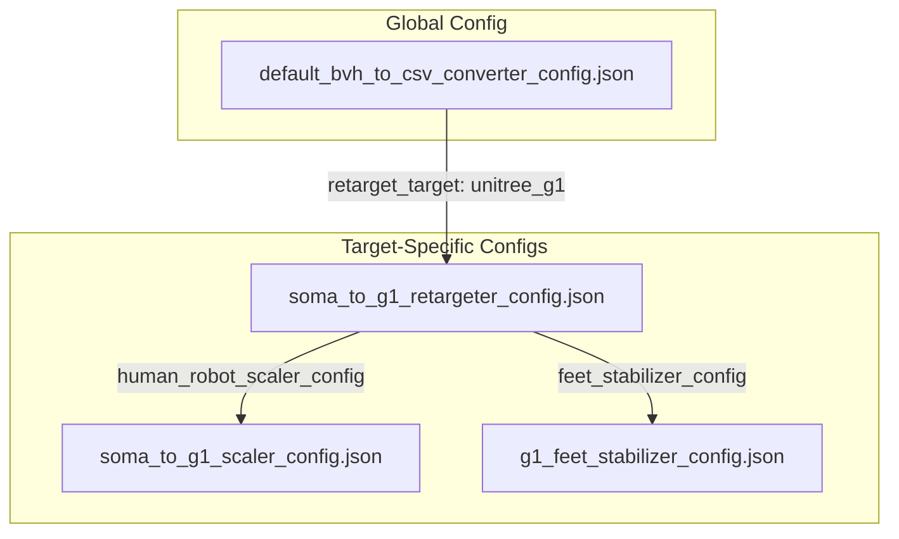
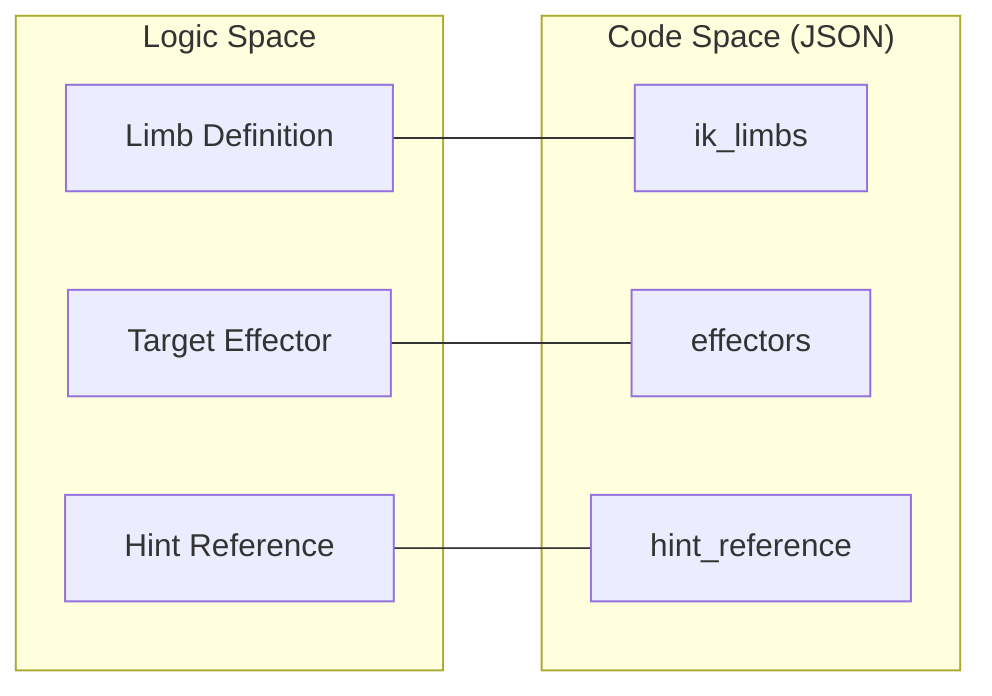

<!-- source: DeepWiki mcp.deepwiki.com · repo NVIDIA/soma-retargeter · page 7 Configuration Reference · fetched 2026-10-26 -->

# Configuration Reference

Relevant source files

The following files were used as context for generating this wiki page:

- [assets/default_bvh_to_csv_converter_config.json](assets/default_bvh_to_csv_converter_config.json)
- [soma_retargeter/configs/__init__.py](soma_retargeter/configs/__init__.py)
- [soma_retargeter/configs/unitree_g1/__init__.py](soma_retargeter/configs/unitree_g1/__init__.py)
- [soma_retargeter/configs/unitree_g1/g1_feet_stabilizer_config.json](soma_retargeter/configs/unitree_g1/g1_feet_stabilizer_config.json)
- [soma_retargeter/configs/unitree_g1/soma_to_g1_retargeter_config.json](soma_retargeter/configs/unitree_g1/soma_to_g1_retargeter_config.json)
- [soma_retargeter/configs/unitree_g1/soma_to_g1_scaler_config.json](soma_retargeter/configs/unitree_g1/soma_to_g1_scaler_config.json)

The SOMA Retargeter pipeline is governed by a hierarchical set of JSON configuration files. These files define everything from high-level I/O paths to low-level Inverse Kinematics (IK) weights and per-joint scaling factors. This modular approach allows the system to support different source skeletons and robot targets by swapping configuration sets.

### Configuration Hierarchy

The system uses a top-down configuration approach where the main converter config points to specific retargeter configs, which in turn point to specialized scaler and stabilizer configs.

Title: Configuration File Dependency Graph

Sources: [assets/default_bvh_to_csv_converter_config.json:1-9](), [soma_retargeter/configs/unitree_g1/soma_to_g1_retargeter_config.json:5-6]()

---

### Main Converter Configuration

The `default_bvh_to_csv_converter_config.json` file defines the execution environment for the `bvh_to_csv_converter.py` script. It specifies where to find input BVH files, where to save the resulting CSVs, and which retargeting profile to load.

| Key | Type | Description |
| :--- | :--- | :--- |
| `import_folder` | String | Path to source BVH files [assets/default_bvh_to_csv_converter_config.json:2](). |
| `export_folder` | String | Output directory for robot-compatible CSVs [assets/default_bvh_to_csv_converter_config.json:3](). |
| `retarget_target` | String | The target robot identifier (e.g., `unitree_g1`) [assets/default_bvh_to_csv_converter_config.json:7](). |
| `retarget_source_facing_direction` | String | Coordinate convention of the source (e.g., `Mujoco`) [assets/default_bvh_to_csv_converter_config.json:8](). |

Sources: [assets/default_bvh_to_csv_converter_config.json:1-9]()

---

### Retargeter Configuration (`ik_map`)

The retargeter configuration (e.g., `soma_to_g1_retargeter_config.json`) is the primary bridge between the SOMA human model and the robot model. It defines the `ik_map`, which associates SOMA joints with robot bodies and assigns weights to position (`t_weight`) and rotation (`r_weight`) objectives.

| Parameter | Role |
| :--- | :--- |
| `initialization_pose` | Path to the BVH used to define the reference pose [soma_retargeter/configs/unitree_g1/soma_to_g1_retargeter_config.json:2](). |
| `ik_iterations` | Number of solver iterations per frame [soma_retargeter/configs/unitree_g1/soma_to_g1_retargeter_config.json:9](). |
| `ik_map` | Mapping of human joints (e.g., `Hips`) to robot bodies (e.g., `pelvis`) [soma_retargeter/configs/unitree_g1/soma_to_g1_retargeter_config.json:24-109](). |
| `smooth_joint_filter_weight` | Weight for the temporal smoothing objective [soma_retargeter/configs/unitree_g1/soma_to_g1_retargeter_config.json:11](). |

For details on the SOMA-specific initialization assets, see [SOMA Source Configuration](#7.1).

Sources: [soma_retargeter/configs/unitree_g1/soma_to_g1_retargeter_config.json:1-110]()

---

### Scaler Configuration (`joint_scales`, `joint_offsets`)

The scaler configuration (e.g., `soma_to_g1_scaler_config.json`) handles the anatomical differences between humans and robots. It adjusts the source motion to fit the robot's physical dimensions.

*   **`human_height_assumption`**: The assumed height (in meters) of the person in the source BVH [soma_retargeter/configs/unitree_g1/soma_to_g1_scaler_config.json:4]().
*   **`joint_scales`**: Per-joint multipliers to adjust limb lengths [soma_retargeter/configs/unitree_g1/soma_to_g1_scaler_config.json:5-27]().
*   **`joint_offsets`**: Translation and rotation offsets applied to align the SOMA skeleton with the robot's zero-pose [soma_retargeter/configs/unitree_g1/soma_to_g1_scaler_config.json:49-126]().

For details on the Unitree G1 scaling parameters, see [Unitree G1 Target Configuration](#7.2).

Sources: [soma_retargeter/configs/unitree_g1/soma_to_g1_scaler_config.json:1-127]()

---

### Feet Stabilizer Configuration

The `g1_feet_stabilizer_config.json` governs the post-processing stage that ensures the robot's feet maintain contact with the ground and follow natural kinematics.

Title: Feet Stabilizer Entity Association

*   **`ik_limbs`**: Defines groups of joints (e.g., `left_leg`) that are solved together [soma_retargeter/configs/unitree_g1/g1_feet_stabilizer_config.json:17-28]().
*   **`hint_offset`**: Used to guide the knee/elbow direction during the two-bone IK solve [soma_retargeter/configs/unitree_g1/g1_feet_stabilizer_config.json:21]().
*   **`effectors`**: Specific weights for bodies involved in the stabilization (e.g., `pelvis`, `ankle`) [soma_retargeter/configs/unitree_g1/g1_feet_stabilizer_config.json:6-14]().

Sources: [soma_retargeter/configs/unitree_g1/g1_feet_stabilizer_config.json:1-29]()

---

