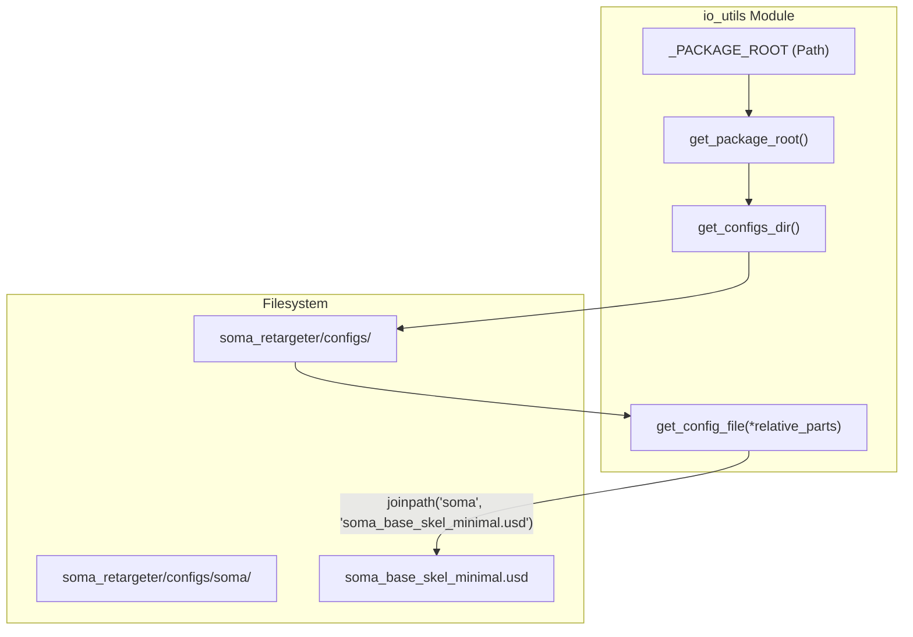
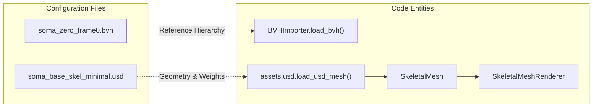

<!-- source: DeepWiki mcp.deepwiki.com · repo NVIDIA/soma-retargeter · page 7.1 SOMA Source Configuration · fetched 2026-10-26 -->

# SOMA Source Configuration

Relevant source files

The following files were used as context for generating this wiki page:

- [soma_retargeter/configs/soma/soma_base_skel_minimal.usd](soma_retargeter/configs/soma/soma_base_skel_minimal.usd)
- [soma_retargeter/configs/soma/soma_zero_frame0.bvh](soma_retargeter/configs/soma/soma_zero_frame0.bvh)
- [soma_retargeter/utils/io_utils.py](soma_retargeter/utils/io_utils.py)

The SOMA Source Configuration defines the foundational assets and resolution mechanisms used to represent the source human character in the retargeting pipeline. These assets provide the reference geometry for visualization and the initialization pose used to align human motion data with the robot target.

### Configuration Path Resolution

The system utilizes a centralized utility module, `io_utils.py`, to resolve paths to configuration assets. This ensures that the codebase can locate required files regardless of the current working directory, provided the package structure remains intact.

The resolution logic is anchored to the `_PACKAGE_ROOT`, which is dynamically determined based on the filesystem location of the `soma_retargeter/utils/io_utils.py` file [soma_retargeter/utils/io_utils.py:10-10]().

| Function | Purpose | Implementation |
| :--- | :--- | :--- |
| `get_package_root()` | Returns the absolute path to the root of the `soma_retargeter` package. | [soma_retargeter/utils/io_utils.py:13-15]() |
| `get_configs_dir()` | Points to the `configs/` subdirectory containing SOMA and Robot assets. | [soma_retargeter/utils/io_utils.py:18-20]() |
| `get_config_file()` | Joins arbitrary path parts to the config directory to locate specific assets. | [soma_retargeter/utils/io_utils.py:23-25]() |

**Config Resolution Data Flow**

The following diagram illustrates how the system resolves the path to a SOMA asset using the `io_utils` logic.

Title: Configuration Path Resolution Flow

Sources: [soma_retargeter/utils/io_utils.py:10-25]()

### Core SOMA Assets

The SOMA character is defined by two primary files located in `soma_retargeter/configs/soma/`. These files are tracked via Git LFS due to their binary nature.

#### 1. Initialization Pose (`soma_zero_frame0.bvh`)
The file `soma_zero_frame0.bvh` serves as the canonical reference pose for the human skeleton [soma_retargeter/configs/soma/soma_zero_frame0.bvh:1-3]().
*   **Purpose**: It defines the "Zero Pose" or "T-Pose" used during the initialization phase of the retargeting pipeline.
*   **Usage**: The pipeline uses this file to establish the base hierarchy and bone lengths of the source character before applying motion from external BVH files.

#### 2. Body Mesh (`soma_base_skel_minimal.usd`)
The file `soma_base_skel_minimal.usd` contains the geometric representation of the SOMA character [soma_retargeter/configs/soma/soma_base_skel_minimal.usd:1-3]().
*   **Format**: Universal Scene Description (USD).
*   **Contents**: It includes the skeletal mesh, skinning weights, and the bind pose.
*   **Visualization**: This mesh is loaded by the `SkeletalMeshRenderer` to provide a visual overlay of the human source in the interactive viewer, allowing users to compare the source motion against the robot's retargeted pose.

**Asset Mapping to Code Entities**

The following diagram maps the physical configuration files to the internal classes and functions that consume them.

Title: SOMA Asset Consumption Map

Sources: [soma_retargeter/configs/soma/soma_zero_frame0.bvh:1-3](), [soma_retargeter/configs/soma/soma_base_skel_minimal.usd:1-3](), [soma_retargeter/utils/io_utils.py:23-25]()

### JSON Utility
While the primary SOMA assets are BVH and USD, the `io_utils` module also provides a `load_json` helper used extensively for robot-specific configurations (such as the Unitree G1). This function includes error handling to ensure that missing configuration files raise descriptive `FileNotFoundError` exceptions [soma_retargeter/utils/io_utils.py:28-43]().

Sources: [soma_retargeter/utils/io_utils.py:28-43]()

---

