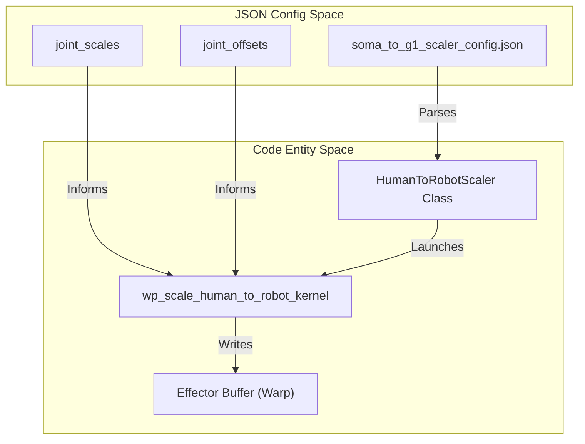
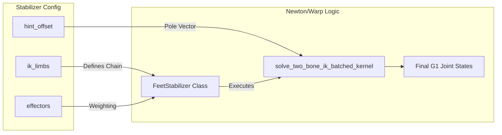

<!-- source: DeepWiki mcp.deepwiki.com · repo NVIDIA/soma-retargeter · page 7.2 Unitree G1 Target Configuration · fetched 2026-10-26 -->

# Unitree G1 Target Configuration

Relevant source files

The following files were used as context for generating this wiki page:

- [soma_retargeter/configs/unitree_g1/g1_feet_stabilizer_config.json](soma_retargeter/configs/unitree_g1/g1_feet_stabilizer_config.json)
- [soma_retargeter/configs/unitree_g1/soma_to_g1_retargeter_config.json](soma_retargeter/configs/unitree_g1/soma_to_g1_retargeter_config.json)
- [soma_retargeter/configs/unitree_g1/soma_to_g1_scaler_config.json](soma_retargeter/configs/unitree_g1/soma_to_g1_scaler_config.json)

This page documents the configuration assets specifically tailored for the Unitree G1 humanoid robot. These files define how the SOMA source animation is mapped, scaled, and stabilized to produce valid joint commands for the G1 hardware.

The configuration is split into three primary functional areas:
1.  **Retargeter Config**: High-level mapping and IK solver parameters.
2.  **Scaler Config**: Geometric transformation from human proportions to G1 proportions.
3.  **Feet Stabilizer Config**: Post-processing parameters for foot-ground contact and leg IK.

## 1. Retargeter Configuration (`soma_to_g1_retargeter_config.json`)

The main retargeter configuration orchestrates the pipeline by referencing other sub-configs and defining the `ik_map`, which associates SOMA source joints with G1 target body links.

### Key Solver Parameters
The solver uses a specific iteration count and weighting scheme to balance pose accuracy against joint smoothness.
*   **`ik_iterations`**: Set to 24 for the G1 to ensure convergence of the Newton IK solver [soma_retargeter/configs/unitree_g1/soma_to_g1_retargeter_config.json:9-9]().
*   **`smooth_joint_filter_weight`**: Set to 5.5 to penalize high-frequency joint jitter [soma_retargeter/configs/unitree_g1/soma_to_g1_retargeter_config.json:11-11]().
*   **`smooth_joint_filter_objective_body_masks`**: Specifically lowers the smoothing penalty for shoulder links (e.g., `left_shoulder_pitch_link` at 0.1) to allow for faster arm movements while keeping the roll/yaw more stable [soma_retargeter/configs/unitree_g1/soma_to_g1_retargeter_config.json:15-22]().

### Joint Mapping (`ik_map`)
The `ik_map` defines the target body links in the G1 URDF/Newton model that should follow the SOMA joints. Each entry specifies a translation weight (`t_weight`) and rotation weight (`r_weight`).

| SOMA Joint | G1 Body Link | T-Weight | R-Weight |
| :--- | :--- | :--- | :--- |
| `Hips` | `pelvis` | 30.0 | 2.0 |
| `LeftFoot` | `left_ankle_roll_link` | 30.0 | 2.0 |
| `RightFoot` | `right_ankle_roll_link` | 30.0 | 2.0 |
| `LeftHand` | `left_wrist_yaw_link` | 2.0 | 1.2 |
| `Chest` | `torso_link` | 0.7 | 0.7 |

Sources: [soma_retargeter/configs/unitree_g1/soma_to_g1_retargeter_config.json:24-109]()

## 2. Human-to-Robot Scaler Configuration (`soma_to_g1_scaler_config.json`)

The `HumanToRobotScaler` uses this file to adjust the SOMA skeleton to match the physical dimensions and coordinate frames of the G1.

### Scaling Logic
*   **`human_height_assumption`**: The source SOMA data is assumed to represent a human of 1.8m [soma_retargeter/configs/unitree_g1/soma_to_g1_scaler_config.json:4-4]().
*   **`joint_scales`**: Defines per-joint multipliers to adjust bone lengths. For G1, most joints are scaled between 0.78 and 0.86 (e.g., `LeftLeg` at 0.86) [soma_retargeter/configs/unitree_g1/soma_to_g1_scaler_config.json:5-27]().

### Joint Offsets and Orientations
Because the G1's local joint frames differ from the SOMA BVH standard, `joint_offsets` provide a translation and a quaternion rotation to align the frames.
*   **Data Format**: `[ [tx, ty, tz], [qx, qy, qz, qw] ]`
*   **Example**: The `LeftLeg` offset `[0.459, -0.538, -0.538, 0.459]` rotates the hip joint to align with the G1's hardware axis [soma_retargeter/configs/unitree_g1/soma_to_g1_scaler_config.json:54-57]().

### Config Entity Relationship
The following diagram illustrates how the `HumanToRobotScaler` class consumes the JSON configuration to produce scaled effector targets.

**Title: Scaler Configuration Data Flow**

Sources: [soma_retargeter/configs/unitree_g1/soma_to_g1_scaler_config.json:1-127]()

## 3. Feet Stabilizer Configuration (`g1_feet_stabilizer_config.json`)

After the main IK solve, the `FeetStabilizer` performs a specialized pass to ensure the feet are correctly placed on the ground and the legs follow a natural 2-bone IK solution.

### IK Limb Definition
The G1 configuration defines two IK chains for the legs:
*   **`ik_root`**: Index 0 (typically the pelvis) [soma_retargeter/configs/unitree_g1/g1_feet_stabilizer_config.json:16-16]().
*   **`ik_limbs`**: Defines `left_leg` and `right_leg`.
    *   **`effectors`**: Indices `[1, 2, 3]` for the left leg correspond to the hip, knee, and ankle links defined in the `effectors` map [soma_retargeter/configs/unitree_g1/g1_feet_stabilizer_config.json:18-22]().
    *   **`hint_reference`**: Points to the ankle link (index 3 or 6) to determine the direction of the knee "hint" or pole vector [soma_retargeter/configs/unitree_g1/g1_feet_stabilizer_config.json:20-25]().
    *   **`hint_offset`**: Set to `[0.25, 0.0, 0.25]` to push the knee hint forward and slightly outward [soma_retargeter/configs/unitree_g1/g1_feet_stabilizer_config.json:21-26]().

### Effector Weights
Individual links within the stabilizer have their own weights to balance position vs. rotation:
*   **`pelvis`**: High translation weight (30.0) to keep the base stable [soma_retargeter/configs/unitree_g1/g1_feet_stabilizer_config.json:7-7]().
*   **`ankle_roll_link`**: High translation weight (10.0) to ensure ground contact [soma_retargeter/configs/unitree_g1/g1_feet_stabilizer_config.json:10-13]().

**Title: Feet Stabilizer Component Mapping**

Sources: [soma_retargeter/configs/unitree_g1/g1_feet_stabilizer_config.json:1-29]()

---

