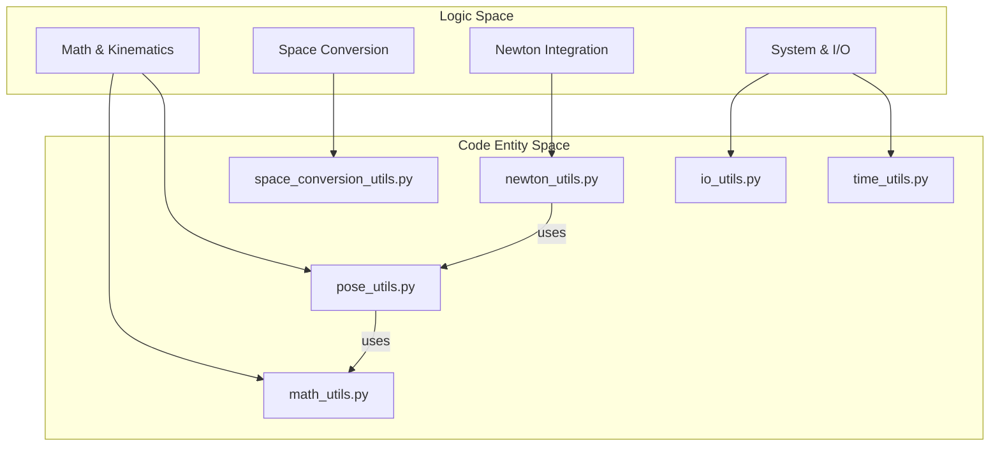
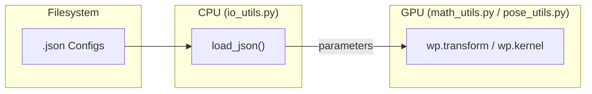

<!-- source: DeepWiki mcp.deepwiki.com · repo NVIDIA/soma-retargeter · page 8 Utility Modules · fetched 2026-10-26 -->

# Utility Modules

Relevant source files

The following files were used as context for generating this wiki page:

- [soma_retargeter/utils/__init__.py](soma_retargeter/utils/__init__.py)
- [soma_retargeter/utils/io_utils.py](soma_retargeter/utils/io_utils.py)
- [soma_retargeter/utils/math_utils.py](soma_retargeter/utils/math_utils.py)
- [soma_retargeter/utils/newton_utils.py](soma_retargeter/utils/newton_utils.py)
- [soma_retargeter/utils/pose_utils.py](soma_retargeter/utils/pose_utils.py)
- [soma_retargeter/utils/space_conversion_utils.py](soma_retargeter/utils/space_conversion_utils.py)
- [soma_retargeter/utils/time_utils.py](soma_retargeter/utils/time_utils.py)

The `soma_retargeter/utils` sub-package provides a collection of stateless helper functions and utility classes that support the core retargeting pipeline. These modules handle low-level operations such as GPU-accelerated pose mathematics, coordinate space transformations, Newton-specific model parsing, and filesystem I/O for configuration management.

### System Overview and Code Mapping

The following diagram maps the logical utility categories to their respective implementations in the codebase.

**Utility Module Architecture**

Sources: [soma_retargeter/utils/math_utils.py:1-40](), [soma_retargeter/utils/pose_utils.py:1-171](), [soma_retargeter/utils/newton_utils.py:1-140]()

---

### Math and Pose Utilities
The system relies heavily on NVIDIA Warp for high-performance skeletal operations. These utilities bridge standard Python/NumPy data with Warp's GPU-accelerated types (`wp.transform`, `wp.quat`).

*   **`math_utils.py`**: Contains fundamental geometric functions like `quat_twist` [soma_retargeter/utils/math_utils.py:28-33]() for decomposing rotations and `project_point_to_plane` [soma_retargeter/utils/math_utils.py:37-39]() for spatial projections.
*   **`pose_utils.py`**: Implements the core Forward Kinematics (FK) logic. It includes `compute_global_pose` [soma_retargeter/utils/pose_utils.py:64-94]() and `compute_local_pose` [soma_retargeter/utils/pose_utils.py:97-124](), which launch Warp kernels to traverse skeletal hierarchies. It also provides `blend_poses` [soma_retargeter/utils/pose_utils.py:141-167]() for spherical linear interpolation (SLERP) between animation frames.

For details, see [Math and Pose Utilities](#8.1).

---

### Space Conversion and Newton Utilities
Retargeting requires mapping data between different coordinate conventions (e.g., Y-up vs Z-up) and interacting with the Newton IK solver's internal model representation.

*   **`space_conversion_utils.py`**: Features the `SpaceConverter` class [soma_retargeter/utils/space_conversion_utils.py:54-90](), which manages rotations between `FacingDirectionType.MAYA` or `MUJOCO` [soma_retargeter/utils/space_conversion_utils.py:9-12]() and the Newton coordinate system.
*   **`newton_utils.py`**: Provides helpers to bridge the `AnimationBuffer` with Newton models. Key functions include `create_joint_coord_masks` [soma_retargeter/utils/newton_utils.py:33-61]() for isolating specific DOFs during IK and `create_buffer_with_initialization_frames` [soma_retargeter/utils/newton_utils.py:64-127](), which prepends transition frames to an animation to ensure a smooth start from a rest pose.

For details, see [Space Conversion and Newton Utilities](#8.2).

---

### I/O and Timing Helpers
These modules handle the boilerplate of asset resolution and temporal sampling.

*   **`io_utils.py`**: Manages path resolution for the package. It defines `get_package_root()` [soma_retargeter/utils/io_utils.py:13-15]() and `get_config_file()` [soma_retargeter/utils/io_utils.py:23-25](), ensuring that configuration JSONs are found regardless of the current working directory. It also includes a standard `load_json` [soma_retargeter/utils/io_utils.py:28-43]() helper.
*   **`time_utils.py`**: Contains `frame_index_from_time` [soma_retargeter/utils/time_utils.py:7-34](), which converts a continuous time value into a discrete frame index and an interpolation alpha (0.0 to 1.0) for smooth playback.

**Data Flow: From Filesystem to GPU**

Sources: [soma_retargeter/utils/io_utils.py:28-43](), [soma_retargeter/utils/math_utils.py:8-10](), [soma_retargeter/utils/pose_utils.py:25-35]()

---

### Summary Table of Utility Classes

| Module | Key Entity | Purpose |
| :--- | :--- | :--- |
| `math_utils.py` | `quat_twist` | Extracts axial rotation (twist) from a quaternion. |
| `pose_utils.py` | `compute_global_pose` | Converts parent-relative transforms to world-space via FK. |
| `space_conversion_utils.py` | `SpaceConverter` | Handles basis changes between Maya, Mujoco, and Newton. |
| `newton_utils.py` | `create_buffer_with_initialization_frames` | Generates "warm-up" frames for IK stability. |
| `io_utils.py` | `get_config_file` | Resolves paths to internal JSON configuration assets. |
| `time_utils.py` | `frame_index_from_time` | Calculates frame indices and blend factors for sampling. |

Sources: [soma_retargeter/utils/math_utils.py:28](), [soma_retargeter/utils/pose_utils.py:64](), [soma_retargeter/utils/space_conversion_utils.py:54](), [soma_retargeter/utils/newton_utils.py:64](), [soma_retargeter/utils/io_utils.py:23](), [soma_retargeter/utils/time_utils.py:7]()

---

