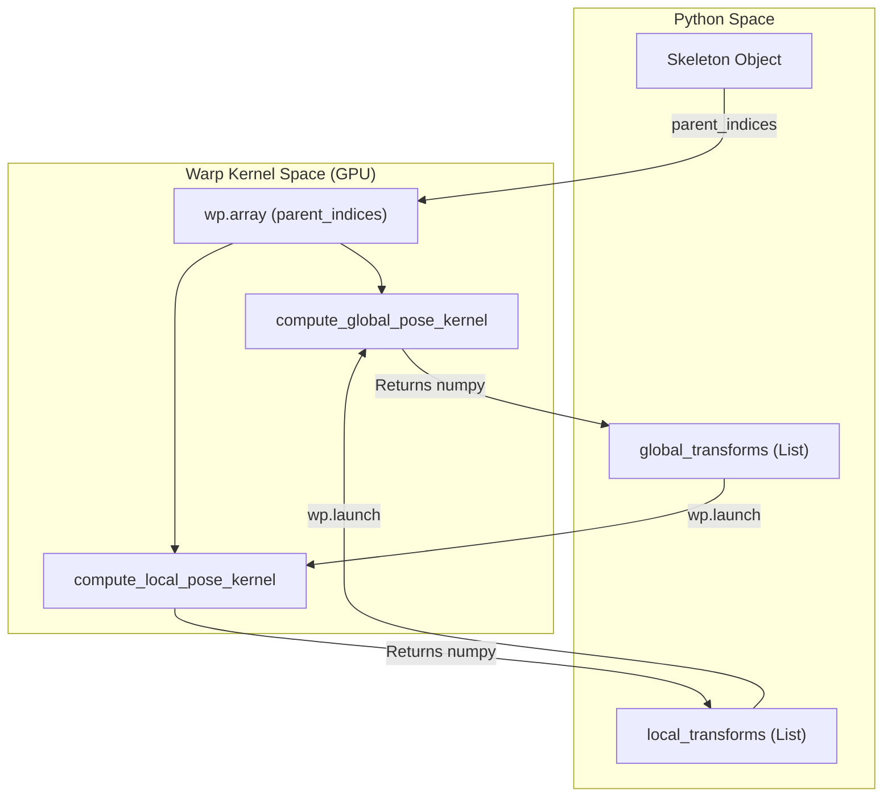
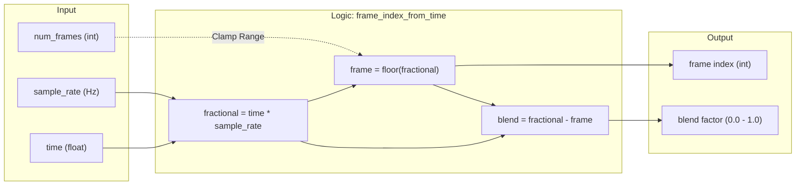

<!-- source: DeepWiki mcp.deepwiki.com · repo NVIDIA/soma-retargeter · page 8.1 Math and Pose Utilities · fetched 2026-10-26 -->

# Math and Pose Utilities

Relevant source files

The following files were used as context for generating this wiki page:

- [soma_retargeter/utils/math_utils.py](soma_retargeter/utils/math_utils.py)
- [soma_retargeter/utils/pose_utils.py](soma_retargeter/utils/pose_utils.py)
- [soma_retargeter/utils/time_utils.py](soma_retargeter/utils/time_utils.py)

This module provides the foundational mathematical operations and skeletal pose manipulation logic used throughout the SOMA Retargeter. It leverages **NVIDIA Warp** for high-performance GPU-accelerated transformations, specifically for forward kinematics (FK), inverse kinematics (IK) preprocessing, and temporal interpolation.

## Math Utilities

The `math_utils.py` module contains geometric functions for quaternion manipulation and spatial projections. These functions are typically defined as `wp.func` to allow them to be called within larger Warp kernels.

### Key Functions
*   **`transform_from_array`**: A utility to convert flat NumPy arrays (typically size 7: 3 for position, 4 for quaternion) into `wp.transform` objects [soma_retargeter/utils/math_utils.py:8-10]().
*   **`quat_twist`**: Extracts the twist component of a rotation around a specific axis. This is critical for isolating specific degrees of freedom (e.g., knee flexion vs. rotation) [soma_retargeter/utils/math_utils.py:27-33]().
*   **`project_point_to_plane`**: Orthogonally projects a 3D point onto a plane passing through the origin defined by a normal vector [soma_retargeter/utils/math_utils.py:36-39]().
*   **Equality Checks**: `are_rotations_equal` and `are_transforms_equal` provide tolerance-based comparisons for unit testing and convergence checks [soma_retargeter/utils/math_utils.py:13-24]().

**Sources:**
* [soma_retargeter/utils/math_utils.py:1-40]()

---

## Pose Utilities

The `pose_utils.py` module handles the conversion between **Local Space** (parent-relative) and **Global Space** (world-relative) for skeletal hierarchies. 

### Global and Local Pose Computation
The system uses a serial loop within Warp kernels to process joint hierarchies. Because joint $i$ depends on its parent $p < i$, the kernels iterate through the joints to ensure parent transforms are computed before children.

| Function | Description | Logic |
| :--- | :--- | :--- |
| `compute_global_pose` | Converts local transforms to world space. | `out[i] = out[parent] * local[i]` [soma_retargeter/utils/pose_utils.py:38-50]() |
| `compute_local_pose` | Converts world transforms to local space. | `out[i] = inv(global[parent]) * global[i]` [soma_retargeter/utils/pose_utils.py:11-23]() |
| `blend_poses` | Interpolates between two skeletal poses. | Linear interpolation for position, Spherical Linear Interpolation (Slerp) for rotation [soma_retargeter/utils/pose_utils.py:128-139]() |

### Data Flow: Pose Transformation
The following diagram illustrates how the `pose_utils` functions bridge the gap between high-level Python `Skeleton` objects and low-level GPU `wp.array` data.

**Pose Computation Data Flow**

**Sources:**
* [soma_retargeter/utils/pose_utils.py:11-124]()
* [soma_retargeter/utils/pose_utils.py:127-167]()

---

## Time Utilities

The `time_utils.py` module provides a standardized way to map continuous time (seconds) to discrete animation frames. This is used by the `AnimationBuffer` and `CSVAnimationBuffer` to sample poses at arbitrary timestamps.

### Frame Index Calculation
The `frame_index_from_time` function calculates the floor index and a normalized blend factor for interpolation between the current and subsequent frame [soma_retargeter/utils/time_utils.py:7-34]().

**Logic Mapping**

**Sources:**
* [soma_retargeter/utils/time_utils.py:7-34]()

---

## Summary of Core Entities

| Entity | File | Role |
| :--- | :--- | :--- |
| `wp_compute_global_pose` | `pose_utils.py` | Low-level Warp function implementing the FK chain [soma_retargeter/utils/pose_utils.py:38-50](). |
| `compute_global_pose` | `pose_utils.py` | Python wrapper that manages memory allocation and kernel launching [soma_retargeter/utils/pose_utils.py:64-94](). |
| `blend_pose_kernel` | `pose_utils.py` | GPU kernel for parallel pose interpolation using `wp.lerp` and `wp.quat_slerp` [soma_retargeter/utils/pose_utils.py:127-139](). |
| `quat_twist` | `math_utils.py` | Decomposes rotation into swing and twist components [soma_retargeter/utils/math_utils.py:27-33](). |
| `frame_index_from_time` | `time_utils.py` | Maps timeline seconds to buffer indices for sampling [soma_retargeter/utils/time_utils.py:7-34](). |

**Sources:**
* [soma_retargeter/utils/math_utils.py:1-40]()
* [soma_retargeter/utils/pose_utils.py:1-175]()
* [soma_retargeter/utils/time_utils.py:1-34]()

---

