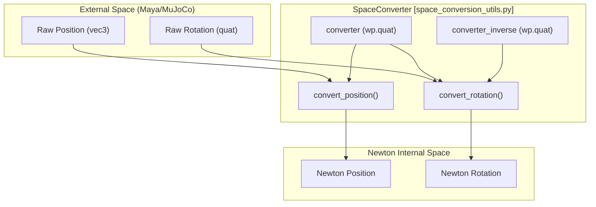
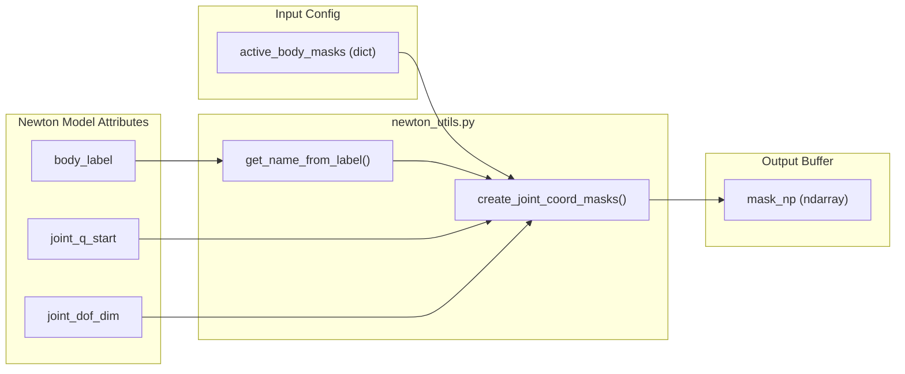

<!-- source: DeepWiki mcp.deepwiki.com · repo NVIDIA/soma-retargeter · page 8.2 Space Conversion and Newton Utilities · fetched 2026-10-26 -->

# Space Conversion and Newton Utilities

Relevant source files

The following files were used as context for generating this wiki page:

- [soma_retargeter/utils/newton_utils.py](soma_retargeter/utils/newton_utils.py)
- [soma_retargeter/utils/space_conversion_utils.py](soma_retargeter/utils/space_conversion_utils.py)

This page documents the utility modules responsible for coordinate space transformations and Newton-specific model manipulations. These utilities bridge the gap between external DCC (Digital Content Creation) tools like Maya or simulation environments like MuJoCo and the internal representation used by the Newton IK solver.

## Space Conversion

The `SpaceConverter` class handles the transformation of positions and rotations between different coordinate conventions. This is essential for ensuring that source motion data (e.g., from BVH files) and target robot models are aligned correctly within the Newton world space [soma_retargeter/utils/space_conversion_utils.py:54-58]().

### Supported Facing Directions
The system defines standard facing directions via the `FacingDirectionType` enum [soma_retargeter/utils/space_conversion_utils.py:9-12]():

| Enum Value | Description | Internal Quaternion Logic |
| :--- | :--- | :--- |
| `MAYA` | Standard Maya Y-up, Z-forward convention. | $q_1(0,1,0, 90^\circ) \times q_2(0,0,1, 90^\circ)$ [soma_retargeter/utils/space_conversion_utils.py:62-65]() |
| `MUJOCO` | Standard MuJoCo Z-up convention. | $q(1,0,0, 90^\circ)$ [soma_retargeter/utils/space_conversion_utils.py:60-61]() |

### Implementation Details
The `SpaceConverter` stores a `converter` quaternion and its inverse to perform efficient rotations of vectors and quaternions using NVIDIA Warp [soma_retargeter/utils/space_conversion_utils.py:59-69]().

*   **Position Conversion**: Rotates a scaled position vector into the target space using `wp.quat_rotate` [soma_retargeter/utils/space_conversion_utils.py:71-73]().
*   **Rotation Conversion**: Conjugates the source quaternion: $q_{new} = q_{conv} \times q_{src} \times q_{conv}^{-1}$ [soma_retargeter/utils/space_conversion_utils.py:75-77]().

**Sources:** [soma_retargeter/utils/space_conversion_utils.py:1-90]()

## Newton Model Utilities

The `newton_utils.py` module provides helper functions to interact with the Newton model structure, specifically for masking degrees of freedom (DOF) and preparing animation buffers for the solver.

### Joint Coordinate Masking
The `create_joint_coord_masks` function generates a 1D array of weights (masks) corresponding to every joint coordinate in the Newton model. This is used to selectively enable or disable specific DOFs during the IK solve [soma_retargeter/utils/newton_utils.py:33-50]().

1.  It initializes a NumPy array of size `model.joint_coord_count` with a `default_mask_fill_value` [soma_retargeter/utils/newton_utils.py:51]().
2.  It maps body labels to indices using `get_name_from_label` to handle hierarchical naming (e.g., "robot/link1" becomes "link1") [soma_retargeter/utils/newton_utils.py:54,130-139]().
3.  For each body in `active_body_masks`, it locates the start index in the global coordinate array using `model.joint_q_start` and the dimension from `model.joint_dof_dim` [soma_retargeter/utils/newton_utils.py:55-59]().

### Initialization and Stabilization Frames
To prevent "snapping" at the start of a retargeted motion, `create_buffer_with_initialization_frames` prepends a sequence of transition frames to an `AnimationBuffer` [soma_retargeter/utils/newton_utils.py:64-84]().

**The Transition Sequence:**
1.  **Root Blending**: Interpolates the root joint's position (`wp.lerp`) and rotation (`wp.quat_slerp`) from the `init_pose` to the first frame of the animation [soma_retargeter/utils/newton_utils.py:99-113]().
2.  **Joint Blending**: Uses `pose_utils.blend_poses` to smoothly transition all internal joint rotations [soma_retargeter/utils/newton_utils.py:115-119]().
3.  **Stabilization**: Appends static frames of the first animation pose to allow the IK solver and feet stabilizer to settle before motion begins [soma_retargeter/utils/newton_utils.py:120-121]().

**Sources:** [soma_retargeter/utils/newton_utils.py:1-140]()

## System Architecture Diagrams

### Coordinate Space Transformation Flow
This diagram illustrates how `SpaceConverter` transforms external motion data into the Newton Solver's internal space.

**Sources:** [soma_retargeter/utils/space_conversion_utils.py:54-86]()

### Newton Model Data Mapping
This diagram shows how `newton_utils.py` bridges high-level body names to the low-level flattened coordinate arrays required by the solver.

**Sources:** [soma_retargeter/utils/newton_utils.py:33-61]()

## Utility Function Summary

| Function | File | Description |
| :--- | :--- | :--- |
| `create_child_parent_map` | `newton_utils.py` | Extracts the kinematic hierarchy from a Newton model as a dictionary [soma_retargeter/utils/newton_utils.py:12-30](). |
| `get_name_from_label` | `newton_utils.py` | Splits slash-delimited strings to find the leaf body name [soma_retargeter/utils/newton_utils.py:130-140](). |
| `create_buffer_with_initialization_frames` | `newton_utils.py` | Merges an initial pose and an animation buffer with root and joint blending [soma_retargeter/utils/newton_utils.py:64-128](). |
| `get_facing_direction_type_from_str` | `space_conversion_utils.py` | Converts string identifiers (e.g., "Maya") to `FacingDirectionType` enums [soma_retargeter/utils/space_conversion_utils.py:34-52](). |

**Sources:** [soma_retargeter/utils/newton_utils.py:1-140](), [soma_retargeter/utils/space_conversion_utils.py:1-90]()

---

