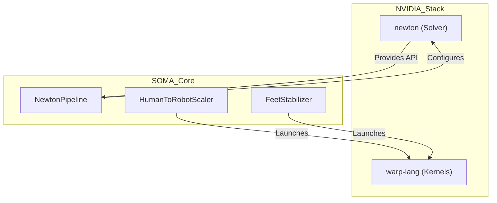
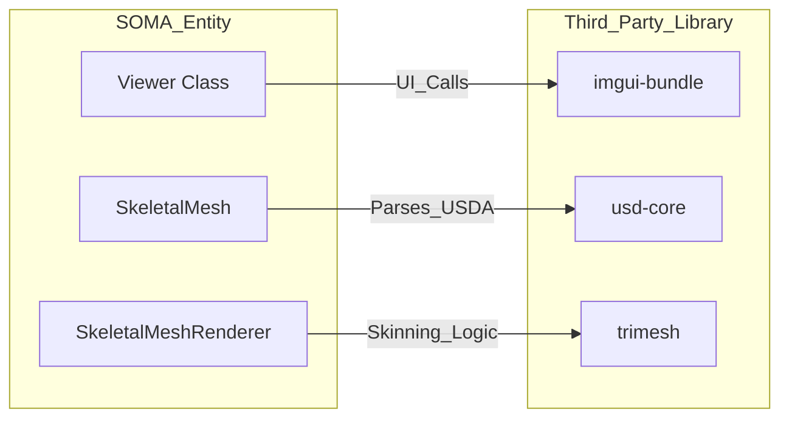

<!-- source: DeepWiki mcp.deepwiki.com · repo NVIDIA/soma-retargeter · page 9 Third-Party Dependencies and Licenses · fetched 2026-10-26 -->

# Third-Party Dependencies and Licenses

Relevant source files

The following files were used as context for generating this wiki page:

- [licenses/GitPython-LICENSE.txt](licenses/GitPython-LICENSE.txt)
- [licenses/imgui_bundle-LICENSE.txt](licenses/imgui_bundle-LICENSE.txt)
- [licenses/newton-LICENSE.txt](licenses/newton-LICENSE.txt)
- [licenses/numpy-LICENSE.txt](licenses/numpy-LICENSE.txt)
- [licenses/pyglet-LICENSE.txt](licenses/pyglet-LICENSE.txt)
- [licenses/scipy-LICENSE.txt](licenses/scipy-LICENSE.txt)
- [licenses/tqdm-LICENSE.txt](licenses/tqdm-LICENSE.txt)
- [licenses/trimesh-LICENSE.txt](licenses/trimesh-LICENSE.txt)
- [licenses/typing_extensions-LICENSE.txt](licenses/typing_extensions-LICENSE.txt)
- [licenses/usd-core-LICENSE.txt](licenses/usd-core-LICENSE.txt)
- [licenses/warp-LICENSE.txt](licenses/warp-LICENSE.txt)
- [pyproject.toml](pyproject.toml)

This page provides a comprehensive list of the third-party libraries used by the SOMA Retargeter project. It details their specific roles within the architecture, their versions as defined in the project metadata, and links to their respective license agreements bundled within the codebase.

The project relies on a high-performance stack combining GPU-accelerated simulation (Newton, Warp), standard scientific computing (NumPy, SciPy), and modern graphics/UI frameworks (imgui-bundle, pyglet) [pyproject.toml:11-23]().

## Dependency Overview

The following table summarizes the core dependencies required for the SOMA Retargeter pipeline:

| Library | Version | Primary Role | License File |
| :--- | :--- | :--- | :--- |
| `newton` | 1.0.0 | Core IK solver and visualization engine | [licenses/newton-LICENSE.txt]() |
| `warp-lang` | 1.12.0 | GPU kernels for scaling, IK, and rendering | [licenses/warp-LICENSE.txt]() |
| `numpy` | 2.4.3 | Linear algebra and data manipulation | [licenses/numpy-LICENSE.txt]() |
| `scipy` | 1.17.1 | Rotation mathematics and optimization | [licenses/scipy-LICENSE.txt]() |
| `trimesh` | 4.11.3 | Mesh processing for skeletal visualization | [licenses/trimesh-LICENSE.txt]() |
| `imgui-bundle` | 1.92.4 | Interactive Viewer UI and gizmos | [licenses/imgui_bundle-LICENSE.txt]() |
| `usd-core` | 26.3 | Loading SOMA body mesh assets | [licenses/usd-core-LICENSE.txt]() |
| `pyglet` | 2.1.13 | Windowing and event handling | [licenses/pyglet-LICENSE.txt]() |
| `tqdm` | 4.67.3 | Progress bars for batch processing | [licenses/tqdm-LICENSE.txt]() |
| `GitPython` | 3.1.46 | Version tracking for exported assets | [licenses/GitPython-LICENSE.txt]() |
| `typing_extensions`| 4.15.0 | Backported type hinting support | [licenses/typing_extensions-LICENSE.txt]() |

**Sources:** [pyproject.toml:11-23]()

## Technical Implementation Roles

### Computational Core (Newton & Warp)
The system's performance is driven by the integration of `newton` and `nvidia-warp`. Newton provides the high-level IK framework, while Warp executes custom kernels for per-frame operations.

**Dependency Interaction Flow:**
The diagram below illustrates how third-party entities interact with internal SOMA components during a retargeting solve.

**Title: Solver Dependency Graph**

**Sources:** [pyproject.toml:12-13](), [licenses/newton-LICENSE.txt](), [licenses/warp-LICENSE.txt]()

### Visualization and UI (imgui & usd-core)
The interactive `Viewer` uses `imgui-bundle` for its control panels and `usd-core` to ingest high-fidelity robot and human mesh representations.

**Title: Visualization Entity Mapping**

**Sources:** [pyproject.toml:18-20](), [licenses/imgui_bundle-LICENSE.txt](), [licenses/usd-core-LICENSE.txt](), [licenses/trimesh-LICENSE.txt]()

## License Details

The SOMA Retargeter is distributed under the **Apache-2.0** license [pyproject.toml:8-9](). However, it incorporates various third-party components with differing license terms.

### Apache License 2.0
The following libraries are governed by the Apache 2.0 license (or variants like the Tomorrow Open Source Technology License):
*   **Newton**: [licenses/newton-LICENSE.txt:1-131]()
*   **NVIDIA Warp**: [licenses/warp-LICENSE.txt:1-131]()
*   **USD Core**: [licenses/usd-core-LICENSE.txt:1-131]()

### MIT License
The following libraries use the permissive MIT license:
*   **imgui-bundle**: [licenses/imgui_bundle-LICENSE.txt:1-21]()
*   **trimesh**: [licenses/trimesh-LICENSE.txt:1-21]()
*   **tqdm**: [licenses/tqdm-LICENSE.txt:29-49]()

### BSD-style Licenses
Standard scientific and utility libraries often use 3-clause BSD licenses:
*   **NumPy**: [licenses/numpy-LICENSE.txt:1-30]()
*   **SciPy**: [licenses/scipy-LICENSE.txt:1-30]()
*   **Pyglet**: [licenses/pyglet-LICENSE.txt:1-30]()
*   **GitPython**: [licenses/GitPython-LICENSE.txt:1-29]()

### Python Software Foundation (PSF) License
*   **typing_extensions**: This library follows the Python Software Foundation License Version 2 [licenses/typing_extensions-LICENSE.txt:73-122]().

**Sources:** [licenses/newton-LICENSE.txt](), [licenses/warp-LICENSE.txt](), [licenses/usd-core-LICENSE.txt](), [licenses/imgui_bundle-LICENSE.txt](), [licenses/trimesh-LICENSE.txt](), [licenses/tqdm-LICENSE.txt](), [licenses/numpy-LICENSE.txt](), [licenses/scipy-LICENSE.txt](), [licenses/pyglet-LICENSE.txt](), [licenses/GitPython-LICENSE.txt](), [licenses/typing_extensions-LICENSE.txt]()

---

