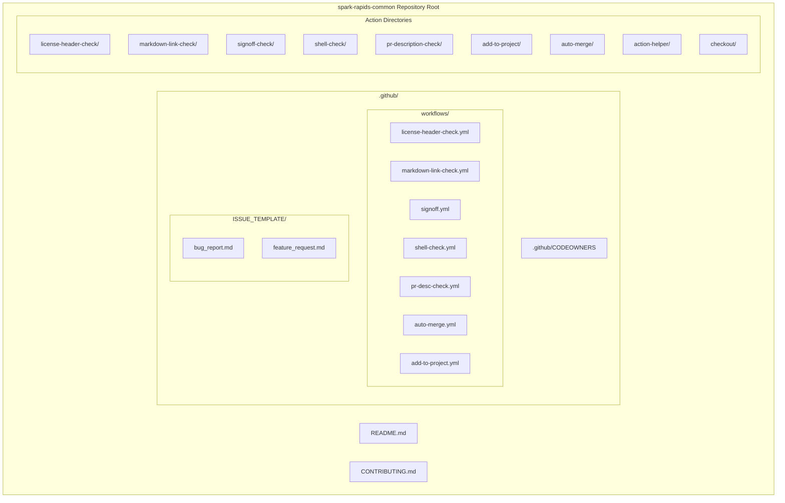
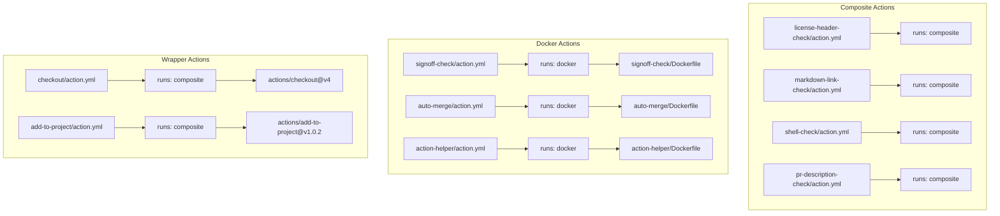
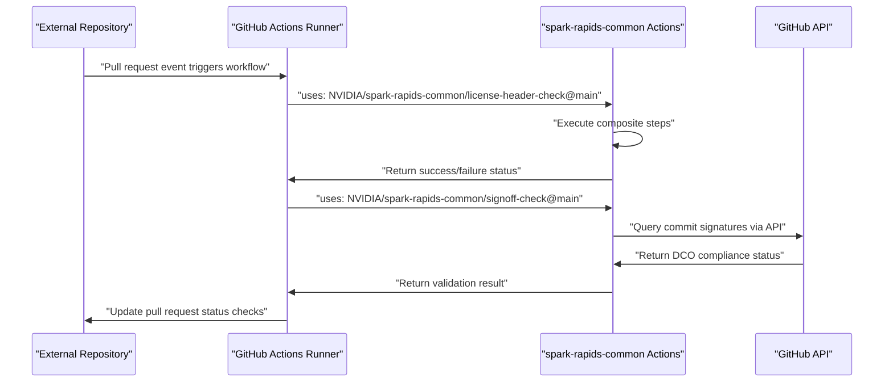
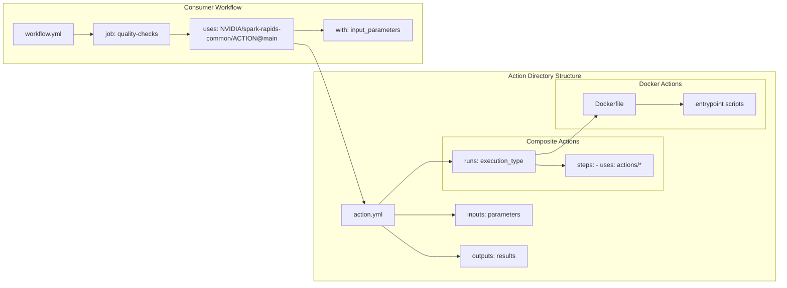

<!-- source: DeepWiki mcp.deepwiki.com · repo NVIDIA/spark-rapids-common · page 1 Spark RAPIDS Common Overview · fetched 2026-10-26 -->

# Spark RAPIDS Common Overview

Relevant source files

The following files were used as context for generating this wiki page:

- [README.md](README.md)

## Purpose and Scope

This document provides an overview of the `spark-rapids-common` repository, which serves as a centralized hub for reusable GitHub Actions, workflows, and common scripts used across the NVIDIA Spark RAPIDS ecosystem. The repository standardizes quality gates, project management automation, and development workflows to ensure consistency across multiple Spark RAPIDS projects.

For detailed information about specific quality validation systems, see [Quality Gates System](#2). For project management features, see [Project Management](#3). For automated merging capabilities, see [Automated Merging System](#4).

## Repository Architecture

The `spark-rapids-common` repository follows a modular architecture that separates reusable GitHub Actions from their consuming workflows. This design enables external repositories to reference standardized automation while maintaining flexibility in their specific implementations.

### Repository Structure Overview

**Sources:** [README.md:1-8]()

### Action Implementation Patterns

The repository implements three distinct architectural patterns for GitHub Actions, each optimized for different use cases and complexity levels.

**Sources:** [README.md:7]()

## Core Functionality

The repository provides three primary categories of functionality that support the entire Spark RAPIDS development lifecycle.

### Quality Assurance Pipeline

The quality assurance system implements multiple validation layers that execute in parallel during pull request events, ensuring code quality and legal compliance before merge approval.

| Action | Pattern | Primary Function | Consumer Usage |
|--------|---------|------------------|----------------|
| `license-header-check` | Composite | Validates NVIDIA copyright headers | `uses: NVIDIA/spark-rapids-common/license-header-check@main` |
| `markdown-link-check` | Composite | Validates markdown link integrity | `uses: NVIDIA/spark-rapids-common/markdown-link-check@main` |
| `signoff-check` | Docker | Enforces DCO sign-off compliance | `uses: NVIDIA/spark-rapids-common/signoff-check@main` |
| `shell-check` | Composite | Static analysis for shell scripts | `uses: NVIDIA/spark-rapids-common/shell-check@main` |
| `pr-description-check` | Composite | Validates PR description format | `uses: NVIDIA/spark-rapids-common/pr-description-check@main` |

### Project Management Automation

Project management components handle issue tracking, code ownership, and GitHub project board integration to streamline development workflows.

### Automated Branch Management

The automated merging system maintains branch currency and handles complex merge scenarios through Docker-based actions that interact with the GitHub API.

## Integration Patterns

### Cross-Repository Usage Flow

External repositories integrate with `spark-rapids-common` by referencing specific actions in their workflow files, creating a distributed but standardized development environment.

**Sources:** [README.md:7]()

### Action Composition Architecture

Each action directory contains standardized files that define inputs, outputs, and execution logic, enabling consistent behavior across different repository contexts.

**Sources:** [README.md:7]()

## Repository Impact and Usage

The `spark-rapids-common` repository serves as a foundational component that standardizes development practices across the NVIDIA Spark RAPIDS ecosystem. By centralizing quality gates and automation workflows, it ensures consistent code quality, legal compliance, and project management practices across multiple consumer repositories.

Consumer projects benefit from this centralized approach by reducing duplicate workflow maintenance, ensuring consistent validation standards, and providing immediate access to updates and improvements in the shared automation infrastructure.

**Sources:** [README.md:1-8]()

---

