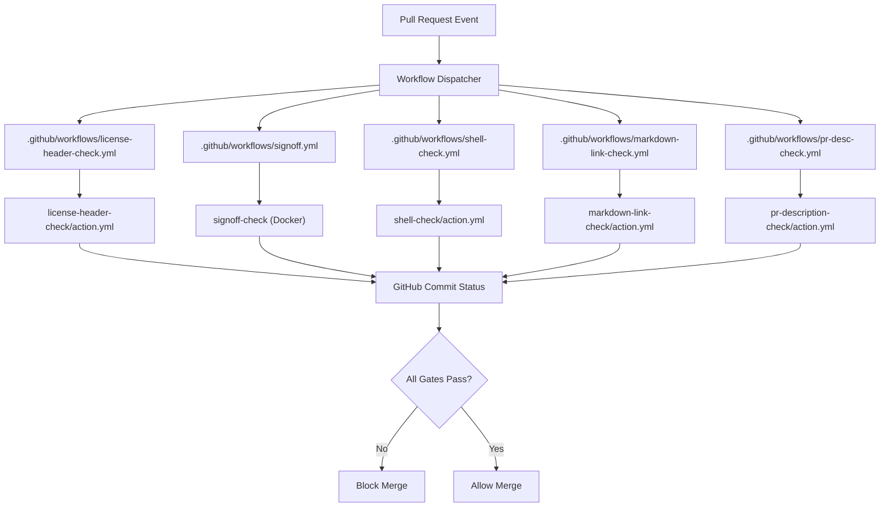
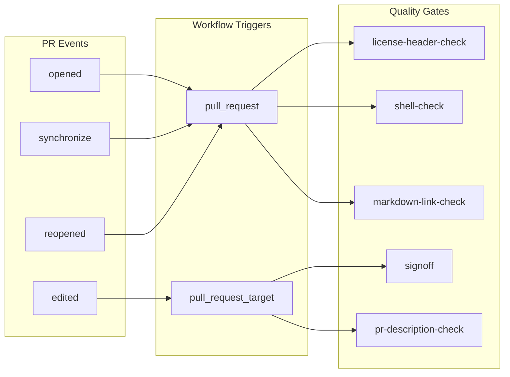
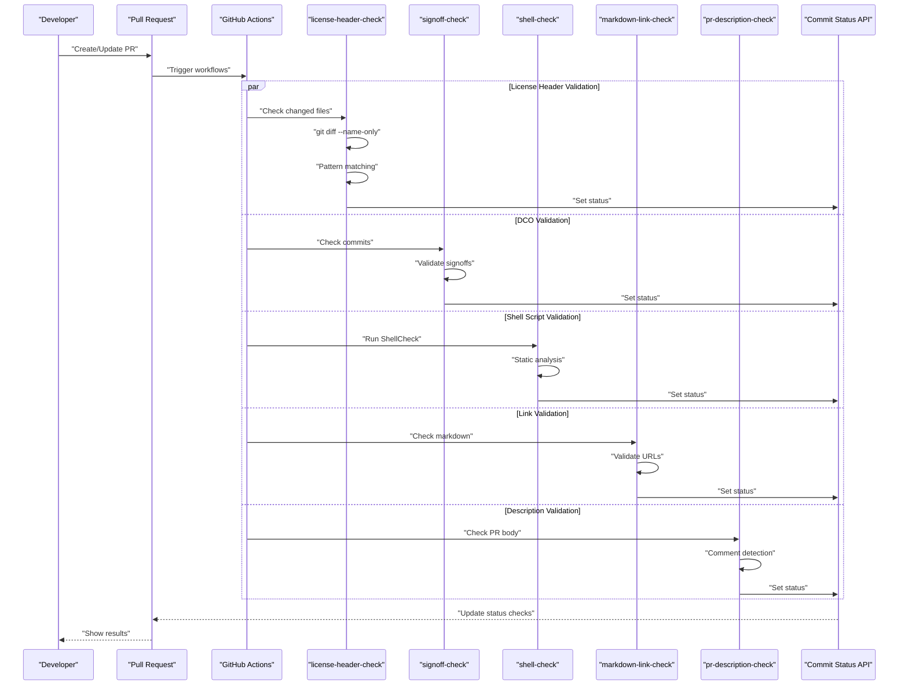

<!-- source: DeepWiki mcp.deepwiki.com · repo NVIDIA/spark-rapids-common · page 2 Quality Gates System · fetched 2026-10-26 -->

# Quality Gates System

<details>
<summary>Relevant source files</summary>

The following files were used as context for generating this wiki page:

- [.github/workflows/license-header-check.yml](.github/workflows/license-header-check.yml)
- [.github/workflows/markdown-link-check.yml](.github/workflows/markdown-link-check.yml)
- [.github/workflows/pr-desc-check.yml](.github/workflows/pr-desc-check.yml)
- [.github/workflows/shell-check.yml](.github/workflows/shell-check.yml)
- [.github/workflows/signoff.yml](.github/workflows/signoff.yml)
- [license-header-check/action.yml](license-header-check/action.yml)
- [markdown-link-check/action.yml](markdown-link-check/action.yml)
- [pr-description-check/action.yml](pr-description-check/action.yml)
- [shell-check/action.yml](shell-check/action.yml)
- [signoff-check/README.md](signoff-check/README.md)

</details>


## Purpose and Scope

The Quality Gates System is a comprehensive validation pipeline that ensures code quality, legal compliance, and documentation integrity across Spark Rapids projects. This system automatically executes a series of checks on pull requests to maintain consistent standards before code can be merged.

The system consists of five primary quality gates that validate different aspects of contributions: license header compliance, Developer Certificate of Origin (DCO) sign-offs, shell script quality, documentation link integrity, and pull request description formatting. Each gate operates as both a standalone GitHub Action and as part of integrated workflows.

For details on individual quality gate implementations, see [License Header Check](#2.1), [Signoff Check](#2.2), [Shell Check](#2.3), [Markdown Link Check](#2.4), and [PR Description Check](#2.5). For information about automated merging that occurs after quality gates pass, see [Automated Merging System](#4).

## Quality Gates Architecture

The quality gates operate through a coordinated system of GitHub workflows and reusable actions. Each gate validates specific aspects of pull request changes and reports status back to the GitHub pull request interface.

### System Overview



Sources: [.github/workflows/license-header-check.yml:15-45](), [.github/workflows/signoff.yml:15-33](), [.github/workflows/shell-check.yml:15-32](), [.github/workflows/markdown-link-check.yml:15-36](), [.github/workflows/pr-desc-check.yml:15-35]()

### Trigger Patterns and Event Handling



Sources: [.github/workflows/license-header-check.yml:18-20](), [.github/workflows/signoff.yml:18-20](), [.github/workflows/shell-check.yml:18-20](), [.github/workflows/markdown-link-check.yml:18-20](), [.github/workflows/pr-desc-check.yml:18-20]()

## Quality Gate Execution Flow

The quality gates execute in parallel when a pull request is created or updated. Each gate performs specific validation logic and reports results through GitHub's commit status API.

### Execution Pipeline



Sources: [license-header-check/action.yml:35-106](), [pr-description-check/action.yml:25-54](), [shell-check/action.yml:24-84](), [markdown-link-check/action.yml:50-130]()

## Individual Quality Gates

### License Header Check

The `license-header-check` action validates that all modified source files contain proper NVIDIA copyright and Apache 2.0 license headers with the current year.

**Key Implementation Details:**
- Uses composite action pattern with bash script execution
- Generates dynamic license pattern: `Copyright \(c\) .*?${CURRENT_YEAR},? NVIDIA CORPORATION.`
- Processes files using `git diff --name-only --diff-filter=AM` to identify added/modified files
- Supports include/exclude patterns for selective file checking
- Handles renamed files by checking `git diff --name-status` with R flag

**Configuration:**
| Input | Required | Default | Description |
|-------|----------|---------|-------------|
| `included_file_patterns` | Yes | - | Comma-separated file patterns to check |
| `excluded_file_patterns` | No | - | Comma-separated file patterns to skip |
| `check_main` | No | `false` | Whether to check main branch merges |

Sources: [license-header-check/action.yml:15-106](), [.github/workflows/license-header-check.yml:36-44]()

### Signoff Check

The `signoff-check` validates Developer Certificate of Origin (DCO) compliance by ensuring all commits in a pull request are properly signed off.

**Implementation:**
- Docker-based action for DCO validation
- Integrates with GitHub API to check commit metadata
- Triggered on `pull_request_target` events for security

**Required Inputs:**
| Input | Description |
|-------|-------------|
| `owner` | Repository owner name |
| `repo` | Repository name |
| `pull_number` | Pull request number |
| `token` | GitHub token with read access |

Sources: [.github/workflows/signoff.yml:22-32](), [signoff-check/README.md:1-29]()

### Shell Check

The `shell-check` action performs static analysis on shell scripts using ShellCheck with a curated set of excluded rules for common patterns.

**Excluded Rules:**
- `SC2086`: Double quote to prevent globbing and word splitting
- `SC2046`: Quote this to prevent word splitting  
- `SC2155`: Declare and assign separately to avoid masking return values
- `SC2006`: Use $(...) notation instead of legacy backticks
- Plus 11 additional rules for practical shell scripting patterns

**Configuration:**
| Input | Required | Default | Description |
|-------|----------|---------|-------------|
| `excluded_codes` | No | "" | Additional comma-separated codes to exclude |

Sources: [shell-check/action.yml:15-84](), [.github/workflows/shell-check.yml:30-31]()

### Markdown Link Check

The `markdown-link-check` action validates that all links in markdown files are accessible and not broken.

**Features:**
- Uses `tcort/github-action-markdown-link-check` as underlying engine
- Comprehensive result summarization with error reporting
- Supports both verbose and quiet modes
- Configurable depth and file filtering

**Key Inputs:**
| Input | Default | Description |
|-------|---------|-------------|
| `use-verbose-mode` | `'yes'` | Show detailed HTTP status for checked links |
| `max-depth` | `-1` | Directory traversal depth (-1 for unlimited) |
| `check-modified-files-only` | - | Only check modified markdown files in PRs |

Sources: [markdown-link-check/action.yml:15-130](), [.github/workflows/markdown-link-check.yml:31-35]()

### PR Description Check

The `pr-description-check` action ensures pull request descriptions don't contain HTML comments that should be manually removed.

**Implementation:**
- Uses GitHub Script API for PR body analysis  
- Searches for `<!--` patterns in PR description
- Sets commit status via GitHub API
- Fails the check if comments are detected

**Logic Flow:**
1. Extract PR body from `context.payload.pull_request`
2. Check for presence of `<!--` substring
3. Set failure state if comments found
4. Create commit status with descriptive message

Sources: [pr-description-check/action.yml:25-54](), [.github/workflows/pr-desc-check.yml:31-34]()

## Integration Points

### Bot PR Exclusion

Most quality gates exclude bot-generated pull requests using the condition:
```yaml
if: "!contains(github.event.pull_request.title, '[bot]')"
```

This prevents automated dependency updates and other bot PRs from triggering unnecessary validations.

### Checkout Integration

Quality gates use the standardized `NVIDIA/spark-rapids-common/checkout@main` action for consistent repository checkout behavior, with dynamic fetch depth calculation for license header checks:

```yaml
- name: Get checkout depth
  run: |
    echo "PR_FETCH_DEPTH=$(( ${{ github.event.pull_request.commits }} + 10 ))" >> $GITHUB_ENV
```

Sources: [.github/workflows/license-header-check.yml:25-34](), [.github/workflows/shell-check.yml:27-28](), [.github/workflows/markdown-link-check.yml:28-29]()

---

