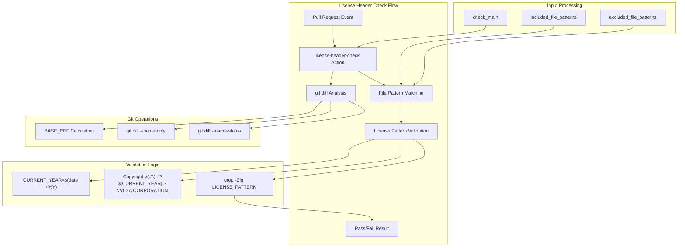
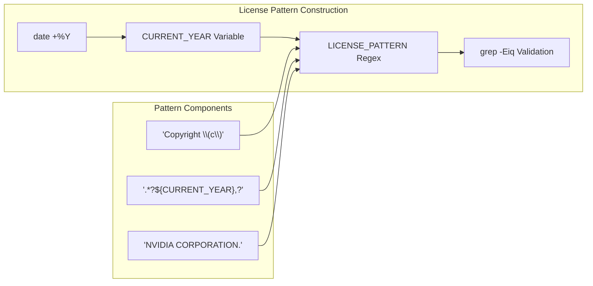
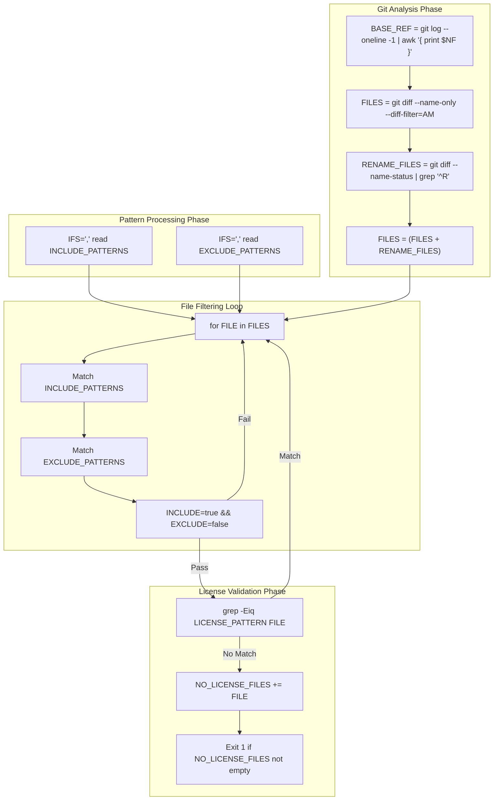
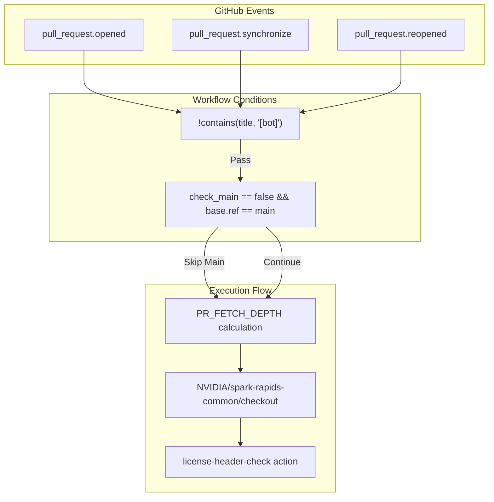

<!-- source: DeepWiki mcp.deepwiki.com · repo NVIDIA/spark-rapids-common · page 2.1 License Header Check · fetched 2026-10-26 -->

# License Header Check

<details>
<summary>Relevant source files</summary>

The following files were used as context for generating this wiki page:

- [.github/workflows/license-header-check.yml](.github/workflows/license-header-check.yml)
- [license-header-check/action.yml](license-header-check/action.yml)

</details>


## Purpose and Scope

The License Header Check system validates that all source files in pull requests contain proper NVIDIA copyright and Apache 2.0 license headers. This system serves as the most critical quality gate in the RAPIDS ecosystem, with an importance score of 22.06, ensuring legal compliance across all NVIDIA Spark Rapids projects.

This page covers the composite GitHub Action that implements license header validation, including file pattern matching, git diff analysis, and error reporting. For information about other quality gates, see [Quality Gates System](#2). For DCO signoff validation, see [Signoff Check](#2.2).

## System Architecture

The License Header Check operates as a composite GitHub Action that integrates git operations, pattern matching, and license validation into a single workflow step.



**Sources:** [license-header-check/action.yml:15-106](), [license-header-check/action.yml:41-42](), [license-header-check/action.yml:57-63]()

## Action Configuration

The `license-header-check` action is defined as a composite action with three configurable inputs that control its behavior across different repository contexts.

### Input Parameters

| Parameter | Type | Required | Default | Description |
|-----------|------|----------|---------|-------------|
| `included_file_patterns` | string | true | - | Comma-separated glob patterns for files to check |
| `excluded_file_patterns` | string | false | - | Comma-separated glob patterns for files to exclude |
| `check_main` | boolean | false | false | Whether to run checks on main branch PRs |

### Usage Example

```yaml
- name: license-header-check
  uses: NVIDIA/spark-rapids-common/license-header-check@main
  with:
    check_main: true
    included_file_patterns: |
      *.yml,
      *Dockerfile*,
      auto-merge/automerge,
      signoff-check/signoff-check
```

**Sources:** [license-header-check/action.yml:17-30](), [.github/workflows/license-header-check.yml:36-44]()

## License Pattern Validation

The system enforces a specific copyright header format that must include the current year and NVIDIA corporate attribution.

### Required Header Format

The license pattern validation uses a dynamic regular expression that incorporates the current year:



The constructed pattern is: `Copyright \(c\) .*?${CURRENT_YEAR},? NVIDIA CORPORATION.`

This pattern matches copyright headers that:
- Start with "Copyright (c)"
- Include any year range ending with the current year
- May have a comma after the year
- Include "NVIDIA CORPORATION." attribution

**Sources:** [license-header-check/action.yml:40-42](), [license-header-check/action.yml:84]()

## File Processing Pipeline

The action implements a comprehensive file filtering and validation pipeline that processes changed files from git diff operations.



**Sources:** [license-header-check/action.yml:57-63](), [license-header-check/action.yml:50-54](), [license-header-check/action.yml:66-88]()

## Error Handling and Reporting

The system provides comprehensive error handling for both git operations and license validation failures, with specific guidance for common resolution strategies.

### Git Operation Error Handling

When git diff operations fail due to stale base commits, the action provides specific guidance:

```bash
git diff --name-only --diff-filter=AM ${BASE_REF} HEAD || \
  (echo "Your base commit ID is too old, please try upmerge first." && exit 1)
```

### License Validation Reporting

The action aggregates all files missing license headers and provides detailed output:

```bash
if [ ! -z "$NO_LICENSE_FILES" ]; then
  echo "Following files missed copyright/license header or expired:"
  echo $NO_LICENSE_FILES | tr ' ' '\n'
  echo "--------- NOTICE ---------"
  echo "${ERROR_MESSAGE}"
  exit 1
fi
```

The `ERROR_MESSAGE` explains that outdated feature branches may cause false positives and recommends upmerging to the latest development branch.

**Sources:** [license-header-check/action.yml:59](), [license-header-check/action.yml:92-106]()

## Workflow Integration

The License Header Check integrates with GitHub workflows through event-driven execution and conditional logic for different branch scenarios.

### Workflow Triggers and Conditions



The workflow calculates checkout depth dynamically based on PR commit count:
```yaml
echo "PR_FETCH_DEPTH=$(( ${{ github.event.pull_request.commits }} + 10 ))" >> $GITHUB_ENV
```

### Main Branch Handling

The action includes special logic for main branch PRs controlled by the `check_main` input:

```bash
if [[ "${{ inputs.check_main }}" == "false" && "${{ github.event.pull_request.base.ref }}" == "main" ]]; then
  echo "Skip this check for Merge to main PR."
  exit 0
fi
```

**Sources:** [.github/workflows/license-header-check.yml:18-25](), [.github/workflows/license-header-check.yml:27-34](), [license-header-check/action.yml:44-48]()

---

