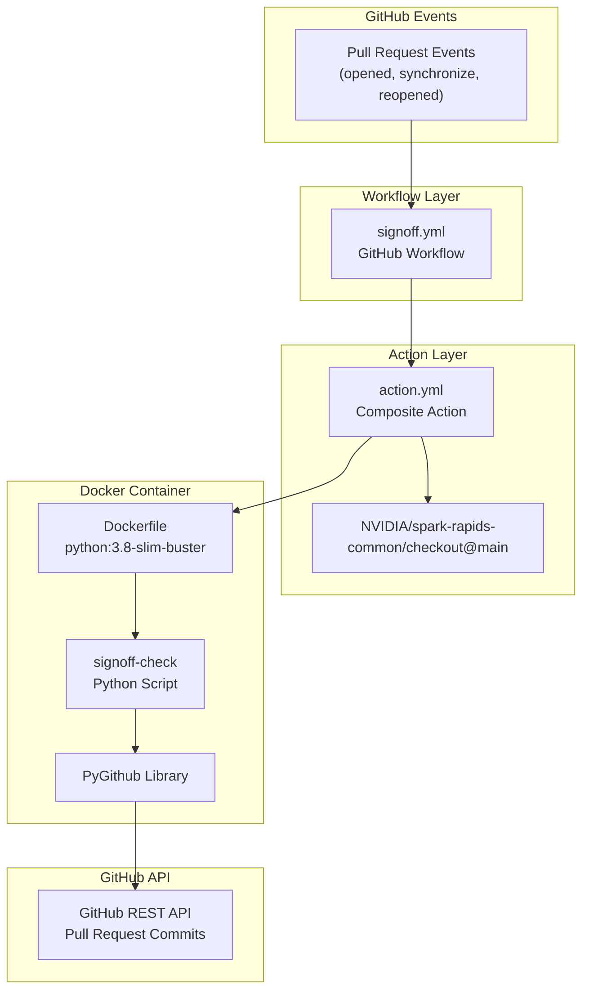
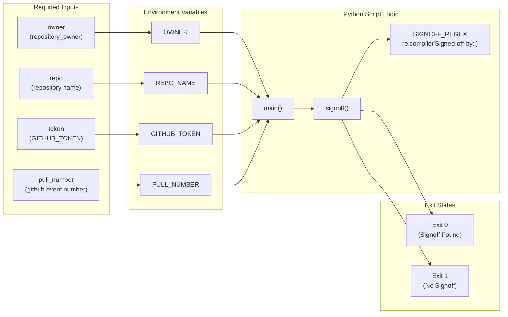
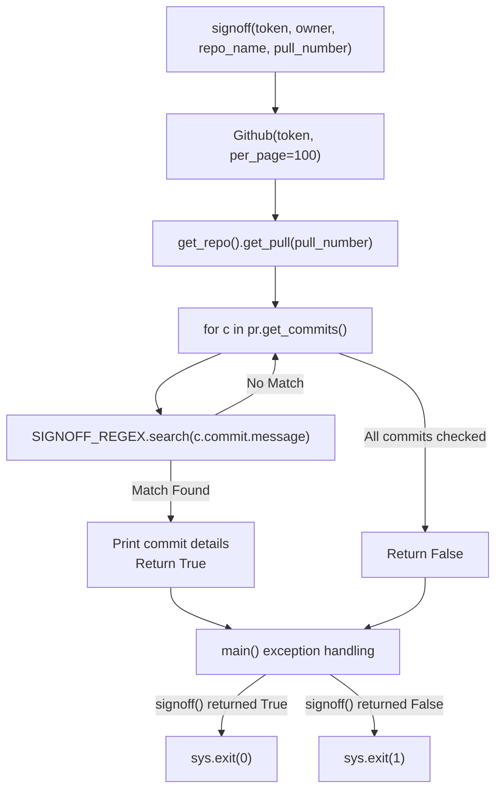
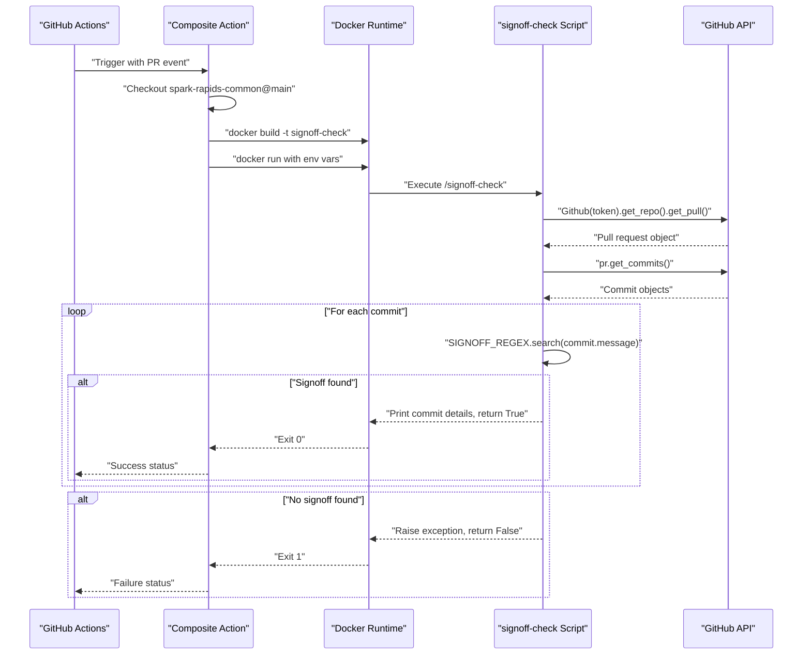

<!-- source: DeepWiki mcp.deepwiki.com · repo NVIDIA/spark-rapids-common · page 2.2 Signoff Check · fetched 2026-10-26 -->

# Signoff Check

<details>
<summary>Relevant source files</summary>

The following files were used as context for generating this wiki page:

- [.github/workflows/signoff.yml](.github/workflows/signoff.yml)
- [signoff-check/Dockerfile](signoff-check/Dockerfile)
- [signoff-check/README.md](signoff-check/README.md)
- [signoff-check/action.yml](signoff-check/action.yml)
- [signoff-check/signoff-check](signoff-check/signoff-check)

</details>


## Purpose and Scope

The Signoff Check system enforces Developer Certificate of Origin (DCO) compliance by validating that pull requests contain at least one commit with a proper sign-off. This quality gate ensures legal compliance across NVIDIA Spark Rapids projects by requiring developers to certify their contributions meet DCO requirements through `Signed-off-by:` commit message headers.

For information about other quality gates in the system, see [Quality Gates System](#2). For broader contribution requirements including DCO policies, see [Contributing Guidelines](#6).

## System Architecture

The Signoff Check system implements a Docker-based GitHub Action that validates commit sign-offs through the GitHub API. The system follows the composite action pattern with containerized execution.

### Component Overview



Sources: [.github/workflows/signoff.yml:1-33](), [signoff-check/action.yml:1-55](), [signoff-check/Dockerfile:1-23]()

### Action Input/Output Flow



Sources: [signoff-check/action.yml:17-33](), [signoff-check/signoff-check:54-71](), [signoff-check/signoff-check:30-42]()

## Implementation Details

### Docker Container Configuration

The signoff check runs in a Python 3.8 slim container with minimal dependencies:

| Component | Details |
|-----------|---------|
| Base Image | `python:3.8-slim-buster` |
| Dependencies | `PyGithub` library |
| Entrypoint | `/signoff-check` executable |
| Working Directory | `/` |

The container expects four environment variables: `OWNER`, `REPO_NAME`, `GITHUB_TOKEN`, and `PULL_NUMBER`.

Sources: [signoff-check/Dockerfile:15-22]()

### Core Validation Logic

The `signoff()` function implements the DCO validation algorithm:



Sources: [signoff-check/signoff-check:33-52]()

The regex pattern `re.compile('Signed-off-by:')` matches the standard DCO sign-off format. When a match is found, the system outputs the commit SHA and message before returning success.

Sources: [signoff-check/signoff-check:30](), [signoff-check/signoff-check:37-41]()

## Usage Configuration

### Workflow Integration

Consumer repositories integrate the signoff check using the `pull_request_target` event trigger:

```yaml
on:
  pull_request_target:
    types: [opened, synchronize, reopened]
```

The `pull_request_target` event provides access to repository secrets while running in the context of the base branch, enabling secure token access for API operations.

Sources: [.github/workflows/signoff.yml:18-20]()

### Input Parameters

| Parameter | Type | Description | Example |
|-----------|------|-------------|---------|
| `owner` | string | Repository owner | `${{ github.repository_owner }}` |
| `repo` | string | Repository name | `spark-rapids-common` |
| `pull_number` | string | PR number | `${{ github.event.number }}` |
| `token` | string | GitHub token | `${{ secrets.GITHUB_TOKEN }}` |

Sources: [signoff-check/action.yml:17-33](), [signoff-check/README.md:14-28]()

### Command Line Interface

The Python script supports both environment variables and command line arguments:

| Argument | Environment Variable | Required | Description |
|----------|---------------------|----------|-------------|
| `--owner` | `OWNER` | Yes | Repository owner |
| `--repo_name` | `REPO_NAME` | Yes | Repository name |
| `--token` | `GITHUB_TOKEN` | Yes | GitHub API token |
| `--pull_number` | `PULL_NUMBER` | Yes | Pull request number |

Sources: [signoff-check/signoff-check:55-69]()

## Technical Execution Flow

### Action Execution Sequence



Sources: [signoff-check/action.yml:44-54](), [signoff-check/signoff-check:33-51]()

### Error Handling

The system implements comprehensive error handling with clear exit codes:

- **Exit 0**: At least one commit contains a valid `Signed-off-by:` line
- **Exit 1**: No commits contain sign-offs or API errors occurred

Exception handling catches all errors and outputs diagnostic information before setting the failure exit code.

Sources: [signoff-check/signoff-check:46-51]()

---

