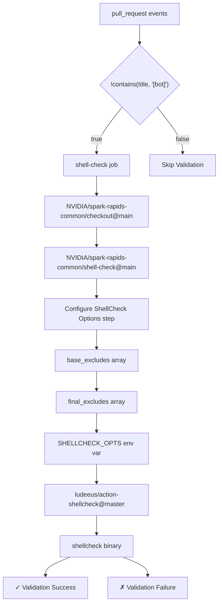
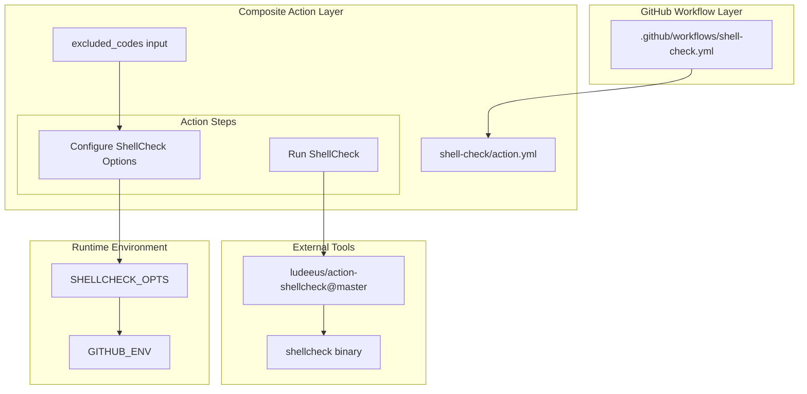
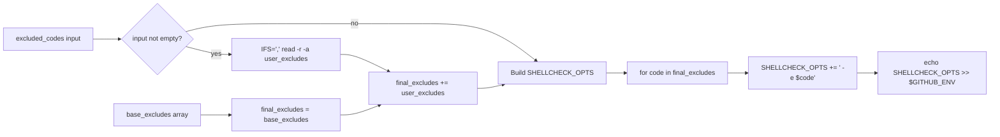

<!-- source: DeepWiki mcp.deepwiki.com · repo NVIDIA/spark-rapids-common · page 2.3 Shell Check · fetched 2026-10-26 -->

# Shell Check

<details>
<summary>Relevant source files</summary>

The following files were used as context for generating this wiki page:

- [.github/workflows/shell-check.yml](.github/workflows/shell-check.yml)
- [shell-check/action.yml](shell-check/action.yml)

</details>


## Purpose and Scope

The Shell Check system provides automated validation of shell scripts in pull requests using the ShellCheck static analysis tool. This system serves as one of the quality gates that must pass before code can be merged, ensuring shell scripts follow best practices and are free from common syntax and logic errors.

This system specifically handles shell script validation. For other code quality checks, see [License Header Check](#2.1), [Signoff Check](#2.2), and [PR Description Check](#2.5).

## System Architecture

The Shell Check system consists of a GitHub workflow that orchestrates validation and a composite action that configures and executes ShellCheck with project-specific settings.

### Shell Check Execution Flow



Sources: [.github/workflows/shell-check.yml:18-32](), [shell-check/action.yml:24-84]()

### Component Architecture



Sources: [.github/workflows/shell-check.yml:27-31](), [shell-check/action.yml:15-84]()

## Workflow Configuration

The workflow is defined in [.github/workflows/shell-check.yml:15-32]() and implements the following behavior:

| Configuration | Value | Purpose |
|---------------|-------|---------|
| **Name** | `shell check` | Workflow identifier |
| **Trigger Events** | `pull_request: [opened, synchronize, reopened]` | Validates shell scripts on PR changes |
| **Runner** | `ubuntu-latest` | Provides consistent Linux environment |
| **Job Condition** | `!contains(github.event.pull_request.title, '[bot]')` | Skips automated bot PRs |

### Workflow Steps

1. **Checkout**: Uses `NVIDIA/spark-rapids-common/checkout@main` for repository access
2. **Shell Validation**: Executes `NVIDIA/spark-rapids-common/shell-check@main` action

Sources: [.github/workflows/shell-check.yml:18-32]()

## Action Implementation

The composite action is implemented in [shell-check/action.yml:15-84]() as a multi-step process that configures ShellCheck options and executes validation.

### Input Parameters

| Input | Type | Default | Description |
|-------|------|---------|-------------|
| `excluded_codes` | `string` | `""` | Comma-separated ShellCheck codes to exclude (e.g., `SC2086,SC2046`) |

Sources: [shell-check/action.yml:17-22]()

### Action Steps

The action executes two primary steps:

1. **Configure ShellCheck Options** [shell-check/action.yml:27-78]()
   - Defines base exclusions for common false positives
   - Merges user-provided exclusions
   - Sets `SHELLCHECK_OPTS` environment variable

2. **Run ShellCheck** [shell-check/action.yml:80-84]()
   - Delegates to `ludeeus/action-shellcheck@master`
   - Passes configured options via environment variables

Sources: [shell-check/action.yml:24-84]()

## ShellCheck Configuration

The action includes a comprehensive set of excluded ShellCheck codes to accommodate common patterns in shell scripting that may trigger false positives.

### Base Exclusions Categories

```mermaid
graph TB
    base_excludes["base_excludes array"] --> quoting_issues["Quoting Issues"]
    base_excludes --> variable_issues["Variable Issues"]  
    base_excludes --> command_substitution["Command Substitution"]
    base_excludes --> array_issues["Array and Pattern Issues"]
    base_excludes --> file_operations["File Operations"]
    base_excludes --> logic_issues["Logic Issues"]
    
    quoting_issues --> SC2086["SC2086: Double quote to prevent globbing"]
    quoting_issues --> SC2046["SC2046: Quote to prevent word splitting"]
    quoting_issues --> SC2016["SC2016: Expressions don't expand in single quotes"]
    
    variable_issues --> SC2155["SC2155: Declare and assign separately"]
    variable_issues --> SC2154["SC2154: Variable referenced but not assigned"]
    variable_issues --> SC2034["SC2034: Variable appears unused"]
    variable_issues --> SC2163["SC2163: Does not export VAR"]
    
    command_substitution --> SC2006["SC2006: Use $(...) instead of backticks"]
    command_substitution --> SC2001["SC2001: Use ${variable//search/replace}"]
    
    array_issues --> SC2102["SC2102: Ranges match single chars"]
    array_issues --> SC2207["SC2207: Prefer mapfile or read -a"]
    array_issues --> SC2145["SC2145: Argument mixes string and array"]
    
    file_operations --> SC1091["SC1091: Not following file not specified"]
    file_operations --> SC2010["SC2010: Don't use ls | grep"]
    file_operations --> SC2012["SC2012: Use find instead of ls"]
    
    logic_issues --> SC2015["SC2015: A && B || C is not if-then-else"]
```



Sources: [shell-check/action.yml:30-62]()

### Exclusion Management Process



The system supports both predefined base exclusions and runtime user exclusions:

1. **Base Exclusions**: Hardcoded `base_excludes` array [shell-check/action.yml:30-63]()
2. **User Exclusions**: Runtime input via `excluded_codes` parameter [shell-check/action.yml:65-67]()
3. **Option Building**: Constructs `SHELLCHECK_OPTS` string with `-e` flags [shell-check/action.yml:69-76]()

Sources: [shell-check/action.yml:64-78]()

## Usage Patterns

### Standard Usage

The action is typically consumed through the workflow without additional configuration:

```yaml
- name: Run ShellCheck
  uses: NVIDIA/spark-rapids-common/shell-check@main
```

### Custom Exclusions

Projects can provide additional exclusions for project-specific needs:

```yaml
- name: Run ShellCheck
  uses: NVIDIA/spark-rapids-common/shell-check@main
  with:
    excluded_codes: "SC2001,SC2010"
```

### Integration Requirements

The action requires:
- Repository checkout (typically via `NVIDIA/spark-rapids-common/checkout@main`)
- Shell scripts present in the repository
- Ubuntu runner environment

Sources: [.github/workflows/shell-check.yml:27-31](), [shell-check/action.yml:17-22]()

---

