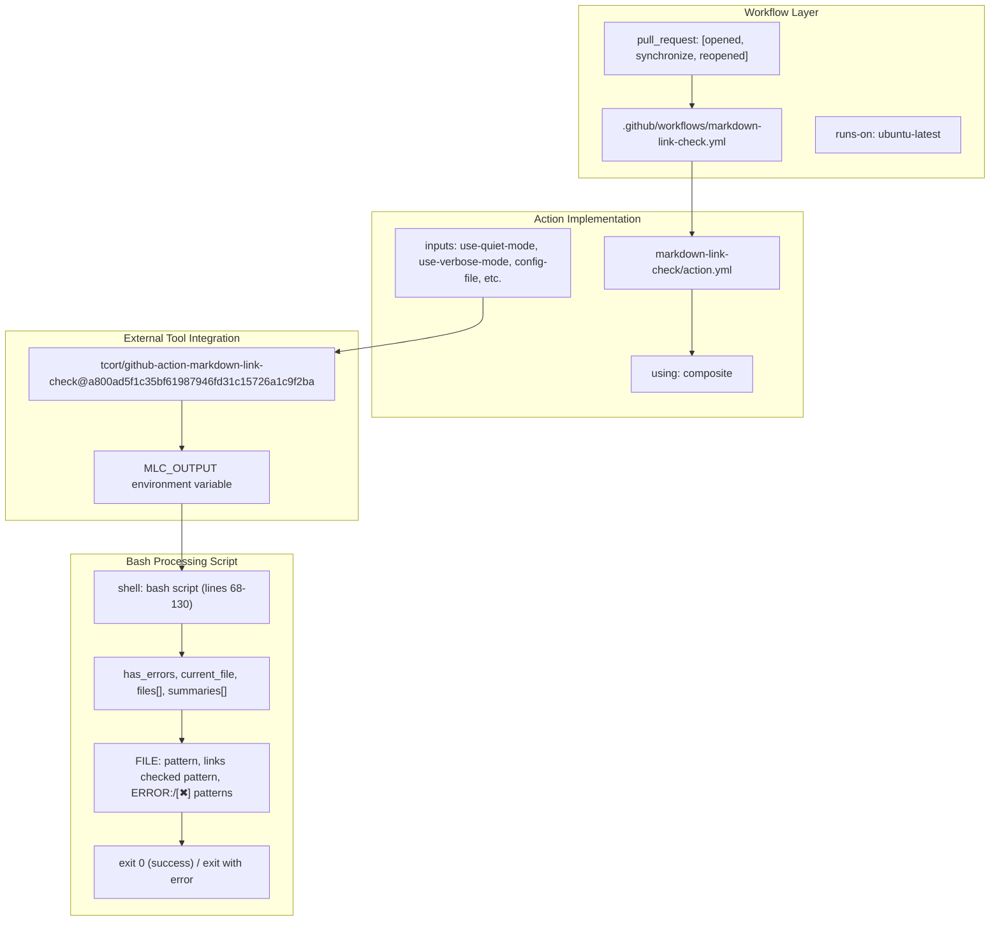
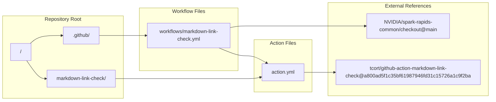
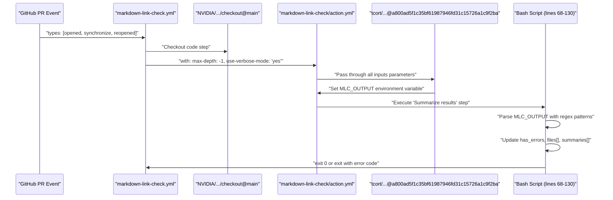
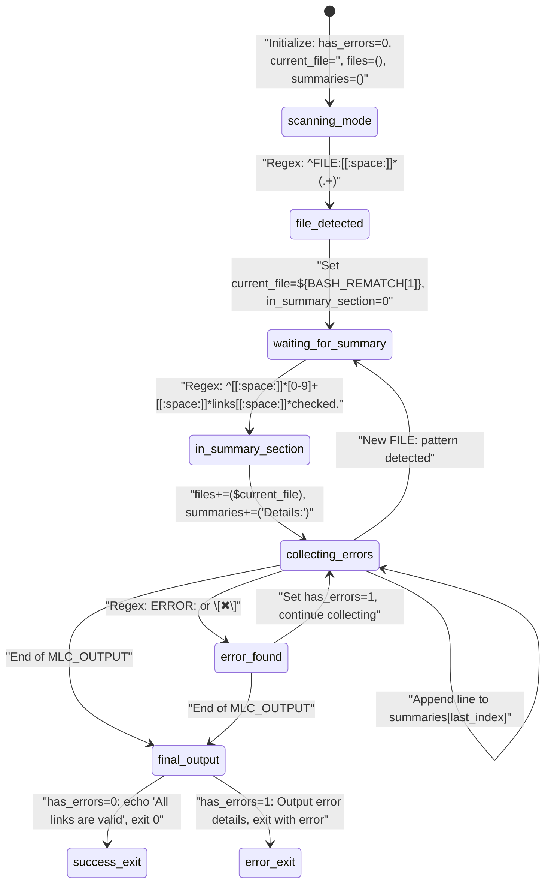
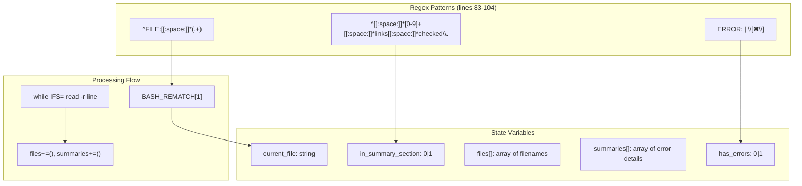
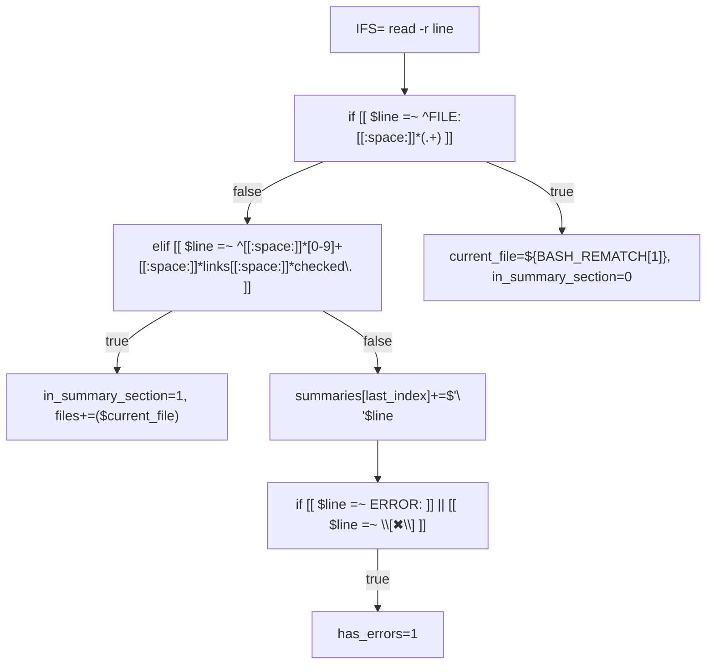

<!-- source: DeepWiki mcp.deepwiki.com · repo NVIDIA/spark-rapids-common · page 2.4 Markdown Link Check · fetched 2026-10-26 -->

# Markdown Link Check

<details>
<summary>Relevant source files</summary>

The following files were used as context for generating this wiki page:

- [.github/workflows/markdown-link-check.yml](.github/workflows/markdown-link-check.yml)
- [markdown-link-check/action.yml](markdown-link-check/action.yml)

</details>


This document covers the markdown link validation system that ensures documentation links remain valid and accessible across Spark RAPIDS projects. The system validates all markdown files in a repository by checking HTTP/HTTPS links, local file references, and anchor links to detect broken or invalid URLs.

For information about other quality gate systems, see [Quality Gates System](#2). For shell script validation, see [Shell Check](#2.3).

## Purpose and Architecture

The Markdown Link Check system provides automated link validation for markdown documentation through a composite GitHub Action that wraps the external `tcort/github-action-markdown-link-check` tool. The system runs on pull request events and validates links in markdown files to ensure documentation quality and accessibility.

### System Components

#### Code Entity Architecture


#### File Structure and Dependencies


Sources: [markdown-link-check/action.yml:1-130](), [.github/workflows/markdown-link-check.yml:1-36]()

## Configuration Inputs

The composite action accepts multiple configuration parameters to customize link checking behavior:

| Input Parameter | Description | Default Value | Required |
|-----------------|-------------|---------------|----------|
| `use-quiet-mode` | Show only errors in output | `no` | No |
| `use-verbose-mode` | Show detailed HTTP status for checked links | `yes` | No |
| `config-file` | Path to custom configuration file | - | No |
| `folder-path` | Comma-separated folders to check | entire repository | No |
| `max-depth` | Directory traversal depth (-1 for unlimited) | `-1` | No |
| `check-modified-files-only` | Only check modified markdown files in PRs | - | No |
| `base-branch` | Comparison branch for modified files check | - | No |
| `file-extension` | File extension to check | - | No |
| `file-path` | Comma-separated specific files to check | - | No |

Sources: [markdown-link-check/action.yml:18-48]()

## Workflow Integration

The workflow triggers on pull request events and executes the link validation process:

#### Execution Flow with Code Entities


Sources: [.github/workflows/markdown-link-check.yml:18-36](), [markdown-link-check/action.yml:50-66]()

## Result Processing Logic

The action includes custom result processing that parses the output from the external tool and provides structured error reporting:

### Bash Script Processing Algorithm

The `Summarize results` step implements a state machine using bash variables and regex patterns:

#### State Machine Implementation


#### Bash Variable State Tracking


Sources: [markdown-link-check/action.yml:74-107]()

### Bash Regex Pattern Implementation

The bash script uses specific regex patterns with `BASH_REMATCH` array for parsing:

| Pattern Purpose | Bash Regex Expression | Code Reference | Capture Group |
|-----------------|------------------------|----------------|---------------|
| File Detection | `^FILE:[[:space:]]*(.+)` | [line 83]() | `${BASH_REMATCH[1]}` → `current_file` |
| Summary Detection | `^[[:space:]]*[0-9]+[[:space:]]*links[[:space:]]*checked\.` | [line 88]() | No capture group |
| Error Detection | `ERROR:` \| `\[✖\]` | [line 103]() | No capture group |

#### Pattern Matching Logic


Sources: [markdown-link-check/action.yml:81-106]()

## Error Reporting

When errors are detected, the system provides structured output with file-specific error details:

### Success Case
```
=========== All links are valid ===========
```

### Error Case
```
=========== Found error links ===========
File: path/to/file.md
  Details:
  ERROR: 404 → https://example.com/broken-link
  [✖] https://invalid-url.com
```

The reporting logic iterates through collected summaries and outputs only files containing errors, with proper indentation for readability.

Sources: [markdown-link-check/action.yml:110-130]()

## Integration with Quality Gates

The Markdown Link Check system operates as part of the broader quality gates infrastructure, running automatically on pull requests to validate documentation quality before code merge. The action uses the standard `NVIDIA/spark-rapids-common/checkout@main` action for repository access and integrates seamlessly with other validation workflows in the spark-rapids-common ecosystem.

Sources: [.github/workflows/markdown-link-check.yml:28-35]()

---

