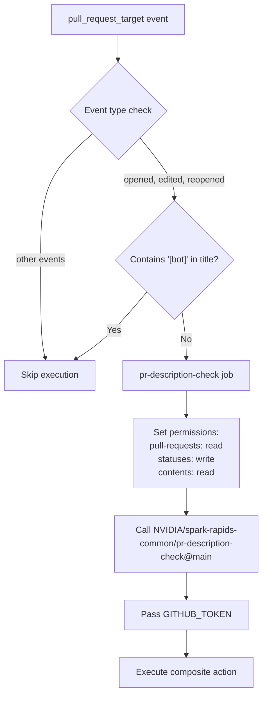
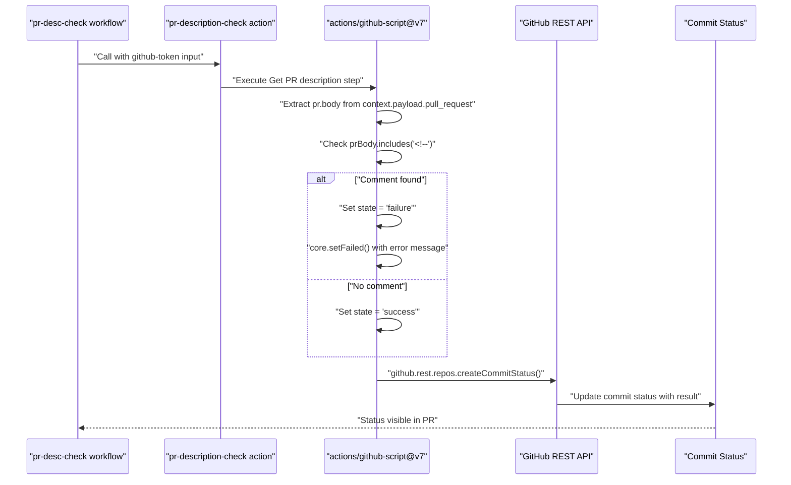
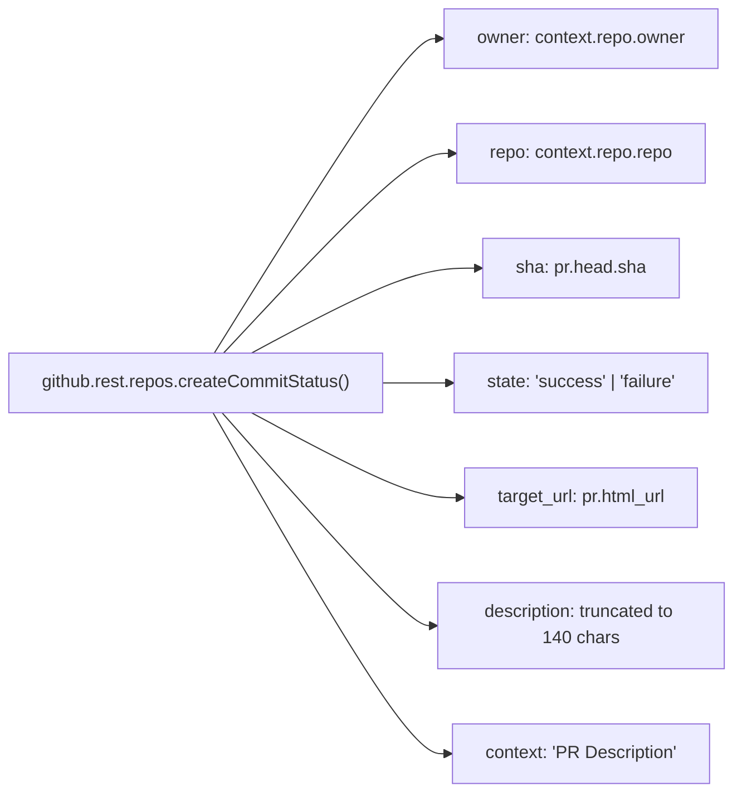

<!-- source: DeepWiki mcp.deepwiki.com · repo NVIDIA/spark-rapids-common · page 2.5 PR Description Check · fetched 2026-10-26 -->

# PR Description Check

Relevant source files

The following files were used as context for generating this wiki page:

- [.github/workflows/pr-desc-check.yml](.github/workflows/pr-desc-check.yml)
- [pr-description-check/action.yml](pr-description-check/action.yml)

## Purpose and Scope

The PR Description Check system validates pull request descriptions to ensure they do not contain HTML comments, maintaining clean and professional documentation standards across the NVIDIA Spark Rapids ecosystem. This system prevents accidentally committed HTML comment blocks (starting with `<!--`) from appearing in PR descriptions, which could indicate incomplete or draft content.

This document covers the automated validation workflow and composite action implementation. For information about other quality gates, see [Quality Gates System](#2). For signoff validation requirements, see [Signoff Check](#2.2).

## Workflow Execution Flow

The PR description validation is triggered automatically through the `pr-desc-check.yml` workflow on specific pull request events.

#### PR Description Check Workflow Execution

Sources: [.github/workflows/pr-desc-check.yml:18-34]()

The workflow uses `pull_request_target` trigger for security reasons, allowing access to secrets while processing PRs from forks. The bot filter at [.github/workflows/pr-desc-check.yml:29]() prevents unnecessary execution on automated PRs.

## Action Implementation Architecture

The `pr-description-check` composite action implements the core validation logic using GitHub's scripting capabilities.

#### Action Internal Flow and GitHub API Integration

Sources: [pr-description-check/action.yml:26-53]()

## Validation Logic Details

The action performs a simple but effective validation check against HTML comments in PR descriptions.

### Input Configuration

| Input Parameter | Type | Required | Purpose |
|---|---|---|---|
| `github-token` | string | Yes | Authentication token for GitHub API access |

Sources: [pr-description-check/action.yml:17-21]()

### Validation Algorithm

The validation logic at [pr-description-check/action.yml:31-43]() follows this process:

1. **Extract PR Data**: Retrieves `pr.body` and `pr.head.sha` from `context.payload.pull_request`
2. **Comment Detection**: Checks if `prBody.includes('<!--')` returns true
3. **State Determination**: Sets `state` to `'failure'` if comments found, `'success'` otherwise
4. **Error Handling**: Calls `core.setFailed()` with descriptive message when validation fails

### Status Reporting Mechanism

The action creates a commit status through the GitHub REST API with these parameters:

Sources: [pr-description-check/action.yml:45-53]()

The status description is truncated to 140 characters at [pr-description-check/action.yml:51]() to comply with GitHub's API limits. The context name `'PR Description'` appears as a separate status check in the PR's status panel.

## Error Messages and User Feedback

The system provides clear feedback through standardized error messages:

- **Success State**: `"PR description is valid."`
- **Failure State**: `"PR description contains comment in '<!--'. Please remove the comment manually."`

Sources: [pr-description-check/action.yml:37-39]()

These messages guide developers to resolve issues by manually removing HTML comment blocks from their PR descriptions, ensuring clean and professional documentation standards across the project.

---

