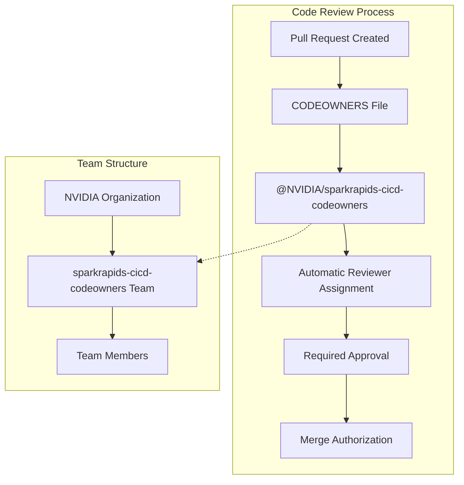
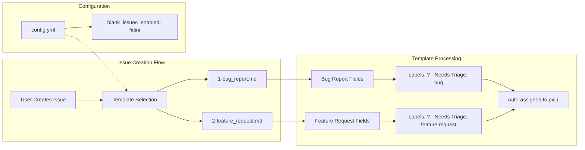
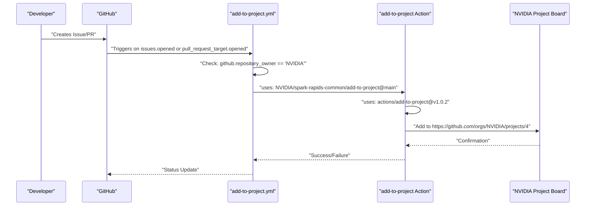
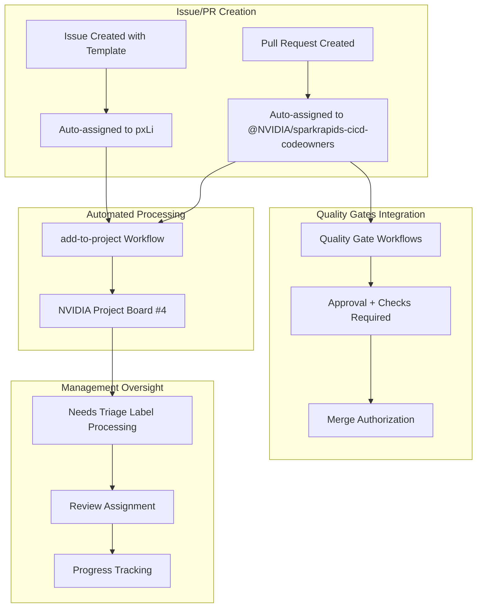

<!-- source: DeepWiki mcp.deepwiki.com · repo NVIDIA/spark-rapids-common · page 3 Project Management · fetched 2026-10-26 -->

# Project Management

Relevant source files

The following files were used as context for generating this wiki page:

- [.github/CODEOWNERS](.github/CODEOWNERS)
- [.github/ISSUE_TEMPLATE/1-bug_report.md](.github/ISSUE_TEMPLATE/1-bug_report.md)
- [.github/ISSUE_TEMPLATE/2-feature_request.md](.github/ISSUE_TEMPLATE/2-feature_request.md)
- [.github/ISSUE_TEMPLATE/config.yml](.github/ISSUE_TEMPLATE/config.yml)
- [.github/workflows/add-to-project.yml](.github/workflows/add-to-project.yml)
- [add-to-project/README.md](add-to-project/README.md)
- [add-to-project/action.yml](add-to-project/action.yml)

This document covers the automated project management infrastructure within the spark-rapids-common repository. The system encompasses code ownership enforcement, structured issue tracking templates, and automated project board integration that ensures consistent project governance across the NVIDIA Spark Rapids ecosystem.

The project management system operates through three primary components: the `CODEOWNERS` configuration for review assignments, GitHub issue templates for standardized reporting, and the automated `add-to-project` workflow for project board tracking. For information about quality assurance workflows that complement these management processes, see [Quality Gates System](#2).

## Code Ownership System

The repository implements a centralized code ownership model through the `CODEOWNERS` configuration that automatically assigns reviewers for all changes.

**Code Ownership Configuration**

The ownership model assigns universal responsibility to the `@NVIDIA/sparkrapids-cicd-codeowners` team for all repository content, as defined in [.github/CODEOWNERS:1](). This ensures that every pull request receives appropriate review from qualified team members who understand the CI/CD infrastructure implications.

**Sources:** [.github/CODEOWNERS:1-2]()

## Issue Template System

The repository provides structured issue templates that standardize bug reporting and feature requests, ensuring consistent information capture for project management.

**Issue Template Architecture**

### Bug Report Template

The bug report template in [.github/ISSUE_TEMPLATE/1-bug_report.md]() structures issue submission with the following components:

| Field | Purpose |
|-------|---------|
| `title` | Prefixed with "[BUG]" for categorization |
| `labels` | Auto-applies "? - Needs Triage, bug" |
| `assignees` | Automatically assigns to `pxLi` |
| Description fields | Structured prompts for bug details, reproduction steps, and expected behavior |

### Feature Request Template

The feature request template in [.github/ISSUE_TEMPLATE/2-feature_request.md]() provides structured fields for enhancement proposals:

| Field | Purpose |
|-------|---------|
| `title` | Prefixed with "[FEA]" for categorization |
| `labels` | Auto-applies "? - Needs Triage, feature request" |
| `assignees` | Automatically assigns to `pxLi` |
| Description fields | Problem description, solution proposal, alternatives, and context |

The system disables blank issues through [.github/ISSUE_TEMPLATE/config.yml:15](), forcing users to select appropriate templates and ensuring consistent issue quality.

**Sources:** [.github/ISSUE_TEMPLATE/1-bug_report.md:1-23](), [.github/ISSUE_TEMPLATE/2-feature_request.md:1-22](), [.github/ISSUE_TEMPLATE/config.yml:15]()

## Automated Project Board Integration

The `add-to-project` system automatically integrates new issues and pull requests into the NVIDIA project board for centralized tracking and management.

**Project Integration Workflow**

### Workflow Configuration

The workflow in [.github/workflows/add-to-project.yml]() activates on specific GitHub events:

- **Issue Events**: `issues.opened` ([.github/workflows/add-to-project.yml:18-20]())
- **Pull Request Events**: `pull_request_target.opened` ([.github/workflows/add-to-project.yml:21-23]())

The workflow includes a security check at [.github/workflows/add-to-project.yml:27]() that restricts execution to repositories owned by the NVIDIA organization, preventing unauthorized project board additions from forked repositories.

### Action Implementation

The `add-to-project` action serves as a wrapper around the official GitHub `actions/add-to-project@v1.0.2` action, configured with NVIDIA-specific settings:

| Component | Configuration |
|-----------|---------------|
| **Target Project** | `https://github.com/orgs/NVIDIA/projects/4` ([add-to-project/action.yml:29]()) |
| **Authentication** | Uses `PROJECT_TOKEN` secret ([.github/workflows/add-to-project.yml:33]()) |
| **Action Type** | Composite action ([add-to-project/action.yml:24]()) |

**Sources:** [.github/workflows/add-to-project.yml:15-34](), [add-to-project/action.yml:15-31](), [add-to-project/README.md:1-24]()

## System Integration

The project management components work together to create a comprehensive governance framework that ensures proper oversight, tracking, and process adherence.

**Integrated Project Management Flow**

The integrated system ensures that:

1. **All contributions receive appropriate review** through `CODEOWNERS` assignments
2. **Issues follow structured reporting** via required templates  
3. **Work items are automatically tracked** in the centralized project board
4. **Security is maintained** through organization ownership validation
5. **Process consistency** is enforced across the entire Spark Rapids ecosystem

**Sources:** [.github/CODEOWNERS:1-2](), [.github/workflows/add-to-project.yml:27](), [add-to-project/action.yml:29]()

---

