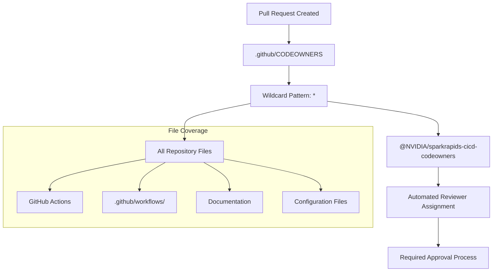
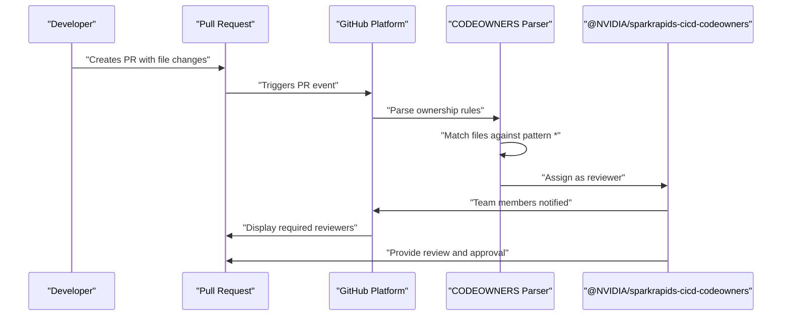
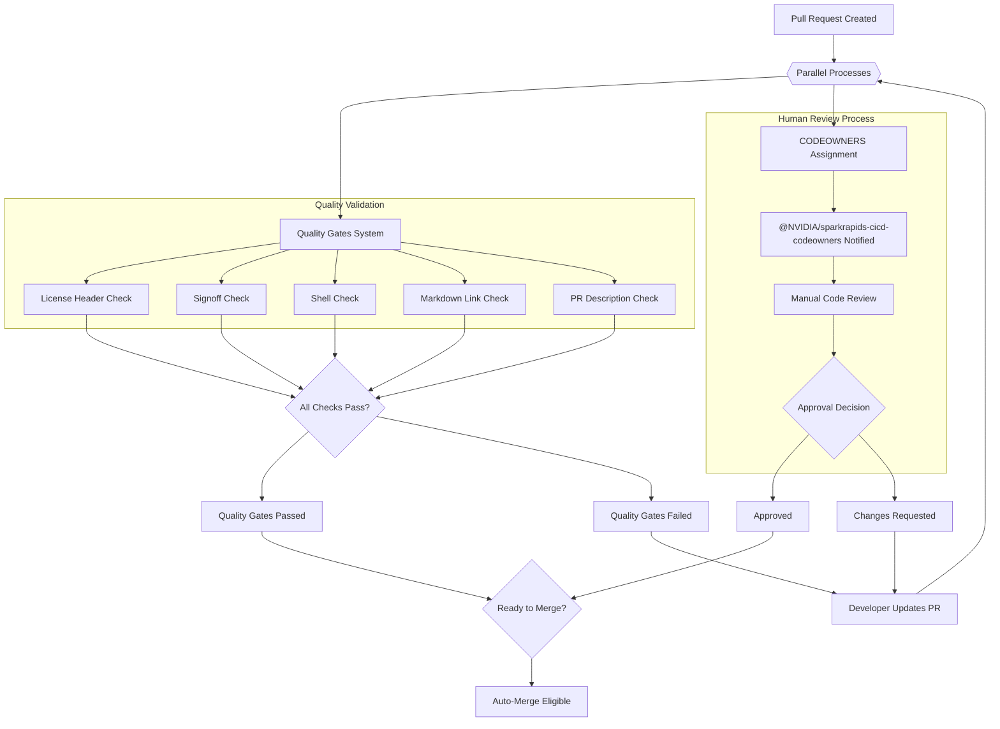
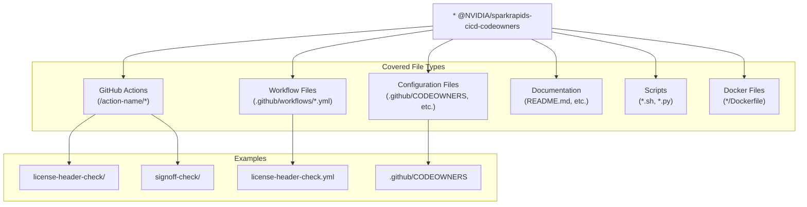

<!-- source: DeepWiki mcp.deepwiki.com · repo NVIDIA/spark-rapids-common · page 3.1 Code Ownership · fetched 2026-10-26 -->

# Code Ownership

<details>
<summary>Relevant source files</summary>

The following files were used as context for generating this wiki page:

- [.github/CODEOWNERS](.github/CODEOWNERS)

</details>


This document covers the code ownership system in spark-rapids-common, which defines review responsibilities and automated reviewer assignment through GitHub's CODEOWNERS mechanism. The system ensures proper oversight of all changes by automatically assigning the appropriate team members as reviewers when pull requests are created.

For information about the broader project management automation including issue templates and project board integration, see [Project Management](#3).

## Purpose and Configuration

The code ownership system is implemented through GitHub's CODEOWNERS functionality, which automatically assigns reviewers to pull requests based on file path patterns. The spark-rapids-common repository uses a centralized ownership model where all files are owned by a single team.

### CODEOWNERS Configuration

The ownership rules are defined in [.github/CODEOWNERS:1-2](), which establishes a simple but comprehensive ownership structure:

```
* @NVIDIA/sparkrapids-cicd-codeowners
```

This configuration assigns the `@NVIDIA/sparkrapids-cicd-codeowners` team as owners for all files in the repository using the wildcard pattern `*`.

**Sources:** [.github/CODEOWNERS:1-2]()

### Ownership Model Architecture



**Sources:** [.github/CODEOWNERS:1-2]()

## Reviewer Assignment Process

The code ownership system integrates with GitHub's pull request workflow to automatically assign reviewers based on the files modified in each pull request. This ensures consistent oversight across all repository changes.

### Assignment Workflow



**Sources:** [.github/CODEOWNERS:1-2]()

## Integration with Quality Gates

The code ownership system works in conjunction with the quality gates system to ensure both automated validation and human oversight. The reviewer assignment occurs alongside the automated quality checks documented in [Quality Gates System](#2).

### Review and Merge Flow



**Sources:** [.github/CODEOWNERS:1-2]()

## Team Structure and Responsibilities

The `@NVIDIA/sparkrapids-cicd-codeowners` team serves as the central authority for all repository changes. This team structure provides several benefits for the spark-rapids-common repository:

### Ownership Benefits

| Aspect | Benefit |
|--------|---------|
| **Consistency** | Single team ensures uniform review standards across all components |
| **Expertise** | Team specializes in CI/CD and automation systems |
| **Accountability** | Clear ownership chain for all repository changes |
| **Coverage** | No files excluded from review requirements |

### Team Responsibilities

The code owners are responsible for:

- Reviewing all pull requests for technical correctness
- Ensuring changes align with repository standards and practices
- Validating that modifications don't break existing functionality
- Maintaining the quality and security of reusable GitHub Actions
- Approving changes that affect CI/CD workflows and automation

**Sources:** [.github/CODEOWNERS:1-2]()

## Repository-Wide Coverage

The wildcard pattern `*` in the CODEOWNERS configuration ensures comprehensive coverage of all repository components. This includes critical infrastructure components that require careful oversight:

### Protected Components



**Sources:** [.github/CODEOWNERS:1-2]()

This comprehensive ownership model ensures that all changes to the spark-rapids-common repository receive appropriate technical review, maintaining the reliability and quality of the centralized CI/CD infrastructure that supports the broader NVIDIA Spark Rapids ecosystem.

---

