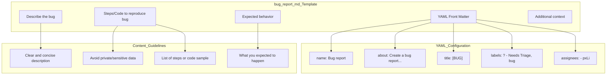
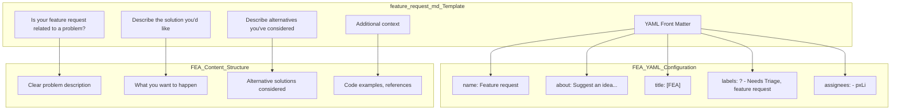

<!-- source: DeepWiki mcp.deepwiki.com · repo NVIDIA/spark-rapids-common · page 3.2 Issue Templates · fetched 2026-10-26 -->

# Issue Templates

Relevant source files

The following files were used as context for generating this wiki page:

- [.github/ISSUE_TEMPLATE/1-bug_report.md](.github/ISSUE_TEMPLATE/1-bug_report.md)
- [.github/ISSUE_TEMPLATE/2-feature_request.md](.github/ISSUE_TEMPLATE/2-feature_request.md)
- [.github/ISSUE_TEMPLATE/config.yml](.github/ISSUE_TEMPLATE/config.yml)

This document covers the structured issue template system in the spark-rapids-common repository that standardizes bug reports and feature requests. The templates ensure consistent information collection for effective issue triage and resolution.

For information about automated issue project board integration, see [Add to Project Action](#3.3). For code review assignments related to issues, see [Code Ownership](#3.1).

## Template Structure Overview

The issue template system consists of two standardized templates and a configuration file that collectively manage how users submit issues to the repository.

```mermaid
flowchart TD
    subgraph "GitHub_ISSUE_TEMPLATE_Directory" [".github/ISSUE_TEMPLATE/"]
        CONFIG["config.yml"]
        BUG_TEMPLATE["1-bug_report.md"]
        FEATURE_TEMPLATE["2-feature_request.md"]
    end
    
    subgraph "Template_Configuration"
        BLANK_DISABLED["blank_issues_enabled: false"]
        COPYRIGHT["NVIDIA Copyright Header"]
    end
    
    subgraph "Bug_Report_Structure"
        BUG_TITLE["Title: [BUG]"]
        BUG_LABELS["Labels: ? - Needs Triage, bug"]
        BUG_ASSIGNEE["Assignee: pxLi"]
        BUG_SECTIONS["Sections: Description, Steps, Expected, Context"]
    end
    
    subgraph "Feature_Request_Structure"
        FEA_TITLE["Title: [FEA]"]
        FEA_LABELS["Labels: ? - Needs Triage, feature request"]
        FEA_ASSIGNEE["Assignee: pxLi"]
        FEA_SECTIONS["Sections: Problem, Solution, Alternatives, Context"]
    end
    
    CONFIG --> BLANK_DISABLED
    CONFIG --> COPYRIGHT
    BUG_TEMPLATE --> BUG_TITLE
    BUG_TEMPLATE --> BUG_LABELS
    BUG_TEMPLATE --> BUG_ASSIGNEE
    BUG_TEMPLATE --> BUG_SECTIONS
    FEATURE_TEMPLATE --> FEA_TITLE
    FEATURE_TEMPLATE --> FEA_LABELS
    FEATURE_TEMPLATE --> FEA_ASSIGNEE
    FEATURE_TEMPLATE --> FEA_SECTIONS
```

Sources: [.github/ISSUE_TEMPLATE/config.yml:1-16](), [.github/ISSUE_TEMPLATE/1-bug_report.md:1-23](), [.github/ISSUE_TEMPLATE/2-feature_request.md:1-22]()

## Template Configuration

The `config.yml` file controls global issue template behavior by disabling blank issue creation, forcing users to select from the structured templates.

| Configuration Setting | Value | Purpose |
|----------------------|--------|---------|
| `blank_issues_enabled` | `false` | Forces template selection |
| Copyright Header | NVIDIA Apache 2.0 | Legal compliance |

Sources: [.github/ISSUE_TEMPLATE/config.yml:15-16]()

## Bug Report Template

The bug report template (`1-bug_report.md`) provides a structured format for reporting defects and issues.

Sources: [.github/ISSUE_TEMPLATE/1-bug_report.md:1-23]()

### Bug Report Fields

The template includes four structured sections:

1. **Bug Description** - Clear description of the defect [.github/ISSUE_TEMPLATE/1-bug_report.md:11-12]()
2. **Reproduction Steps** - Code or steps to reproduce, with security guidance [.github/ISSUE_TEMPLATE/1-bug_report.md:14-16]()
3. **Expected Behavior** - Description of correct behavior [.github/ISSUE_TEMPLATE/1-bug_report.md:18-19]()
4. **Additional Context** - Supporting information [.github/ISSUE_TEMPLATE/1-bug_report.md:21-22]()

## Feature Request Template

The feature request template (`2-feature_request.md`) structures enhancement and new feature proposals.

Sources: [.github/ISSUE_TEMPLATE/2-feature_request.md:1-22]()

### Feature Request Fields

The template structures enhancement requests into four sections:

1. **Problem Description** - Identifies the issue the feature addresses [.github/ISSUE_TEMPLATE/2-feature_request.md:11-12]()
2. **Proposed Solution** - Clear description of desired functionality [.github/ISSUE_TEMPLATE/2-feature_request.md:14-15]()
3. **Alternatives Considered** - Analysis of other approaches [.github/ISSUE_TEMPLATE/2-feature_request.md:17-18]()
4. **Additional Context** - Code examples and references [.github/ISSUE_TEMPLATE/2-feature_request.md:20-21]()

## Automatic Processing

Both templates include automatic processing metadata that integrates with the project management system:

| Template Element | Bug Report | Feature Request |
|------------------|------------|-----------------|
| Title Prefix | `[BUG]` | `[FEA]` |
| Initial Labels | `? - Needs Triage, bug` | `? - Needs Triage, feature request` |
| Default Assignee | `pxLi` | `pxLi` |

The `? - Needs Triage` label ensures new issues enter the triage workflow for prioritization and assignment.

Sources: [.github/ISSUE_TEMPLATE/1-bug_report.md:4-7](), [.github/ISSUE_TEMPLATE/2-feature_request.md:4-7]()

---

