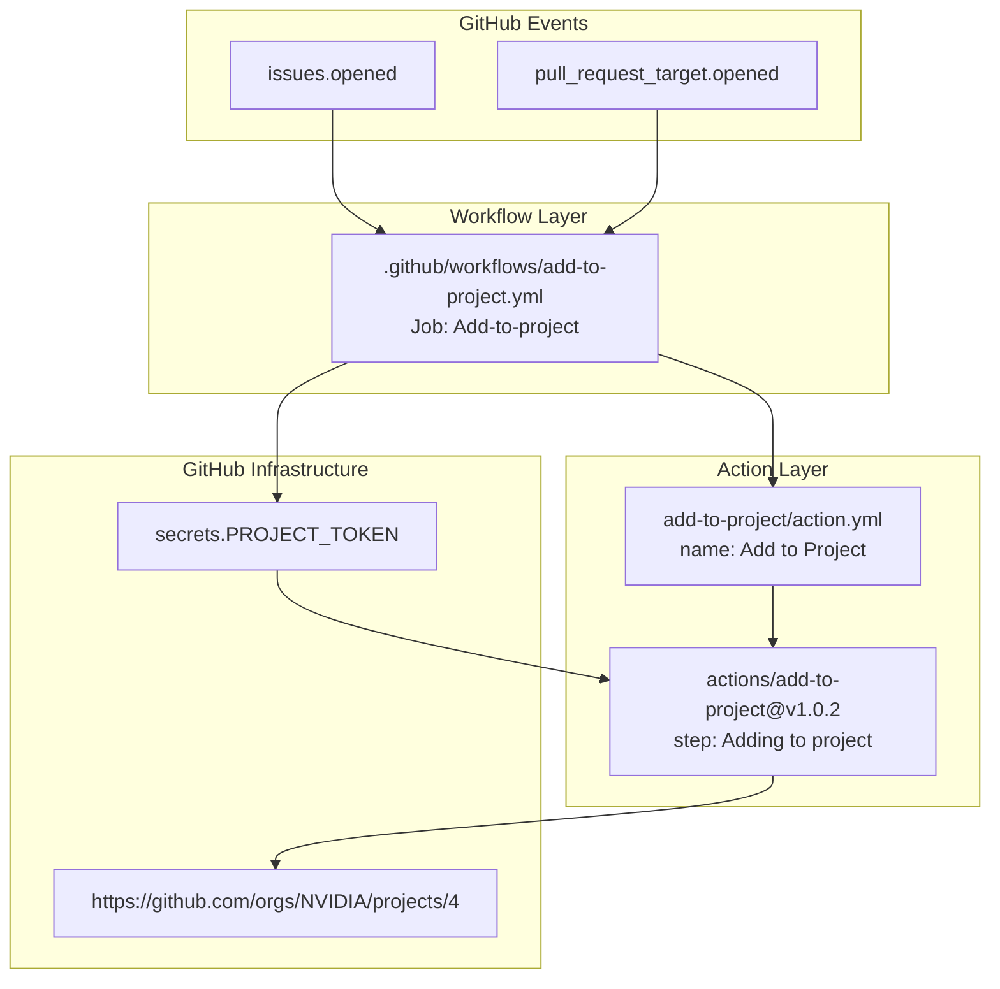
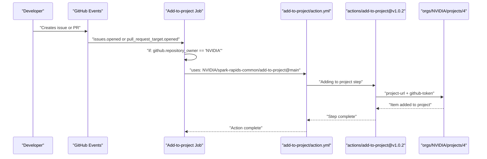
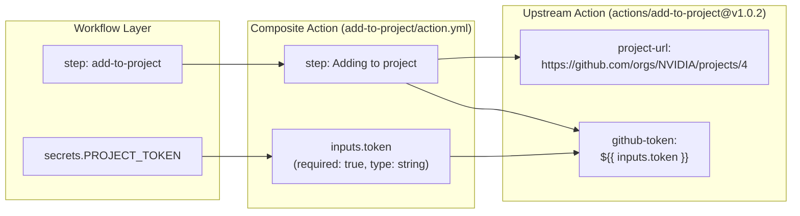

<!-- source: DeepWiki mcp.deepwiki.com · repo NVIDIA/spark-rapids-common · page 3.3 Add to Project Action · fetched 2026-10-26 -->

# Add to Project Action

<details>
<summary>Relevant source files</summary>

The following files were used as context for generating this wiki page:

- [.github/workflows/add-to-project.yml](.github/workflows/add-to-project.yml)
- [add-to-project/README.md](add-to-project/README.md)
- [add-to-project/action.yml](add-to-project/action.yml)

</details>


This document covers the automated system that adds newly created issues and pull requests to GitHub project boards. The system consists of a reusable composite action and an event-driven workflow that ensures all new repository activity is automatically tracked in centralized project management boards.

For information about other project management features like code ownership, see [Code Ownership](#3.1). For details about issue creation templates, see [Issue Templates](#3.2).

## Purpose and Architecture

The Add to Project Action provides automated project board management through two main components: an event-triggered workflow and a reusable composite action wrapper.

### System Component Diagram



Sources: [.github/workflows/add-to-project.yml:17-23](), [add-to-project/action.yml:27-30]()

## Workflow Trigger System

The workflow responds to specific GitHub repository events to automatically capture new items that need project board tracking.

### Event Configuration

The `add-to-project.yml` workflow triggers on two distinct event types:

| Event Type | Trigger Condition | Purpose |
|------------|------------------|---------|
| `issues` | `opened` | Adds newly created issues to project board |
| `pull_request_target` | `opened` | Adds newly created pull requests to project board |

The workflow includes a repository ownership filter to prevent execution on forked repositories:

```yaml
if: github.repository_owner == 'NVIDIA'
```

Sources: [.github/workflows/add-to-project.yml:17-27]()

### Workflow Execution Flow

### Workflow Execution Flow



Sources: [.github/workflows/add-to-project.yml:25-33](), [add-to-project/action.yml:26-30]()

## Composite Action Implementation

The `add-to-project` action serves as a wrapper around the upstream `actions/add-to-project@v1.0.2` action, providing organization-specific configuration.

### Action Configuration

The composite action definition includes these key specifications:

- **Action Type**: Composite action using `runs.using: "composite"`
- **Input Requirements**: Single required `token` input of type `string`  
- **Target Project**: Hardcoded to `https://github.com/orgs/NVIDIA/projects/4`
- **Upstream Action**: Uses `actions/add-to-project@v1.0.2`

### Input and Parameter Flow

### Input and Parameter Flow



Sources: [add-to-project/action.yml:17-30]()

## Usage and Configuration

### Basic Implementation

Consumer repositories can integrate the action by adding the workflow file and configuring the required secret. The complete job structure follows this pattern:

```yaml
jobs:
  Add-to-project:
    if: github.repository_owner == 'NVIDIA'
    runs-on: ubuntu-latest
    steps:
      - name: add-to-project
        uses: NVIDIA/spark-rapids-common/add-to-project@main
        with:
          token: ${{ secrets.PROJECT_TOKEN }}
```

### Target Project Configuration

The action automatically adds items to a specific NVIDIA project board:

| Configuration | Value | Purpose |
|---------------|-------|---------|
| **Project URL** | `https://github.com/orgs/NVIDIA/projects/4` | Hardcoded target project board |
| **Organization** | `NVIDIA` | Organization-level project board |
| **Project ID** | `4` | Specific project board identifier |

### Repository Requirements

| Requirement | Description | Implementation |
|-------------|-------------|----------------|
| **Repository Ownership** | Must be NVIDIA-owned repository | Checked via `github.repository_owner == 'NVIDIA'` |
| **Secret Configuration** | `PROJECT_TOKEN` must be configured | Repository or organization secret |
| **Project Access** | Token must have write access to target project | GitHub token permissions |

Sources: [add-to-project/README.md:11-23](), [.github/workflows/add-to-project.yml:27]()

## Security and Access Control

### Token Requirements

The action requires a `PROJECT_TOKEN` secret with specific permissions:

- **Write Access**: Token must have write permissions to the target project board
- **Scope**: Token should be scoped to the minimum necessary permissions
- **Storage**: Must be stored as a GitHub secret (repository or organization level)

### Repository Filtering

The workflow includes explicit filtering to prevent execution on unauthorized repositories:

```yaml
if: github.repository_owner == 'NVIDIA'
```

This ensures the action only executes within the NVIDIA organization context, preventing potential abuse from forked repositories.

Sources: [.github/workflows/add-to-project.yml:27](), [add-to-project/README.md:7]()

---

