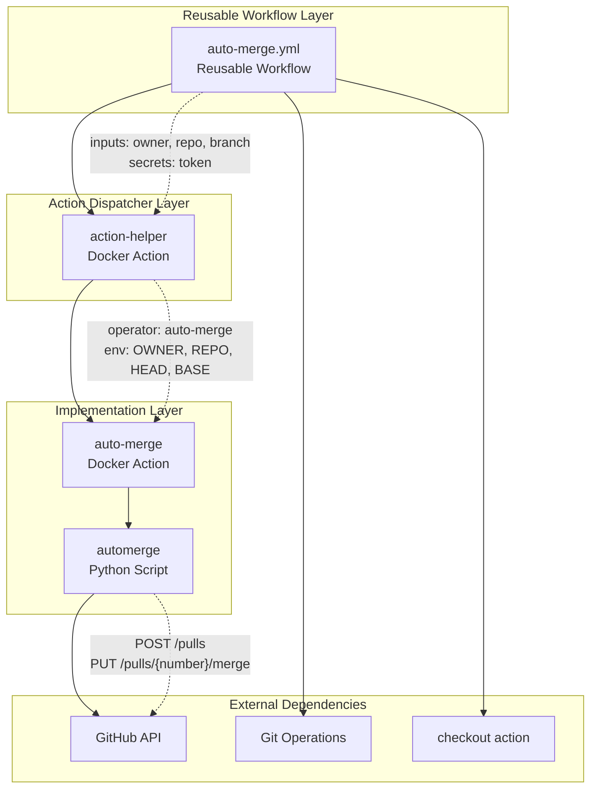
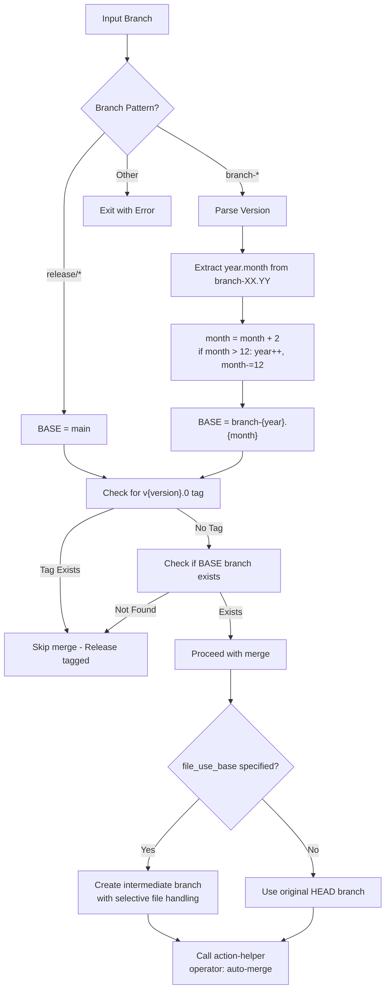
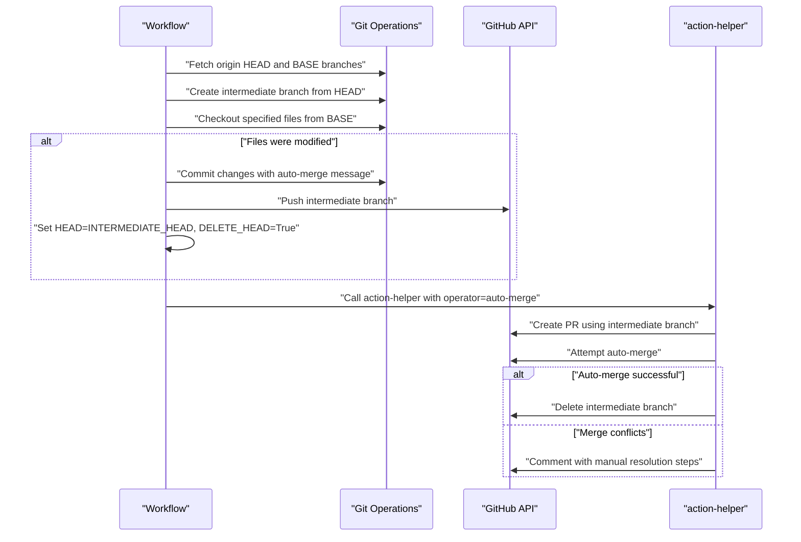
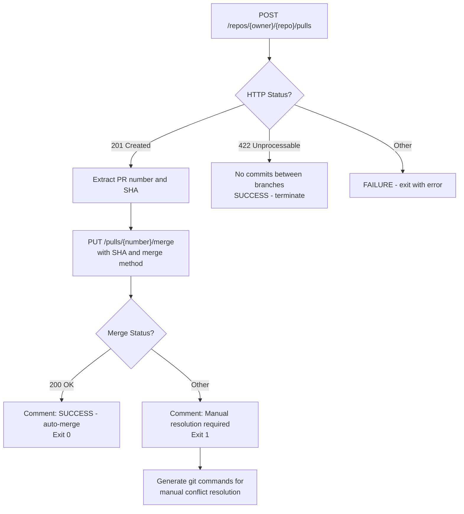

<!-- source: DeepWiki mcp.deepwiki.com · repo NVIDIA/spark-rapids-common · page 4 Automated Merging System · fetched 2026-10-26 -->

# Automated Merging System

Relevant source files

The following files were used as context for generating this wiki page:

- [.github/workflows/auto-merge.yml](.github/workflows/auto-merge.yml)
- [action-helper/action.yml](action-helper/action.yml)
- [auto-merge/Dockerfile](auto-merge/Dockerfile)
- [auto-merge/action.yml](auto-merge/action.yml)
- [auto-merge/automerge](auto-merge/automerge)

## Purpose and Scope

The Automated Merging System provides infrastructure for maintaining synchronization between release branches in NVIDIA Spark Rapids projects. This system automatically creates and merges pull requests to keep downstream branches up-to-date when changes are made to upstream branches, with support for selective file handling and conflict resolution.

For information about the individual auto-merge action component, see [Auto-Merge Action](#4.2). For details about the action helper infrastructure that dispatches merge operations, see [Action Helper System](#4.3).

## System Architecture

The Automated Merging System consists of three primary components that work together to provide branch synchronization capabilities:

Sources: [.github/workflows/auto-merge.yml:1-157](), [auto-merge/action.yml:15-19](), [action-helper/action.yml:15-26](), [auto-merge/automerge:48-86]()

## Branch Resolution Logic

The system implements intelligent branch resolution that determines target branches based on naming conventions and release cycles:

Sources: [.github/workflows/auto-merge.yml:51-72](), [.github/workflows/auto-merge.yml:74-96](), [.github/workflows/auto-merge.yml:98-110]()

## Selective File Handling

When `file_use_base` is specified, the system creates an intermediate branch that synchronizes most changes while preserving specific files from the target branch:

| Component | Purpose | Implementation |
|-----------|---------|----------------|
| `INTERMEDIATE_HEAD` | Temporary branch name | `bot-auto-merge-${{ env.HEAD }}` |
| File Override Logic | Preserve base versions | `git checkout origin/${BASE} -- ${FILE_USE_BASE}` |
| Commit Strategy | Signed commits | `git commit -s -am "Auto-merge use ${BASE} versions"` |
| Branch Cleanup | Remove temp branch | `DELETE_HEAD=True` environment variable |

The selective handling process follows this sequence:

Sources: [.github/workflows/auto-merge.yml:112-144](), [.github/workflows/auto-merge.yml:145-157]()

## Auto-Merge Implementation

The core auto-merge functionality is implemented in a Python script that handles PR creation and automatic merging through the GitHub API:

### PR Creation Process

The `create()` function in [auto-merge/automerge:48-73]() performs the following operations:

| Parameter | Value | Purpose |
|-----------|-------|---------|
| `title` | `[auto-merge] {HEAD} to {BASE} [skip ci] [bot]` | Identifies automated PRs |
| `head` | Source branch | Branch containing changes |
| `base` | Target branch | Branch to merge into |
| `maintainer_can_modify` | `True` | Allows repository maintainers to modify PR |

### Auto-Merge Logic

The `auto_merge()` function attempts to automatically merge the created PR using merge method `merge`. The system handles three outcomes:

Sources: [auto-merge/automerge:48-73](), [auto-merge/automerge:76-111]()

### Environment Variables

The auto-merge script requires the following environment variables:

| Variable | Source | Purpose |
|----------|--------|---------|
| `OWNER` | Workflow input | Repository owner |
| `REPO_NAME` | Workflow input (`REPO`) | Repository name |
| `HEAD` | Calculated by workflow | Source branch for merge |
| `BASE` | Calculated by workflow | Target branch for merge |
| `AUTOMERGE_TOKEN` | Workflow secret (`TOKEN`) | GitHub authentication token |

Sources: [auto-merge/automerge:30-45](), [.github/workflows/auto-merge.yml:151-156]()

## Integration Points

The Automated Merging System integrates with several other components in the spark-rapids-common ecosystem:

### Action Helper Integration

The system uses the action-helper as a dispatcher, calling it with `operator: auto-merge` to trigger the merge operation. This provides a consistent interface for various automated operations.

### Checkout Action Integration  

For selective file handling scenarios, the workflow uses the standardized checkout action to ensure consistent repository state before performing git operations.

### GitHub API Integration

Direct integration with GitHub's REST API enables:
- PR creation and management
- Branch and tag validation
- Automated commenting for status updates
- Merge operation execution

Sources: [.github/workflows/auto-merge.yml:147-157](), [auto-merge/automerge:42-45](), [.github/workflows/auto-merge.yml:113-117]()

---

