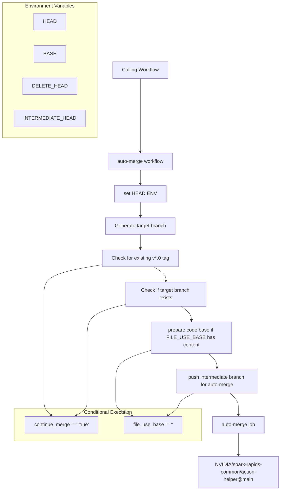
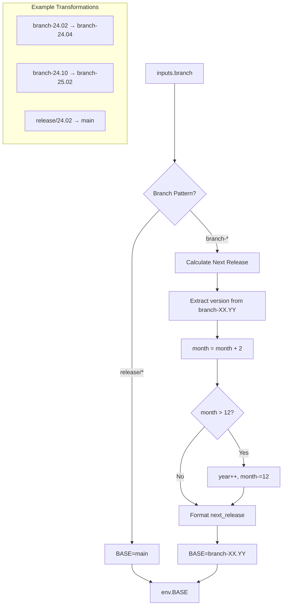
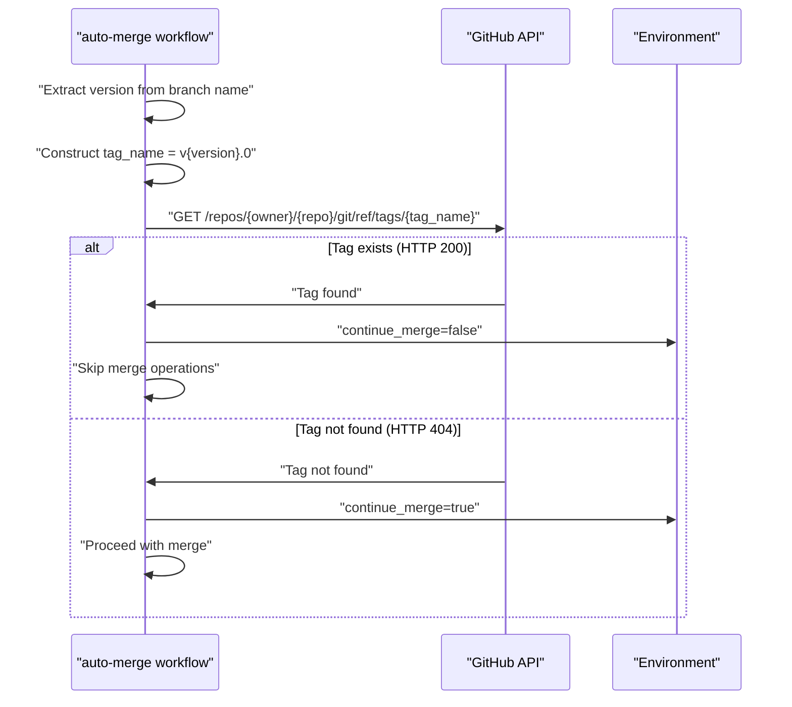
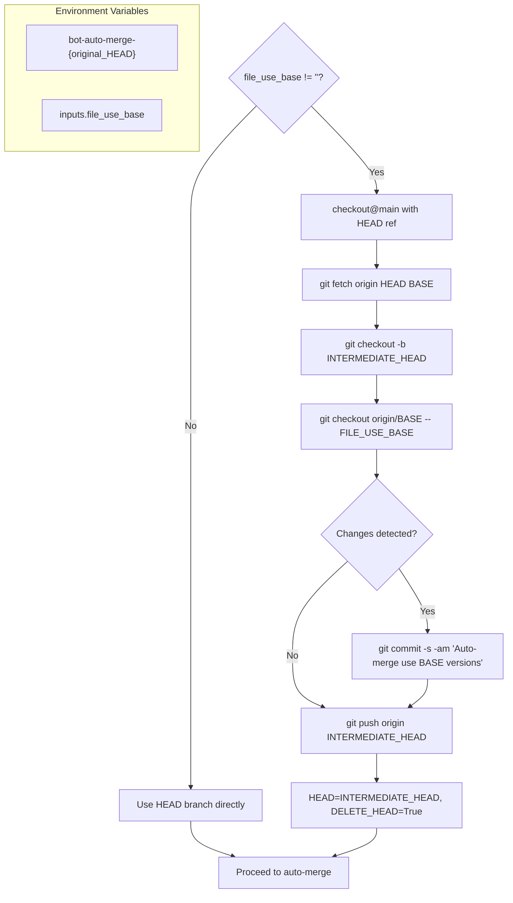
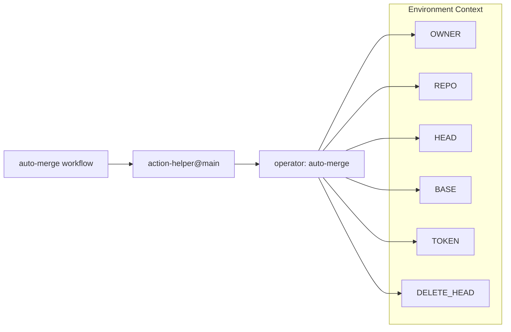

<!-- source: DeepWiki mcp.deepwiki.com · repo NVIDIA/spark-rapids-common · page 4.1 Auto-Merge Workflow · fetched 2026-10-26 -->

# Auto-Merge Workflow

Relevant source files

The following files were used as context for generating this wiki page:

- [.github/workflows/auto-merge.yml](.github/workflows/auto-merge.yml)

## Purpose and Scope

The Auto-Merge Workflow is a reusable GitHub Actions workflow that automates the process of merging commits from current release branches to their corresponding target branches. This workflow handles complex branching scenarios including merging from `release/*` branches to `main` and from `branch-*` branches to their next sequential release branches.

The workflow provides selective file handling capabilities, allowing certain files to maintain their base branch versions during the merge process. For information about the underlying auto-merge action implementation, see [Auto-Merge Action](#4.2). For details about the action helper infrastructure that executes the merge operations, see [Action Helper System](#4.3).

## Workflow Overview

The auto-merge workflow serves as a high-level orchestrator that determines merge targets, handles file conflicts, and delegates the actual merge execution to the action helper system. It operates as a reusable workflow that can be called by other repositories in the Spark Rapids ecosystem.

### Workflow Architecture

Sources: [.github/workflows/auto-merge.yml:1-157]()

## Branch Logic and Target Determination

The workflow implements sophisticated branch mapping logic to determine the appropriate target branch for merge operations. This logic handles both modern `release/*` naming conventions and legacy `branch-*` patterns.

### Branch Target Resolution

| Input Branch Pattern | Target Branch | Logic |
|---------------------|---------------|-------|
| `release/*` | `main` | Direct mapping for modern releases |
| `branch-XX.YY` | `branch-XX.(YY+2)` | Sequential release increment |
| `branch-XX.10` | `branch-(XX+1).02` | Year rollover handling |

Sources: [.github/workflows/auto-merge.yml:51-72]()

## Version Tag Validation

The workflow includes safeguards to prevent merging after a release has been tagged, ensuring that completed releases are not inadvertently modified.

### Tag Existence Check Process

Sources: [.github/workflows/auto-merge.yml:74-96]()

## Selective File Handling

The workflow supports selective file handling through the `file_use_base` input parameter, which specifies files that should maintain their base branch versions during the merge process.

### Intermediate Branch Creation

When `file_use_base` is specified, the workflow creates an intermediate branch with modified file contents:

The intermediate branch naming follows the pattern `bot-auto-merge-{original_branch_name}` and is automatically deleted after the merge completes.

Sources: [.github/workflows/auto-merge.yml:112-144]()

## Action Helper Integration

The workflow delegates the actual merge execution to the `action-helper` system with the `auto-merge` operator, passing all necessary environment variables for the operation.

### Environment Variable Mapping

| Workflow Environment | Action Helper Usage | Purpose |
|---------------------|-------------------|---------|
| `inputs.owner` | `OWNER` | Repository owner |
| `inputs.repo` | `REPO` | Repository name |
| `env.HEAD` | `HEAD` | Source branch (possibly intermediate) |
| `env.BASE` | `BASE` | Target branch |
| `secrets.token` | `TOKEN` | GitHub authentication |
| `env.DELETE_HEAD` | `DELETE_HEAD` | Cleanup flag for intermediate branches |

### Action Helper Invocation

Sources: [.github/workflows/auto-merge.yml:145-156]()

## Workflow Input Parameters

The workflow accepts the following input parameters for customization:

| Parameter | Type | Required | Default | Description |
|-----------|------|----------|---------|-------------|
| `owner` | string | Yes | - | Repository owner name |
| `repo` | string | Yes | - | Repository name |
| `branch` | string | Yes | - | Source branch (typically `github.event.pull_request.base.ref`) |
| `file_use_base` | string | No | `''` | Space-separated paths of files to use base branch versions |

The `file_use_base` parameter enables selective file handling, allowing certain configuration files or version-specific content to maintain consistency with the target branch.

Sources: [.github/workflows/auto-merge.yml:19-38]()

---

