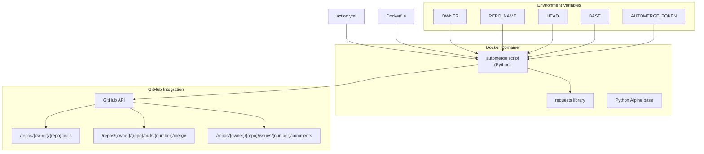
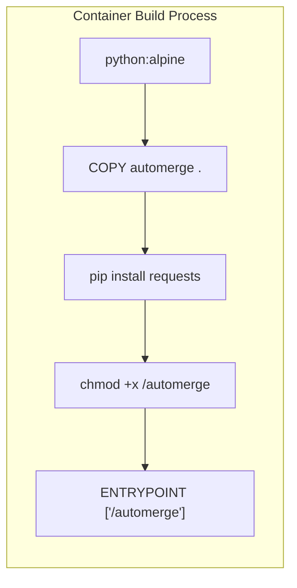
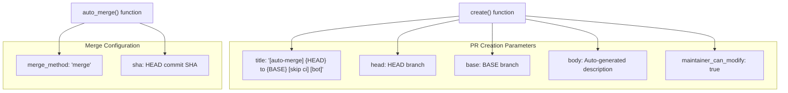
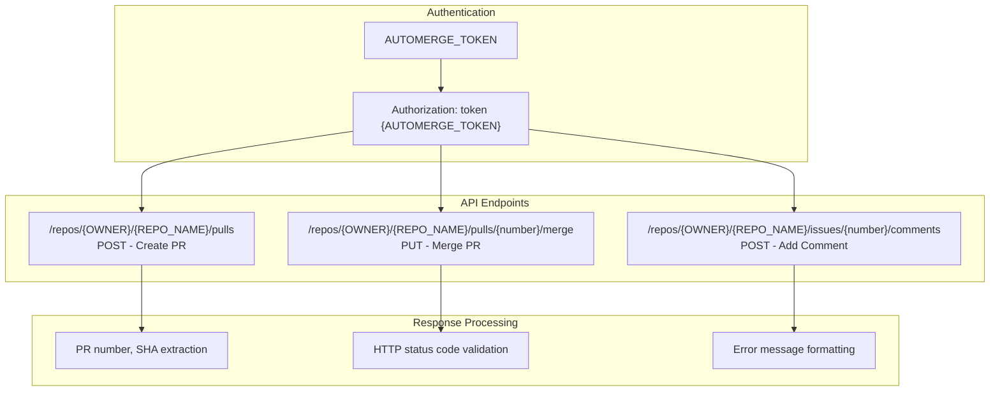

<!-- source: DeepWiki mcp.deepwiki.com · repo NVIDIA/spark-rapids-common · page 4.2 Auto-Merge Action · fetched 2026-10-26 -->

# Auto-Merge Action

Relevant source files

The following files were used as context for generating this wiki page:

- [auto-merge/Dockerfile](auto-merge/Dockerfile)
- [auto-merge/action.yml](auto-merge/action.yml)
- [auto-merge/automerge](auto-merge/automerge)

## Purpose and Scope

The Auto-Merge Action is a Docker-based GitHub Action that automates the process of creating pull requests to merge changes from one branch to another and attempting to automatically merge them. This action is specifically designed to maintain branch currency by creating merge commits between release branches or development streams.

For information about the reusable auto-merge workflow that orchestrates this action, see [Auto-Merge Workflow](#4.1). For details about the broader action helper infrastructure, see [Action Helper System](#4.3).

## Architecture Overview

The Auto-Merge Action follows a Docker-based action pattern, consisting of three core components that work together to provide automated branch merging capabilities.

### Auto-Merge Action Architecture

*Sources: [auto-merge/action.yml:15-19](), [auto-merge/Dockerfile:15-22](), [auto-merge/automerge:30-45]()*

## Core Components

### Action Definition

The action is defined as a Docker-based action in the `action.yml` file, which specifies that it runs using a local Dockerfile.

| Property | Value |
|----------|-------|
| Name | auto-merge action |
| Description | auto-merge HEAD to BASE |
| Runtime | Docker |
| Image | Local Dockerfile |

*Sources: [auto-merge/action.yml:1-20]()*

### Docker Container

The Docker container is built from a Python Alpine base image and includes the necessary dependencies for GitHub API interaction.

*Sources: [auto-merge/Dockerfile:15-22]()*

### Python Script Components

The main logic is implemented in the `automerge` Python script, which contains several key functions:

| Function | Purpose | API Endpoint |
|----------|---------|--------------|
| `create()` | Creates pull request | `/repos/{OWNER}/{REPO_NAME}/pulls` |
| `auto_merge()` | Attempts to merge PR | `/repos/{OWNER}/{REPO_NAME}/pulls/{number}/merge` |
| `comment()` | Posts comments to PR | `/repos/{OWNER}/{REPO_NAME}/issues/{number}/comments` |
| `main()` | Orchestrates the process | N/A |

*Sources: [auto-merge/automerge:48-137]()*

## Operation Flow

The Auto-Merge Action follows a sequential process to create and merge pull requests automatically.

### Auto-Merge Process Flow

```mermaid
sequenceDiagram
    participant Action as "Auto-Merge Action"
    participant GitHub as "GitHub API"
    participant PR as "Pull Request"
    
    Action->>GitHub: POST /repos/{OWNER}/{REPO_NAME}/pulls
    Note over Action,GitHub: Create PR: {HEAD} → {BASE}
    
    alt PR Created Successfully (201)
        GitHub-->>Action: PR number, SHA, mergeable status
        Action->>GitHub: PUT /repos/{OWNER}/{REPO_NAME}/pulls/{number}/merge
        Note over Action,GitHub: Attempt auto-merge with merge method
        
        alt Auto-merge Success (200)
            GitHub-->>Action: Merge successful
            Action->>GitHub: POST /repos/{OWNER}/{REPO_NAME}/issues/{number}/comments
            Note over Action,GitHub: Comment: "SUCCESS - auto-merge"
            Action->>Action: Exit with success (0)
        else Auto-merge Failure
            GitHub-->>Action: Merge failed with details
            Action->>GitHub: POST /repos/{OWNER}/{REPO_NAME}/issues/{number}/comments
            Note over Action,GitHub: Comment: Manual resolution steps
            Action->>Action: Exit with failure (1)
        end
        
    else No Commits Between Branches (422)
        GitHub-->>Action: No commits to merge
        Action->>Action: Exit with success (0)
        
    else PR Creation Failed
        GitHub-->>Action: Error details
        Action->>Action: Exit with failure (1)
    end
```

*Sources: [auto-merge/automerge:48-137]()*

## Environment Variables and Configuration

The action requires five environment variables to operate correctly:

### Required Environment Variables

| Variable | Description | Usage |
|----------|-------------|--------|
| `OWNER` | Repository owner/organization | Used in GitHub API endpoints |
| `REPO_NAME` | Repository name | Used in GitHub API endpoints |
| `HEAD` | Source branch to merge from | Specified as PR head branch |
| `BASE` | Target branch to merge into | Specified as PR base branch |
| `AUTOMERGE_TOKEN` | GitHub token for API access | Used in Authorization header |

*Sources: [auto-merge/automerge:30-40](), [auto-merge/Dockerfile:21]()*

### Pull Request Configuration

The action creates pull requests with standardized properties:

*Sources: [auto-merge/automerge:48-81]()*

## Error Handling and Manual Intervention

The action provides comprehensive error handling and guidance for manual resolution when automated merging fails.

### Error Response Handling

| Status Code | Scenario | Action Response |
|-------------|----------|-----------------|
| 201 | PR created successfully | Proceed to auto-merge attempt |
| 422 | No commits between branches | Exit successfully (no work needed) |
| 200 | Auto-merge successful | Comment success, exit with code 0 |
| Other | Creation or merge failure | Comment with manual steps, exit with code 1 |

### Manual Resolution Instructions

When auto-merge fails, the action automatically posts a comment with detailed manual resolution steps:

1. Fetch both `HEAD` and `BASE` branches from upstream
2. Create a fix branch from the `BASE` branch  
3. Merge the `HEAD` branch into the fix branch
4. Resolve any merge conflicts
5. Push to a personal fork and create a manual PR
6. Use "Create a merge commit" strategy when merging

*Sources: [auto-merge/automerge:76-111]()*

## Integration with GitHub Ecosystem

The Auto-Merge Action integrates deeply with GitHub's pull request and issue management systems through authenticated API calls.

### GitHub API Integration Points

*Sources: [auto-merge/automerge:42-45](), [auto-merge/automerge:48-126]()*

---

