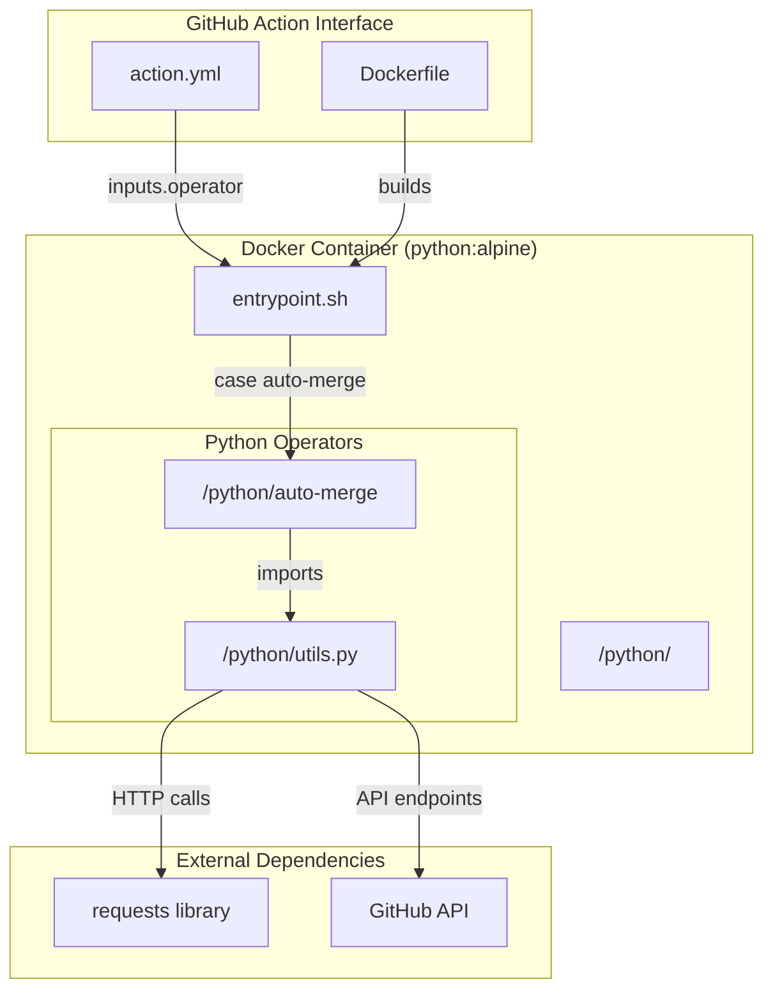
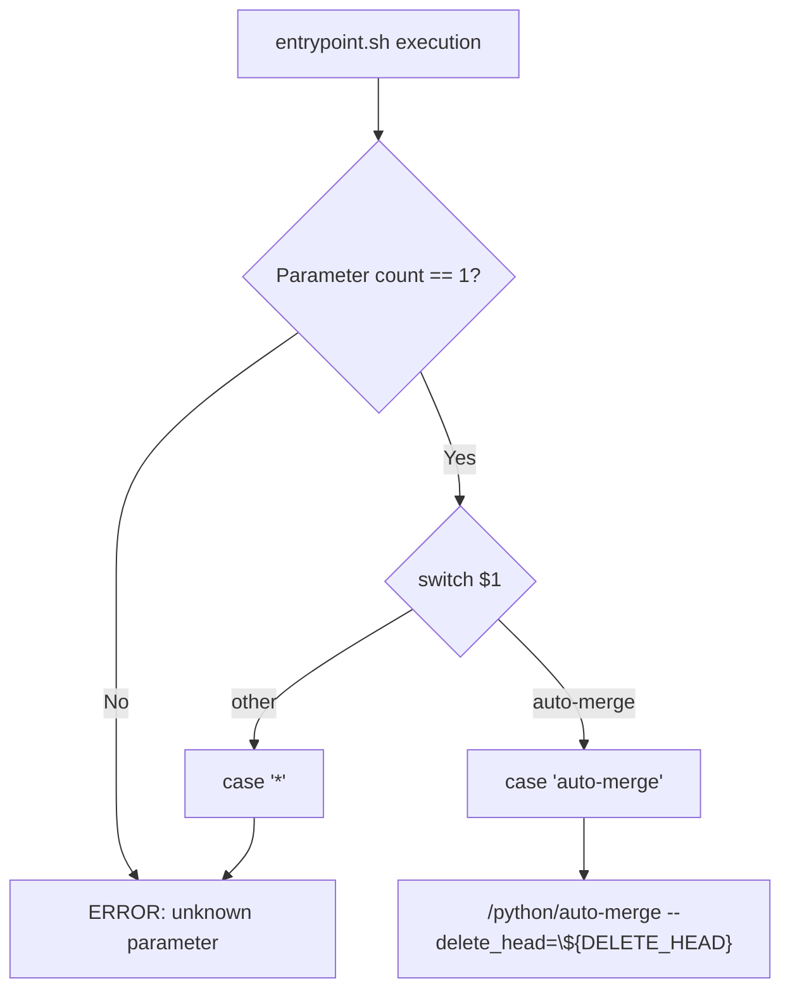
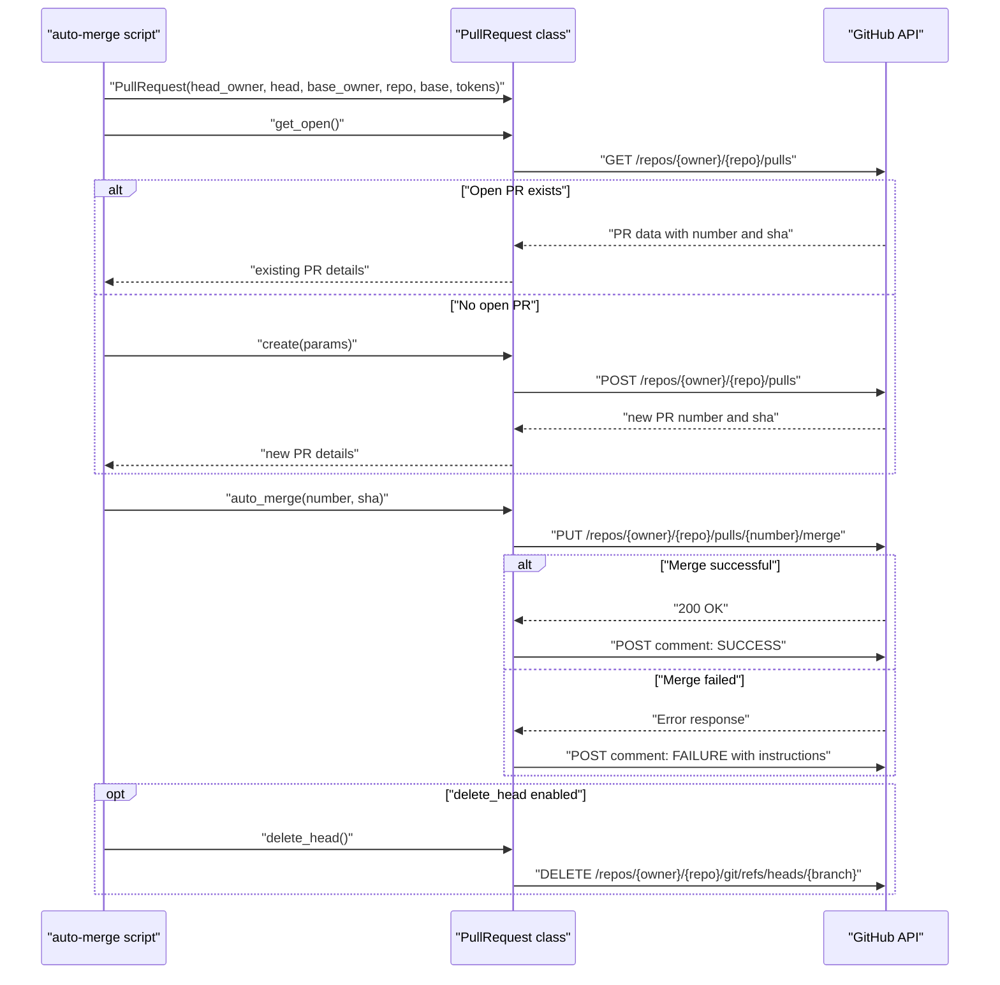
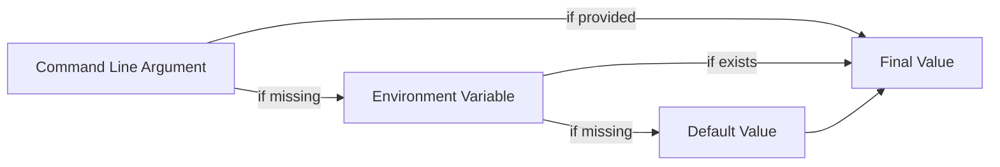

<!-- source: DeepWiki mcp.deepwiki.com · repo NVIDIA/spark-rapids-common · page 4.3 Action Helper System · fetched 2026-10-26 -->

# Action Helper System

<details>
<summary>Relevant source files</summary>

The following files were used as context for generating this wiki page:

- [action-helper/Dockerfile](action-helper/Dockerfile)
- [action-helper/action.yml](action-helper/action.yml)
- [action-helper/entrypoint.sh](action-helper/entrypoint.sh)
- [action-helper/python/auto-merge](action-helper/python/auto-merge)
- [action-helper/python/utils.py](action-helper/python/utils.py)

</details>


## Purpose and Scope

The Action Helper System provides a containerized execution environment for GitHub automation utilities within the spark-rapids-common repository. This system implements a modular operator pattern that allows multiple automation functions to be packaged within a single Docker-based GitHub Action. Currently, the system primarily supports the `auto-merge` operator for automated pull request management.

For information about the workflow that orchestrates auto-merge operations, see page 4.1. For details about the standalone auto-merge action interface, see page 4.2.

## Container Architecture

The Action Helper System is built as a Docker-based GitHub Action that uses an operator dispatch pattern to route execution to specific automation functions.

### Container Structure



Sources: [action-helper/action.yml:15-25](), [action-helper/Dockerfile:15-23](), [action-helper/entrypoint.sh:18-34]()

### Action Definition

The system exposes a single GitHub Action interface through `action.yml` that accepts an `operator` input parameter to determine which functionality to execute.

| Component | Purpose | Implementation |
|-----------|---------|----------------|
| `inputs.operator` | Specifies which automation function to execute | Required string parameter |
| `runs.using` | Container execution method | Docker-based action |
| `runs.image` | Container build source | Local Dockerfile |
| `runs.args` | Parameter passing | Maps `operator` input to container argument |

Sources: [action-helper/action.yml:17-25]()

## Operator Dispatch System

The Action Helper System uses a shell-based dispatch mechanism in `entrypoint.sh` to route execution to specific Python operators based on the input parameter.

### Dispatch Logic



Sources: [action-helper/entrypoint.sh:20-34]()

The dispatch system validates exactly one parameter is provided and uses a shell `case` statement to route to the appropriate operator. Currently, only the `auto-merge` operator is implemented, with environment variable `DELETE_HEAD` passed as a command-line flag.

## Auto-Merge Operator Implementation

The `auto-merge` operator handles automated pull request creation and merging operations for branch synchronization workflows.

### Command-Line Interface

The `/python/auto-merge` script accepts multiple parameters through the `ArgumentParser` class with `EnvDefault` action support:

| Parameter | Environment Variable | Purpose |
|-----------|---------------------|---------|
| `--owner` | `OWNER` | GitHub repository owner |
| `--repo` | `REPO` | Repository name |
| `--head` | `HEAD` | Source branch reference |
| `--base` | `BASE` | Target branch reference |
| `--token` | `TOKEN` | GitHub authentication token |
| `--delete_head` | - | Boolean flag for HEAD branch deletion |

Sources: [action-helper/python/auto-merge:24-37]()

### Execution Flow



Sources: [action-helper/python/auto-merge:39-65](), [action-helper/python/utils.py:87-121]()

## Utility Components

The `utils.py` module provides core functionality for GitHub API interactions and argument parsing.

### PullRequest Class

The `PullRequest` class encapsulates all GitHub pull request operations:

| Method | Purpose | API Endpoint |
|--------|---------|--------------|
| `get_open()` | Query existing open PRs | `GET /repos/{owner}/{repo}/pulls` |
| `create(params)` | Create new pull request | `POST /repos/{owner}/{repo}/pulls` |
| `merge(number, params)` | Merge pull request | `PUT /repos/{owner}/{repo}/pulls/{number}/merge` |
| `auto_merge(number, sha)` | Automated merge with error handling | Calls `merge()` + `comment()` |
| `comment(number, content)` | Add PR comment | `POST /repos/{owner}/{repo}/issues/{number}/comments` |
| `delete_branch(owner, branch)` | Delete git branch | `DELETE /repos/{owner}/{repo}/git/refs/heads/{branch}` |

Sources: [action-helper/python/utils.py:24-151]()

### Authentication and Headers

The `PullRequest` class maintains separate authentication headers for head and base repositories:

```python
self._head_auth_headers = {
    'Accept': 'application/vnd.github.v3+json',
    'Authorization': f"token {head_token}"
}
self._base_auth_headers = {
    'Accept': 'application/vnd.github.v3+json', 
    'Authorization': f"token {base_token}"
}
```

This dual-token approach enables cross-repository operations where the head and base may have different access requirements.

Sources: [action-helper/python/utils.py:36-43]()

### EnvDefault Argument Parser

The `EnvDefault` class extends `argparse.Action` to automatically fallback to environment variables when command-line arguments are not provided:



Sources: [action-helper/python/utils.py:153-165]()

## Container Execution Environment

The Docker container is built from `python:alpine` with minimal dependencies and specific permissions configured for GitHub Actions execution.

### Build Configuration

| Component | Configuration | Purpose |
|-----------|---------------|---------|
| Base Image | `python:alpine` | Lightweight Python runtime |
| Working Directory | `/` | Root-level execution context |
| Python Code | `/python/` | Operator implementations |
| Entry Point | `/entrypoint.sh` | Shell dispatch script |
| Permissions | `chmod -R +x` | Executable permissions for scripts |
| Dependencies | `pip install requests` | HTTP client for GitHub API |

Sources: [action-helper/Dockerfile:15-23]()

The container design prioritizes minimal size and security by using Alpine Linux and installing only the essential `requests` library for HTTP operations.

---

