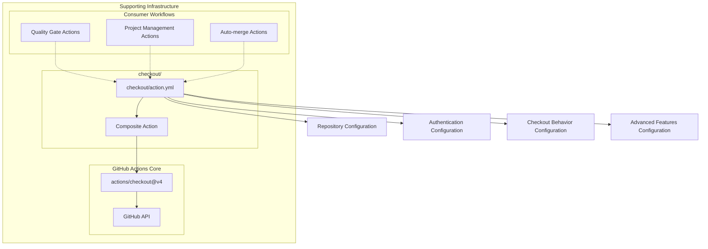
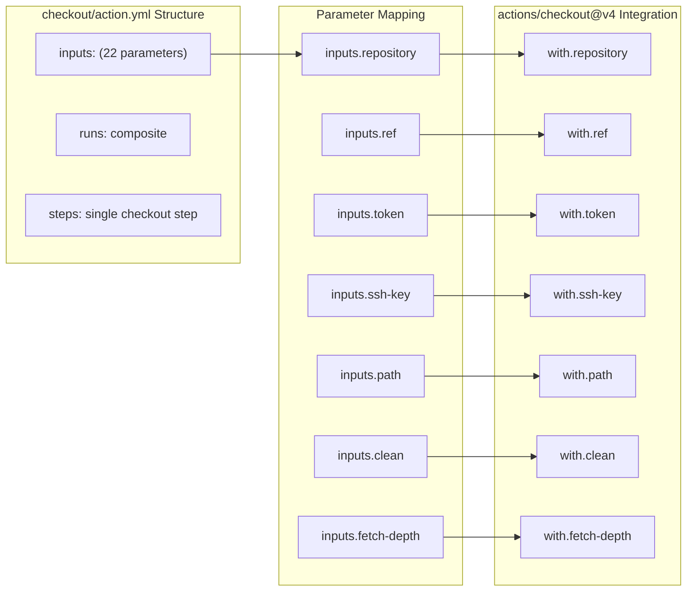
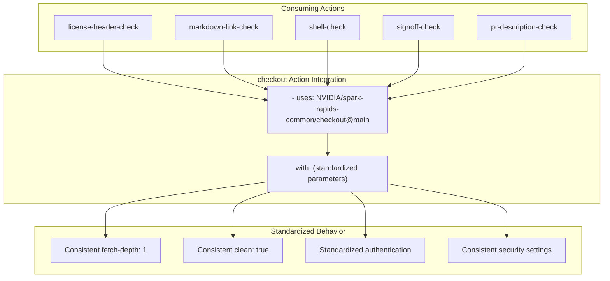

<!-- source: DeepWiki mcp.deepwiki.com · repo NVIDIA/spark-rapids-common · page 5 Supporting Infrastructure · fetched 2026-10-26 -->

# Supporting Infrastructure

Relevant source files

The following files were used as context for generating this wiki page:

- [checkout/action.yml](checkout/action.yml)

This document covers the supporting utilities and infrastructure components that enable the core functionality of the spark-rapids-common repository. These foundational components provide standardized, reusable building blocks that underpin the quality gates, project management, and automated merging systems.

The supporting infrastructure focuses on creating consistent, reliable interfaces to GitHub's native functionality while adding enterprise-grade configurability and error handling. For information about the quality validation pipeline that depends on this infrastructure, see [Quality Gates System](#2). For details about automated workflows that leverage these components, see [Automated Merging System](#4).

## System Architecture

The supporting infrastructure follows a wrapper pattern that enhances GitHub's native actions with standardized parameter handling, comprehensive configurability, and consistent error handling across the ecosystem.

### Infrastructure Component Architecture

Sources: [checkout/action.yml:1-119]()

## Standardized Checkout Action

The checkout action serves as the primary infrastructure component, providing a comprehensive wrapper around GitHub's standard `actions/checkout@v4` action with enterprise-grade configurability and parameter standardization.

### Input Parameter Categories

The checkout action organizes its functionality into distinct parameter categories that address different aspects of repository checkout operations:

| Category | Parameters | Purpose |
|----------|------------|---------|
| Repository Configuration | `repository`, `ref`, `github-server-url` | Target repository identification |
| Authentication | `token`, `ssh-key`, `ssh-known-hosts`, `ssh-strict`, `ssh-user` | Secure repository access |
| Credential Management | `persist-credentials` | Git credential handling |
| Checkout Behavior | `path`, `clean`, `fetch-depth`, `fetch-tags`, `show-progress` | Basic checkout operations |
| Advanced Features | `filter`, `sparse-checkout`, `sparse-checkout-cone-mode`, `lfs`, `submodules` | Specialized checkout modes |
| Security | `set-safe-directory` | Git security configuration |

Sources: [checkout/action.yml:18-92]()

### Parameter Flow and Default Values

```mermaid
flowchart TD
    subgraph "Input Processing"
        github_context["GitHub Context Variables"]
        default_values["Action Default Values"]
        user_inputs["User-Provided Inputs"]
    end
    
    subgraph "Parameter Resolution"
        repository_param["repository: ${{ github.repository }}"]
        token_param["token: ${{ github.token }}"]
        ssh_strict_param["ssh-strict: 'true'"]
        ssh_user_param["ssh-user: 'git'"]
        persist_creds_param["persist-credentials: 'true'"]
        clean_param["clean: 'true'"]
        sparse_cone_param["sparse-checkout-cone-mode: 'true'"]
        fetch_depth_param["fetch-depth: '1'"]
        fetch_tags_param["fetch-tags: 'false'"]
        show_progress_param["show-progress: 'true'"]
        lfs_param["lfs: 'false'"]
        submodules_param["submodules: 'false'"]
        set_safe_param["set-safe-directory: 'true'"]
        github_server_param["github-server-url: 'https://github.com'"]
    end
    
    subgraph "actions/checkout@v4"
        checkout_execution["Repository Checkout Execution"]
    end
    
    github_context --> repository_param
    github_context --> token_param
    default_values --> ssh_strict_param
    default_values --> clean_param
    default_values --> fetch_depth_param
    
    user_inputs --> repository_param
    user_inputs --> token_param
    user_inputs --> ssh_strict_param
    
    repository_param --> checkout_execution
    token_param --> checkout_execution
    ssh_strict_param --> checkout_execution
    clean_param --> checkout_execution
    fetch_depth_param --> checkout_execution
```

Sources: [checkout/action.yml:19-29](), [checkout/action.yml:39-93]()

## Implementation Pattern

The checkout action implements a transparent wrapper pattern that preserves all upstream functionality while adding standardized defaults and comprehensive parameter support.

### Composite Action Structure

The action uses GitHub's composite action pattern to create a single-step wrapper that passes all parameters directly to the upstream `actions/checkout@v4` action:

Sources: [checkout/action.yml:94-119]()

## Enterprise Configuration Support

The checkout action provides enterprise-grade configuration options that address common requirements in large-scale development environments.

### Authentication Methods

The action supports multiple authentication mechanisms for different enterprise scenarios:

- **Token Authentication**: Default GitHub token with option for custom tokens
- **SSH Authentication**: Full SSH key support with known hosts and strict checking
- **Credential Persistence**: Configurable credential storage for subsequent Git operations

### Advanced Checkout Features

Enterprise-specific features include:

- **Sparse Checkout**: Partial repository checkout with cone mode optimization
- **LFS Support**: Git Large File Storage integration
- **Submodule Handling**: Recursive submodule checkout options
- **Filter Support**: Partial clone capabilities for large repositories
- **Security Configuration**: Safe directory settings for containerized environments

Sources: [checkout/action.yml:30-43](), [checkout/action.yml:55-88]()

## Integration with Ecosystem

The standardized checkout action serves as a foundational component across the spark-rapids-common ecosystem, providing consistent repository access patterns for all dependent actions and workflows.

### Consumer Integration Pattern

Sources: [checkout/action.yml:15-16](), [checkout/action.yml:94-98]()

The supporting infrastructure provides the essential foundation that enables the spark-rapids-common ecosystem to deliver consistent, reliable automation across multiple repositories while maintaining enterprise-grade security and configurability standards.

---

