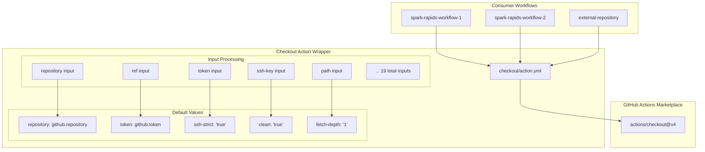
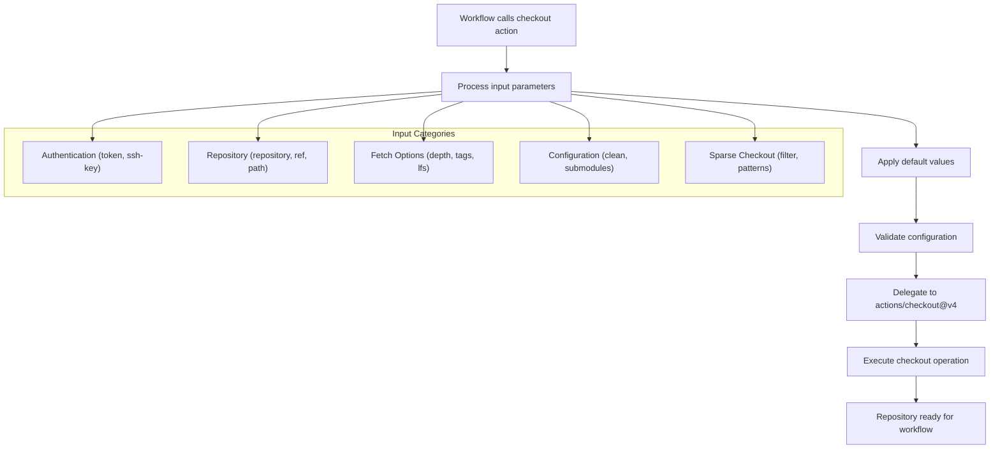
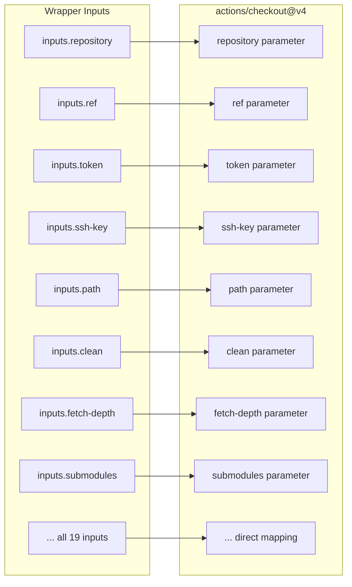
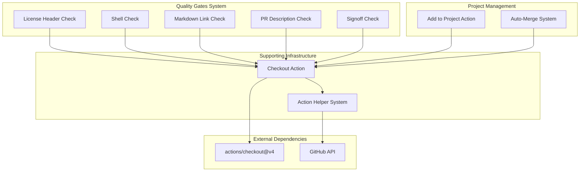

<!-- source: DeepWiki mcp.deepwiki.com · repo NVIDIA/spark-rapids-common · page 5.1 Checkout Action · fetched 2026-10-26 -->

# Checkout Action

<details>
<summary>Relevant source files</summary>

The following files were used as context for generating this wiki page:

- [checkout/action.yml](checkout/action.yml)

</details>


The Checkout Action provides a standardized wrapper for the official `actions/checkout` action, ensuring consistent repository checkout behavior across all workflows in the spark-rapids-common ecosystem. This composite action exposes the complete parameter set of `actions/checkout@v4` while maintaining compatibility and providing default values optimized for NVIDIA's development practices.

## Purpose and Architecture

The Checkout Action implements the Wrapper Actions Pattern, serving as an abstraction layer that standardizes checkout operations across multiple repositories. It provides a single, consistent interface while delegating all actual checkout functionality to the proven `actions/checkout@v4` action.

### System Architecture



**Sources:** [checkout/action.yml:1-119]()

### Implementation Pattern



**Sources:** [checkout/action.yml:94-119]()

## Input Parameters

The Checkout Action accepts 19 input parameters, organized into functional categories. All parameters are optional, with sensible defaults provided for NVIDIA's development environment.

### Repository and Reference Configuration

| Parameter | Description | Default | Required |
|-----------|-------------|---------|----------|
| `repository` | Repository name with owner | `${{ github.repository }}` | No |
| `ref` | Ref to checkout (branch, tag, SHA) | - | No |
| `path` | Relative path to checkout repository | - | No |

### Authentication Configuration

| Parameter | Description | Default | Required |
|-----------|-------------|---------|----------|
| `token` | Token used for authentication | `${{ github.token }}` | No |
| `ssh-key` | SSH key for checkout | - | No |
| `ssh-known-hosts` | Known hosts for SSH | - | No |
| `ssh-strict` | Enable strict SSH host checking | `'true'` | No |
| `ssh-user` | SSH connection user | `'git'` | No |

### Fetch and Clone Configuration

| Parameter | Description | Default | Required |
|-----------|-------------|---------|----------|
| `fetch-depth` | Fetch depth history | `'1'` | No |
| `fetch-tags` | Fetch tags history | `'false'` | No |
| `clean` | Clean repository before checkout | `'true'` | No |
| `persist-credentials` | Persist credentials in .git directory | `'true'` | No |
| `show-progress` | Show fetch progress | `'true'` | No |

### Advanced Features

| Parameter | Description | Default | Required |
|-----------|-------------|---------|----------|
| `lfs` | Enable LFS support | `'false'` | No |
| `submodules` | Checkout submodules (true\|recursive) | `'false'` | No |
| `filter` | Partially clone against filter | - | No |
| `sparse-checkout` | Sparse checkout patterns | - | No |
| `sparse-checkout-cone-mode` | Use cone-mode for sparse checkout | `'true'` | No |
| `set-safe-directory` | Add safe directory config | `'true'` | No |
| `github-server-url` | GitHub server URL | `'https://github.com'` | No |

**Sources:** [checkout/action.yml:18-92]()

## Implementation Details

The action is implemented as a composite action that performs direct parameter passthrough to `actions/checkout@v4`. This design ensures compatibility while providing a centralized configuration point.

### Parameter Mapping



**Sources:** [checkout/action.yml:98-119]()

### Composite Action Structure

The action follows the standard composite action structure defined in [checkout/action.yml:94-119]():

```yaml
runs:
  using: "composite"
  steps:
    - name: Checkout code
      uses: actions/checkout@v4
      with:
        # Direct parameter passthrough
```

This implementation ensures that all functionality from the upstream `actions/checkout@v4` action is preserved while providing a consistent interface across the spark-rapids-common ecosystem.

**Sources:** [checkout/action.yml:94-119]()

## Usage Patterns

The Checkout Action is designed for use in GitHub workflows where standardized repository checkout behavior is required. It supports both simple and complex checkout scenarios.

### Basic Usage

```yaml
- uses: NVIDIA/spark-rapids-common/checkout@main
```

### Advanced Configuration

```yaml
- uses: NVIDIA/spark-rapids-common/checkout@main
  with:
    repository: 'NVIDIA/spark-rapids'
    ref: 'branch-24.12'
    fetch-depth: 0
    submodules: true
    path: 'spark-rapids-checkout'
```

### SSH Authentication

```yaml
- uses: NVIDIA/spark-rapids-common/checkout@main
  with:
    ssh-key: ${{ secrets.SSH_PRIVATE_KEY }}
    ssh-known-hosts: ${{ secrets.SSH_KNOWN_HOSTS }}
```

**Sources:** [checkout/action.yml:18-92]()

## Integration with Supporting Infrastructure

The Checkout Action integrates with other components in the spark-rapids-common ecosystem to provide comprehensive workflow support. It serves as a foundational component for all repository access operations.

### System Integration



The Checkout Action provides the repository access foundation that enables all other quality gates and automation systems to operate on the checked-out code.

**Sources:** [checkout/action.yml:1-119]()

---

