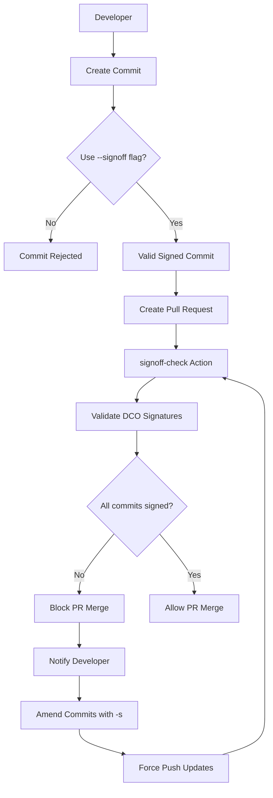
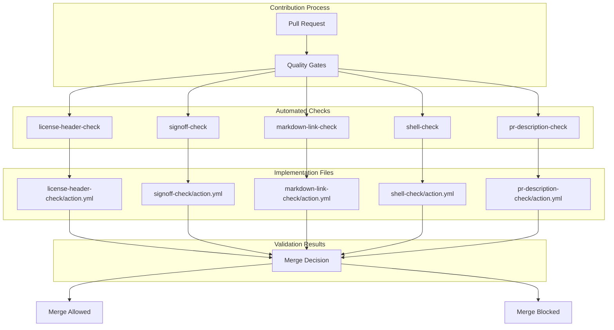
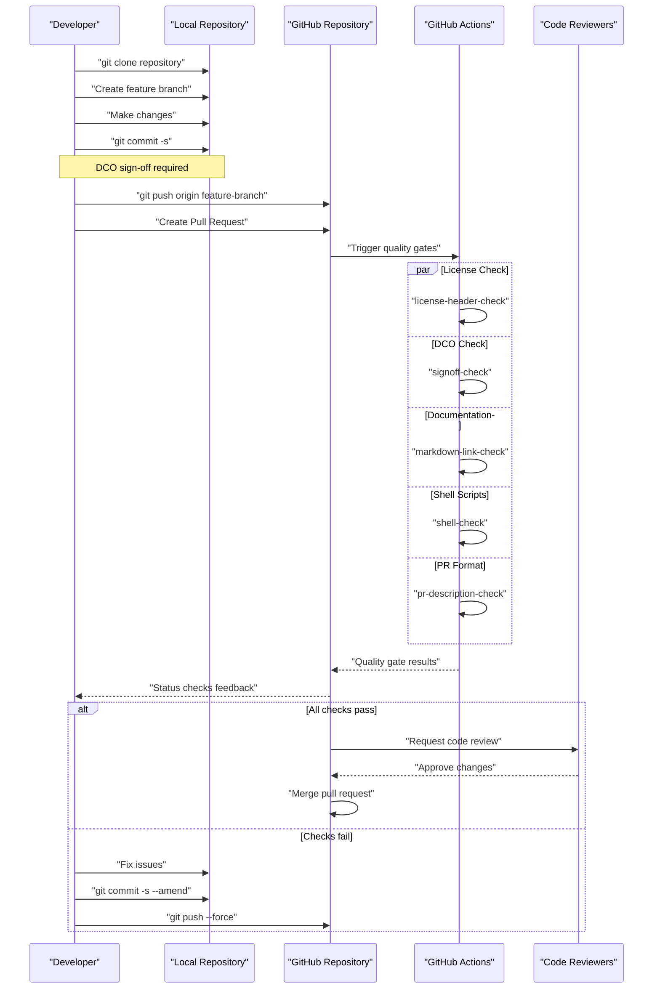
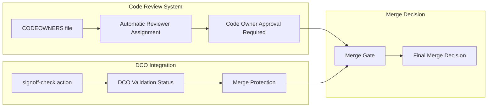

<!-- source: DeepWiki mcp.deepwiki.com · repo NVIDIA/spark-rapids-common · page 6 Contributing Guidelines · fetched 2026-10-26 -->

# Contributing Guidelines

<details>
<summary>Relevant source files</summary>

The following files were used as context for generating this wiki page:

- [CONTRIBUTING.md](CONTRIBUTING.md)

</details>


This document outlines the contribution requirements and development practices for the spark-rapids-common repository. It covers the Developer Certificate of Origin (DCO) sign-off requirements, quality gate compliance, and submission workflows that all contributors must follow.

For information about specific quality gates and their implementation details, see [Quality Gates System](#2). For project management automation, see [Project Management](#3).

## Developer Certificate of Origin Requirements

All contributions to spark-rapids-common must comply with the Developer Certificate of Origin (DCO) version 1.1. This requirement ensures legal compliance and establishes clear contribution ownership.

### DCO Compliance Workflow



The sign-off process requires the `--signoff` or `-s` flag when committing changes. This appends a `Signed-off-by` line containing the contributor's real name and email address.

**Sources:** [CONTRIBUTING.md:11-21]()

### Sign-off Implementation

Contributors must use their real name and configured Git email address when signing off commits:

```bash
git commit -s -m "Add cool feature."
```

The resulting commit message includes:
```
Signed-off-by: Your Name <your@email.com>
```

This signature certifies compliance with the DCO requirements defined in [CONTRIBUTING.md:28-66](). Contributors must not use pseudonyms or anonymous contributions.

**Sources:** [CONTRIBUTING.md:11-24]()

## Quality Gate Compliance

The repository enforces multiple quality gates that must pass before contributions can be merged. These gates ensure code quality, documentation integrity, and legal compliance.

### Quality Gate Architecture



Each quality gate must pass for pull request approval. The `signoff-check` action specifically validates DCO compliance by examining commit signatures.

**Sources:** [CONTRIBUTING.md:5-10]()

## Development Workflow

Contributors must follow a structured development workflow that integrates DCO compliance with the repository's quality assurance systems.

### Contribution Process Flow



The workflow ensures DCO compliance is validated automatically through the `signoff-check` action, preventing non-compliant contributions from being merged.

**Sources:** [CONTRIBUTING.md:1-67]()

## DCO Certificate Text

The Developer Certificate of Origin establishes the legal framework for contributions. Contributors certify they have the right to submit their work under the project's open source license.

### DCO Version 1.1 Requirements

| Certification | Description |
|---------------|-------------|
| **(a) Original Work** | Contribution created wholly or partially by contributor with submission rights |
| **(b) Previous Work** | Based on appropriately licensed previous work with modification rights |
| **(c) Third Party** | Provided by another person who certified (a), (b), or (c) without modification |
| **(d) Public Record** | Understanding that contribution and personal information are public and permanent |

The full DCO text is maintained in [CONTRIBUTING.md:28-66]() and follows the standard established by the Linux Foundation at developercertificate.org.

**Sources:** [CONTRIBUTING.md:26-66]()

## Code Review Requirements

All contributions require code owner approval as defined in the repository's `CODEOWNERS` configuration. The review process integrates with DCO validation to ensure both technical and legal compliance.

### Review Integration Points



The code review system works in conjunction with DCO validation to ensure contributions meet both technical standards and legal requirements before integration.

**Sources:** [CONTRIBUTING.md:5-10]()