# Page: Spark RAPIDS Common Overview

# Spark RAPIDS Common Overview

<details>
<summary>Relevant source files</summary>

The following files were used as context for generating this wiki page:

- [README.md](README.md)

</details>


## Purpose and Scope

This document provides an overview of the `spark-rapids-common` repository, which serves as a centralized hub for reusable GitHub Actions, workflows, and common scripts used across the NVIDIA Spark RAPIDS ecosystem. The repository standardizes quality gates, project management automation, and development workflows to ensure consistency across multiple Spark RAPIDS projects.

For detailed information about specific quality validation systems, see [Quality Gates System](#2). For project management features, see [Project Management](#3). For automated merging capabilities, see [Automated Merging System](#4).

## Repository Architecture

The `spark-rapids-common` repository follows a modular architecture that separates reusable GitHub Actions from their consuming workflows. This design enables external repositories to reference standardized automation while maintaining flexibility in their specific implementations.

### Repository Structure Overview

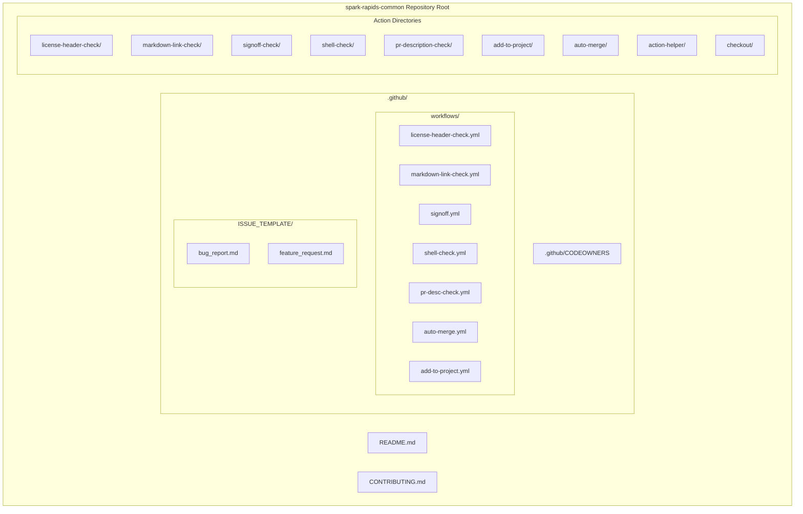

**Sources:** [README.md:1-8]()

### Action Implementation Patterns

The repository implements three distinct architectural patterns for GitHub Actions, each optimized for different use cases and complexity levels.

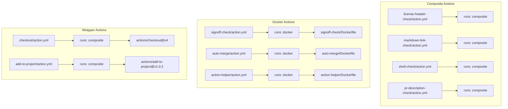

**Sources:** [README.md:7]()

## Core Functionality

The repository provides three primary categories of functionality that support the entire Spark RAPIDS development lifecycle.

### Quality Assurance Pipeline

The quality assurance system implements multiple validation layers that execute in parallel during pull request events, ensuring code quality and legal compliance before merge approval.

| Action | Pattern | Primary Function | Consumer Usage |
|--------|---------|------------------|----------------|
| `license-header-check` | Composite | Validates NVIDIA copyright headers | `uses: NVIDIA/spark-rapids-common/license-header-check@main` |
| `markdown-link-check` | Composite | Validates markdown link integrity | `uses: NVIDIA/spark-rapids-common/markdown-link-check@main` |
| `signoff-check` | Docker | Enforces DCO sign-off compliance | `uses: NVIDIA/spark-rapids-common/signoff-check@main` |
| `shell-check` | Composite | Static analysis for shell scripts | `uses: NVIDIA/spark-rapids-common/shell-check@main` |
| `pr-description-check` | Composite | Validates PR description format | `uses: NVIDIA/spark-rapids-common/pr-description-check@main` |

### Project Management Automation

Project management components handle issue tracking, code ownership, and GitHub project board integration to streamline development workflows.

### Automated Branch Management

The automated merging system maintains branch currency and handles complex merge scenarios through Docker-based actions that interact with the GitHub API.

## Integration Patterns

### Cross-Repository Usage Flow

External repositories integrate with `spark-rapids-common` by referencing specific actions in their workflow files, creating a distributed but standardized development environment.

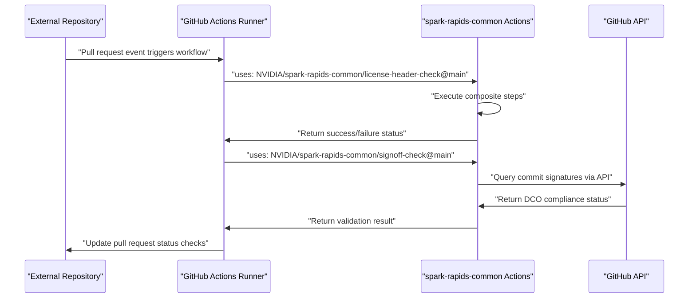

**Sources:** [README.md:7]()

### Action Composition Architecture

Each action directory contains standardized files that define inputs, outputs, and execution logic, enabling consistent behavior across different repository contexts.

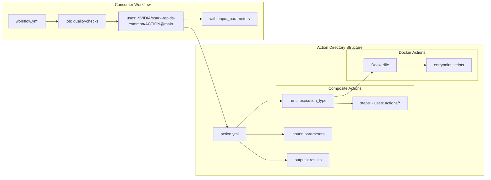

**Sources:** [README.md:7]()

## Repository Impact and Usage

The `spark-rapids-common` repository serves as a foundational component that standardizes development practices across the NVIDIA Spark RAPIDS ecosystem. By centralizing quality gates and automation workflows, it ensures consistent code quality, legal compliance, and project management practices across multiple consumer repositories.

Consumer projects benefit from this centralized approach by reducing duplicate workflow maintenance, ensuring consistent validation standards, and providing immediate access to updates and improvements in the shared automation infrastructure.

**Sources:** [README.md:1-8]()

---

# Page: Quality Gates System

# Quality Gates System

<details>
<summary>Relevant source files</summary>

The following files were used as context for generating this wiki page:

- [.github/workflows/license-header-check.yml](.github/workflows/license-header-check.yml)
- [.github/workflows/markdown-link-check.yml](.github/workflows/markdown-link-check.yml)
- [.github/workflows/pr-desc-check.yml](.github/workflows/pr-desc-check.yml)
- [.github/workflows/shell-check.yml](.github/workflows/shell-check.yml)
- [.github/workflows/signoff.yml](.github/workflows/signoff.yml)
- [license-header-check/action.yml](license-header-check/action.yml)
- [markdown-link-check/action.yml](markdown-link-check/action.yml)
- [pr-description-check/action.yml](pr-description-check/action.yml)
- [shell-check/action.yml](shell-check/action.yml)
- [signoff-check/README.md](signoff-check/README.md)

</details>


## Purpose and Scope

The Quality Gates System is a comprehensive validation pipeline that ensures code quality, legal compliance, and documentation integrity across Spark Rapids projects. This system automatically executes a series of checks on pull requests to maintain consistent standards before code can be merged.

The system consists of five primary quality gates that validate different aspects of contributions: license header compliance, Developer Certificate of Origin (DCO) sign-offs, shell script quality, documentation link integrity, and pull request description formatting. Each gate operates as both a standalone GitHub Action and as part of integrated workflows.

For details on individual quality gate implementations, see [License Header Check](#2.1), [Signoff Check](#2.2), [Shell Check](#2.3), [Markdown Link Check](#2.4), and [PR Description Check](#2.5). For information about automated merging that occurs after quality gates pass, see [Automated Merging System](#4).

## Quality Gates Architecture

The quality gates operate through a coordinated system of GitHub workflows and reusable actions. Each gate validates specific aspects of pull request changes and reports status back to the GitHub pull request interface.

### System Overview

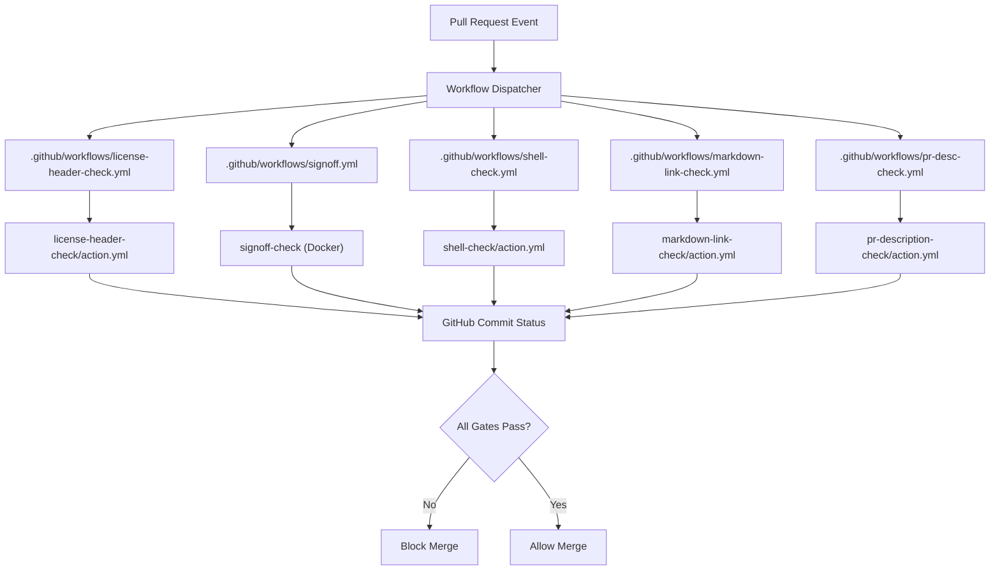

Sources: [.github/workflows/license-header-check.yml:15-45](), [.github/workflows/signoff.yml:15-33](), [.github/workflows/shell-check.yml:15-32](), [.github/workflows/markdown-link-check.yml:15-36](), [.github/workflows/pr-desc-check.yml:15-35]()

### Trigger Patterns and Event Handling

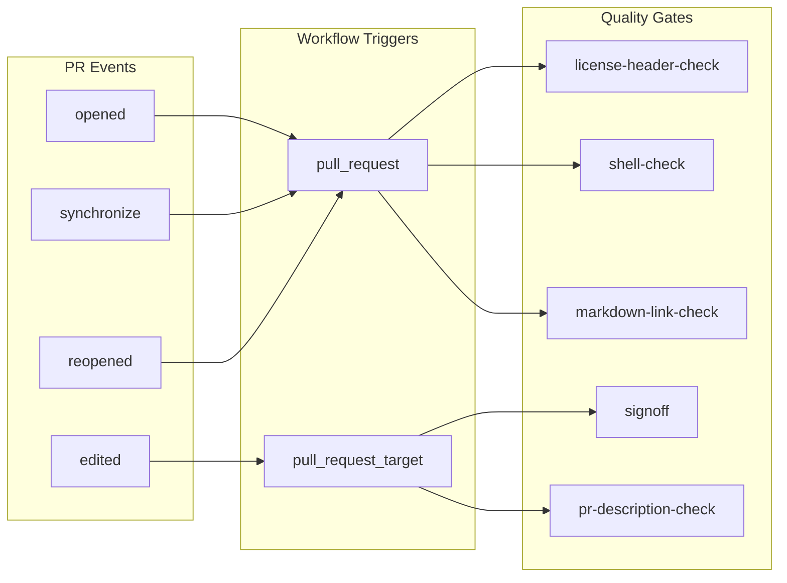

Sources: [.github/workflows/license-header-check.yml:18-20](), [.github/workflows/signoff.yml:18-20](), [.github/workflows/shell-check.yml:18-20](), [.github/workflows/markdown-link-check.yml:18-20](), [.github/workflows/pr-desc-check.yml:18-20]()

## Quality Gate Execution Flow

The quality gates execute in parallel when a pull request is created or updated. Each gate performs specific validation logic and reports results through GitHub's commit status API.

### Execution Pipeline

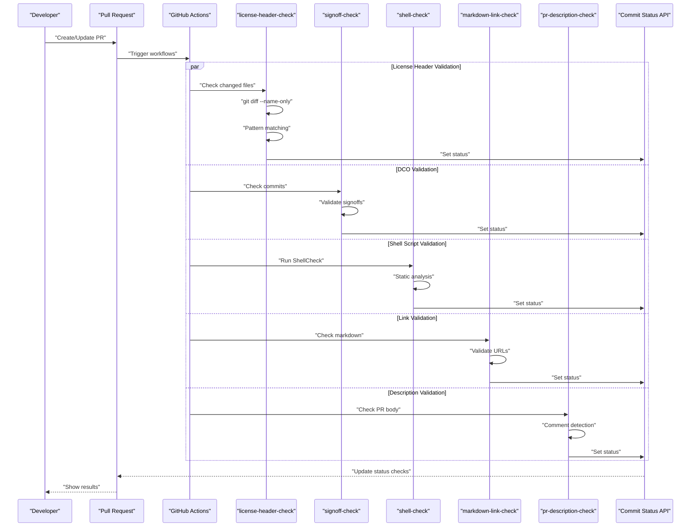

Sources: [license-header-check/action.yml:35-106](), [pr-description-check/action.yml:25-54](), [shell-check/action.yml:24-84](), [markdown-link-check/action.yml:50-130]()

## Individual Quality Gates

### License Header Check

The `license-header-check` action validates that all modified source files contain proper NVIDIA copyright and Apache 2.0 license headers with the current year.

**Key Implementation Details:**
- Uses composite action pattern with bash script execution
- Generates dynamic license pattern: `Copyright \(c\) .*?${CURRENT_YEAR},? NVIDIA CORPORATION.`
- Processes files using `git diff --name-only --diff-filter=AM` to identify added/modified files
- Supports include/exclude patterns for selective file checking
- Handles renamed files by checking `git diff --name-status` with R flag

**Configuration:**
| Input | Required | Default | Description |
|-------|----------|---------|-------------|
| `included_file_patterns` | Yes | - | Comma-separated file patterns to check |
| `excluded_file_patterns` | No | - | Comma-separated file patterns to skip |
| `check_main` | No | `false` | Whether to check main branch merges |

Sources: [license-header-check/action.yml:15-106](), [.github/workflows/license-header-check.yml:36-44]()

### Signoff Check

The `signoff-check` validates Developer Certificate of Origin (DCO) compliance by ensuring all commits in a pull request are properly signed off.

**Implementation:**
- Docker-based action for DCO validation
- Integrates with GitHub API to check commit metadata
- Triggered on `pull_request_target` events for security

**Required Inputs:**
| Input | Description |
|-------|-------------|
| `owner` | Repository owner name |
| `repo` | Repository name |
| `pull_number` | Pull request number |
| `token` | GitHub token with read access |

Sources: [.github/workflows/signoff.yml:22-32](), [signoff-check/README.md:1-29]()

### Shell Check

The `shell-check` action performs static analysis on shell scripts using ShellCheck with a curated set of excluded rules for common patterns.

**Excluded Rules:**
- `SC2086`: Double quote to prevent globbing and word splitting
- `SC2046`: Quote this to prevent word splitting  
- `SC2155`: Declare and assign separately to avoid masking return values
- `SC2006`: Use $(...) notation instead of legacy backticks
- Plus 11 additional rules for practical shell scripting patterns

**Configuration:**
| Input | Required | Default | Description |
|-------|----------|---------|-------------|
| `excluded_codes` | No | "" | Additional comma-separated codes to exclude |

Sources: [shell-check/action.yml:15-84](), [.github/workflows/shell-check.yml:30-31]()

### Markdown Link Check

The `markdown-link-check` action validates that all links in markdown files are accessible and not broken.

**Features:**
- Uses `tcort/github-action-markdown-link-check` as underlying engine
- Comprehensive result summarization with error reporting
- Supports both verbose and quiet modes
- Configurable depth and file filtering

**Key Inputs:**
| Input | Default | Description |
|-------|---------|-------------|
| `use-verbose-mode` | `'yes'` | Show detailed HTTP status for checked links |
| `max-depth` | `-1` | Directory traversal depth (-1 for unlimited) |
| `check-modified-files-only` | - | Only check modified markdown files in PRs |

Sources: [markdown-link-check/action.yml:15-130](), [.github/workflows/markdown-link-check.yml:31-35]()

### PR Description Check

The `pr-description-check` action ensures pull request descriptions don't contain HTML comments that should be manually removed.

**Implementation:**
- Uses GitHub Script API for PR body analysis  
- Searches for `<!--` patterns in PR description
- Sets commit status via GitHub API
- Fails the check if comments are detected

**Logic Flow:**
1. Extract PR body from `context.payload.pull_request`
2. Check for presence of `<!--` substring
3. Set failure state if comments found
4. Create commit status with descriptive message

Sources: [pr-description-check/action.yml:25-54](), [.github/workflows/pr-desc-check.yml:31-34]()

## Integration Points

### Bot PR Exclusion

Most quality gates exclude bot-generated pull requests using the condition:
```yaml
if: "!contains(github.event.pull_request.title, '[bot]')"
```

This prevents automated dependency updates and other bot PRs from triggering unnecessary validations.

### Checkout Integration

Quality gates use the standardized `NVIDIA/spark-rapids-common/checkout@main` action for consistent repository checkout behavior, with dynamic fetch depth calculation for license header checks:

```yaml
- name: Get checkout depth
  run: |
    echo "PR_FETCH_DEPTH=$(( ${{ github.event.pull_request.commits }} + 10 ))" >> $GITHUB_ENV
```

Sources: [.github/workflows/license-header-check.yml:25-34](), [.github/workflows/shell-check.yml:27-28](), [.github/workflows/markdown-link-check.yml:28-29]()

---

# Page: License Header Check

# License Header Check

<details>
<summary>Relevant source files</summary>

The following files were used as context for generating this wiki page:

- [.github/workflows/license-header-check.yml](.github/workflows/license-header-check.yml)
- [license-header-check/action.yml](license-header-check/action.yml)

</details>


## Purpose and Scope

The License Header Check system validates that all source files in pull requests contain proper NVIDIA copyright and Apache 2.0 license headers. This system serves as the most critical quality gate in the RAPIDS ecosystem, with an importance score of 22.06, ensuring legal compliance across all NVIDIA Spark Rapids projects.

This page covers the composite GitHub Action that implements license header validation, including file pattern matching, git diff analysis, and error reporting. For information about other quality gates, see [Quality Gates System](#2). For DCO signoff validation, see [Signoff Check](#2.2).

## System Architecture

The License Header Check operates as a composite GitHub Action that integrates git operations, pattern matching, and license validation into a single workflow step.

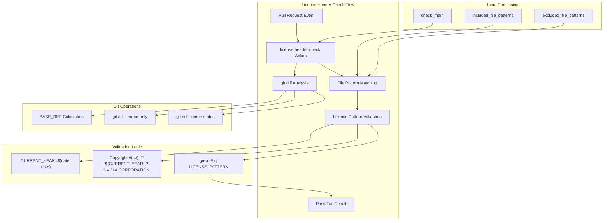

**Sources:** [license-header-check/action.yml:15-106](), [license-header-check/action.yml:41-42](), [license-header-check/action.yml:57-63]()

## Action Configuration

The `license-header-check` action is defined as a composite action with three configurable inputs that control its behavior across different repository contexts.

### Input Parameters

| Parameter | Type | Required | Default | Description |
|-----------|------|----------|---------|-------------|
| `included_file_patterns` | string | true | - | Comma-separated glob patterns for files to check |
| `excluded_file_patterns` | string | false | - | Comma-separated glob patterns for files to exclude |
| `check_main` | boolean | false | false | Whether to run checks on main branch PRs |

### Usage Example

```yaml
- name: license-header-check
  uses: NVIDIA/spark-rapids-common/license-header-check@main
  with:
    check_main: true
    included_file_patterns: |
      *.yml,
      *Dockerfile*,
      auto-merge/automerge,
      signoff-check/signoff-check
```

**Sources:** [license-header-check/action.yml:17-30](), [.github/workflows/license-header-check.yml:36-44]()

## License Pattern Validation

The system enforces a specific copyright header format that must include the current year and NVIDIA corporate attribution.

### Required Header Format

The license pattern validation uses a dynamic regular expression that incorporates the current year:

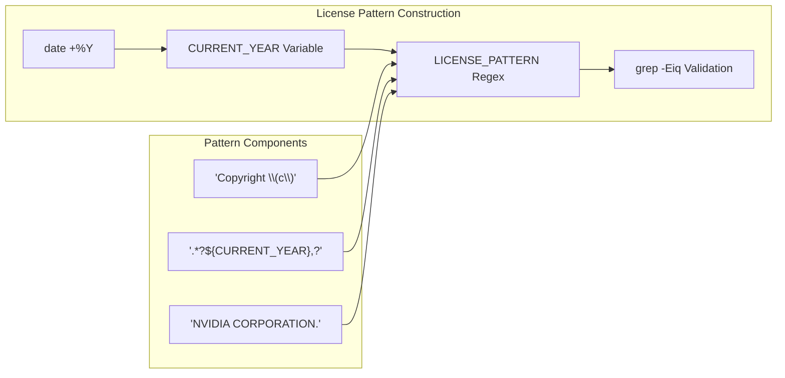

The constructed pattern is: `Copyright \(c\) .*?${CURRENT_YEAR},? NVIDIA CORPORATION.`

This pattern matches copyright headers that:
- Start with "Copyright (c)"
- Include any year range ending with the current year
- May have a comma after the year
- Include "NVIDIA CORPORATION." attribution

**Sources:** [license-header-check/action.yml:40-42](), [license-header-check/action.yml:84]()

## File Processing Pipeline

The action implements a comprehensive file filtering and validation pipeline that processes changed files from git diff operations.

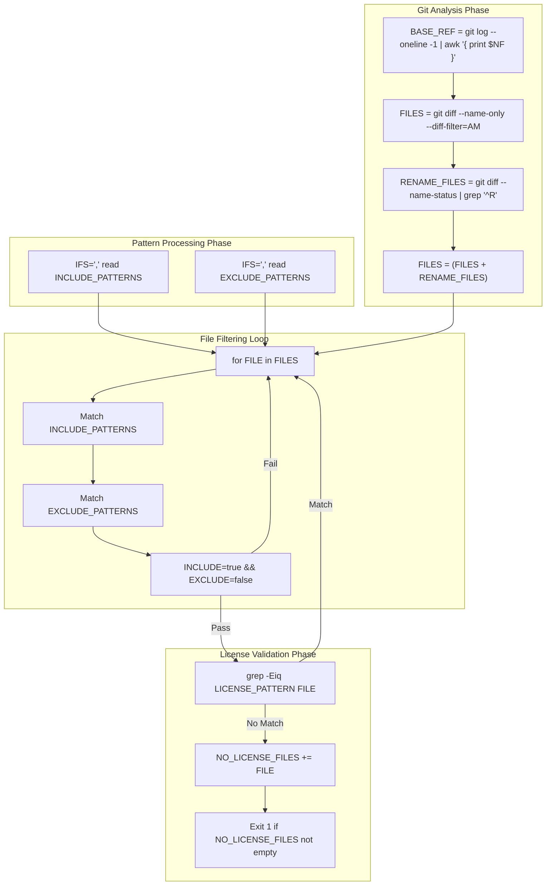

**Sources:** [license-header-check/action.yml:57-63](), [license-header-check/action.yml:50-54](), [license-header-check/action.yml:66-88]()

## Error Handling and Reporting

The system provides comprehensive error handling for both git operations and license validation failures, with specific guidance for common resolution strategies.

### Git Operation Error Handling

When git diff operations fail due to stale base commits, the action provides specific guidance:

```bash
git diff --name-only --diff-filter=AM ${BASE_REF} HEAD || \
  (echo "Your base commit ID is too old, please try upmerge first." && exit 1)
```

### License Validation Reporting

The action aggregates all files missing license headers and provides detailed output:

```bash
if [ ! -z "$NO_LICENSE_FILES" ]; then
  echo "Following files missed copyright/license header or expired:"
  echo $NO_LICENSE_FILES | tr ' ' '\n'
  echo "--------- NOTICE ---------"
  echo "${ERROR_MESSAGE}"
  exit 1
fi
```

The `ERROR_MESSAGE` explains that outdated feature branches may cause false positives and recommends upmerging to the latest development branch.

**Sources:** [license-header-check/action.yml:59](), [license-header-check/action.yml:92-106]()

## Workflow Integration

The License Header Check integrates with GitHub workflows through event-driven execution and conditional logic for different branch scenarios.

### Workflow Triggers and Conditions

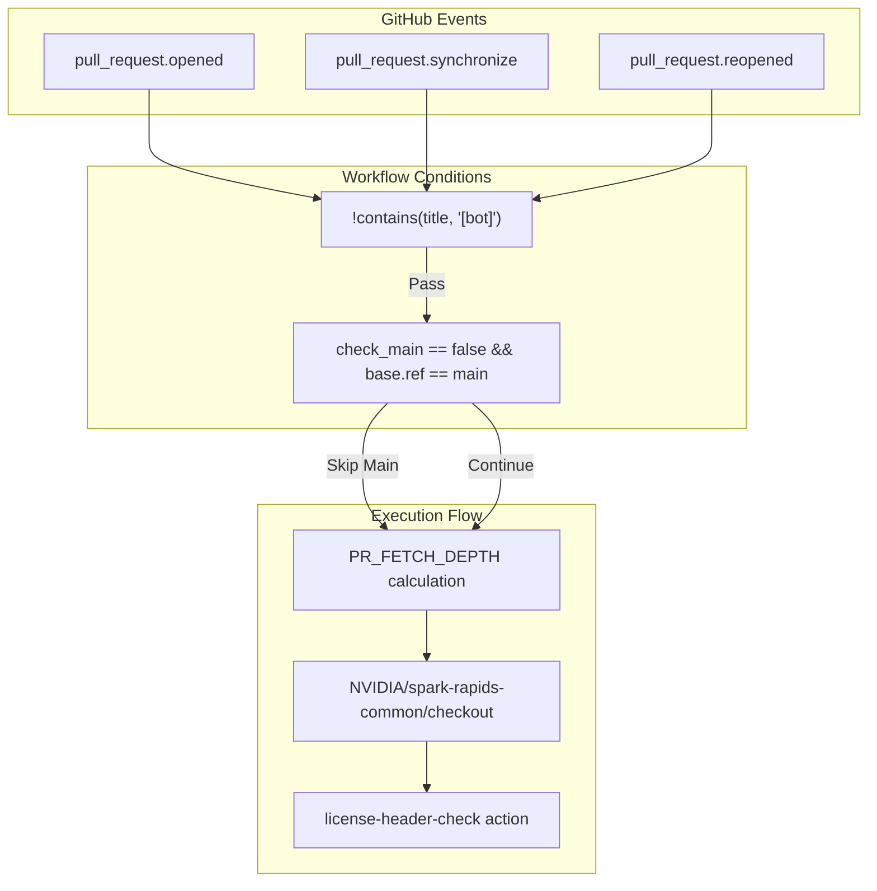

The workflow calculates checkout depth dynamically based on PR commit count:
```yaml
echo "PR_FETCH_DEPTH=$(( ${{ github.event.pull_request.commits }} + 10 ))" >> $GITHUB_ENV
```

### Main Branch Handling

The action includes special logic for main branch PRs controlled by the `check_main` input:

```bash
if [[ "${{ inputs.check_main }}" == "false" && "${{ github.event.pull_request.base.ref }}" == "main" ]]; then
  echo "Skip this check for Merge to main PR."
  exit 0
fi
```

**Sources:** [.github/workflows/license-header-check.yml:18-25](), [.github/workflows/license-header-check.yml:27-34](), [license-header-check/action.yml:44-48]()

---

# Page: Signoff Check

# Signoff Check

<details>
<summary>Relevant source files</summary>

The following files were used as context for generating this wiki page:

- [.github/workflows/signoff.yml](.github/workflows/signoff.yml)
- [signoff-check/Dockerfile](signoff-check/Dockerfile)
- [signoff-check/README.md](signoff-check/README.md)
- [signoff-check/action.yml](signoff-check/action.yml)
- [signoff-check/signoff-check](signoff-check/signoff-check)

</details>


## Purpose and Scope

The Signoff Check system enforces Developer Certificate of Origin (DCO) compliance by validating that pull requests contain at least one commit with a proper sign-off. This quality gate ensures legal compliance across NVIDIA Spark Rapids projects by requiring developers to certify their contributions meet DCO requirements through `Signed-off-by:` commit message headers.

For information about other quality gates in the system, see [Quality Gates System](#2). For broader contribution requirements including DCO policies, see [Contributing Guidelines](#6).

## System Architecture

The Signoff Check system implements a Docker-based GitHub Action that validates commit sign-offs through the GitHub API. The system follows the composite action pattern with containerized execution.

### Component Overview

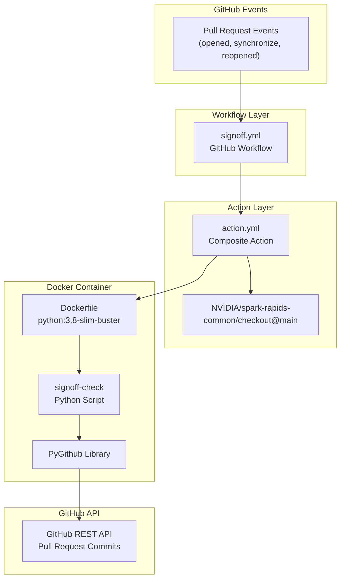

Sources: [.github/workflows/signoff.yml:1-33](), [signoff-check/action.yml:1-55](), [signoff-check/Dockerfile:1-23]()

### Action Input/Output Flow

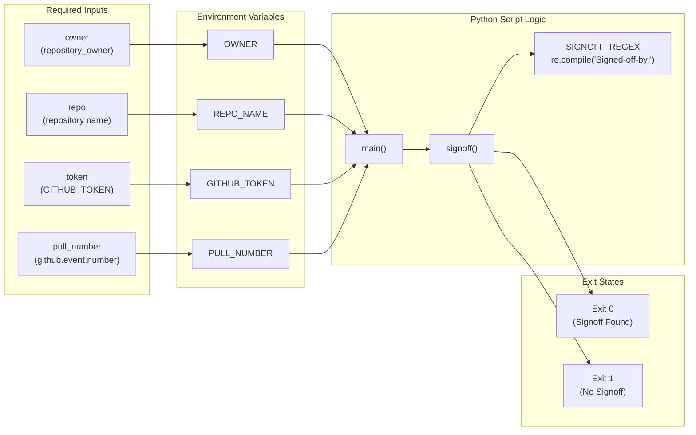

Sources: [signoff-check/action.yml:17-33](), [signoff-check/signoff-check:54-71](), [signoff-check/signoff-check:30-42]()

## Implementation Details

### Docker Container Configuration

The signoff check runs in a Python 3.8 slim container with minimal dependencies:

| Component | Details |
|-----------|---------|
| Base Image | `python:3.8-slim-buster` |
| Dependencies | `PyGithub` library |
| Entrypoint | `/signoff-check` executable |
| Working Directory | `/` |

The container expects four environment variables: `OWNER`, `REPO_NAME`, `GITHUB_TOKEN`, and `PULL_NUMBER`.

Sources: [signoff-check/Dockerfile:15-22]()

### Core Validation Logic

The `signoff()` function implements the DCO validation algorithm:

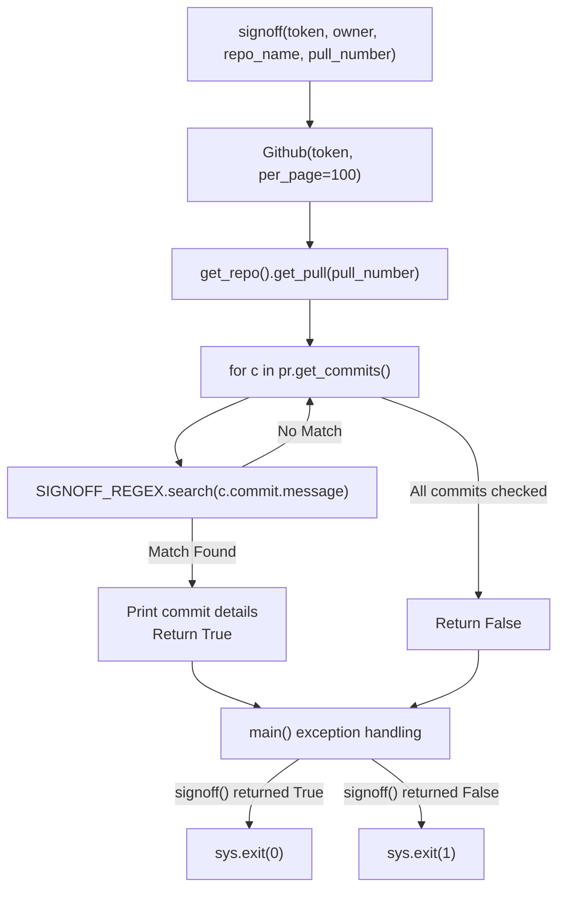

Sources: [signoff-check/signoff-check:33-52]()

The regex pattern `re.compile('Signed-off-by:')` matches the standard DCO sign-off format. When a match is found, the system outputs the commit SHA and message before returning success.

Sources: [signoff-check/signoff-check:30](), [signoff-check/signoff-check:37-41]()

## Usage Configuration

### Workflow Integration

Consumer repositories integrate the signoff check using the `pull_request_target` event trigger:

```yaml
on:
  pull_request_target:
    types: [opened, synchronize, reopened]
```

The `pull_request_target` event provides access to repository secrets while running in the context of the base branch, enabling secure token access for API operations.

Sources: [.github/workflows/signoff.yml:18-20]()

### Input Parameters

| Parameter | Type | Description | Example |
|-----------|------|-------------|---------|
| `owner` | string | Repository owner | `${{ github.repository_owner }}` |
| `repo` | string | Repository name | `spark-rapids-common` |
| `pull_number` | string | PR number | `${{ github.event.number }}` |
| `token` | string | GitHub token | `${{ secrets.GITHUB_TOKEN }}` |

Sources: [signoff-check/action.yml:17-33](), [signoff-check/README.md:14-28]()

### Command Line Interface

The Python script supports both environment variables and command line arguments:

| Argument | Environment Variable | Required | Description |
|----------|---------------------|----------|-------------|
| `--owner` | `OWNER` | Yes | Repository owner |
| `--repo_name` | `REPO_NAME` | Yes | Repository name |
| `--token` | `GITHUB_TOKEN` | Yes | GitHub API token |
| `--pull_number` | `PULL_NUMBER` | Yes | Pull request number |

Sources: [signoff-check/signoff-check:55-69]()

## Technical Execution Flow

### Action Execution Sequence

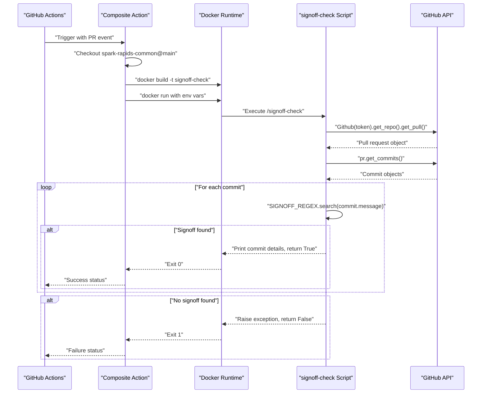

Sources: [signoff-check/action.yml:44-54](), [signoff-check/signoff-check:33-51]()

### Error Handling

The system implements comprehensive error handling with clear exit codes:

- **Exit 0**: At least one commit contains a valid `Signed-off-by:` line
- **Exit 1**: No commits contain sign-offs or API errors occurred

Exception handling catches all errors and outputs diagnostic information before setting the failure exit code.

Sources: [signoff-check/signoff-check:46-51]()

---

# Page: Shell Check

# Shell Check

<details>
<summary>Relevant source files</summary>

The following files were used as context for generating this wiki page:

- [.github/workflows/shell-check.yml](.github/workflows/shell-check.yml)
- [shell-check/action.yml](shell-check/action.yml)

</details>


## Purpose and Scope

The Shell Check system provides automated validation of shell scripts in pull requests using the ShellCheck static analysis tool. This system serves as one of the quality gates that must pass before code can be merged, ensuring shell scripts follow best practices and are free from common syntax and logic errors.

This system specifically handles shell script validation. For other code quality checks, see [License Header Check](#2.1), [Signoff Check](#2.2), and [PR Description Check](#2.5).

## System Architecture

The Shell Check system consists of a GitHub workflow that orchestrates validation and a composite action that configures and executes ShellCheck with project-specific settings.

### Shell Check Execution Flow

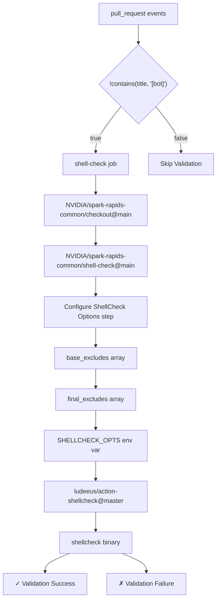

Sources: [.github/workflows/shell-check.yml:18-32](), [shell-check/action.yml:24-84]()

### Component Architecture

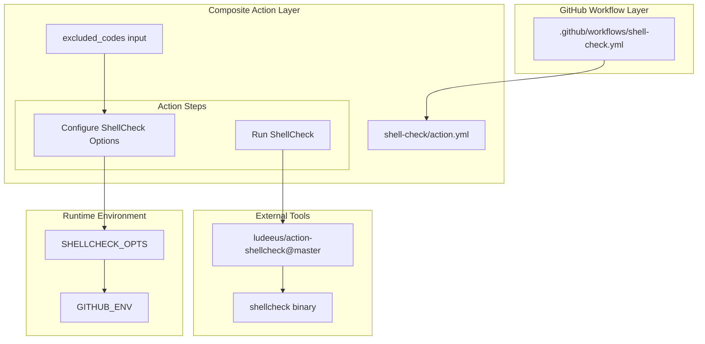

Sources: [.github/workflows/shell-check.yml:27-31](), [shell-check/action.yml:15-84]()

## Workflow Configuration

The workflow is defined in [.github/workflows/shell-check.yml:15-32]() and implements the following behavior:

| Configuration | Value | Purpose |
|---------------|-------|---------|
| **Name** | `shell check` | Workflow identifier |
| **Trigger Events** | `pull_request: [opened, synchronize, reopened]` | Validates shell scripts on PR changes |
| **Runner** | `ubuntu-latest` | Provides consistent Linux environment |
| **Job Condition** | `!contains(github.event.pull_request.title, '[bot]')` | Skips automated bot PRs |

### Workflow Steps

1. **Checkout**: Uses `NVIDIA/spark-rapids-common/checkout@main` for repository access
2. **Shell Validation**: Executes `NVIDIA/spark-rapids-common/shell-check@main` action

Sources: [.github/workflows/shell-check.yml:18-32]()

## Action Implementation

The composite action is implemented in [shell-check/action.yml:15-84]() as a multi-step process that configures ShellCheck options and executes validation.

### Input Parameters

| Input | Type | Default | Description |
|-------|------|---------|-------------|
| `excluded_codes` | `string` | `""` | Comma-separated ShellCheck codes to exclude (e.g., `SC2086,SC2046`) |

Sources: [shell-check/action.yml:17-22]()

### Action Steps

The action executes two primary steps:

1. **Configure ShellCheck Options** [shell-check/action.yml:27-78]()
   - Defines base exclusions for common false positives
   - Merges user-provided exclusions
   - Sets `SHELLCHECK_OPTS` environment variable

2. **Run ShellCheck** [shell-check/action.yml:80-84]()
   - Delegates to `ludeeus/action-shellcheck@master`
   - Passes configured options via environment variables

Sources: [shell-check/action.yml:24-84]()

## ShellCheck Configuration

The action includes a comprehensive set of excluded ShellCheck codes to accommodate common patterns in shell scripting that may trigger false positives.

### Base Exclusions Categories

```mermaid
graph TB
    base_excludes["base_excludes array"] --> quoting_issues["Quoting Issues"]
    base_excludes --> variable_issues["Variable Issues"]  
    base_excludes --> command_substitution["Command Substitution"]
    base_excludes --> array_issues["Array and Pattern Issues"]
    base_excludes --> file_operations["File Operations"]
    base_excludes --> logic_issues["Logic Issues"]
    
    quoting_issues --> SC2086["SC2086: Double quote to prevent globbing"]
    quoting_issues --> SC2046["SC2046: Quote to prevent word splitting"]
    quoting_issues --> SC2016["SC2016: Expressions don't expand in single quotes"]
    
    variable_issues --> SC2155["SC2155: Declare and assign separately"]
    variable_issues --> SC2154["SC2154: Variable referenced but not assigned"]
    variable_issues --> SC2034["SC2034: Variable appears unused"]
    variable_issues --> SC2163["SC2163: Does not export VAR"]
    
    command_substitution --> SC2006["SC2006: Use $(...) instead of backticks"]
    command_substitution --> SC2001["SC2001: Use ${variable//search/replace}"]
    
    array_issues --> SC2102["SC2102: Ranges match single chars"]
    array_issues --> SC2207["SC2207: Prefer mapfile or read -a"]
    array_issues --> SC2145["SC2145: Argument mixes string and array"]
    
    file_operations --> SC1091["SC1091: Not following file not specified"]
    file_operations --> SC2010["SC2010: Don't use ls | grep"]
    file_operations --> SC2012["SC2012: Use find instead of ls"]
    
    logic_issues --> SC2015["SC2015: A && B || C is not if-then-else"]
```

Sources: [shell-check/action.yml:30-62]()

### Exclusion Management Process

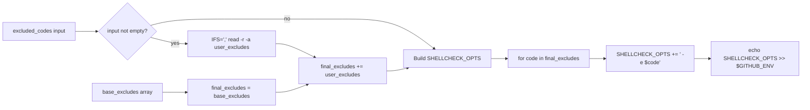

The system supports both predefined base exclusions and runtime user exclusions:

1. **Base Exclusions**: Hardcoded `base_excludes` array [shell-check/action.yml:30-63]()
2. **User Exclusions**: Runtime input via `excluded_codes` parameter [shell-check/action.yml:65-67]()
3. **Option Building**: Constructs `SHELLCHECK_OPTS` string with `-e` flags [shell-check/action.yml:69-76]()

Sources: [shell-check/action.yml:64-78]()

## Usage Patterns

### Standard Usage

The action is typically consumed through the workflow without additional configuration:

```yaml
- name: Run ShellCheck
  uses: NVIDIA/spark-rapids-common/shell-check@main
```

### Custom Exclusions

Projects can provide additional exclusions for project-specific needs:

```yaml
- name: Run ShellCheck
  uses: NVIDIA/spark-rapids-common/shell-check@main
  with:
    excluded_codes: "SC2001,SC2010"
```

### Integration Requirements

The action requires:
- Repository checkout (typically via `NVIDIA/spark-rapids-common/checkout@main`)
- Shell scripts present in the repository
- Ubuntu runner environment

Sources: [.github/workflows/shell-check.yml:27-31](), [shell-check/action.yml:17-22]()

---

# Page: Markdown Link Check

# Markdown Link Check

<details>
<summary>Relevant source files</summary>

The following files were used as context for generating this wiki page:

- [.github/workflows/markdown-link-check.yml](.github/workflows/markdown-link-check.yml)
- [markdown-link-check/action.yml](markdown-link-check/action.yml)

</details>


This document covers the markdown link validation system that ensures documentation links remain valid and accessible across Spark RAPIDS projects. The system validates all markdown files in a repository by checking HTTP/HTTPS links, local file references, and anchor links to detect broken or invalid URLs.

For information about other quality gate systems, see [Quality Gates System](#2). For shell script validation, see [Shell Check](#2.3).

## Purpose and Architecture

The Markdown Link Check system provides automated link validation for markdown documentation through a composite GitHub Action that wraps the external `tcort/github-action-markdown-link-check` tool. The system runs on pull request events and validates links in markdown files to ensure documentation quality and accessibility.

### System Components

#### Code Entity Architecture
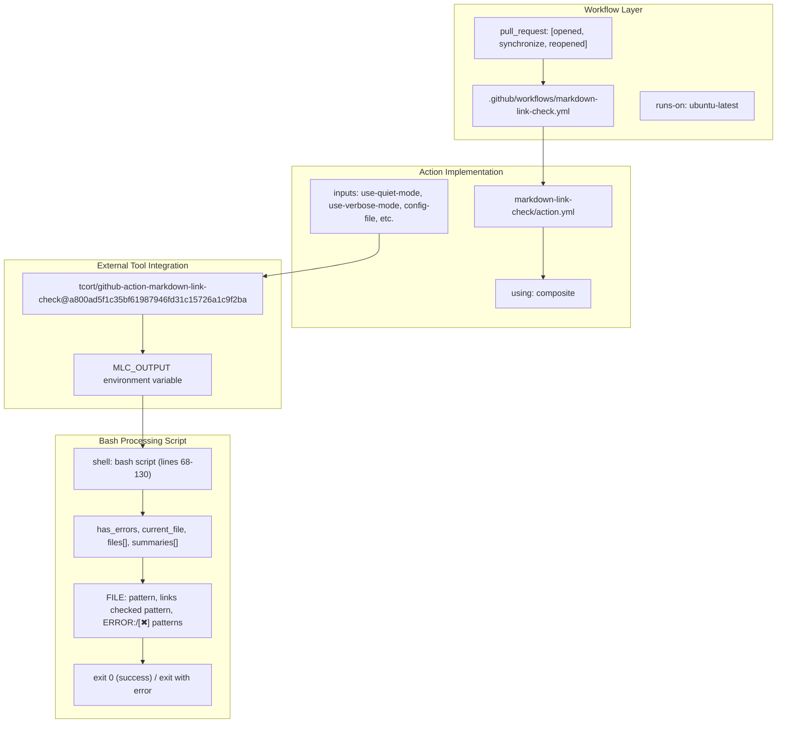

#### File Structure and Dependencies
```mermaid
graph LR
    subgraph "Repository Root"
        root_dir["/"]
        github_dir[".github/"]
        mdlc_dir["markdown-link-check/"]
    end
    
    subgraph "Workflow Files"
        workflow["workflows/markdown-link-check.yml"]
    end
    
    subgraph "Action Files"
        action["action.yml"]
    end
    
    subgraph "External References"
        checkout_action["NVIDIA/spark-rapids-common/checkout@main"]
        tcort_upstream["tcort/github-action-markdown-link-check@a800ad5f1c35bf61987946fd31c15726a1c9f2ba"]
    end
    
    root_dir --> github_dir
    root_dir --> mdlc_dir
    github_dir --> workflow
    mdlc_dir --> action
    workflow --> checkout_action
    workflow --> action
    action --> tcort_upstream
```

Sources: [markdown-link-check/action.yml:1-130](), [.github/workflows/markdown-link-check.yml:1-36]()

## Configuration Inputs

The composite action accepts multiple configuration parameters to customize link checking behavior:

| Input Parameter | Description | Default Value | Required |
|-----------------|-------------|---------------|----------|
| `use-quiet-mode` | Show only errors in output | `no` | No |
| `use-verbose-mode` | Show detailed HTTP status for checked links | `yes` | No |
| `config-file` | Path to custom configuration file | - | No |
| `folder-path` | Comma-separated folders to check | entire repository | No |
| `max-depth` | Directory traversal depth (-1 for unlimited) | `-1` | No |
| `check-modified-files-only` | Only check modified markdown files in PRs | - | No |
| `base-branch` | Comparison branch for modified files check | - | No |
| `file-extension` | File extension to check | - | No |
| `file-path` | Comma-separated specific files to check | - | No |

Sources: [markdown-link-check/action.yml:18-48]()

## Workflow Integration

The workflow triggers on pull request events and executes the link validation process:

#### Execution Flow with Code Entities
```mermaid
sequenceDiagram
    participant github_event as "GitHub PR Event"
    participant workflow_yml as "markdown-link-check.yml"
    participant checkout_action as "NVIDIA/.../checkout@main"
    participant composite_action as "markdown-link-check/action.yml"
    participant tcort_tool as "tcort/...@a800ad5f1c35bf61987946fd31c15726a1c9f2ba"
    participant bash_processor as "Bash Script (lines 68-130)"
    
    github_event->>workflow_yml: "types: [opened, synchronize, reopened]"
    workflow_yml->>checkout_action: "Checkout code step"
    workflow_yml->>composite_action: "with: max-depth: -1, use-verbose-mode: 'yes'"
    composite_action->>tcort_tool: "Pass through all inputs parameters"
    tcort_tool->>composite_action: "Set MLC_OUTPUT environment variable"
    composite_action->>bash_processor: "Execute 'Summarize results' step"
    bash_processor->>bash_processor: "Parse MLC_OUTPUT with regex patterns"
    bash_processor->>bash_processor: "Update has_errors, files[], summaries[]"
    bash_processor->>workflow_yml: "exit 0 or exit with error code"
```

Sources: [.github/workflows/markdown-link-check.yml:18-36](), [markdown-link-check/action.yml:50-66]()

## Result Processing Logic

The action includes custom result processing that parses the output from the external tool and provides structured error reporting:

### Bash Script Processing Algorithm

The `Summarize results` step implements a state machine using bash variables and regex patterns:

#### State Machine Implementation
```mermaid
stateDiagram-v2
    [*] --> scanning_mode: "Initialize: has_errors=0, current_file='', files=(), summaries=()"
    scanning_mode --> file_detected: "Regex: ^FILE:[[:space:]]*(.+)"
    file_detected --> waiting_for_summary: "Set current_file=${BASH_REMATCH[1]}, in_summary_section=0"
    waiting_for_summary --> in_summary_section: "Regex: ^[[:space:]]*[0-9]+[[:space:]]*links[[:space:]]*checked\."
    in_summary_section --> collecting_errors: "files+=($current_file), summaries+=('Details:')"
    collecting_errors --> error_found: "Regex: ERROR: or \\[✖\\]"
    collecting_errors --> collecting_errors: "Append line to summaries[last_index]"
    error_found --> collecting_errors: "Set has_errors=1, continue collecting"
    collecting_errors --> waiting_for_summary: "New FILE: pattern detected"
    collecting_errors --> final_output: "End of MLC_OUTPUT"
    error_found --> final_output: "End of MLC_OUTPUT"
    final_output --> success_exit: "has_errors=0: echo 'All links are valid', exit 0"
    final_output --> error_exit: "has_errors=1: Output error details, exit with error"
```

#### Bash Variable State Tracking
```mermaid
graph TB
    subgraph "State Variables"
        has_errors["has_errors: 0|1"]
        current_file["current_file: string"]
        files_array["files[]: array of filenames"]
        summaries_array["summaries[]: array of error details"]
        in_summary_section["in_summary_section: 0|1"]
    end
    
    subgraph "Regex Patterns (lines 83-104)"
        file_pattern["^FILE:[[:space:]]*(.+)"]
        summary_pattern["^[[:space:]]*[0-9]+[[:space:]]*links[[:space:]]*checked\\."]
        error_pattern["ERROR: | \\[✖\\]"]
    end
    
    subgraph "Processing Flow"
        while_loop["while IFS= read -r line"]
        bash_rematch["BASH_REMATCH[1]"]
        array_operations["files+=(), summaries+=()"]
    end
    
    file_pattern --> bash_rematch
    bash_rematch --> current_file
    summary_pattern --> in_summary_section
    error_pattern --> has_errors
    while_loop --> array_operations
```

Sources: [markdown-link-check/action.yml:74-107]()

### Bash Regex Pattern Implementation

The bash script uses specific regex patterns with `BASH_REMATCH` array for parsing:

| Pattern Purpose | Bash Regex Expression | Code Reference | Capture Group |
|-----------------|------------------------|----------------|---------------|
| File Detection | `^FILE:[[:space:]]*(.+)` | [line 83]() | `${BASH_REMATCH[1]}` → `current_file` |
| Summary Detection | `^[[:space:]]*[0-9]+[[:space:]]*links[[:space:]]*checked\.` | [line 88]() | No capture group |
| Error Detection | `ERROR:` \| `\[✖\]` | [line 103]() | No capture group |

#### Pattern Matching Logic
```mermaid
flowchart TD
    read_line["IFS= read -r line"]
    check_file["if [[ $line =~ ^FILE:[[:space:]]*(.+) ]]"]
    check_summary["elif [[ $line =~ ^[[:space:]]*[0-9]+[[:space:]]*links[[:space:]]*checked\. ]]"]
    check_error["if [[ $line =~ ERROR: ]] || [[ $line =~ \\[✖\\] ]]"]
    
    set_file["current_file=${BASH_REMATCH[1]}, in_summary_section=0"]
    set_summary["in_summary_section=1, files+=($current_file)"]
    set_error["has_errors=1"]
    append_line["summaries[last_index]+=$'\\n'$line"]
    
    read_line --> check_file
    check_file -->|true| set_file
    check_file -->|false| check_summary
    check_summary -->|true| set_summary
    check_summary -->|false| append_line
    append_line --> check_error
    check_error -->|true| set_error
```

Sources: [markdown-link-check/action.yml:81-106]()

## Error Reporting

When errors are detected, the system provides structured output with file-specific error details:

### Success Case
```
=========== All links are valid ===========
```

### Error Case
```
=========== Found error links ===========
File: path/to/file.md
  Details:
  ERROR: 404 → https://example.com/broken-link
  [✖] https://invalid-url.com
```

The reporting logic iterates through collected summaries and outputs only files containing errors, with proper indentation for readability.

Sources: [markdown-link-check/action.yml:110-130]()

## Integration with Quality Gates

The Markdown Link Check system operates as part of the broader quality gates infrastructure, running automatically on pull requests to validate documentation quality before code merge. The action uses the standard `NVIDIA/spark-rapids-common/checkout@main` action for repository access and integrates seamlessly with other validation workflows in the spark-rapids-common ecosystem.

Sources: [.github/workflows/markdown-link-check.yml:28-35]()

---

# Page: PR Description Check

# PR Description Check

<details>
<summary>Relevant source files</summary>

The following files were used as context for generating this wiki page:

- [.github/workflows/pr-desc-check.yml](.github/workflows/pr-desc-check.yml)
- [pr-description-check/action.yml](pr-description-check/action.yml)

</details>


## Purpose and Scope

The PR Description Check system validates pull request descriptions to ensure they do not contain HTML comments, maintaining clean and professional documentation standards across the NVIDIA Spark Rapids ecosystem. This system prevents accidentally committed HTML comment blocks (starting with `<!--`) from appearing in PR descriptions, which could indicate incomplete or draft content.

This document covers the automated validation workflow and composite action implementation. For information about other quality gates, see [Quality Gates System](#2). For signoff validation requirements, see [Signoff Check](#2.2).

## Workflow Execution Flow

The PR description validation is triggered automatically through the `pr-desc-check.yml` workflow on specific pull request events.

#### PR Description Check Workflow Execution

```mermaid
flowchart TD
    PR_EVENT["pull_request_target event"] --> EVENT_CHECK{"Event type check"}
    EVENT_CHECK -->|"opened, edited, reopened"| BOT_CHECK{"Contains '[bot]' in title?"}
    EVENT_CHECK -->|"other events"| SKIP["Skip execution"]
    
    BOT_CHECK -->|"Yes"| SKIP
    BOT_CHECK -->|"No"| JOB_START["pr-description-check job"]
    
    JOB_START --> PERMISSIONS["Set permissions:\npull-requests: read\nstatuses: write\ncontents: read"]
    PERMISSIONS --> ACTION_CALL["Call NVIDIA/spark-rapids-common/pr-description-check@main"]
    ACTION_CALL --> TOKEN_PASS["Pass GITHUB_TOKEN"]
    TOKEN_PASS --> ACTION_EXEC["Execute composite action"]
```

Sources: [.github/workflows/pr-desc-check.yml:18-34]()

The workflow uses `pull_request_target` trigger for security reasons, allowing access to secrets while processing PRs from forks. The bot filter at [.github/workflows/pr-desc-check.yml:29]() prevents unnecessary execution on automated PRs.

## Action Implementation Architecture

The `pr-description-check` composite action implements the core validation logic using GitHub's scripting capabilities.

#### Action Internal Flow and GitHub API Integration

```mermaid
sequenceDiagram
    participant WF as "pr-desc-check workflow"
    participant CA as "pr-description-check action"
    participant GS as "actions/github-script@v7"
    participant API as "GitHub REST API"
    participant CS as "Commit Status"

    WF->>CA: "Call with github-token input"
    CA->>GS: "Execute Get PR description step"
    GS->>GS: "Extract pr.body from context.payload.pull_request"
    GS->>GS: "Check prBody.includes('<!--')"
    
    alt "Comment found"
        GS->>GS: "Set state = 'failure'"
        GS->>GS: "core.setFailed() with error message"
    else "No comment"
        GS->>GS: "Set state = 'success'"
    end
    
    GS->>API: "github.rest.repos.createCommitStatus()"
    API->>CS: "Update commit status with result"
    CS-->>WF: "Status visible in PR"
```

Sources: [pr-description-check/action.yml:26-53]()

## Validation Logic Details

The action performs a simple but effective validation check against HTML comments in PR descriptions.

### Input Configuration

| Input Parameter | Type | Required | Purpose |
|---|---|---|---|
| `github-token` | string | Yes | Authentication token for GitHub API access |

Sources: [pr-description-check/action.yml:17-21]()

### Validation Algorithm

The validation logic at [pr-description-check/action.yml:31-43]() follows this process:

1. **Extract PR Data**: Retrieves `pr.body` and `pr.head.sha` from `context.payload.pull_request`
2. **Comment Detection**: Checks if `prBody.includes('<!--')` returns true
3. **State Determination**: Sets `state` to `'failure'` if comments found, `'success'` otherwise
4. **Error Handling**: Calls `core.setFailed()` with descriptive message when validation fails

### Status Reporting Mechanism

The action creates a commit status through the GitHub REST API with these parameters:

```mermaid
graph LR
    STATUS_CALL["github.rest.repos.createCommitStatus()"] --> OWNER["owner: context.repo.owner"]
    STATUS_CALL --> REPO["repo: context.repo.repo"]
    STATUS_CALL --> SHA["sha: pr.head.sha"]
    STATUS_CALL --> STATE["state: 'success' | 'failure'"]
    STATUS_CALL --> URL["target_url: pr.html_url"]
    STATUS_CALL --> DESC["description: truncated to 140 chars"]
    STATUS_CALL --> CONTEXT["context: 'PR Description'"]
```

Sources: [pr-description-check/action.yml:45-53]()

The status description is truncated to 140 characters at [pr-description-check/action.yml:51]() to comply with GitHub's API limits. The context name `'PR Description'` appears as a separate status check in the PR's status panel.

## Error Messages and User Feedback

The system provides clear feedback through standardized error messages:

- **Success State**: `"PR description is valid."`
- **Failure State**: `"PR description contains comment in '<!--'. Please remove the comment manually."`

Sources: [pr-description-check/action.yml:37-39]()

These messages guide developers to resolve issues by manually removing HTML comment blocks from their PR descriptions, ensuring clean and professional documentation standards across the project.

---

# Page: Project Management

# Project Management

<details>
<summary>Relevant source files</summary>

The following files were used as context for generating this wiki page:

- [.github/CODEOWNERS](.github/CODEOWNERS)
- [.github/ISSUE_TEMPLATE/1-bug_report.md](.github/ISSUE_TEMPLATE/1-bug_report.md)
- [.github/ISSUE_TEMPLATE/2-feature_request.md](.github/ISSUE_TEMPLATE/2-feature_request.md)
- [.github/ISSUE_TEMPLATE/config.yml](.github/ISSUE_TEMPLATE/config.yml)
- [.github/workflows/add-to-project.yml](.github/workflows/add-to-project.yml)
- [add-to-project/README.md](add-to-project/README.md)
- [add-to-project/action.yml](add-to-project/action.yml)

</details>


This document covers the automated project management infrastructure within the spark-rapids-common repository. The system encompasses code ownership enforcement, structured issue tracking templates, and automated project board integration that ensures consistent project governance across the NVIDIA Spark Rapids ecosystem.

The project management system operates through three primary components: the `CODEOWNERS` configuration for review assignments, GitHub issue templates for standardized reporting, and the automated `add-to-project` workflow for project board tracking. For information about quality assurance workflows that complement these management processes, see [Quality Gates System](#2).

## Code Ownership System

The repository implements a centralized code ownership model through the `CODEOWNERS` configuration that automatically assigns reviewers for all changes.

**Code Ownership Configuration**

```mermaid
graph TD
    subgraph "Code Review Process"
        PR["Pull Request Created"] --> CODEOWNERS["CODEOWNERS File"]
        CODEOWNERS --> TEAM["@NVIDIA/sparkrapids-cicd-codeowners"]
        TEAM --> REVIEW["Automatic Reviewer Assignment"]
        REVIEW --> APPROVAL["Required Approval"]
        APPROVAL --> MERGE["Merge Authorization"]
    end
    
    subgraph "Team Structure"
        NVIDIA_ORG["NVIDIA Organization"] --> SPARKRAPIDS_TEAM["sparkrapids-cicd-codeowners Team"]
        SPARKRAPIDS_TEAM --> MEMBERS["Team Members"]
    end
    
    TEAM -.-> SPARKRAPIDS_TEAM
```

The ownership model assigns universal responsibility to the `@NVIDIA/sparkrapids-cicd-codeowners` team for all repository content, as defined in [.github/CODEOWNERS:1](). This ensures that every pull request receives appropriate review from qualified team members who understand the CI/CD infrastructure implications.

**Sources:** [.github/CODEOWNERS:1-2]()

## Issue Template System

The repository provides structured issue templates that standardize bug reporting and feature requests, ensuring consistent information capture for project management.

**Issue Template Architecture**

```mermaid
graph LR
    subgraph "Issue Creation Flow"
        USER["User Creates Issue"] --> TEMPLATE_SELECT["Template Selection"]
        TEMPLATE_SELECT --> BUG_TEMPLATE["1-bug_report.md"]
        TEMPLATE_SELECT --> FEATURE_TEMPLATE["2-feature_request.md"]
    end
    
    subgraph "Template Processing"
        BUG_TEMPLATE --> BUG_FIELDS["Bug Report Fields"]
        FEATURE_TEMPLATE --> FEATURE_FIELDS["Feature Request Fields"]
        BUG_FIELDS --> LABELS_BUG["Labels: ? - Needs Triage, bug"]
        FEATURE_FIELDS --> LABELS_FEATURE["Labels: ? - Needs Triage, feature request"]
        LABELS_BUG --> ASSIGNEE["Auto-assigned to pxLi"]
        LABELS_FEATURE --> ASSIGNEE
    end
    
    subgraph "Configuration"
        CONFIG["config.yml"] --> BLANK_DISABLED["blank_issues_enabled: false"]
    end
    
    CONFIG -.-> TEMPLATE_SELECT
```

### Bug Report Template

The bug report template in [.github/ISSUE_TEMPLATE/1-bug_report.md]() structures issue submission with the following components:

| Field | Purpose |
|-------|---------|
| `title` | Prefixed with "[BUG]" for categorization |
| `labels` | Auto-applies "? - Needs Triage, bug" |
| `assignees` | Automatically assigns to `pxLi` |
| Description fields | Structured prompts for bug details, reproduction steps, and expected behavior |

### Feature Request Template

The feature request template in [.github/ISSUE_TEMPLATE/2-feature_request.md]() provides structured fields for enhancement proposals:

| Field | Purpose |
|-------|---------|
| `title` | Prefixed with "[FEA]" for categorization |
| `labels` | Auto-applies "? - Needs Triage, feature request" |
| `assignees` | Automatically assigns to `pxLi` |
| Description fields | Problem description, solution proposal, alternatives, and context |

The system disables blank issues through [.github/ISSUE_TEMPLATE/config.yml:15](), forcing users to select appropriate templates and ensuring consistent issue quality.

**Sources:** [.github/ISSUE_TEMPLATE/1-bug_report.md:1-23](), [.github/ISSUE_TEMPLATE/2-feature_request.md:1-22](), [.github/ISSUE_TEMPLATE/config.yml:15]()

## Automated Project Board Integration

The `add-to-project` system automatically integrates new issues and pull requests into the NVIDIA project board for centralized tracking and management.

**Project Integration Workflow**

```mermaid
sequenceDiagram
    participant DEV as "Developer"
    participant GH as "GitHub"
    participant WORKFLOW as "add-to-project.yml"
    participant ACTION as "add-to-project Action"
    participant PROJECT as "NVIDIA Project Board"
    
    DEV->>GH: "Creates Issue/PR"
    GH->>WORKFLOW: "Triggers on issues.opened or pull_request_target.opened"
    WORKFLOW->>WORKFLOW: "Check: github.repository_owner == 'NVIDIA'"
    WORKFLOW->>ACTION: "uses: NVIDIA/spark-rapids-common/add-to-project@main"
    ACTION->>ACTION: "uses: actions/add-to-project@v1.0.2"
    ACTION->>PROJECT: "Add to https://github.com/orgs/NVIDIA/projects/4"
    PROJECT-->>ACTION: "Confirmation"
    ACTION-->>WORKFLOW: "Success/Failure"
    WORKFLOW-->>GH: "Status Update"
```

### Workflow Configuration

The workflow in [.github/workflows/add-to-project.yml]() activates on specific GitHub events:

- **Issue Events**: `issues.opened` ([.github/workflows/add-to-project.yml:18-20]())
- **Pull Request Events**: `pull_request_target.opened` ([.github/workflows/add-to-project.yml:21-23]())

The workflow includes a security check at [.github/workflows/add-to-project.yml:27]() that restricts execution to repositories owned by the NVIDIA organization, preventing unauthorized project board additions from forked repositories.

### Action Implementation

The `add-to-project` action serves as a wrapper around the official GitHub `actions/add-to-project@v1.0.2` action, configured with NVIDIA-specific settings:

| Component | Configuration |
|-----------|---------------|
| **Target Project** | `https://github.com/orgs/NVIDIA/projects/4` ([add-to-project/action.yml:29]()) |
| **Authentication** | Uses `PROJECT_TOKEN` secret ([.github/workflows/add-to-project.yml:33]()) |
| **Action Type** | Composite action ([add-to-project/action.yml:24]()) |

**Sources:** [.github/workflows/add-to-project.yml:15-34](), [add-to-project/action.yml:15-31](), [add-to-project/README.md:1-24]()

## System Integration

The project management components work together to create a comprehensive governance framework that ensures proper oversight, tracking, and process adherence.

**Integrated Project Management Flow**

```mermaid
graph TB
    subgraph "Issue/PR Creation"
        ISSUE_CREATE["Issue Created with Template"] --> AUTO_ASSIGN["Auto-assigned to pxLi"]
        PR_CREATE["Pull Request Created"] --> CODEOWNER_ASSIGN["Auto-assigned to @NVIDIA/sparkrapids-cicd-codeowners"]
    end
    
    subgraph "Automated Processing"
        AUTO_ASSIGN --> PROJECT_ADD["add-to-project Workflow"]
        CODEOWNER_ASSIGN --> PROJECT_ADD
        PROJECT_ADD --> PROJECT_BOARD["NVIDIA Project Board #4"]
    end
    
    subgraph "Management Oversight"
        PROJECT_BOARD --> TRIAGE["Needs Triage Label Processing"]
        TRIAGE --> REVIEW_ASSIGNMENT["Review Assignment"]
        REVIEW_ASSIGNMENT --> TRACKING["Progress Tracking"]
    end
    
    subgraph "Quality Gates Integration"
        CODEOWNER_ASSIGN --> QUALITY_CHECKS["Quality Gate Workflows"]
        QUALITY_CHECKS --> APPROVAL_REQUIRED["Approval + Checks Required"]
        APPROVAL_REQUIRED --> MERGE_AUTHORIZED["Merge Authorization"]
    end
```

The integrated system ensures that:

1. **All contributions receive appropriate review** through `CODEOWNERS` assignments
2. **Issues follow structured reporting** via required templates  
3. **Work items are automatically tracked** in the centralized project board
4. **Security is maintained** through organization ownership validation
5. **Process consistency** is enforced across the entire Spark Rapids ecosystem

**Sources:** [.github/CODEOWNERS:1-2](), [.github/workflows/add-to-project.yml:27](), [add-to-project/action.yml:29]()

---

# Page: Code Ownership

# Code Ownership

<details>
<summary>Relevant source files</summary>

The following files were used as context for generating this wiki page:

- [.github/CODEOWNERS](.github/CODEOWNERS)

</details>


This document covers the code ownership system in spark-rapids-common, which defines review responsibilities and automated reviewer assignment through GitHub's CODEOWNERS mechanism. The system ensures proper oversight of all changes by automatically assigning the appropriate team members as reviewers when pull requests are created.

For information about the broader project management automation including issue templates and project board integration, see [Project Management](#3).

## Purpose and Configuration

The code ownership system is implemented through GitHub's CODEOWNERS functionality, which automatically assigns reviewers to pull requests based on file path patterns. The spark-rapids-common repository uses a centralized ownership model where all files are owned by a single team.

### CODEOWNERS Configuration

The ownership rules are defined in [.github/CODEOWNERS:1-2](), which establishes a simple but comprehensive ownership structure:

```
* @NVIDIA/sparkrapids-cicd-codeowners
```

This configuration assigns the `@NVIDIA/sparkrapids-cicd-codeowners` team as owners for all files in the repository using the wildcard pattern `*`.

**Sources:** [.github/CODEOWNERS:1-2]()

### Ownership Model Architecture

```mermaid
graph TD
    PR["Pull Request Created"] --> CODEOWNERS[".github/CODEOWNERS"]
    CODEOWNERS --> PATTERN["Wildcard Pattern: *"]
    PATTERN --> TEAM["@NVIDIA/sparkrapids-cicd-codeowners"]
    TEAM --> REVIEWERS["Automated Reviewer Assignment"]
    REVIEWERS --> APPROVAL["Required Approval Process"]
    
    subgraph "File Coverage"
        ALL_FILES["All Repository Files"]
        ACTIONS["GitHub Actions"]
        WORKFLOWS[".github/workflows/"]
        DOCS["Documentation"]
        CONFIG["Configuration Files"]
    end
    
    PATTERN --> ALL_FILES
    ALL_FILES --> ACTIONS
    ALL_FILES --> WORKFLOWS
    ALL_FILES --> DOCS
    ALL_FILES --> CONFIG
```

**Sources:** [.github/CODEOWNERS:1-2]()

## Reviewer Assignment Process

The code ownership system integrates with GitHub's pull request workflow to automatically assign reviewers based on the files modified in each pull request. This ensures consistent oversight across all repository changes.

### Assignment Workflow

```mermaid
sequenceDiagram
    participant Dev as "Developer"
    participant PR as "Pull Request"
    participant GitHub as "GitHub Platform"
    participant CODEOWNERS as "CODEOWNERS Parser"
    participant Team as "@NVIDIA/sparkrapids-cicd-codeowners"
    
    Dev->>PR: "Creates PR with file changes"
    PR->>GitHub: "Triggers PR event"
    GitHub->>CODEOWNERS: "Parse ownership rules"
    CODEOWNERS->>CODEOWNERS: "Match files against pattern *"
    CODEOWNERS->>Team: "Assign as reviewer"
    Team->>GitHub: "Team members notified"
    GitHub->>PR: "Display required reviewers"
    Team->>PR: "Provide review and approval"
```

**Sources:** [.github/CODEOWNERS:1-2]()

## Integration with Quality Gates

The code ownership system works in conjunction with the quality gates system to ensure both automated validation and human oversight. The reviewer assignment occurs alongside the automated quality checks documented in [Quality Gates System](#2).

### Review and Merge Flow

```mermaid
flowchart TD
    PR_CREATE["Pull Request Created"] --> PARALLEL_START{{"Parallel Processes"}}
    
    PARALLEL_START --> QUALITY_GATES["Quality Gates System"]
    PARALLEL_START --> REVIEWER_ASSIGN["CODEOWNERS Assignment"]
    
    subgraph "Quality Validation"
        QUALITY_GATES --> LICENSE_CHECK["License Header Check"]
        QUALITY_GATES --> SIGNOFF_CHECK["Signoff Check"]
        QUALITY_GATES --> SHELL_CHECK["Shell Check"]
        QUALITY_GATES --> MARKDOWN_CHECK["Markdown Link Check"]
        QUALITY_GATES --> PR_DESC_CHECK["PR Description Check"]
    end
    
    subgraph "Human Review Process"
        REVIEWER_ASSIGN --> TEAM_NOTIFY["@NVIDIA/sparkrapids-cicd-codeowners Notified"]
        TEAM_NOTIFY --> HUMAN_REVIEW["Manual Code Review"]
        HUMAN_REVIEW --> APPROVAL_DECISION{"Approval Decision"}
    end
    
    LICENSE_CHECK --> QUALITY_PASS{"All Checks Pass?"}
    SIGNOFF_CHECK --> QUALITY_PASS
    SHELL_CHECK --> QUALITY_PASS
    MARKDOWN_CHECK --> QUALITY_PASS
    PR_DESC_CHECK --> QUALITY_PASS
    
    APPROVAL_DECISION --> APPROVED["Approved"]
    APPROVAL_DECISION --> CHANGES_REQUESTED["Changes Requested"]
    
    QUALITY_PASS --> QUALITY_SUCCESS["Quality Gates Passed"]
    QUALITY_PASS --> QUALITY_FAIL["Quality Gates Failed"]
    
    QUALITY_SUCCESS --> MERGE_READY{"Ready to Merge?"}
    APPROVED --> MERGE_READY
    
    MERGE_READY --> AUTO_MERGE["Auto-Merge Eligible"]
    CHANGES_REQUESTED --> PR_UPDATE["Developer Updates PR"]
    QUALITY_FAIL --> PR_UPDATE
    PR_UPDATE --> PARALLEL_START
```

**Sources:** [.github/CODEOWNERS:1-2]()

## Team Structure and Responsibilities

The `@NVIDIA/sparkrapids-cicd-codeowners` team serves as the central authority for all repository changes. This team structure provides several benefits for the spark-rapids-common repository:

### Ownership Benefits

| Aspect | Benefit |
|--------|---------|
| **Consistency** | Single team ensures uniform review standards across all components |
| **Expertise** | Team specializes in CI/CD and automation systems |
| **Accountability** | Clear ownership chain for all repository changes |
| **Coverage** | No files excluded from review requirements |

### Team Responsibilities

The code owners are responsible for:

- Reviewing all pull requests for technical correctness
- Ensuring changes align with repository standards and practices
- Validating that modifications don't break existing functionality
- Maintaining the quality and security of reusable GitHub Actions
- Approving changes that affect CI/CD workflows and automation

**Sources:** [.github/CODEOWNERS:1-2]()

## Repository-Wide Coverage

The wildcard pattern `*` in the CODEOWNERS configuration ensures comprehensive coverage of all repository components. This includes critical infrastructure components that require careful oversight:

### Protected Components

```mermaid
graph TB
    CODEOWNERS_RULE["* @NVIDIA/sparkrapids-cicd-codeowners"]
    
    subgraph "Covered File Types"
        ACTIONS["GitHub Actions<br/>(/action-name/*)"]
        WORKFLOWS["Workflow Files<br/>(.github/workflows/*.yml)"]
        CONFIG_FILES["Configuration Files<br/>(.github/CODEOWNERS, etc.)"]
        DOCS["Documentation<br/>(README.md, etc.)"]
        SCRIPTS["Scripts<br/>(*.sh, *.py)"]
        DOCKER["Docker Files<br/>(*/Dockerfile)"]
    end
    
    CODEOWNERS_RULE --> ACTIONS
    CODEOWNERS_RULE --> WORKFLOWS
    CODEOWNERS_RULE --> CONFIG_FILES
    CODEOWNERS_RULE --> DOCS
    CODEOWNERS_RULE --> SCRIPTS
    CODEOWNERS_RULE --> DOCKER
    
    subgraph "Examples"
        ACTIONS --> LICENSE_ACTION["license-header-check/"]
        ACTIONS --> SIGNOFF_ACTION["signoff-check/"]
        WORKFLOWS --> LICENSE_WF["license-header-check.yml"]
        CONFIG_FILES --> CODEOWNERS_FILE[".github/CODEOWNERS"]
    end
```

**Sources:** [.github/CODEOWNERS:1-2]()

This comprehensive ownership model ensures that all changes to the spark-rapids-common repository receive appropriate technical review, maintaining the reliability and quality of the centralized CI/CD infrastructure that supports the broader NVIDIA Spark Rapids ecosystem.

---

# Page: Issue Templates

# Issue Templates

<details>
<summary>Relevant source files</summary>

The following files were used as context for generating this wiki page:

- [.github/ISSUE_TEMPLATE/1-bug_report.md](.github/ISSUE_TEMPLATE/1-bug_report.md)
- [.github/ISSUE_TEMPLATE/2-feature_request.md](.github/ISSUE_TEMPLATE/2-feature_request.md)
- [.github/ISSUE_TEMPLATE/config.yml](.github/ISSUE_TEMPLATE/config.yml)

</details>


This document covers the structured issue template system in the spark-rapids-common repository that standardizes bug reports and feature requests. The templates ensure consistent information collection for effective issue triage and resolution.

For information about automated issue project board integration, see [Add to Project Action](#3.3). For code review assignments related to issues, see [Code Ownership](#3.1).

## Template Structure Overview

The issue template system consists of two standardized templates and a configuration file that collectively manage how users submit issues to the repository.

```mermaid
flowchart TD
    subgraph "GitHub_ISSUE_TEMPLATE_Directory" [".github/ISSUE_TEMPLATE/"]
        CONFIG["config.yml"]
        BUG_TEMPLATE["1-bug_report.md"]
        FEATURE_TEMPLATE["2-feature_request.md"]
    end
    
    subgraph "Template_Configuration"
        BLANK_DISABLED["blank_issues_enabled: false"]
        COPYRIGHT["NVIDIA Copyright Header"]
    end
    
    subgraph "Bug_Report_Structure"
        BUG_TITLE["Title: [BUG]"]
        BUG_LABELS["Labels: ? - Needs Triage, bug"]
        BUG_ASSIGNEE["Assignee: pxLi"]
        BUG_SECTIONS["Sections: Description, Steps, Expected, Context"]
    end
    
    subgraph "Feature_Request_Structure"
        FEA_TITLE["Title: [FEA]"]
        FEA_LABELS["Labels: ? - Needs Triage, feature request"]
        FEA_ASSIGNEE["Assignee: pxLi"]
        FEA_SECTIONS["Sections: Problem, Solution, Alternatives, Context"]
    end
    
    CONFIG --> BLANK_DISABLED
    CONFIG --> COPYRIGHT
    BUG_TEMPLATE --> BUG_TITLE
    BUG_TEMPLATE --> BUG_LABELS
    BUG_TEMPLATE --> BUG_ASSIGNEE
    BUG_TEMPLATE --> BUG_SECTIONS
    FEATURE_TEMPLATE --> FEA_TITLE
    FEATURE_TEMPLATE --> FEA_LABELS
    FEATURE_TEMPLATE --> FEA_ASSIGNEE
    FEATURE_TEMPLATE --> FEA_SECTIONS
```

Sources: [.github/ISSUE_TEMPLATE/config.yml:1-16](), [.github/ISSUE_TEMPLATE/1-bug_report.md:1-23](), [.github/ISSUE_TEMPLATE/2-feature_request.md:1-22]()

## Template Configuration

The `config.yml` file controls global issue template behavior by disabling blank issue creation, forcing users to select from the structured templates.

| Configuration Setting | Value | Purpose |
|----------------------|--------|---------|
| `blank_issues_enabled` | `false` | Forces template selection |
| Copyright Header | NVIDIA Apache 2.0 | Legal compliance |

Sources: [.github/ISSUE_TEMPLATE/config.yml:15-16]()

## Bug Report Template

The bug report template (`1-bug_report.md`) provides a structured format for reporting defects and issues.

```mermaid
flowchart TD
    subgraph "bug_report_md_Template"
        YAML_FRONT["YAML Front Matter"]
        BUG_DESC["Describe the bug"]
        REPRO_STEPS["Steps/Code to reproduce bug"]
        EXPECTED["Expected behavior"]
        CONTEXT["Additional context"]
    end
    
    subgraph "YAML_Configuration"
        NAME["name: Bug report"]
        ABOUT["about: Create a bug report..."]
        TITLE_PREFIX["title: [BUG]"]
        LABEL_TRIAGE["labels: ? - Needs Triage, bug"]
        ASSIGN_PXLi["assignees: - pxLi"]
    end
    
    subgraph "Content_Guidelines"
        CLEAR_DESC["Clear and concise description"]
        AVOID_SENSITIVE["Avoid private/sensitive data"]
        REPRODUCTION["List of steps or code sample"]
        EXPECTED_OUTCOME["What you expected to happen"]
    end
    
    YAML_FRONT --> NAME
    YAML_FRONT --> ABOUT
    YAML_FRONT --> TITLE_PREFIX
    YAML_FRONT --> LABEL_TRIAGE
    YAML_FRONT --> ASSIGN_PXLi
    
    BUG_DESC --> CLEAR_DESC
    REPRO_STEPS --> AVOID_SENSITIVE
    REPRO_STEPS --> REPRODUCTION
    EXPECTED --> EXPECTED_OUTCOME
```

Sources: [.github/ISSUE_TEMPLATE/1-bug_report.md:1-23]()

### Bug Report Fields

The template includes four structured sections:

1. **Bug Description** - Clear description of the defect [.github/ISSUE_TEMPLATE/1-bug_report.md:11-12]()
2. **Reproduction Steps** - Code or steps to reproduce, with security guidance [.github/ISSUE_TEMPLATE/1-bug_report.md:14-16]()
3. **Expected Behavior** - Description of correct behavior [.github/ISSUE_TEMPLATE/1-bug_report.md:18-19]()
4. **Additional Context** - Supporting information [.github/ISSUE_TEMPLATE/1-bug_report.md:21-22]()

## Feature Request Template

The feature request template (`2-feature_request.md`) structures enhancement and new feature proposals.

```mermaid
flowchart TD
    subgraph "feature_request_md_Template"
        FEA_YAML["YAML Front Matter"]
        PROBLEM_DESC["Is your feature request related to a problem?"]
        SOLUTION_DESC["Describe the solution you'd like"]
        ALTERNATIVES["Describe alternatives you've considered"]
        FEA_CONTEXT["Additional context"]
    end
    
    subgraph "FEA_YAML_Configuration"
        FEA_NAME["name: Feature request"]
        FEA_ABOUT["about: Suggest an idea..."]
        FEA_TITLE["title: [FEA]"]
        FEA_LABELS["labels: ? - Needs Triage, feature request"]
        FEA_ASSIGNEE["assignees: - pxLi"]
    end
    
    subgraph "FEA_Content_Structure"
        PROBLEM_CLARITY["Clear problem description"]
        SOLUTION_VISION["What you want to happen"]
        ALT_ANALYSIS["Alternative solutions considered"]
        CODE_EXAMPLES["Code examples, references"]
    end
    
    FEA_YAML --> FEA_NAME
    FEA_YAML --> FEA_ABOUT
    FEA_YAML --> FEA_TITLE
    FEA_YAML --> FEA_LABELS
    FEA_YAML --> FEA_ASSIGNEE
    
    PROBLEM_DESC --> PROBLEM_CLARITY
    SOLUTION_DESC --> SOLUTION_VISION
    ALTERNATIVES --> ALT_ANALYSIS
    FEA_CONTEXT --> CODE_EXAMPLES
```

Sources: [.github/ISSUE_TEMPLATE/2-feature_request.md:1-22]()

### Feature Request Fields

The template structures enhancement requests into four sections:

1. **Problem Description** - Identifies the issue the feature addresses [.github/ISSUE_TEMPLATE/2-feature_request.md:11-12]()
2. **Proposed Solution** - Clear description of desired functionality [.github/ISSUE_TEMPLATE/2-feature_request.md:14-15]()
3. **Alternatives Considered** - Analysis of other approaches [.github/ISSUE_TEMPLATE/2-feature_request.md:17-18]()
4. **Additional Context** - Code examples and references [.github/ISSUE_TEMPLATE/2-feature_request.md:20-21]()

## Automatic Processing

Both templates include automatic processing metadata that integrates with the project management system:

| Template Element | Bug Report | Feature Request |
|------------------|------------|-----------------|
| Title Prefix | `[BUG]` | `[FEA]` |
| Initial Labels | `? - Needs Triage, bug` | `? - Needs Triage, feature request` |
| Default Assignee | `pxLi` | `pxLi` |

The `? - Needs Triage` label ensures new issues enter the triage workflow for prioritization and assignment.

Sources: [.github/ISSUE_TEMPLATE/1-bug_report.md:4-7](), [.github/ISSUE_TEMPLATE/2-feature_request.md:4-7]()

---

# Page: Add to Project Action

# Add to Project Action

<details>
<summary>Relevant source files</summary>

The following files were used as context for generating this wiki page:

- [.github/workflows/add-to-project.yml](.github/workflows/add-to-project.yml)
- [add-to-project/README.md](add-to-project/README.md)
- [add-to-project/action.yml](add-to-project/action.yml)

</details>


This document covers the automated system that adds newly created issues and pull requests to GitHub project boards. The system consists of a reusable composite action and an event-driven workflow that ensures all new repository activity is automatically tracked in centralized project management boards.

For information about other project management features like code ownership, see [Code Ownership](#3.1). For details about issue creation templates, see [Issue Templates](#3.2).

## Purpose and Architecture

The Add to Project Action provides automated project board management through two main components: an event-triggered workflow and a reusable composite action wrapper.

### System Component Diagram

```mermaid
graph TB
    subgraph "GitHub Events"
        ISSUE_OPEN["issues.opened"]
        PR_OPEN["pull_request_target.opened"]
    end
    
    subgraph "Workflow Layer"
        ATP_WF[".github/workflows/add-to-project.yml<br/>Job: Add-to-project"]
    end
    
    subgraph "Action Layer"
        ATP_ACTION["add-to-project/action.yml<br/>name: Add to Project"]
        UPSTREAM["actions/add-to-project@v1.0.2<br/>step: Adding to project"]
    end
    
    subgraph "GitHub Infrastructure"
        PROJECT_BOARD["https://github.com/orgs/NVIDIA/projects/4"]
        PROJECT_TOKEN["secrets.PROJECT_TOKEN"]
    end
    
    ISSUE_OPEN --> ATP_WF
    PR_OPEN --> ATP_WF
    ATP_WF --> ATP_ACTION
    ATP_ACTION --> UPSTREAM
    UPSTREAM --> PROJECT_BOARD
    ATP_WF --> PROJECT_TOKEN
    PROJECT_TOKEN --> UPSTREAM
```

Sources: [.github/workflows/add-to-project.yml:17-23](), [add-to-project/action.yml:27-30]()

## Workflow Trigger System

The workflow responds to specific GitHub repository events to automatically capture new items that need project board tracking.

### Event Configuration

The `add-to-project.yml` workflow triggers on two distinct event types:

| Event Type | Trigger Condition | Purpose |
|------------|------------------|---------|
| `issues` | `opened` | Adds newly created issues to project board |
| `pull_request_target` | `opened` | Adds newly created pull requests to project board |

The workflow includes a repository ownership filter to prevent execution on forked repositories:

```yaml
if: github.repository_owner == 'NVIDIA'
```

Sources: [.github/workflows/add-to-project.yml:17-27]()

### Workflow Execution Flow

### Workflow Execution Flow

```mermaid
sequenceDiagram
    participant DEV as "Developer"
    participant GH as "GitHub Events"
    participant WF as "Add-to-project Job"
    participant ACT as "add-to-project/action.yml"
    participant UPSTREAM as "actions/add-to-project@v1.0.2"
    participant PROJ as "orgs/NVIDIA/projects/4"
    
    DEV->>GH: "Creates issue or PR"
    GH->>WF: "issues.opened or pull_request_target.opened"
    WF->>WF: "if: github.repository_owner == 'NVIDIA'"
    WF->>ACT: "uses: NVIDIA/spark-rapids-common/add-to-project@main"
    ACT->>UPSTREAM: "Adding to project step"
    UPSTREAM->>PROJ: "project-url + github-token"
    PROJ-->>UPSTREAM: "Item added to project"
    UPSTREAM-->>ACT: "Step complete"
    ACT-->>WF: "Action complete"
```

Sources: [.github/workflows/add-to-project.yml:25-33](), [add-to-project/action.yml:26-30]()

## Composite Action Implementation

The `add-to-project` action serves as a wrapper around the upstream `actions/add-to-project@v1.0.2` action, providing organization-specific configuration.

### Action Configuration

The composite action definition includes these key specifications:

- **Action Type**: Composite action using `runs.using: "composite"`
- **Input Requirements**: Single required `token` input of type `string`  
- **Target Project**: Hardcoded to `https://github.com/orgs/NVIDIA/projects/4`
- **Upstream Action**: Uses `actions/add-to-project@v1.0.2`

### Input and Parameter Flow

### Input and Parameter Flow

```mermaid
graph LR
    subgraph "Workflow Layer"
        WF_SECRET["secrets.PROJECT_TOKEN"]
        WF_STEP["step: add-to-project"]
    end
    
    subgraph "Composite Action (add-to-project/action.yml)"
        INPUT_TOKEN["inputs.token<br/>(required: true, type: string)"]
        COMP_STEP["step: Adding to project"]
    end
    
    subgraph "Upstream Action (actions/add-to-project@v1.0.2)"
        PROJECT_URL["project-url:<br/>https://github.com/orgs/NVIDIA/projects/4"]
        GITHUB_TOKEN["github-token:<br/>${{ inputs.token }}"]
    end
    
    WF_SECRET --> INPUT_TOKEN
    WF_STEP --> COMP_STEP
    INPUT_TOKEN --> GITHUB_TOKEN
    COMP_STEP --> PROJECT_URL
    COMP_STEP --> GITHUB_TOKEN
```

Sources: [add-to-project/action.yml:17-30]()

## Usage and Configuration

### Basic Implementation

Consumer repositories can integrate the action by adding the workflow file and configuring the required secret. The complete job structure follows this pattern:

```yaml
jobs:
  Add-to-project:
    if: github.repository_owner == 'NVIDIA'
    runs-on: ubuntu-latest
    steps:
      - name: add-to-project
        uses: NVIDIA/spark-rapids-common/add-to-project@main
        with:
          token: ${{ secrets.PROJECT_TOKEN }}
```

### Target Project Configuration

The action automatically adds items to a specific NVIDIA project board:

| Configuration | Value | Purpose |
|---------------|-------|---------|
| **Project URL** | `https://github.com/orgs/NVIDIA/projects/4` | Hardcoded target project board |
| **Organization** | `NVIDIA` | Organization-level project board |
| **Project ID** | `4` | Specific project board identifier |

### Repository Requirements

| Requirement | Description | Implementation |
|-------------|-------------|----------------|
| **Repository Ownership** | Must be NVIDIA-owned repository | Checked via `github.repository_owner == 'NVIDIA'` |
| **Secret Configuration** | `PROJECT_TOKEN` must be configured | Repository or organization secret |
| **Project Access** | Token must have write access to target project | GitHub token permissions |

Sources: [add-to-project/README.md:11-23](), [.github/workflows/add-to-project.yml:27]()

## Security and Access Control

### Token Requirements

The action requires a `PROJECT_TOKEN` secret with specific permissions:

- **Write Access**: Token must have write permissions to the target project board
- **Scope**: Token should be scoped to the minimum necessary permissions
- **Storage**: Must be stored as a GitHub secret (repository or organization level)

### Repository Filtering

The workflow includes explicit filtering to prevent execution on unauthorized repositories:

```yaml
if: github.repository_owner == 'NVIDIA'
```

This ensures the action only executes within the NVIDIA organization context, preventing potential abuse from forked repositories.

Sources: [.github/workflows/add-to-project.yml:27](), [add-to-project/README.md:7]()

---

# Page: Automated Merging System

# Automated Merging System

<details>
<summary>Relevant source files</summary>

The following files were used as context for generating this wiki page:

- [.github/workflows/auto-merge.yml](.github/workflows/auto-merge.yml)
- [action-helper/action.yml](action-helper/action.yml)
- [auto-merge/Dockerfile](auto-merge/Dockerfile)
- [auto-merge/action.yml](auto-merge/action.yml)
- [auto-merge/automerge](auto-merge/automerge)

</details>


## Purpose and Scope

The Automated Merging System provides infrastructure for maintaining synchronization between release branches in NVIDIA Spark Rapids projects. This system automatically creates and merges pull requests to keep downstream branches up-to-date when changes are made to upstream branches, with support for selective file handling and conflict resolution.

For information about the individual auto-merge action component, see [Auto-Merge Action](#4.2). For details about the action helper infrastructure that dispatches merge operations, see [Action Helper System](#4.3).

## System Architecture

The Automated Merging System consists of three primary components that work together to provide branch synchronization capabilities:

```mermaid
graph TB
    subgraph "Reusable Workflow Layer"
        WorkFlow["auto-merge.yml<br/>Reusable Workflow"]
    end
    
    subgraph "Action Dispatcher Layer"  
        ActionHelper["action-helper<br/>Docker Action"]
    end
    
    subgraph "Implementation Layer"
        AutoMergeAction["auto-merge<br/>Docker Action"]
        AutoMergeScript["automerge<br/>Python Script"]
    end
    
    subgraph "External Dependencies"
        GitHubAPI["GitHub API"]
        GitOps["Git Operations"]
        CheckoutAction["checkout action"]
    end
    
    WorkFlow --> CheckoutAction
    WorkFlow --> ActionHelper
    ActionHelper --> AutoMergeAction
    AutoMergeAction --> AutoMergeScript
    AutoMergeScript --> GitHubAPI
    WorkFlow --> GitOps
    
    WorkFlow -.->|"inputs: owner, repo, branch<br/>secrets: token"| ActionHelper
    ActionHelper -.->|"operator: auto-merge<br/>env: OWNER, REPO, HEAD, BASE"| AutoMergeAction
    AutoMergeScript -.->|"POST /pulls<br/>PUT /pulls/{number}/merge"| GitHubAPI
```

Sources: [.github/workflows/auto-merge.yml:1-157](), [auto-merge/action.yml:15-19](), [action-helper/action.yml:15-26](), [auto-merge/automerge:48-86]()

## Branch Resolution Logic

The system implements intelligent branch resolution that determines target branches based on naming conventions and release cycles:

```mermaid
flowchart TD
    Start["Input Branch"] --> BranchCheck{"Branch Pattern?"}
    
    BranchCheck -->|"release/*"| ReleaseFlow["BASE = main"]
    BranchCheck -->|"branch-*"| LegacyFlow["Parse Version"]
    BranchCheck -->|"Other"| Error["Exit with Error"]
    
    LegacyFlow --> ParseVersion["Extract year.month from branch-XX.YY"]
    ParseVersion --> CalcNext["month = month + 2<br/>if month > 12: year++, month-=12"]
    CalcNext --> FormatNext["BASE = branch-{year}.{month}"]
    
    ReleaseFlow --> TagCheck["Check for v{version}.0 tag"]
    FormatNext --> TagCheck
    
    TagCheck -->|"Tag Exists"| SkipMerge["Skip merge - Release tagged"]
    TagCheck -->|"No Tag"| BranchExists["Check if BASE branch exists"]
    
    BranchExists -->|"Exists"| ContinueMerge["Proceed with merge"]
    BranchExists -->|"Not Found"| SkipMerge
    
    ContinueMerge --> FileCheck{"file_use_base specified?"}
    FileCheck -->|"Yes"| SelectiveHandling["Create intermediate branch<br/>with selective file handling"]
    FileCheck -->|"No"| DirectMerge["Use original HEAD branch"]
    
    SelectiveHandling --> CallActionHelper["Call action-helper<br/>operator: auto-merge"]
    DirectMerge --> CallActionHelper
```

Sources: [.github/workflows/auto-merge.yml:51-72](), [.github/workflows/auto-merge.yml:74-96](), [.github/workflows/auto-merge.yml:98-110]()

## Selective File Handling

When `file_use_base` is specified, the system creates an intermediate branch that synchronizes most changes while preserving specific files from the target branch:

| Component | Purpose | Implementation |
|-----------|---------|----------------|
| `INTERMEDIATE_HEAD` | Temporary branch name | `bot-auto-merge-${{ env.HEAD }}` |
| File Override Logic | Preserve base versions | `git checkout origin/${BASE} -- ${FILE_USE_BASE}` |
| Commit Strategy | Signed commits | `git commit -s -am "Auto-merge use ${BASE} versions"` |
| Branch Cleanup | Remove temp branch | `DELETE_HEAD=True` environment variable |

The selective handling process follows this sequence:

```mermaid
sequenceDiagram
    participant W as "Workflow"
    participant G as "Git Operations" 
    participant GH as "GitHub API"
    participant AH as "action-helper"
    
    W->>G: "Fetch origin HEAD and BASE branches"
    W->>G: "Create intermediate branch from HEAD"
    W->>G: "Checkout specified files from BASE"
    
    alt "Files were modified"
        W->>G: "Commit changes with auto-merge message"
        W->>GH: "Push intermediate branch"
        W->>W: "Set HEAD=INTERMEDIATE_HEAD, DELETE_HEAD=True"
    end
    
    W->>AH: "Call action-helper with operator=auto-merge"
    AH->>GH: "Create PR using intermediate branch"
    AH->>GH: "Attempt auto-merge"
    
    alt "Auto-merge successful"
        AH->>GH: "Delete intermediate branch"
    else "Merge conflicts"
        AH->>GH: "Comment with manual resolution steps"
    end
```

Sources: [.github/workflows/auto-merge.yml:112-144](), [.github/workflows/auto-merge.yml:145-157]()

## Auto-Merge Implementation

The core auto-merge functionality is implemented in a Python script that handles PR creation and automatic merging through the GitHub API:

### PR Creation Process

The `create()` function in [auto-merge/automerge:48-73]() performs the following operations:

| Parameter | Value | Purpose |
|-----------|-------|---------|
| `title` | `[auto-merge] {HEAD} to {BASE} [skip ci] [bot]` | Identifies automated PRs |
| `head` | Source branch | Branch containing changes |
| `base` | Target branch | Branch to merge into |
| `maintainer_can_modify` | `True` | Allows repository maintainers to modify PR |

### Auto-Merge Logic

The `auto_merge()` function attempts to automatically merge the created PR using merge method `merge`. The system handles three outcomes:

```mermaid
flowchart TD
    CreatePR["POST /repos/{owner}/{repo}/pulls"] --> CheckResponse{"HTTP Status?"}
    
    CheckResponse -->|"201 Created"| GetPRData["Extract PR number and SHA"]
    CheckResponse -->|"422 Unprocessable"| NoCommits["No commits between branches<br/>SUCCESS - terminate"]
    CheckResponse -->|"Other"| CreateFailed["FAILURE - exit with error"]
    
    GetPRData --> AttemptMerge["PUT /pulls/{number}/merge<br/>with SHA and merge method"]
    
    AttemptMerge --> MergeResponse{"Merge Status?"}
    MergeResponse -->|"200 OK"| MergeSuccess["Comment: SUCCESS - auto-merge<br/>Exit 0"]
    MergeResponse -->|"Other"| MergeFailed["Comment: Manual resolution required<br/>Exit 1"]
    
    MergeFailed --> DetailedInstructions["Generate git commands for<br/>manual conflict resolution"]
```

Sources: [auto-merge/automerge:48-73](), [auto-merge/automerge:76-111]()

### Environment Variables

The auto-merge script requires the following environment variables:

| Variable | Source | Purpose |
|----------|--------|---------|
| `OWNER` | Workflow input | Repository owner |
| `REPO_NAME` | Workflow input (`REPO`) | Repository name |
| `HEAD` | Calculated by workflow | Source branch for merge |
| `BASE` | Calculated by workflow | Target branch for merge |
| `AUTOMERGE_TOKEN` | Workflow secret (`TOKEN`) | GitHub authentication token |

Sources: [auto-merge/automerge:30-45](), [.github/workflows/auto-merge.yml:151-156]()

## Integration Points

The Automated Merging System integrates with several other components in the spark-rapids-common ecosystem:

### Action Helper Integration

The system uses the action-helper as a dispatcher, calling it with `operator: auto-merge` to trigger the merge operation. This provides a consistent interface for various automated operations.

### Checkout Action Integration  

For selective file handling scenarios, the workflow uses the standardized checkout action to ensure consistent repository state before performing git operations.

### GitHub API Integration

Direct integration with GitHub's REST API enables:
- PR creation and management
- Branch and tag validation
- Automated commenting for status updates
- Merge operation execution

Sources: [.github/workflows/auto-merge.yml:147-157](), [auto-merge/automerge:42-45](), [.github/workflows/auto-merge.yml:113-117]()

---

# Page: Auto-Merge Workflow

# Auto-Merge Workflow

<details>
<summary>Relevant source files</summary>

The following files were used as context for generating this wiki page:

- [.github/workflows/auto-merge.yml](.github/workflows/auto-merge.yml)

</details>


## Purpose and Scope

The Auto-Merge Workflow is a reusable GitHub Actions workflow that automates the process of merging commits from current release branches to their corresponding target branches. This workflow handles complex branching scenarios including merging from `release/*` branches to `main` and from `branch-*` branches to their next sequential release branches.

The workflow provides selective file handling capabilities, allowing certain files to maintain their base branch versions during the merge process. For information about the underlying auto-merge action implementation, see [Auto-Merge Action](#4.2). For details about the action helper infrastructure that executes the merge operations, see [Action Helper System](#4.3).

## Workflow Overview

The auto-merge workflow serves as a high-level orchestrator that determines merge targets, handles file conflicts, and delegates the actual merge execution to the action helper system. It operates as a reusable workflow that can be called by other repositories in the Spark Rapids ecosystem.

### Workflow Architecture

```mermaid
graph TD
    CALLER["Calling Workflow"] --> WORKFLOW["auto-merge workflow"]
    WORKFLOW --> SET_HEAD["set HEAD ENV"]
    SET_HEAD --> GEN_TARGET["Generate target branch"]
    GEN_TARGET --> CHECK_TAG["Check for existing v*.0 tag"]
    CHECK_TAG --> CHECK_BRANCH["Check if target branch exists"]
    CHECK_BRANCH --> PREPARE["prepare code base if FILE_USE_BASE has content"]
    PREPARE --> PUSH_INTERMEDIATE["push intermediate branch for auto-merge"]
    PUSH_INTERMEDIATE --> AUTO_MERGE["auto-merge job"]
    AUTO_MERGE --> ACTION_HELPER["NVIDIA/spark-rapids-common/action-helper@main"]
    
    subgraph "Environment Variables"
        ENV_HEAD["HEAD"]
        ENV_BASE["BASE"]
        ENV_DELETE_HEAD["DELETE_HEAD"]
        ENV_INTERMEDIATE["INTERMEDIATE_HEAD"]
    end
    
    subgraph "Conditional Execution"
        COND1["continue_merge == 'true'"]
        COND2["file_use_base != ''"]
    end
    
    CHECK_TAG --> COND1
    CHECK_BRANCH --> COND1
    PREPARE --> COND2
    PUSH_INTERMEDIATE --> COND2
```

Sources: [.github/workflows/auto-merge.yml:1-157]()

## Branch Logic and Target Determination

The workflow implements sophisticated branch mapping logic to determine the appropriate target branch for merge operations. This logic handles both modern `release/*` naming conventions and legacy `branch-*` patterns.

### Branch Target Resolution

```mermaid
graph TD
    INPUT_BRANCH["inputs.branch"] --> BRANCH_CHECK{"Branch Pattern?"}
    
    BRANCH_CHECK -->|"release/*"| RELEASE_LOGIC["BASE=main"]
    BRANCH_CHECK -->|"branch-*"| LEGACY_LOGIC["Calculate Next Release"]
    
    LEGACY_LOGIC --> EXTRACT_VERSION["Extract version from branch-XX.YY"]
    EXTRACT_VERSION --> CALC_MONTH["month = month + 2"]
    CALC_MONTH --> YEAR_WRAP{"month > 12?"}
    YEAR_WRAP -->|Yes| YEAR_INC["year++, month-=12"]
    YEAR_WRAP -->|No| FORMAT_VERSION["Format next_release"]
    YEAR_INC --> FORMAT_VERSION
    FORMAT_VERSION --> SET_BASE["BASE=branch-XX.YY"]
    
    RELEASE_LOGIC --> ENV_BASE["env.BASE"]
    SET_BASE --> ENV_BASE
    
    subgraph "Example Transformations"
        EX1["branch-24.02 → branch-24.04"]
        EX2["branch-24.10 → branch-25.02"]
        EX3["release/24.02 → main"]
    end
```

| Input Branch Pattern | Target Branch | Logic |
|---------------------|---------------|-------|
| `release/*` | `main` | Direct mapping for modern releases |
| `branch-XX.YY` | `branch-XX.(YY+2)` | Sequential release increment |
| `branch-XX.10` | `branch-(XX+1).02` | Year rollover handling |

Sources: [.github/workflows/auto-merge.yml:51-72]()

## Version Tag Validation

The workflow includes safeguards to prevent merging after a release has been tagged, ensuring that completed releases are not inadvertently modified.

### Tag Existence Check Process

```mermaid
sequenceDiagram
    participant WF as "auto-merge workflow"
    participant API as "GitHub API"
    participant ENV as "Environment"
    
    WF->>WF: "Extract version from branch name"
    WF->>WF: "Construct tag_name = v{version}.0"
    WF->>API: "GET /repos/{owner}/{repo}/git/ref/tags/{tag_name}"
    
    alt Tag exists (HTTP 200)
        API->>WF: "Tag found"
        WF->>ENV: "continue_merge=false"
        WF->>WF: "Skip merge operations"
    else Tag not found (HTTP 404)
        API->>WF: "Tag not found"
        WF->>ENV: "continue_merge=true"
        WF->>WF: "Proceed with merge"
    end
```

Sources: [.github/workflows/auto-merge.yml:74-96]()

## Selective File Handling

The workflow supports selective file handling through the `file_use_base` input parameter, which specifies files that should maintain their base branch versions during the merge process.

### Intermediate Branch Creation

When `file_use_base` is specified, the workflow creates an intermediate branch with modified file contents:

```mermaid
graph TD
    CHECK_PARAM{"file_use_base != ''?"}
    CHECK_PARAM -->|No| DIRECT_MERGE["Use HEAD branch directly"]
    CHECK_PARAM -->|Yes| CHECKOUT["checkout@main with HEAD ref"]
    
    CHECKOUT --> FETCH["git fetch origin HEAD BASE"]
    FETCH --> CREATE_BRANCH["git checkout -b INTERMEDIATE_HEAD"]
    CREATE_BRANCH --> REPLACE_FILES["git checkout origin/BASE -- FILE_USE_BASE"]
    REPLACE_FILES --> CHECK_CHANGES{"Changes detected?"}
    CHECK_CHANGES -->|Yes| COMMIT["git commit -s -am 'Auto-merge use BASE versions'"]
    CHECK_CHANGES -->|No| PUSH_BRANCH["git push origin INTERMEDIATE_HEAD"]
    COMMIT --> PUSH_BRANCH
    PUSH_BRANCH --> UPDATE_ENV["HEAD=INTERMEDIATE_HEAD, DELETE_HEAD=True"]
    
    DIRECT_MERGE --> MERGE_STEP["Proceed to auto-merge"]
    UPDATE_ENV --> MERGE_STEP
    
    subgraph "Environment Variables"
        INTERMEDIATE_HEAD["bot-auto-merge-{original_HEAD}"]
        FILE_USE_BASE["inputs.file_use_base"]
    end
```

The intermediate branch naming follows the pattern `bot-auto-merge-{original_branch_name}` and is automatically deleted after the merge completes.

Sources: [.github/workflows/auto-merge.yml:112-144]()

## Action Helper Integration

The workflow delegates the actual merge execution to the `action-helper` system with the `auto-merge` operator, passing all necessary environment variables for the operation.

### Environment Variable Mapping

| Workflow Environment | Action Helper Usage | Purpose |
|---------------------|-------------------|---------|
| `inputs.owner` | `OWNER` | Repository owner |
| `inputs.repo` | `REPO` | Repository name |
| `env.HEAD` | `HEAD` | Source branch (possibly intermediate) |
| `env.BASE` | `BASE` | Target branch |
| `secrets.token` | `TOKEN` | GitHub authentication |
| `env.DELETE_HEAD` | `DELETE_HEAD` | Cleanup flag for intermediate branches |

### Action Helper Invocation

```mermaid
graph LR
    WORKFLOW["auto-merge workflow"] --> ACTION_HELPER["action-helper@main"]
    ACTION_HELPER --> OPERATOR["operator: auto-merge"]
    
    subgraph "Environment Context"
        ENV_OWNER["OWNER"]
        ENV_REPO["REPO"] 
        ENV_HEAD["HEAD"]
        ENV_BASE["BASE"]
        ENV_TOKEN["TOKEN"]
        ENV_DELETE["DELETE_HEAD"]
    end
    
    OPERATOR --> ENV_OWNER
    OPERATOR --> ENV_REPO
    OPERATOR --> ENV_HEAD
    OPERATOR --> ENV_BASE
    OPERATOR --> ENV_TOKEN
    OPERATOR --> ENV_DELETE
```

Sources: [.github/workflows/auto-merge.yml:145-156]()

## Workflow Input Parameters

The workflow accepts the following input parameters for customization:

| Parameter | Type | Required | Default | Description |
|-----------|------|----------|---------|-------------|
| `owner` | string | Yes | - | Repository owner name |
| `repo` | string | Yes | - | Repository name |
| `branch` | string | Yes | - | Source branch (typically `github.event.pull_request.base.ref`) |
| `file_use_base` | string | No | `''` | Space-separated paths of files to use base branch versions |

The `file_use_base` parameter enables selective file handling, allowing certain configuration files or version-specific content to maintain consistency with the target branch.

Sources: [.github/workflows/auto-merge.yml:19-38]()

---

# Page: Auto-Merge Action

# Auto-Merge Action

<details>
<summary>Relevant source files</summary>

The following files were used as context for generating this wiki page:

- [auto-merge/Dockerfile](auto-merge/Dockerfile)
- [auto-merge/action.yml](auto-merge/action.yml)
- [auto-merge/automerge](auto-merge/automerge)

</details>


## Purpose and Scope

The Auto-Merge Action is a Docker-based GitHub Action that automates the process of creating pull requests to merge changes from one branch to another and attempting to automatically merge them. This action is specifically designed to maintain branch currency by creating merge commits between release branches or development streams.

For information about the reusable auto-merge workflow that orchestrates this action, see [Auto-Merge Workflow](#4.1). For details about the broader action helper infrastructure, see [Action Helper System](#4.3).

## Architecture Overview

The Auto-Merge Action follows a Docker-based action pattern, consisting of three core components that work together to provide automated branch merging capabilities.

### Auto-Merge Action Architecture

```mermaid
graph TB
    subgraph "Docker Container"
        automerge["automerge script<br/>(Python)"]
        requests["requests library"]
        alpine["Python Alpine base"]
    end
    
    subgraph "GitHub Integration"
        api["GitHub API"]
        pulls["/repos/{owner}/{repo}/pulls"]
        merge["/repos/{owner}/{repo}/pulls/{number}/merge"]
        comments["/repos/{owner}/{repo}/issues/{number}/comments"]
    end
    
    subgraph "Environment Variables"
        OWNER["OWNER"]
        REPO_NAME["REPO_NAME"]
        HEAD["HEAD"]
        BASE["BASE"]
        AUTOMERGE_TOKEN["AUTOMERGE_TOKEN"]
    end
    
    action_yml["action.yml"] --> automerge
    Dockerfile --> automerge
    
    automerge --> requests
    automerge --> api
    api --> pulls
    api --> merge
    api --> comments
    
    OWNER --> automerge
    REPO_NAME --> automerge
    HEAD --> automerge
    BASE --> automerge
    AUTOMERGE_TOKEN --> automerge
```

*Sources: [auto-merge/action.yml:15-19](), [auto-merge/Dockerfile:15-22](), [auto-merge/automerge:30-45]()*

## Core Components

### Action Definition

The action is defined as a Docker-based action in the `action.yml` file, which specifies that it runs using a local Dockerfile.

| Property | Value |
|----------|-------|
| Name | auto-merge action |
| Description | auto-merge HEAD to BASE |
| Runtime | Docker |
| Image | Local Dockerfile |

*Sources: [auto-merge/action.yml:1-20]()*

### Docker Container

The Docker container is built from a Python Alpine base image and includes the necessary dependencies for GitHub API interaction.

```mermaid
graph LR
    subgraph "Container Build Process"
        base["python:alpine"]
        copy["COPY automerge ."]
        install["pip install requests"]
        chmod["chmod +x /automerge"]
        entrypoint["ENTRYPOINT ['/automerge']"]
    end
    
    base --> copy
    copy --> install
    install --> chmod
    chmod --> entrypoint
```

*Sources: [auto-merge/Dockerfile:15-22]()*

### Python Script Components

The main logic is implemented in the `automerge` Python script, which contains several key functions:

| Function | Purpose | API Endpoint |
|----------|---------|--------------|
| `create()` | Creates pull request | `/repos/{OWNER}/{REPO_NAME}/pulls` |
| `auto_merge()` | Attempts to merge PR | `/repos/{OWNER}/{REPO_NAME}/pulls/{number}/merge` |
| `comment()` | Posts comments to PR | `/repos/{OWNER}/{REPO_NAME}/issues/{number}/comments` |
| `main()` | Orchestrates the process | N/A |

*Sources: [auto-merge/automerge:48-137]()*

## Operation Flow

The Auto-Merge Action follows a sequential process to create and merge pull requests automatically.

### Auto-Merge Process Flow

```mermaid
sequenceDiagram
    participant Action as "Auto-Merge Action"
    participant GitHub as "GitHub API"
    participant PR as "Pull Request"
    
    Action->>GitHub: POST /repos/{OWNER}/{REPO_NAME}/pulls
    Note over Action,GitHub: Create PR: {HEAD} → {BASE}
    
    alt PR Created Successfully (201)
        GitHub-->>Action: PR number, SHA, mergeable status
        Action->>GitHub: PUT /repos/{OWNER}/{REPO_NAME}/pulls/{number}/merge
        Note over Action,GitHub: Attempt auto-merge with merge method
        
        alt Auto-merge Success (200)
            GitHub-->>Action: Merge successful
            Action->>GitHub: POST /repos/{OWNER}/{REPO_NAME}/issues/{number}/comments
            Note over Action,GitHub: Comment: "SUCCESS - auto-merge"
            Action->>Action: Exit with success (0)
        else Auto-merge Failure
            GitHub-->>Action: Merge failed with details
            Action->>GitHub: POST /repos/{OWNER}/{REPO_NAME}/issues/{number}/comments
            Note over Action,GitHub: Comment: Manual resolution steps
            Action->>Action: Exit with failure (1)
        end
        
    else No Commits Between Branches (422)
        GitHub-->>Action: No commits to merge
        Action->>Action: Exit with success (0)
        
    else PR Creation Failed
        GitHub-->>Action: Error details
        Action->>Action: Exit with failure (1)
    end
```

*Sources: [auto-merge/automerge:48-137]()*

## Environment Variables and Configuration

The action requires five environment variables to operate correctly:

### Required Environment Variables

| Variable | Description | Usage |
|----------|-------------|--------|
| `OWNER` | Repository owner/organization | Used in GitHub API endpoints |
| `REPO_NAME` | Repository name | Used in GitHub API endpoints |
| `HEAD` | Source branch to merge from | Specified as PR head branch |
| `BASE` | Target branch to merge into | Specified as PR base branch |
| `AUTOMERGE_TOKEN` | GitHub token for API access | Used in Authorization header |

*Sources: [auto-merge/automerge:30-40](), [auto-merge/Dockerfile:21]()*

### Pull Request Configuration

The action creates pull requests with standardized properties:

```mermaid
graph TB
    subgraph "PR Creation Parameters"
        title["title: '[auto-merge] {HEAD} to {BASE} [skip ci] [bot]'"]
        head["head: HEAD branch"]
        base["base: BASE branch"]
        body["body: Auto-generated description"]
        maintainer["maintainer_can_modify: true"]
    end
    
    subgraph "Merge Configuration"
        method["merge_method: 'merge'"]
        sha["sha: HEAD commit SHA"]
    end
    
    create_params["create() function"] --> title
    create_params --> head  
    create_params --> base
    create_params --> body
    create_params --> maintainer
    
    auto_merge_params["auto_merge() function"] --> method
    auto_merge_params --> sha
```

*Sources: [auto-merge/automerge:48-81]()*

## Error Handling and Manual Intervention

The action provides comprehensive error handling and guidance for manual resolution when automated merging fails.

### Error Response Handling

| Status Code | Scenario | Action Response |
|-------------|----------|-----------------|
| 201 | PR created successfully | Proceed to auto-merge attempt |
| 422 | No commits between branches | Exit successfully (no work needed) |
| 200 | Auto-merge successful | Comment success, exit with code 0 |
| Other | Creation or merge failure | Comment with manual steps, exit with code 1 |

### Manual Resolution Instructions

When auto-merge fails, the action automatically posts a comment with detailed manual resolution steps:

1. Fetch both `HEAD` and `BASE` branches from upstream
2. Create a fix branch from the `BASE` branch  
3. Merge the `HEAD` branch into the fix branch
4. Resolve any merge conflicts
5. Push to a personal fork and create a manual PR
6. Use "Create a merge commit" strategy when merging

*Sources: [auto-merge/automerge:76-111]()*

## Integration with GitHub Ecosystem

The Auto-Merge Action integrates deeply with GitHub's pull request and issue management systems through authenticated API calls.

### GitHub API Integration Points

```mermaid
graph TB
    subgraph "Authentication"
        token["AUTOMERGE_TOKEN"]
        headers["Authorization: token {AUTOMERGE_TOKEN}"]
    end
    
    subgraph "API Endpoints"
        pulls_api["/repos/{OWNER}/{REPO_NAME}/pulls<br/>POST - Create PR"]
        merge_api["/repos/{OWNER}/{REPO_NAME}/pulls/{number}/merge<br/>PUT - Merge PR"]  
        comments_api["/repos/{OWNER}/{REPO_NAME}/issues/{number}/comments<br/>POST - Add Comment"]
    end
    
    subgraph "Response Processing"
        pr_data["PR number, SHA extraction"]
        status_check["HTTP status code validation"]
        error_handling["Error message formatting"]
    end
    
    token --> headers
    headers --> pulls_api
    headers --> merge_api
    headers --> comments_api
    
    pulls_api --> pr_data
    merge_api --> status_check
    comments_api --> error_handling
```

*Sources: [auto-merge/automerge:42-45](), [auto-merge/automerge:48-126]()*

---

# Page: Action Helper System

# Action Helper System

<details>
<summary>Relevant source files</summary>

The following files were used as context for generating this wiki page:

- [action-helper/Dockerfile](action-helper/Dockerfile)
- [action-helper/action.yml](action-helper/action.yml)
- [action-helper/entrypoint.sh](action-helper/entrypoint.sh)
- [action-helper/python/auto-merge](action-helper/python/auto-merge)
- [action-helper/python/utils.py](action-helper/python/utils.py)

</details>


## Purpose and Scope

The Action Helper System provides a containerized execution environment for GitHub automation utilities within the spark-rapids-common repository. This system implements a modular operator pattern that allows multiple automation functions to be packaged within a single Docker-based GitHub Action. Currently, the system primarily supports the `auto-merge` operator for automated pull request management.

For information about the workflow that orchestrates auto-merge operations, see page 4.1. For details about the standalone auto-merge action interface, see page 4.2.

## Container Architecture

The Action Helper System is built as a Docker-based GitHub Action that uses an operator dispatch pattern to route execution to specific automation functions.

### Container Structure

```mermaid
graph TB
    subgraph "Docker Container (python:alpine)"
        entrypoint["entrypoint.sh"]
        python_dir["/python/"]
        
        subgraph "Python Operators"
            auto_merge["/python/auto-merge"]
            utils["/python/utils.py"]
        end
    end
    
    subgraph "GitHub Action Interface"
        action_yml["action.yml"]
        dockerfile["Dockerfile"]
    end
    
    subgraph "External Dependencies"
        requests["requests library"]
        github_api["GitHub API"]
    end
    
    action_yml -->|"inputs.operator"| entrypoint
    dockerfile -->|"builds"| entrypoint
    entrypoint -->|"case auto-merge"| auto_merge
    auto_merge -->|"imports"| utils
    utils -->|"HTTP calls"| requests
    utils -->|"API endpoints"| github_api
```

Sources: [action-helper/action.yml:15-25](), [action-helper/Dockerfile:15-23](), [action-helper/entrypoint.sh:18-34]()

### Action Definition

The system exposes a single GitHub Action interface through `action.yml` that accepts an `operator` input parameter to determine which functionality to execute.

| Component | Purpose | Implementation |
|-----------|---------|----------------|
| `inputs.operator` | Specifies which automation function to execute | Required string parameter |
| `runs.using` | Container execution method | Docker-based action |
| `runs.image` | Container build source | Local Dockerfile |
| `runs.args` | Parameter passing | Maps `operator` input to container argument |

Sources: [action-helper/action.yml:17-25]()

## Operator Dispatch System

The Action Helper System uses a shell-based dispatch mechanism in `entrypoint.sh` to route execution to specific Python operators based on the input parameter.

### Dispatch Logic

```mermaid
flowchart TD
    start["entrypoint.sh execution"]
    param_check{"Parameter count == 1?"}
    case_switch{"switch $1"}
    auto_merge_case["`case 'auto-merge'`"]
    unknown_case["`case '*'`"]
    auto_merge_exec["/python/auto-merge --delete_head=\${DELETE_HEAD}"]
    error_exit["ERROR: unknown parameter"]
    
    start --> param_check
    param_check -->|"No"| error_exit
    param_check -->|"Yes"| case_switch
    case_switch -->|"auto-merge"| auto_merge_case
    case_switch -->|"other"| unknown_case
    auto_merge_case --> auto_merge_exec
    unknown_case --> error_exit
```

Sources: [action-helper/entrypoint.sh:20-34]()

The dispatch system validates exactly one parameter is provided and uses a shell `case` statement to route to the appropriate operator. Currently, only the `auto-merge` operator is implemented, with environment variable `DELETE_HEAD` passed as a command-line flag.

## Auto-Merge Operator Implementation

The `auto-merge` operator handles automated pull request creation and merging operations for branch synchronization workflows.

### Command-Line Interface

The `/python/auto-merge` script accepts multiple parameters through the `ArgumentParser` class with `EnvDefault` action support:

| Parameter | Environment Variable | Purpose |
|-----------|---------------------|---------|
| `--owner` | `OWNER` | GitHub repository owner |
| `--repo` | `REPO` | Repository name |
| `--head` | `HEAD` | Source branch reference |
| `--base` | `BASE` | Target branch reference |
| `--token` | `TOKEN` | GitHub authentication token |
| `--delete_head` | - | Boolean flag for HEAD branch deletion |

Sources: [action-helper/python/auto-merge:24-37]()

### Execution Flow

```mermaid
sequenceDiagram
    participant CLI as "auto-merge script"
    participant PR as "PullRequest class"
    participant API as "GitHub API"
    
    CLI->>PR: "PullRequest(head_owner, head, base_owner, repo, base, tokens)"
    CLI->>PR: "get_open()"
    PR->>API: "GET /repos/{owner}/{repo}/pulls"
    
    alt "Open PR exists"
        API-->>PR: "PR data with number and sha"
        PR-->>CLI: "existing PR details"
    else "No open PR"
        CLI->>PR: "create(params)"
        PR->>API: "POST /repos/{owner}/{repo}/pulls"
        API-->>PR: "new PR number and sha"
        PR-->>CLI: "new PR details"
    end
    
    CLI->>PR: "auto_merge(number, sha)"
    PR->>API: "PUT /repos/{owner}/{repo}/pulls/{number}/merge"
    
    alt "Merge successful"
        API-->>PR: "200 OK"
        PR->>API: "POST comment: SUCCESS"
    else "Merge failed"
        API-->>PR: "Error response"
        PR->>API: "POST comment: FAILURE with instructions"
    end
    
    opt "delete_head enabled"
        CLI->>PR: "delete_head()"
        PR->>API: "DELETE /repos/{owner}/{repo}/git/refs/heads/{branch}"
    end
```

Sources: [action-helper/python/auto-merge:39-65](), [action-helper/python/utils.py:87-121]()

## Utility Components

The `utils.py` module provides core functionality for GitHub API interactions and argument parsing.

### PullRequest Class

The `PullRequest` class encapsulates all GitHub pull request operations:

| Method | Purpose | API Endpoint |
|--------|---------|--------------|
| `get_open()` | Query existing open PRs | `GET /repos/{owner}/{repo}/pulls` |
| `create(params)` | Create new pull request | `POST /repos/{owner}/{repo}/pulls` |
| `merge(number, params)` | Merge pull request | `PUT /repos/{owner}/{repo}/pulls/{number}/merge` |
| `auto_merge(number, sha)` | Automated merge with error handling | Calls `merge()` + `comment()` |
| `comment(number, content)` | Add PR comment | `POST /repos/{owner}/{repo}/issues/{number}/comments` |
| `delete_branch(owner, branch)` | Delete git branch | `DELETE /repos/{owner}/{repo}/git/refs/heads/{branch}` |

Sources: [action-helper/python/utils.py:24-151]()

### Authentication and Headers

The `PullRequest` class maintains separate authentication headers for head and base repositories:

```python
self._head_auth_headers = {
    'Accept': 'application/vnd.github.v3+json',
    'Authorization': f"token {head_token}"
}
self._base_auth_headers = {
    'Accept': 'application/vnd.github.v3+json', 
    'Authorization': f"token {base_token}"
}
```

This dual-token approach enables cross-repository operations where the head and base may have different access requirements.

Sources: [action-helper/python/utils.py:36-43]()

### EnvDefault Argument Parser

The `EnvDefault` class extends `argparse.Action` to automatically fallback to environment variables when command-line arguments are not provided:

```mermaid
graph LR
    cli_arg["Command Line Argument"]
    env_var["Environment Variable"]
    default_val["Default Value"]
    final_val["Final Value"]
    
    cli_arg -->|"if provided"| final_val
    cli_arg -->|"if missing"| env_var
    env_var -->|"if exists"| final_val
    env_var -->|"if missing"| default_val
    default_val --> final_val
```

Sources: [action-helper/python/utils.py:153-165]()

## Container Execution Environment

The Docker container is built from `python:alpine` with minimal dependencies and specific permissions configured for GitHub Actions execution.

### Build Configuration

| Component | Configuration | Purpose |
|-----------|---------------|---------|
| Base Image | `python:alpine` | Lightweight Python runtime |
| Working Directory | `/` | Root-level execution context |
| Python Code | `/python/` | Operator implementations |
| Entry Point | `/entrypoint.sh` | Shell dispatch script |
| Permissions | `chmod -R +x` | Executable permissions for scripts |
| Dependencies | `pip install requests` | HTTP client for GitHub API |

Sources: [action-helper/Dockerfile:15-23]()

The container design prioritizes minimal size and security by using Alpine Linux and installing only the essential `requests` library for HTTP operations.

---

# Page: Supporting Infrastructure

# Supporting Infrastructure

<details>
<summary>Relevant source files</summary>

The following files were used as context for generating this wiki page:

- [checkout/action.yml](checkout/action.yml)

</details>


This document covers the supporting utilities and infrastructure components that enable the core functionality of the spark-rapids-common repository. These foundational components provide standardized, reusable building blocks that underpin the quality gates, project management, and automated merging systems.

The supporting infrastructure focuses on creating consistent, reliable interfaces to GitHub's native functionality while adding enterprise-grade configurability and error handling. For information about the quality validation pipeline that depends on this infrastructure, see [Quality Gates System](#2). For details about automated workflows that leverage these components, see [Automated Merging System](#4).

## System Architecture

The supporting infrastructure follows a wrapper pattern that enhances GitHub's native actions with standardized parameter handling, comprehensive configurability, and consistent error handling across the ecosystem.

### Infrastructure Component Architecture

```mermaid
graph TB
    subgraph "Supporting Infrastructure"
        subgraph "checkout/"
            checkout_action["checkout/action.yml"]
            checkout_composite["Composite Action"]
        end
        
        subgraph "GitHub Actions Core"
            actions_checkout["actions/checkout@v4"]
            github_api["GitHub API"]
        end
        
        subgraph "Consumer Workflows"
            quality_gates["Quality Gate Actions"]
            project_mgmt["Project Management Actions"]
            auto_merge["Auto-merge Actions"]
        end
    end
    
    checkout_action --> checkout_composite
    checkout_composite --> actions_checkout
    actions_checkout --> github_api
    
    quality_gates -.-> checkout_action
    project_mgmt -.-> checkout_action
    auto_merge -.-> checkout_action
    
    checkout_action --> repository_config["Repository Configuration"]
    checkout_action --> auth_config["Authentication Configuration"]
    checkout_action --> behavior_config["Checkout Behavior Configuration"]
    checkout_action --> advanced_config["Advanced Features Configuration"]
```

Sources: [checkout/action.yml:1-119]()

## Standardized Checkout Action

The checkout action serves as the primary infrastructure component, providing a comprehensive wrapper around GitHub's standard `actions/checkout@v4` action with enterprise-grade configurability and parameter standardization.

### Input Parameter Categories

The checkout action organizes its functionality into distinct parameter categories that address different aspects of repository checkout operations:

| Category | Parameters | Purpose |
|----------|------------|---------|
| Repository Configuration | `repository`, `ref`, `github-server-url` | Target repository identification |
| Authentication | `token`, `ssh-key`, `ssh-known-hosts`, `ssh-strict`, `ssh-user` | Secure repository access |
| Credential Management | `persist-credentials` | Git credential handling |
| Checkout Behavior | `path`, `clean`, `fetch-depth`, `fetch-tags`, `show-progress` | Basic checkout operations |
| Advanced Features | `filter`, `sparse-checkout`, `sparse-checkout-cone-mode`, `lfs`, `submodules` | Specialized checkout modes |
| Security | `set-safe-directory` | Git security configuration |

Sources: [checkout/action.yml:18-92]()

### Parameter Flow and Default Values

```mermaid
flowchart TD
    subgraph "Input Processing"
        github_context["GitHub Context Variables"]
        default_values["Action Default Values"]
        user_inputs["User-Provided Inputs"]
    end
    
    subgraph "Parameter Resolution"
        repository_param["repository: ${{ github.repository }}"]
        token_param["token: ${{ github.token }}"]
        ssh_strict_param["ssh-strict: 'true'"]
        ssh_user_param["ssh-user: 'git'"]
        persist_creds_param["persist-credentials: 'true'"]
        clean_param["clean: 'true'"]
        sparse_cone_param["sparse-checkout-cone-mode: 'true'"]
        fetch_depth_param["fetch-depth: '1'"]
        fetch_tags_param["fetch-tags: 'false'"]
        show_progress_param["show-progress: 'true'"]
        lfs_param["lfs: 'false'"]
        submodules_param["submodules: 'false'"]
        set_safe_param["set-safe-directory: 'true'"]
        github_server_param["github-server-url: 'https://github.com'"]
    end
    
    subgraph "actions/checkout@v4"
        checkout_execution["Repository Checkout Execution"]
    end
    
    github_context --> repository_param
    github_context --> token_param
    default_values --> ssh_strict_param
    default_values --> clean_param
    default_values --> fetch_depth_param
    
    user_inputs --> repository_param
    user_inputs --> token_param
    user_inputs --> ssh_strict_param
    
    repository_param --> checkout_execution
    token_param --> checkout_execution
    ssh_strict_param --> checkout_execution
    clean_param --> checkout_execution
    fetch_depth_param --> checkout_execution
```

Sources: [checkout/action.yml:19-29](), [checkout/action.yml:39-93]()

## Implementation Pattern

The checkout action implements a transparent wrapper pattern that preserves all upstream functionality while adding standardized defaults and comprehensive parameter support.

### Composite Action Structure

The action uses GitHub's composite action pattern to create a single-step wrapper that passes all parameters directly to the upstream `actions/checkout@v4` action:

```mermaid
graph LR
    subgraph "checkout/action.yml Structure"
        inputs_section["inputs: (22 parameters)"]
        runs_section["runs: composite"]
        steps_section["steps: single checkout step"]
    end
    
    subgraph "Parameter Mapping"
        input_repository["inputs.repository"]
        input_ref["inputs.ref"]
        input_token["inputs.token"]
        input_ssh_key["inputs.ssh-key"]
        input_path["inputs.path"]
        input_clean["inputs.clean"]
        input_fetch_depth["inputs.fetch-depth"]
    end
    
    subgraph "actions/checkout@v4 Integration"
        with_repository["with.repository"]
        with_ref["with.ref"]
        with_token["with.token"]
        with_ssh_key["with.ssh-key"]
        with_path["with.path"]
        with_clean["with.clean"]
        with_fetch_depth["with.fetch-depth"]
    end
    
    inputs_section --> input_repository
    input_repository --> with_repository
    input_ref --> with_ref
    input_token --> with_token
    input_ssh_key --> with_ssh_key
    input_path --> with_path
    input_clean --> with_clean
    input_fetch_depth --> with_fetch_depth
```

Sources: [checkout/action.yml:94-119]()

## Enterprise Configuration Support

The checkout action provides enterprise-grade configuration options that address common requirements in large-scale development environments.

### Authentication Methods

The action supports multiple authentication mechanisms for different enterprise scenarios:

- **Token Authentication**: Default GitHub token with option for custom tokens
- **SSH Authentication**: Full SSH key support with known hosts and strict checking
- **Credential Persistence**: Configurable credential storage for subsequent Git operations

### Advanced Checkout Features

Enterprise-specific features include:

- **Sparse Checkout**: Partial repository checkout with cone mode optimization
- **LFS Support**: Git Large File Storage integration
- **Submodule Handling**: Recursive submodule checkout options
- **Filter Support**: Partial clone capabilities for large repositories
- **Security Configuration**: Safe directory settings for containerized environments

Sources: [checkout/action.yml:30-43](), [checkout/action.yml:55-88]()

## Integration with Ecosystem

The standardized checkout action serves as a foundational component across the spark-rapids-common ecosystem, providing consistent repository access patterns for all dependent actions and workflows.

### Consumer Integration Pattern

```mermaid
graph TB
    subgraph "Consuming Actions"
        license_header["license-header-check"]
        markdown_links["markdown-link-check"]
        shell_check["shell-check"]
        signoff_check["signoff-check"]
        pr_desc_check["pr-description-check"]
    end
    
    subgraph "checkout Action Integration"
        checkout_step["- uses: NVIDIA/spark-rapids-common/checkout@main"]
        checkout_config["with: (standardized parameters)"]
    end
    
    subgraph "Standardized Behavior"
        consistent_fetch["Consistent fetch-depth: 1"]
        consistent_clean["Consistent clean: true"]
        consistent_auth["Standardized authentication"]
        consistent_security["Consistent security settings"]
    end
    
    license_header --> checkout_step
    markdown_links --> checkout_step
    shell_check --> checkout_step
    signoff_check --> checkout_step
    pr_desc_check --> checkout_step
    
    checkout_step --> checkout_config
    checkout_config --> consistent_fetch
    checkout_config --> consistent_clean
    checkout_config --> consistent_auth
    checkout_config --> consistent_security
```

Sources: [checkout/action.yml:15-16](), [checkout/action.yml:94-98]()

The supporting infrastructure provides the essential foundation that enables the spark-rapids-common ecosystem to deliver consistent, reliable automation across multiple repositories while maintaining enterprise-grade security and configurability standards.

---

# Page: Checkout Action

# Checkout Action

<details>
<summary>Relevant source files</summary>

The following files were used as context for generating this wiki page:

- [checkout/action.yml](checkout/action.yml)

</details>


The Checkout Action provides a standardized wrapper for the official `actions/checkout` action, ensuring consistent repository checkout behavior across all workflows in the spark-rapids-common ecosystem. This composite action exposes the complete parameter set of `actions/checkout@v4` while maintaining compatibility and providing default values optimized for NVIDIA's development practices.

## Purpose and Architecture

The Checkout Action implements the Wrapper Actions Pattern, serving as an abstraction layer that standardizes checkout operations across multiple repositories. It provides a single, consistent interface while delegating all actual checkout functionality to the proven `actions/checkout@v4` action.

### System Architecture

```mermaid
graph TB
    subgraph "Consumer Workflows"
        WF1[spark-rapids-workflow-1]
        WF2[spark-rapids-workflow-2] 
        WF3[external-repository]
    end
    
    subgraph "Checkout Action Wrapper"
        CA[checkout/action.yml]
        subgraph "Input Processing"
            IP1["repository input"]
            IP2["ref input"]
            IP3["token input"]
            IP4["ssh-key input"]
            IP5["path input"]
            IPn["... 19 total inputs"]
        end
        subgraph "Default Values"
            DV1["repository: github.repository"]
            DV2["token: github.token"]
            DV3["ssh-strict: 'true'"]
            DV4["clean: 'true'"]
            DV5["fetch-depth: '1'"]
        end
    end
    
    subgraph "GitHub Actions Marketplace"
        ACO["actions/checkout@v4"]
    end
    
    WF1 --> CA
    WF2 --> CA
    WF3 --> CA
    CA --> ACO
    
    IP1 --> DV1
    IP2 --> DV2
    IP3 --> DV3
    IP4 --> DV4
    IP5 --> DV5
```

**Sources:** [checkout/action.yml:1-119]()

### Implementation Pattern

```mermaid
flowchart TD
    START["Workflow calls checkout action"] --> INPUTS["Process input parameters"]
    INPUTS --> DEFAULTS["Apply default values"]
    DEFAULTS --> VALIDATE["Validate configuration"]
    VALIDATE --> DELEGATE["Delegate to actions/checkout@v4"]
    DELEGATE --> EXECUTE["Execute checkout operation"]
    EXECUTE --> COMPLETE["Repository ready for workflow"]
    
    subgraph "Input Categories"
        AUTH["Authentication (token, ssh-key)"]
        REPO["Repository (repository, ref, path)"]
        FETCH["Fetch Options (depth, tags, lfs)"]
        CONFIG["Configuration (clean, submodules)"]
        SPARSE["Sparse Checkout (filter, patterns)"]
    end
    
    INPUTS --> AUTH
    INPUTS --> REPO
    INPUTS --> FETCH
    INPUTS --> CONFIG
    INPUTS --> SPARSE
```

**Sources:** [checkout/action.yml:94-119]()

## Input Parameters

The Checkout Action accepts 19 input parameters, organized into functional categories. All parameters are optional, with sensible defaults provided for NVIDIA's development environment.

### Repository and Reference Configuration

| Parameter | Description | Default | Required |
|-----------|-------------|---------|----------|
| `repository` | Repository name with owner | `${{ github.repository }}` | No |
| `ref` | Ref to checkout (branch, tag, SHA) | - | No |
| `path` | Relative path to checkout repository | - | No |

### Authentication Configuration

| Parameter | Description | Default | Required |
|-----------|-------------|---------|----------|
| `token` | Token used for authentication | `${{ github.token }}` | No |
| `ssh-key` | SSH key for checkout | - | No |
| `ssh-known-hosts` | Known hosts for SSH | - | No |
| `ssh-strict` | Enable strict SSH host checking | `'true'` | No |
| `ssh-user` | SSH connection user | `'git'` | No |

### Fetch and Clone Configuration

| Parameter | Description | Default | Required |
|-----------|-------------|---------|----------|
| `fetch-depth` | Fetch depth history | `'1'` | No |
| `fetch-tags` | Fetch tags history | `'false'` | No |
| `clean` | Clean repository before checkout | `'true'` | No |
| `persist-credentials` | Persist credentials in .git directory | `'true'` | No |
| `show-progress` | Show fetch progress | `'true'` | No |

### Advanced Features

| Parameter | Description | Default | Required |
|-----------|-------------|---------|----------|
| `lfs` | Enable LFS support | `'false'` | No |
| `submodules` | Checkout submodules (true\|recursive) | `'false'` | No |
| `filter` | Partially clone against filter | - | No |
| `sparse-checkout` | Sparse checkout patterns | - | No |
| `sparse-checkout-cone-mode` | Use cone-mode for sparse checkout | `'true'` | No |
| `set-safe-directory` | Add safe directory config | `'true'` | No |
| `github-server-url` | GitHub server URL | `'https://github.com'` | No |

**Sources:** [checkout/action.yml:18-92]()

## Implementation Details

The action is implemented as a composite action that performs direct parameter passthrough to `actions/checkout@v4`. This design ensures compatibility while providing a centralized configuration point.

### Parameter Mapping

```mermaid
graph LR
    subgraph "Wrapper Inputs"
        WI1["inputs.repository"]
        WI2["inputs.ref"]  
        WI3["inputs.token"]
        WI4["inputs.ssh-key"]
        WI5["inputs.path"]
        WI6["inputs.clean"]
        WI7["inputs.fetch-depth"]
        WI8["inputs.submodules"]
        WIn["... all 19 inputs"]
    end
    
    subgraph "actions/checkout@v4"
        CO1["repository parameter"]
        CO2["ref parameter"]
        CO3["token parameter"] 
        CO4["ssh-key parameter"]
        CO5["path parameter"]
        CO6["clean parameter"]
        CO7["fetch-depth parameter"]
        CO8["submodules parameter"]
        COn["... direct mapping"]
    end
    
    WI1 --> CO1
    WI2 --> CO2
    WI3 --> CO3
    WI4 --> CO4
    WI5 --> CO5
    WI6 --> CO6
    WI7 --> CO7
    WI8 --> CO8
    WIn --> COn
```

**Sources:** [checkout/action.yml:98-119]()

### Composite Action Structure

The action follows the standard composite action structure defined in [checkout/action.yml:94-119]():

```yaml
runs:
  using: "composite"
  steps:
    - name: Checkout code
      uses: actions/checkout@v4
      with:
        # Direct parameter passthrough
```

This implementation ensures that all functionality from the upstream `actions/checkout@v4` action is preserved while providing a consistent interface across the spark-rapids-common ecosystem.

**Sources:** [checkout/action.yml:94-119]()

## Usage Patterns

The Checkout Action is designed for use in GitHub workflows where standardized repository checkout behavior is required. It supports both simple and complex checkout scenarios.

### Basic Usage

```yaml
- uses: NVIDIA/spark-rapids-common/checkout@main
```

### Advanced Configuration

```yaml
- uses: NVIDIA/spark-rapids-common/checkout@main
  with:
    repository: 'NVIDIA/spark-rapids'
    ref: 'branch-24.12'
    fetch-depth: 0
    submodules: true
    path: 'spark-rapids-checkout'
```

### SSH Authentication

```yaml
- uses: NVIDIA/spark-rapids-common/checkout@main
  with:
    ssh-key: ${{ secrets.SSH_PRIVATE_KEY }}
    ssh-known-hosts: ${{ secrets.SSH_KNOWN_HOSTS }}
```

**Sources:** [checkout/action.yml:18-92]()

## Integration with Supporting Infrastructure

The Checkout Action integrates with other components in the spark-rapids-common ecosystem to provide comprehensive workflow support. It serves as a foundational component for all repository access operations.

### System Integration

```mermaid
graph TB
    subgraph "Quality Gates System"
        LHC["License Header Check"]
        SC["Shell Check"]  
        MLC["Markdown Link Check"]
        PC["PR Description Check"]
        SGC["Signoff Check"]
    end
    
    subgraph "Project Management"
        ATP["Add to Project Action"]
        AM["Auto-Merge System"]
    end
    
    subgraph "Supporting Infrastructure"
        CA["Checkout Action"]
        AH["Action Helper System"]
    end
    
    LHC --> CA
    SC --> CA
    MLC --> CA  
    PC --> CA
    SGC --> CA
    ATP --> CA
    AM --> CA
    
    CA --> AH
    
    subgraph "External Dependencies"
        ACO["actions/checkout@v4"]
        GH["GitHub API"]
    end
    
    CA --> ACO
    AH --> GH
```

The Checkout Action provides the repository access foundation that enables all other quality gates and automation systems to operate on the checked-out code.

**Sources:** [checkout/action.yml:1-119]()

---

# Page: Contributing Guidelines

# Contributing Guidelines

<details>
<summary>Relevant source files</summary>

The following files were used as context for generating this wiki page:

- [CONTRIBUTING.md](CONTRIBUTING.md)

</details>


This document outlines the contribution requirements and development practices for the spark-rapids-common repository. It covers the Developer Certificate of Origin (DCO) sign-off requirements, quality gate compliance, and submission workflows that all contributors must follow.

For information about specific quality gates and their implementation details, see [Quality Gates System](#2). For project management automation, see [Project Management](#3).

## Developer Certificate of Origin Requirements

All contributions to spark-rapids-common must comply with the Developer Certificate of Origin (DCO) version 1.1. This requirement ensures legal compliance and establishes clear contribution ownership.

### DCO Compliance Workflow

```mermaid
flowchart TD
    DEV["Developer"] --> COMMIT["Create Commit"]
    COMMIT --> SIGNOFF{"Use --signoff flag?"}
    SIGNOFF -->|No| REJECT["Commit Rejected"]
    SIGNOFF -->|Yes| VALID["Valid Signed Commit"]
    
    VALID --> PR["Create Pull Request"]
    PR --> SIGNOFF_CHECK["signoff-check Action"]
    SIGNOFF_CHECK --> VALIDATE["Validate DCO Signatures"]
    
    VALIDATE --> CHECK_RESULTS{"All commits signed?"}
    CHECK_RESULTS -->|No| BLOCK["Block PR Merge"]
    CHECK_RESULTS -->|Yes| ALLOW["Allow PR Merge"]
    
    BLOCK --> NOTIFY["Notify Developer"]
    NOTIFY --> AMEND["Amend Commits with -s"]
    AMEND --> FORCE_PUSH["Force Push Updates"]
    FORCE_PUSH --> SIGNOFF_CHECK
```

The sign-off process requires the `--signoff` or `-s` flag when committing changes. This appends a `Signed-off-by` line containing the contributor's real name and email address.

**Sources:** [CONTRIBUTING.md:11-21]()

### Sign-off Implementation

Contributors must use their real name and configured Git email address when signing off commits:

```bash
git commit -s -m "Add cool feature."
```

The resulting commit message includes:
```
Signed-off-by: Your Name <your@email.com>
```

This signature certifies compliance with the DCO requirements defined in [CONTRIBUTING.md:28-66](). Contributors must not use pseudonyms or anonymous contributions.

**Sources:** [CONTRIBUTING.md:11-24]()

## Quality Gate Compliance

The repository enforces multiple quality gates that must pass before contributions can be merged. These gates ensure code quality, documentation integrity, and legal compliance.

### Quality Gate Architecture

```mermaid
graph TB
    subgraph "Contribution Process"
        PR["Pull Request"] --> GATES["Quality Gates"]
    end
    
    subgraph "Automated Checks"
        GATES --> LICENSE["license-header-check"]
        GATES --> SIGNOFF_ACTION["signoff-check"]
        GATES --> MARKDOWN["markdown-link-check"] 
        GATES --> SHELL["shell-check"]
        GATES --> PRDESC["pr-description-check"]
    end
    
    subgraph "Implementation Files"
        LICENSE --> LIC_ACTION["license-header-check/action.yml"]
        SIGNOFF_ACTION --> SIGN_ACTION["signoff-check/action.yml"]
        MARKDOWN --> MD_ACTION["markdown-link-check/action.yml"]
        SHELL --> SH_ACTION["shell-check/action.yml"]
        PRDESC --> PR_ACTION["pr-description-check/action.yml"]
    end
    
    subgraph "Validation Results"
        LIC_ACTION --> MERGE_GATE["Merge Decision"]
        SIGN_ACTION --> MERGE_GATE
        MD_ACTION --> MERGE_GATE
        SH_ACTION --> MERGE_GATE
        PR_ACTION --> MERGE_GATE
    end
    
    MERGE_GATE --> SUCCESS["Merge Allowed"]
    MERGE_GATE --> FAILURE["Merge Blocked"]
```

Each quality gate must pass for pull request approval. The `signoff-check` action specifically validates DCO compliance by examining commit signatures.

**Sources:** [CONTRIBUTING.md:5-10]()

## Development Workflow

Contributors must follow a structured development workflow that integrates DCO compliance with the repository's quality assurance systems.

### Contribution Process Flow

```mermaid
sequenceDiagram
    participant Dev as "Developer"
    participant Local as "Local Repository" 
    participant GH as "GitHub Repository"
    participant Actions as "GitHub Actions"
    participant Review as "Code Reviewers"
    
    Dev->>Local: "git clone repository"
    Dev->>Local: "Create feature branch"
    Dev->>Local: "Make changes"
    Dev->>Local: "git commit -s"
    
    Note over Dev,Local: DCO sign-off required
    
    Dev->>GH: "git push origin feature-branch"
    Dev->>GH: "Create Pull Request"
    
    GH->>Actions: "Trigger quality gates"
    
    par License Check
        Actions->>Actions: "license-header-check"
    and DCO Check  
        Actions->>Actions: "signoff-check"
    and Documentation
        Actions->>Actions: "markdown-link-check"
    and Shell Scripts
        Actions->>Actions: "shell-check"
    and PR Format
        Actions->>Actions: "pr-description-check"
    end
    
    Actions-->>GH: "Quality gate results"
    GH-->>Dev: "Status checks feedback"
    
    alt All checks pass
        GH->>Review: "Request code review"
        Review-->>GH: "Approve changes"
        GH->>GH: "Merge pull request"
    else Checks fail
        Dev->>Local: "Fix issues"
        Dev->>Local: "git commit -s --amend"
        Dev->>GH: "git push --force"
    end
```

The workflow ensures DCO compliance is validated automatically through the `signoff-check` action, preventing non-compliant contributions from being merged.

**Sources:** [CONTRIBUTING.md:1-67]()

## DCO Certificate Text

The Developer Certificate of Origin establishes the legal framework for contributions. Contributors certify they have the right to submit their work under the project's open source license.

### DCO Version 1.1 Requirements

| Certification | Description |
|---------------|-------------|
| **(a) Original Work** | Contribution created wholly or partially by contributor with submission rights |
| **(b) Previous Work** | Based on appropriately licensed previous work with modification rights |
| **(c) Third Party** | Provided by another person who certified (a), (b), or (c) without modification |
| **(d) Public Record** | Understanding that contribution and personal information are public and permanent |

The full DCO text is maintained in [CONTRIBUTING.md:28-66]() and follows the standard established by the Linux Foundation at developercertificate.org.

**Sources:** [CONTRIBUTING.md:26-66]()

## Code Review Requirements

All contributions require code owner approval as defined in the repository's `CODEOWNERS` configuration. The review process integrates with DCO validation to ensure both technical and legal compliance.

### Review Integration Points

```mermaid
graph LR
    subgraph "Code Review System"
        CODEOWNERS["CODEOWNERS file"] --> REVIEWERS["Automatic Reviewer Assignment"]
        REVIEWERS --> APPROVAL["Code Owner Approval Required"]
    end
    
    subgraph "DCO Integration"
        SIGNOFF_CHECK["signoff-check action"] --> DCO_STATUS["DCO Validation Status"]
        DCO_STATUS --> MERGE_BLOCK["Merge Protection"]
    end
    
    subgraph "Merge Decision"
        APPROVAL --> MERGE_GATE["Merge Gate"]
        MERGE_BLOCK --> MERGE_GATE
        MERGE_GATE --> FINAL["Final Merge Decision"]
    end
```

The code review system works in conjunction with DCO validation to ensure contributions meet both technical standards and legal requirements before integration.

**Sources:** [CONTRIBUTING.md:5-10]()