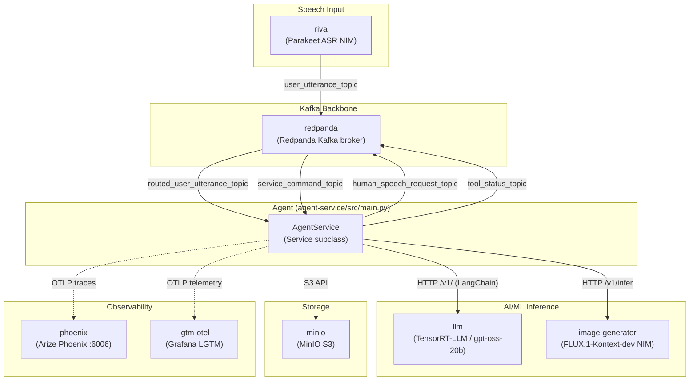
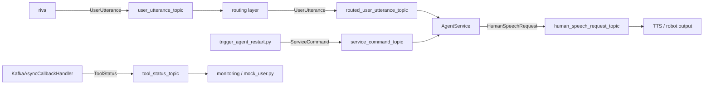
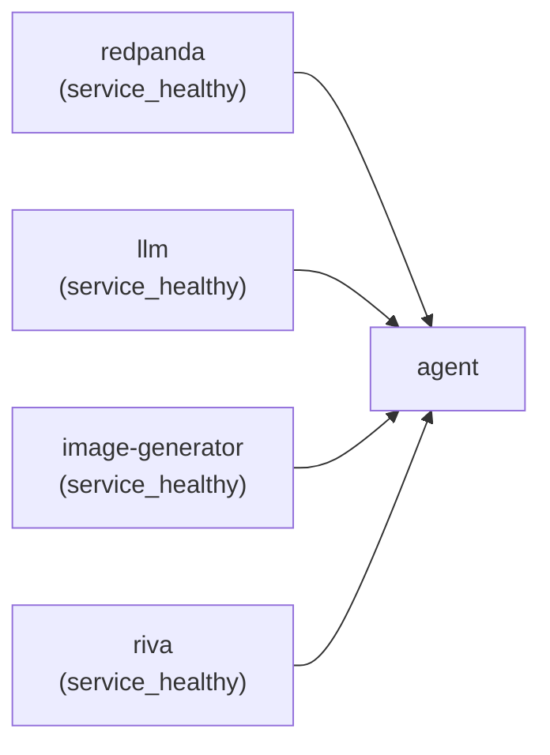

<!-- source: DeepWiki mcp.deepwiki.com · repo NVIDIA/spark-reachy-photo-booth · page 1.1 System Architecture · fetched 2026-10-26 -->

# System Architecture

<details>
<summary>Relevant source files</summary>

The following files were used as context for generating this wiki page:

- [.vscode/tasks.json](.vscode/tasks.json)
- [README.md](README.md)
- [agent-service/README.md](agent-service/README.md)
- [agent-service/compose.yaml](agent-service/compose.yaml)
- [agent-service/src/main.py](agent-service/src/main.py)

</details>


This page describes the overall architecture of the spark-reachy-photo-booth system: the services involved, how they communicate, the startup dependency chain, and how a spoken user utterance flows through the system to produce a generated image. For detail on any specific component, see the linked sub-pages throughout.

---

## Services at a Glance

The application runs as a multi-container stack defined across the repository. The following table lists every service, its Docker image or source, and its role.

| Service | Image / Source | Role |
|---|---|---|
| `agent` | `agent-service/` (built locally) | Central orchestrator; runs the `AgentService` ReAct loop |
| `llm` | `nvcr.io/nvidia/tensorrt-llm/release` (gpt-oss-20b) | LLM inference endpoint at `http://llm:8000/v1/` |
| `image-generator` | `nvcr.io/nim/black-forest-labs/flux.1-kontext-dev` | FLUX image synthesis at `http://image-generator:8000/v1/infer` |
| `riva` | `nvcr.io/nim/nvidia/parakeet-1-1b-ctc-en-us` | Parakeet ASR; converts speech to `UserUtterance` messages |
| `redpanda` | `docker.redpanda.com/redpandadata/redpanda` | Kafka-compatible event broker; the system's message backbone |
| `redpanda-console` | `docker.redpanda.com/redpandadata/console` | Web UI for inspecting Kafka topics |
| `minio` | `minio/minio` | S3-compatible object store; holds generated images |
| `phoenix` | `arizephoenix/phoenix` | Arize Phoenix; LLM trace viewer at `http://phoenix:6006` |
| `lgtm-otel` | `docker.io/grafana/otel-lgtm` | Grafana + OpenTelemetry collector for metrics/logs/traces |

Sources: [README.md:1-65](), [agent-service/compose.yaml:1-39](), [.vscode/tasks.json:25-25]()

---

## Service Topology

**Diagram 1 — Service Topology (code-level names)**



Sources: [agent-service/compose.yaml:1-39](), [agent-service/src/main.py:82-117](), [README.md:22-65]()

---

## Kafka Event Backbone

All inter-service event passing goes through `redpanda`. The table below lists every topic, the message type carried, and the produce/consume directions.

| Topic (workmesh constant) | Message Type | Produced by | Consumed by |
|---|---|---|---|
| `user_utterance_topic` | `UserUtterance` | `riva` (ASR output) | router / filtering layer |
| `routed_user_utterance_topic` | `UserUtterance` | routing layer | `AgentService.on_user_utterance()` |
| `service_command_topic` | `ServiceCommand` | dev scripts (`trigger_agent_restart.py`) | `AgentService.on_service_command()` |
| `human_speech_request_topic` | `HumanSpeechRequest` | `AgentService` tools | TTS / robot speech output |
| `tool_status_topic` | `ToolStatus` | `KafkaAsyncCallbackHandler` | monitoring, dev scripts |

The `agent` service imports its topic constants directly from the `workmesh` package:

```
from workmesh import routed_user_utterance_topic, service_command_topic
```

[agent-service/src/main.py:33-33]()

**Diagram 2 — Kafka Topics: Producers and Consumers**



For full detail on each topic and message schema, see [Kafka Messaging (Redpanda)](#3.1).

Sources: [agent-service/src/main.py:82-117](), [README.md:1-65]()

---

## Startup Dependency Chain

The `agent` service uses `depends_on` with `service_healthy` conditions for all four of its hard dependencies. This means Docker Compose will not start `agent` until each dependency passes its own healthcheck.

[agent-service/compose.yaml:13-21]()

**Diagram 3 — Startup Dependency Chain**



After `agent` itself starts, its own healthcheck does not pass until the NAT workflow has been loaded and warmed up. The `setup_workflow()` method writes `/dev/shm/ready` only after the warm-up call completes:

[agent-service/src/main.py:63-73]()

The healthcheck polls for that file:

```
test: ["CMD-SHELL", 'if stat /dev/shm/ready; then exit 0; else exit 1; fi']
```

[agent-service/compose.yaml:9-12]()

---

## End-to-End Request Flow: Speech to Generated Image

The following sequence diagram traces a user utterance from microphone input through to a generated image stored in MinIO.

**Diagram 4 — Speech-to-Image Event Flow**

```mermaid
sequenceDiagram
    participant User as "User (microphone)"
    participant riva as "riva (Parakeet ASR)"
    participant redpanda as "redpanda (Kafka)"
    participant agent as "AgentService\n(on_user_utterance)"
    participant queue as "_all_messages / _prompt_messages\n(asyncio.Queue)"
    participant loop as "ReAct agent loop\n(_workflow_callable)"
    participant llm as "llm (TensorRT-LLM)"
    participant imggen as "image-generator (FLUX NIM)"
    participant minio as "minio (MinIO)"

    User->>riva: speaks
    riva->>redpanda: UserUtterance (user_utterance_topic)
    redpanda->>redpanda: routing
    redpanda->>agent: UserUtterance (routed_user_utterance_topic)
    agent->>queue: put(_all_messages)
    queue->>loop: process_text_from_user() → _prompt_messages
    loop->>llm: LangChain / OpenAI API call
    llm-->>loop: tool selection (e.g. look_at_human, generate_image)
    loop->>imggen: generate_image tool → HTTP /v1/infer
    imggen-->>loop: generated image bytes
    loop->>minio: upload to photo-booth-agent bucket
    minio-->>loop: public object URL
    loop->>redpanda: HumanSpeechRequest (human_speech_request_topic)
    redpanda-->>User: spoken response with QR / URL
```

Key code entry points for each stage:

| Stage | Code Location |
|---|---|
| Receive utterance from Kafka | `AgentService.on_user_utterance()` — [agent-service/src/main.py:103-117]() |
| Route to waiting agent | `AgentService.process_text_from_user()` — [agent-service/src/main.py:167-173]() |
| HITL await response | `AgentService.await_user_response()` — [agent-service/src/main.py:175-182]() |
| Load and warm up workflow | `AgentService.setup_workflow()` — [agent-service/src/main.py:63-73]() |
| Workflow callable wrapper | `AgentService.get_callable_for_workflow()` — [agent-service/src/main.py:119-165]() |
| React to RESTART command | `AgentService.on_service_command()` — [agent-service/src/main.py:82-101]() |

For the ReAct loop internals (tool selection, LLM calls, scratchpad management), see [ReAct Agent Loop](#2.1). For individual tool implementations, see [Tools](#2.3.1).

Sources: [agent-service/src/main.py:1-193](), [agent-service/compose.yaml:1-39](), [agent-service/README.md:1-144]()

---

