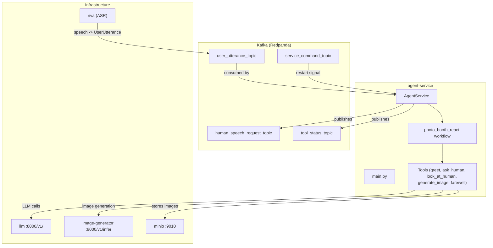
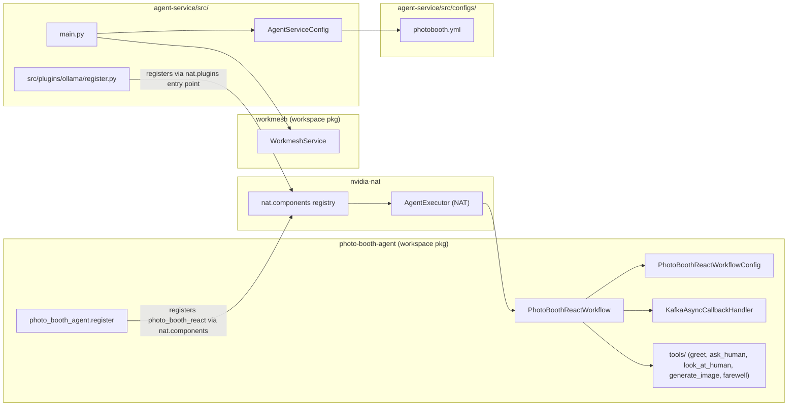

<!-- source: DeepWiki mcp.deepwiki.com · repo NVIDIA/spark-reachy-photo-booth · page 2 Agent Service · fetched 2026-10-26 -->

# Agent Service

<details>
<summary>Relevant source files</summary>

The following files were used as context for generating this wiki page:

- [agent-service/Dockerfile](agent-service/Dockerfile)
- [agent-service/README.md](agent-service/README.md)
- [agent-service/compose.yaml](agent-service/compose.yaml)
- [agent-service/pyproject.toml](agent-service/pyproject.toml)

</details>


This page covers the purpose, structure, key dependencies, and runtime position of the `agent-service` component. It is the entry point for understanding how the photo booth orchestration works at a high level. For the internal ReAct loop logic, see [ReAct Agent Loop](#2.1). For configuration details, see [Agent Configuration](#2.2). For the custom workflow package, see [Photo Booth Agent Workflow](#2.3).

---

## Role in the System

The agent service is the central orchestrator of the photo booth. It:

- Consumes user speech (as `UserUtterance` Kafka messages) from the Redpanda broker
- Runs a ReAct loop that calls an LLM and executes tools (camera capture, image generation, human interaction)
- Publishes `ToolStatus` and `HumanSpeechRequest` events back to Kafka for downstream services to react to
- Coordinates every other service indirectly through its tool calls

It does **not** perform speech-to-text (handled by RIVA), image generation (handled by the image-generator service), or direct robot control. Those are delegated via tools or Kafka events.

Sources: [agent-service/README.md:1-10]()

---

## Package Structure

**Package name:** `agent` (defined in `pyproject.toml`)

**Python entrypoint:** `agent-service/src/main.py`

**Key subdirectories inside `agent-service/`:**

| Path | Contents |
|---|---|
| `src/` | Main application source; contains `main.py` and `configs/` |
| `src/configs/` | YAML agent configuration files (e.g., `photobooth.yml`) |
| `src/plugins/` | NAT plugin registrations (e.g., `ollama` plugin) |
| `workflows/photo_booth_agent/` | Custom NAT workflow package (`photo-booth-agent`) |
| `scripts/` | Developer utilities (`mock_user.py`, `trigger_agent_restart.py`) |

The `workmesh` package (a local workspace dependency) provides the Kafka consumer/producer abstractions. The `photo-booth-agent` package (also a local workspace dependency) provides the ReAct workflow type and all tools.

Sources: [agent-service/pyproject.toml:1-26](), [agent-service/README.md:118-144]()

---

## Dependencies

[agent-service/pyproject.toml:8-13]() declares four runtime dependencies:

| Dependency | Purpose |
|---|---|
| `workmesh` | Kafka-backed service mesh; handles message routing and service lifecycle |
| `langchain-ollama` | LangChain integration for Ollama-compatible LLM backends |
| `nvidia-nat[langchain,phoenix]` | NVIDIA NeMo Agent Toolkit; provides the agent executor, workflow registry, and Phoenix tracing integration |
| `photo-booth-agent` | Local package implementing the `photo_booth_react` workflow type and all agent tools |

A NAT plugin is also registered:

```
[project.entry-points.'nat.plugins']
nat_ollama = "src.plugins.ollama.register"
```

This registers the Ollama LLM provider with NAT at package load time so it is available as a backend for the agent.

Sources: [agent-service/pyproject.toml:1-26]()

---

## Position in the Overall System

**Service topology diagram — agent-service and its dependencies:**



Sources: [agent-service/compose.yaml:1-39](), [agent-service/README.md:12-19]()

---

## Startup and Health Check

The agent service will not start until all four infrastructure services are healthy. This is enforced by the `depends_on` block in [agent-service/compose.yaml:13-21]():

| Dependency | Condition |
|---|---|
| `llm` | `service_healthy` |
| `image-generator` | `service_healthy` |
| `riva` | `service_healthy` |
| `redpanda` | `service_healthy` |

Once running, the agent's own health is reported via a file-based probe: the container is considered healthy when `/dev/shm/ready` exists ([agent-service/compose.yaml:9-11]()).

Sources: [agent-service/compose.yaml:9-21]()

---

## Code Entity Map

The diagram below maps the top-level system concepts to their corresponding code entities so that readers can navigate the codebase directly.



Sources: [agent-service/pyproject.toml:15-16](), [agent-service/README.md:104-116](), [agent-service/README.md:118-144]()

---

## Hot Reload (Development Watch)

During development, `docker compose watch` monitors source paths and reacts without a full rebuild:

| Watch path | Action | Target in container |
|---|---|---|
| `./pyproject.toml` | `rebuild` | — |
| `./src` | `sync+restart` | `/app/src` |
| `./workflows/photo_booth_agent/src/photo_booth_agent` | `sync+restart` | `/app/.venv/lib/python3.12/site-packages/photo_booth_agent` |

The `photo_booth_agent` package is synced directly into the venv's site-packages, enabling live edits to tool logic without rebuilding the Docker image.

Sources: [agent-service/compose.yaml:22-31]()

---

## Related Pages

- **[ReAct Agent Loop](#2.1)** — details of how the LLM reasoning loop works, tool selection, history management, and retries
- **[Agent Configuration](#2.2)** — `AgentServiceConfig`, `photobooth.yml`, and environment variable wiring
- **[Photo Booth Agent Workflow](#2.3)** — the `photo-booth-agent` package, NAT component registration, and the `photo_booth_react` workflow type
- **[Infrastructure Services](#3)** — Kafka topics, LLM service, image generator, and RIVA
- **[Docker Build](#5.1)** — multi-stage Dockerfile and build process
- **[Service Orchestration](#5.2)** — full `compose.yaml` breakdown including debug override

---

