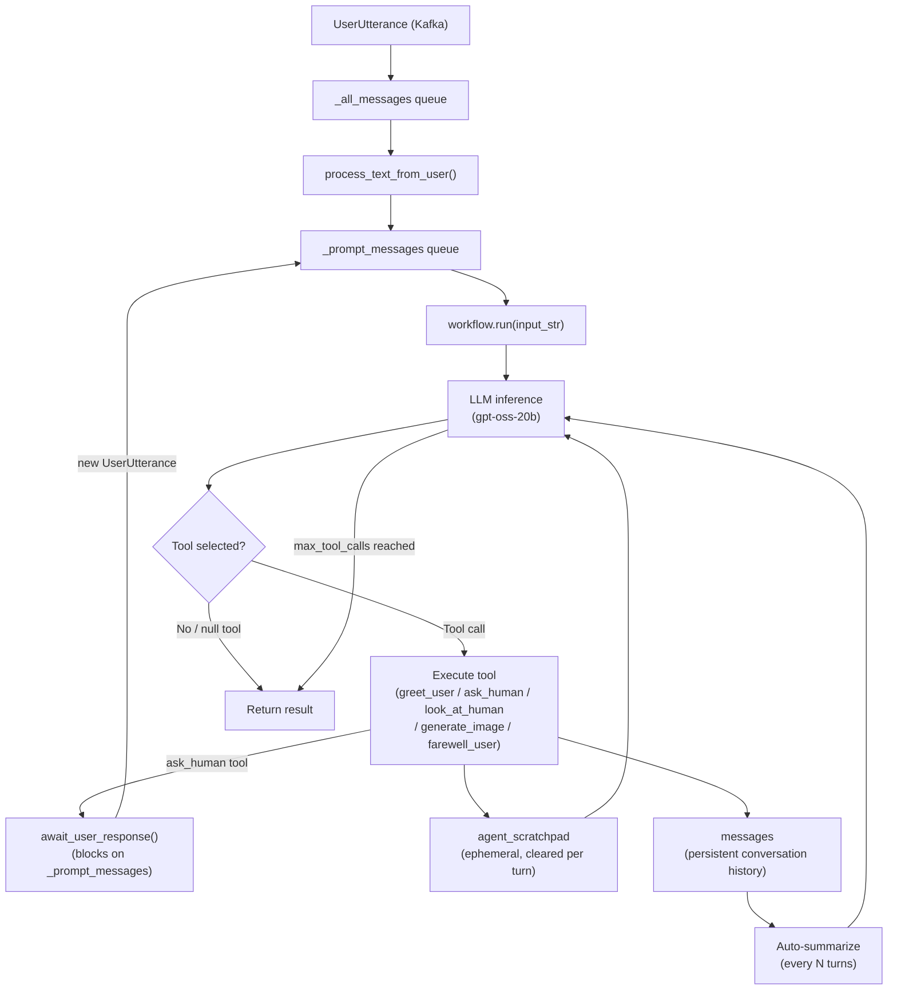
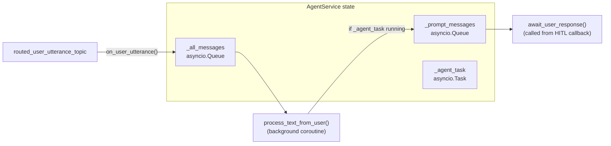
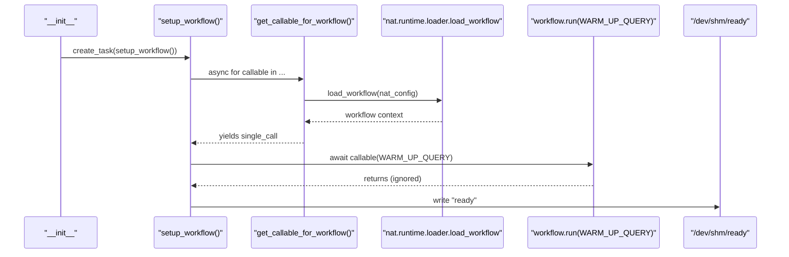
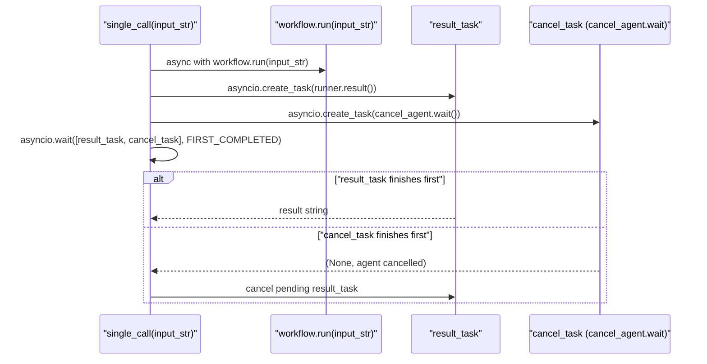
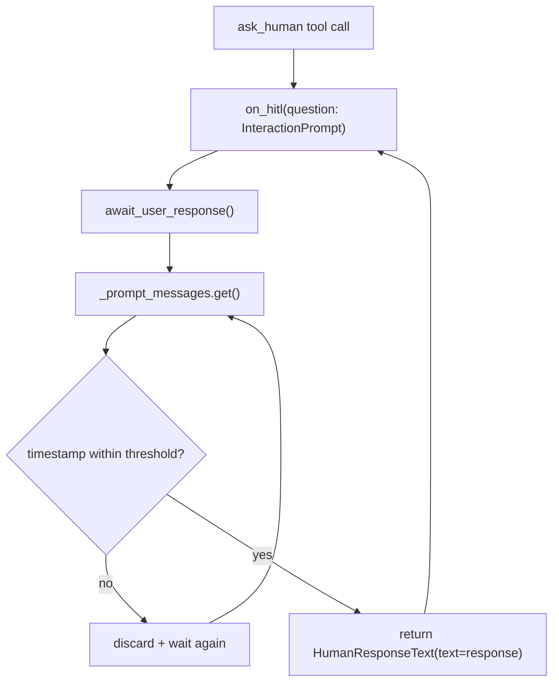

<!-- source: DeepWiki mcp.deepwiki.com · repo NVIDIA/spark-reachy-photo-booth · page 2.1 ReAct Agent Loop · fetched 2026-10-26 -->

# ReAct Agent Loop

<details>
<summary>Relevant source files</summary>

The following files were used as context for generating this wiki page:

- [agent-service/README.md](agent-service/README.md)
- [agent-service/src/configs/photobooth.yml](agent-service/src/configs/photobooth.yml)
- [agent-service/src/configuration.py](agent-service/src/configuration.py)
- [agent-service/src/main.py](agent-service/src/main.py)

</details>


This page describes the internal mechanics of the ReAct (Reasoning and Acting) loop inside the `agent-service` component: how `UserUtterance` messages arrive, how the LLM is invoked iteratively, how tools are selected and called, how user input is awaited mid-loop (HITL), and how guards such as retry limits and history summarization keep the loop stable.

For configuration values that drive these behaviors (LLM settings, tool list, personality instructions), see [Agent Configuration](#2.2). For details on individual tools the loop can invoke, see [Tools](#2.3.1). For the Kafka topics that carry messages into and out of the loop, see [Kafka Messaging](#3.1).

---

## Loop Overview

The ReAct loop follows a think → act → observe cycle. The LLM produces a `thought` and selects a `tool` to call. The tool executes, and its output is fed back to the LLM. This repeats until the LLM signals completion or the `max_tool_calls` limit is reached.

**ReAct Agent Loop — High-Level Flow**



Sources: [agent-service/src/main.py:1-192](), [agent-service/README.md:68-115]()

---

## Entry Point: Receiving User Speech

`AgentService.on_user_utterance` is the Kafka subscriber that receives `UserUtterance` messages from `routed_user_utterance_topic`. Before enqueuing, two filters are applied:

| Filter | Logic | Code |
|---|---|---|
| Utterance status | Only `USER_UTTERANCE_FINISHED` messages are accepted | [main.py:105-107]() |
| Staleness check | `abs(time.time() * 1000 - message.timestamp) < user_utterance_threshold` | [main.py:109-116]() |

`user_utterance_threshold` defaults to `1000` ms. Messages older than this threshold are logged as warnings and discarded. This prevents stale ASR output from being processed after a long silence.

Messages that pass both filters are placed onto `_all_messages`.

Sources: [agent-service/src/main.py:103-117](), [agent-service/src/configuration.py:15-23]()

---

## Internal Message Queues

`AgentService` maintains two `asyncio.Queue[UserUtterance]` instances with distinct routing roles:

**Message Queue Routing — Class-level State**



- **`_all_messages`**: Receives every validated `UserUtterance`. The `process_text_from_user` coroutine reads from this queue and forwards to `_prompt_messages` only if `_agent_task` is currently running (i.e., the agent is active). Messages arriving while no task is running are silently dropped.
- **`_prompt_messages`**: The HITL-specific queue. When `ask_human` is called inside the agent loop, execution blocks on `await_user_response()`, which pops from this queue.

This two-queue design separates the concerns of "did a message arrive at all" (routing via `_all_messages`) from "does the currently waiting agent step need that message" (delivery via `_prompt_messages`).

Sources: [agent-service/src/main.py:56-58](), [agent-service/src/main.py:167-182]()

---

## Workflow Initialization and Warm-Up

`AgentService.setup_workflow` is started as a background task in `__init__`. It calls `get_callable_for_workflow`, which opens a `load_workflow` context from the NAT runtime and yields a `single_call` async callable.

Before the service marks itself healthy, it sends a warm-up query (`"**Warm up call - respond with a simple `ignore-this-message`**"`) through the workflow to pre-load model weights and JIT-compile paths. Only after this completes is `/dev/shm/ready` written, which satisfies the Docker Compose healthcheck.

**Startup Sequence**



Sources: [agent-service/src/main.py:63-73](), [agent-service/src/main.py:119-165]()

---

## The ReAct Iteration in Detail

Each call to `single_call(input_str)` runs one full agent interaction from initial input through all tool calls until the workflow completes or is cancelled.

Inside `single_call`, `workflow.run(input_str)` is called as an async context manager, producing a `runner`. Two `asyncio.Task` objects race:

- **`result_task`**: `runner.result(to_type=str)` — completes when the NAT workflow reaches a terminal state.
- **`cancel_task`**: `self.cancel_agent.wait()` — completes when `cancel_agent` is set (e.g., via a `RESTART` `ServiceCommand`).

`asyncio.wait` with `FIRST_COMPLETED` ensures cancellation is always respected even while the LLM is mid-inference.



Sources: [agent-service/src/main.py:131-164]()

---

## HITL: Pausing for User Input

When the LLM selects the `ask_human` tool, the NAT runtime invokes the registered `user_input_callback`. This callback is set per-call in `single_call` via:

```
nat_context.user_input_callback.set(create_hitl_callback(self))
```

`create_hitl_callback` returns an `on_hitl` async function. When called, it invokes `agent_service.await_user_response()`, which blocks on `_prompt_messages.get()`.

`await_user_response` applies the same staleness guard used at ingestion time: any message older than `user_utterance_threshold` ms is discarded with a warning, and the loop waits for the next one.

**HITL Callback Data Flow**



Sources: [agent-service/src/main.py:38-45](), [agent-service/src/main.py:175-182]()

---

## Message History: Persistent vs Ephemeral State

The NAT/photo_booth_react workflow maintains two categories of state per conversation:

| State | Scope | Description |
|---|---|---|
| `messages` | Persistent | Full conversation history including user turns, assistant turns, and tool results. Survives across tool calls. |
| `agent_scratchpad` | Ephemeral | The current `(thought, tool, tool_input)` tuple being processed. Cleared after each tool call completes. |

The scratchpad isolation means each LLM invocation within the loop sees a clean workspace for its reasoning, while the full `messages` list provides the conversational context needed for coherent multi-turn behavior.

Sources: [agent-service/README.md:92-95]()

### Auto-Summarization

To prevent the `messages` list from exceeding the LLM's context window, the workflow automatically summarizes history every `summarize_every_n_turns` iterations. After summarization, the history is trimmed to at most `max_history` messages.

| Parameter | Default (photobooth.yml) | Description |
|---|---|---|
| `max_history` | `15` | Max messages retained after summarization |
| `summarize_every_n_turns` | `5` | How often summarization is triggered |

Sources: [agent-service/README.md:98-114](), [agent-service/src/configs/photobooth.yml:65]()

---

## Guards: Iteration Limits and Error Recovery

### `max_tool_calls`

The loop is bounded by `max_tool_calls`. In `photobooth.yml` this is set to `1000`, effectively unlimited for normal photo booth interactions, but it prevents runaway loops if the LLM never reaches a terminal state.

If `allow_null_tool` is `false` (as configured), the agent cannot return a plain text response without calling a tool. If it attempts to do so, the workflow redirects it to the tool named in `human_feedback_tool` (`ask_human`).

### Retry Configuration

| Parameter | Value (photobooth.yml) | Effect |
|---|---|---|
| `parse_agent_response_max_retries` | `5` | Retries when the LLM output cannot be parsed as a valid tool call |
| `tool_call_max_retries` | `2` | Retries when a tool raises an exception |
| `pass_tool_call_errors_to_agent` | `true` | Tool exceptions are appended to `messages` so the LLM can reason about failures |
| `retry_parsing_errors` | `true` | Enables the `parse_agent_response_max_retries` path |
| `max_retries` (LLM client) | `3` | HTTP-level retries for LLM inference requests |

Sources: [agent-service/src/configs/photobooth.yml:59-67](), [agent-service/README.md:104-114]()

---

## Cancellation via `ServiceCommand`

`on_service_command` subscribes to `service_command_topic`. On receiving a `RESTART` command targeting `ServiceName.AGENT`:

1. `cancel_agent` event is set, causing the currently racing `cancel_task` to complete.
2. The `result_task` is cancelled; the workflow exits.
3. `cancel_agent` is cleared.
4. A new `_agent_task` is created calling `_workflow_callable(GREET_USER_QUERY)` — starting a fresh interaction.

This allows an operator or the `trigger_agent_restart.py` script to hard-reset the agent mid-conversation without restarting the process. See [Development Scripts](#4.2) for usage.

Sources: [agent-service/src/main.py:82-101]()

---

## Configuration Reference

All loop behavior is controlled through `PhotoBoothReactWorkflowConfig` in the photo_booth_agent package, with values supplied via `photobooth.yml`. The table below maps every loop-relevant parameter to its effective value in the default configuration.

| Parameter | photobooth.yml value | Description |
|---|---|---|
| `max_tool_calls` | `1000` | Maximum tool calls per interaction before forced termination |
| `allow_null_tool` | `false` | If false, agent must always call a tool; redirects to `human_feedback_tool` if null response |
| `human_feedback_tool` | `ask_human` | Tool to invoke when `allow_null_tool` is false and agent gives null response |
| `max_history` | `15` | Max messages kept after summarization |
| `summarize_every_n_turns` | `5` | Summarization trigger frequency |
| `parse_agent_response_max_retries` | `5` | Parse error retry attempts |
| `tool_call_max_retries` | `2` | Tool execution retry attempts |
| `retry_parsing_errors` | `true` | Enable parse error retries |
| `pass_tool_call_errors_to_agent` | `true` | Feed tool errors back into conversation history |
| `verbose` | `true` | Emit detailed logging for each reasoning step |
| `user_utterance_threshold` | `1000` ms | Max message age accepted by `AgentService` |

Sources: [agent-service/src/configs/photobooth.yml:59-67](), [agent-service/src/configuration.py:15-23](), [agent-service/README.md:104-114]()

---

